# 斯坦福大学《统计学习导论2023Python版｜An Introduction to Statistical Learning with Python》中英字幕 - P71：-071-Statistical Learning_ 9.Py ROC Curves I 2023.zh_en - GPT中英字幕课程资源 - BV1u4421A7ZU

Okay， our last topic in today's lab is one not really specific to support vector classifiers。

 but these ROC curves or receiver operator characteristic curves。

 and they're a way to sort of summarize the performance of a classifier you at many different levels in chapter 4 we saw that for a classifier that say predicts probability of being in a class。

 you could vary the threshold and that would give you different different predictions and of course for every different value prediction。

 there's a different accuracy or a different false positive rate， etc。

So the ROC curve sort of summarizes this accuracy as a function of the threshold in place。So。

We're going to use a function。This ROC curve display comes from the psychic learn metrics package。

 and we're going to use this method called from estimator。 So what this does。

 we're going to give it a classifier that's a psychic learn estimator that produces something like a threshold threshold of probability that we can use to vary the threshold and trace out a curve of the accuracy as the parameter changes。

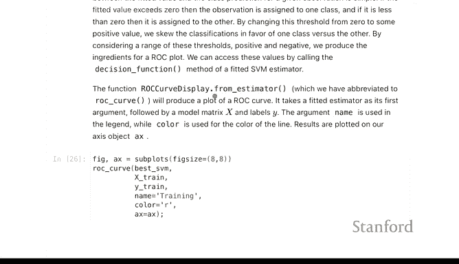

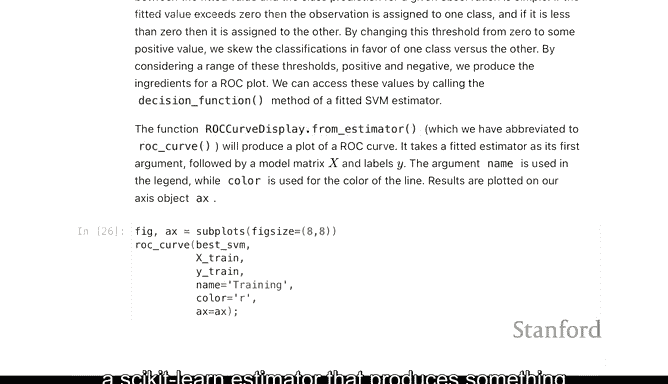

And of course， I should say that。

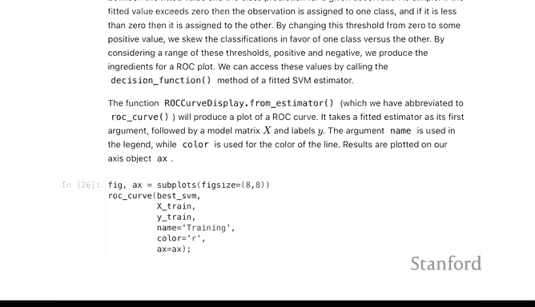

The ROC curve is really meant for binary data because that's one where you can sort of simply describe the performance of the classifier by the accuracy。

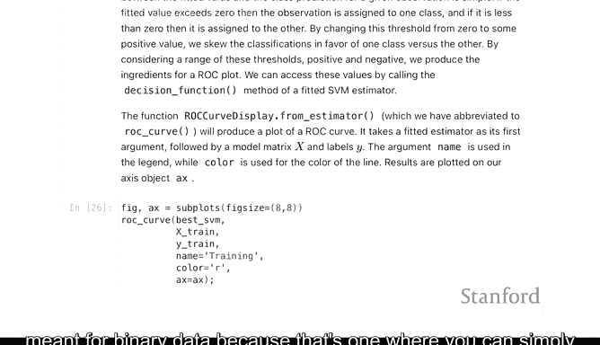

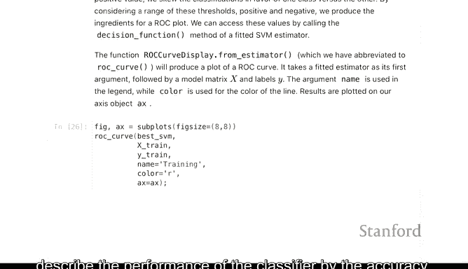

Okay。So our estimator， this was the tune support vector machine we saw just above。

 and we're going to evaluate， well， we can evaluate an RC curve on the training data or the test data。

 First， we'll evaluate when on the training data。

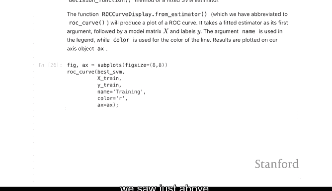

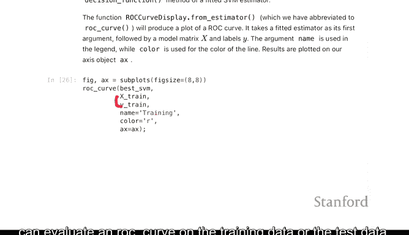

And when we evaluate later on test data we'd expect it to do not as well， and we'll see that as well。

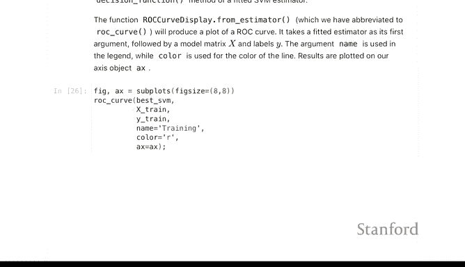

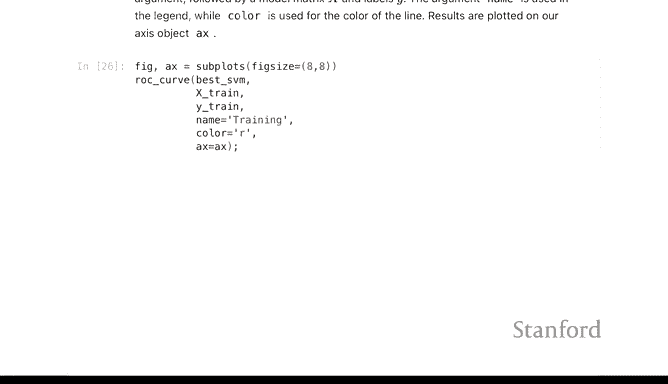

Okay。So this makes a plot that has。

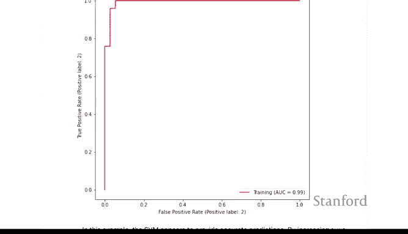

Two quantities， two axes。True positive rate on the y axis and the false positive rate on the negative axis。

 So a good classifier is， you know， something that's high up in this corner is very high。

 true positive rate。 that's measure of the power and very low false positive rate。

 that's a measure of the type 1 error or the false positive。

 And since this was done on the training data， Of course， it does really well。 Yes， yeah。

 And so there's another， there's a summary that people provide of the ROC curve called the area under the curve。

 And that's just the area under this red curve。 And it's about 99%。 For reference。

 a random pure random guessing should be about 50%。 So this is quite close to perfect。

 and the perfect classifier will get 100%。 Yes。

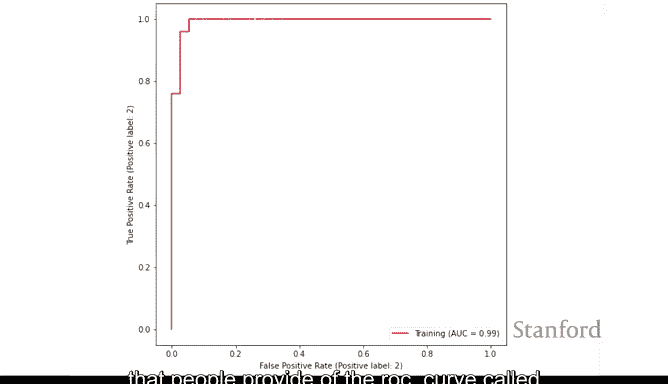

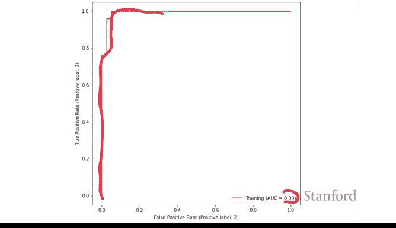

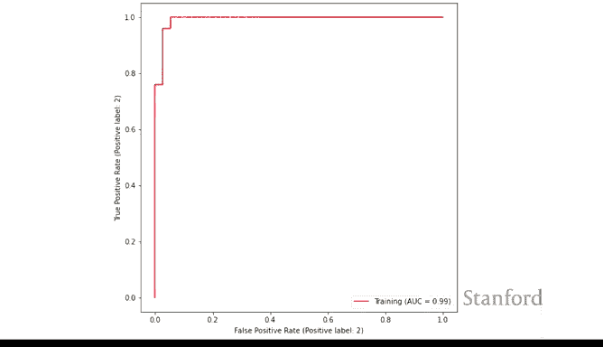

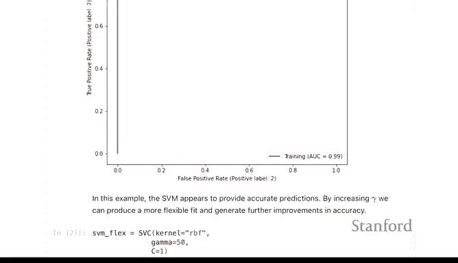

Okay。

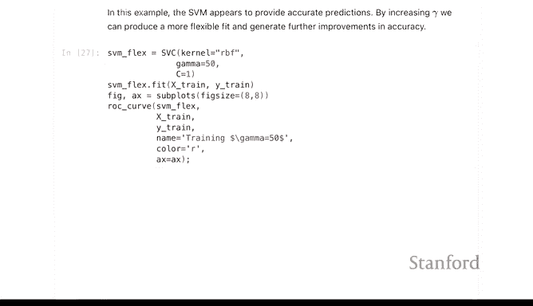

So。We're going to make a few plots on training and test data。

 We are going to here we've changed the classify a little bit。

 but I want to focus here on the difference between training and test rather than on the classifier。

 So here we'll fit this new support vector machine on。

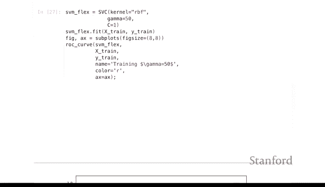

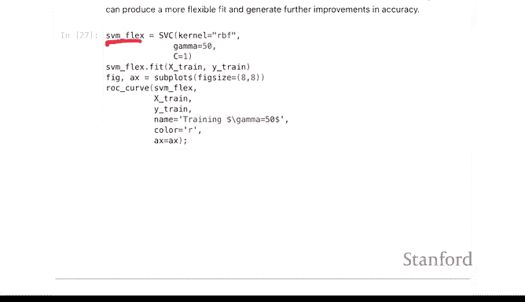

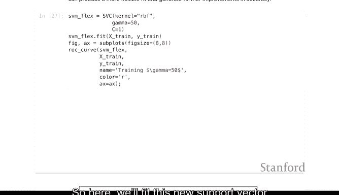

On our training data。 And， of course， it was chosen to be quite flexible。 So here's one。

 as we saw before， a really good classifier can get 100% and。

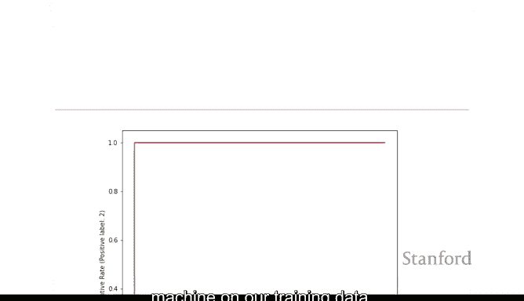

Well， that's 100% on training data， of course， we have to see well it does on test data。

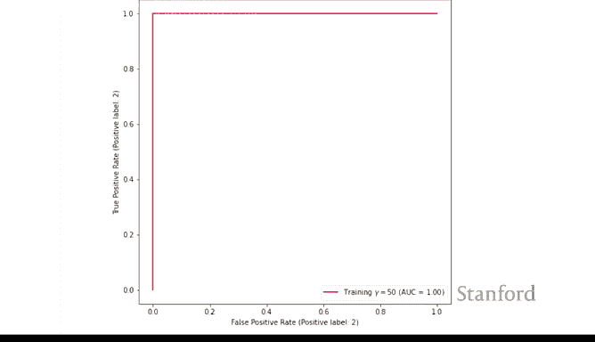

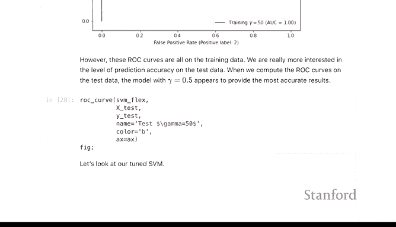

Okay， so now let's make the same plot but。Use test data instead of training data and we're going to plot it on the same plot by giving it this axis argument。

 You'll see actually there are a a lot of functions around in Python that produce plots that you can give this access argument to And remember that the axis is actually the thing where you actually make plots on so you can use this to add features to add things to a plot and most things like Psyit learn and pandas use this act argument so you can add this ROC curve to an existing plot for instance。

And I'm going to redisplay the figure with this fig dangling reference。

 and that just produces the figure in the notebook。

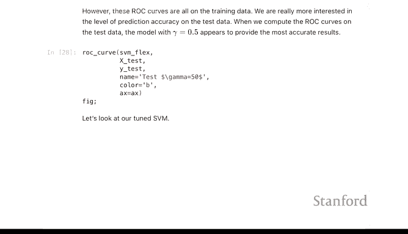

Okay。

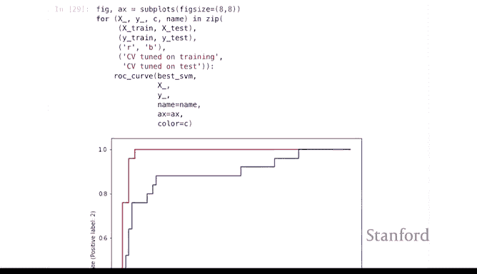

So here， instead of the flexible one， we'll look at the the plot for the tuned one and red is the training data and blue is the test data。

 and as we expect the blue one is slightly worse than the red one because of course， it's test data。

 it still does quite well an AOC of about 90% here。

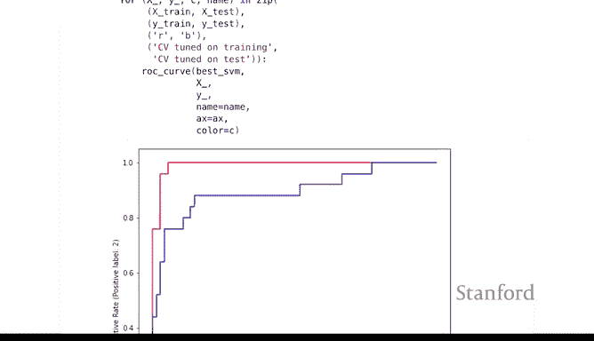

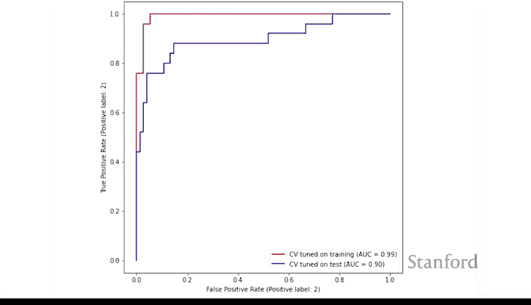

Okay， so that about wraps up what we're going to discuss today。

 there's another topic in the lab that is support vector machine with multiple classes that we encourage you to do offline。

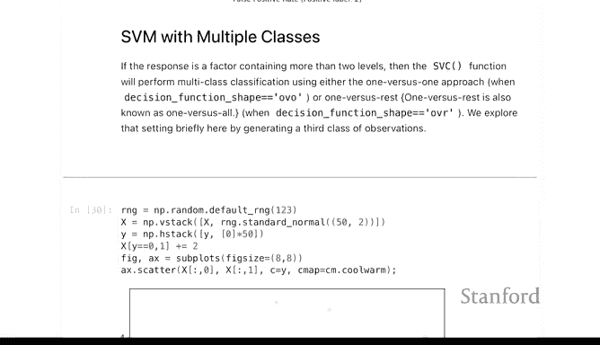

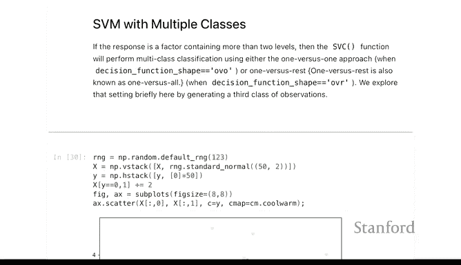

