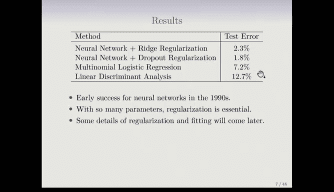

# 斯坦福大学《统计学习导论2023Python版｜An Introduction to Statistical Learning with Python》中英字幕 - P72：-072-Statistical Learning_ 10.1 Introduction to Neural Networks.zh_en - GPT中英字幕课程资源 - BV1u4421A7ZU

Welcome back to the course。

In this series of sessions we're going to be talking about deep learning。

 this is one of the new chapters in the second edition of Introuction to statistical learning deep learning is a new name for neural networks which became popular in the 1980s there were lots of successes hype and great conferences that's where the start of the Europe's sequence were and the snowbird sequence。

And Rob， you and I went we were regular attendees of those conferences。 Yeah。

 from about 85 to into the 90s initially one of the attractions。

 apart from all the really interesting in work was they were held in ski resorts。

 So it was an opportunity to both learn interest in new stuff and and get some ski in then along came support vector machines。

 random forest and boosting which you've learnt about in this course or about to learn about。

And the neural networks took a bit of a back seatat。

They reemerged around 2010 with a new name Deep Learn。And by the 2020s。

 they became very dominant and successful。And they used all over the place now。

So part of the success。It was due to the vast improvements in computing power。

Much bigger training sets and software。 The main software platforms are Tensorflowlow。

 which is a Google software and Pytorch， which comes from Facebook。

But much of the credit goes to three pioneers and their students， there's Jan Laon。

 Jeffrey Hinton and Yo Benjo， who received the 2019 ACM Turing Award for their work in neural networks and you'll find on the website for the course what we do Trevor Ier interview with Jeff Hinton talking about the history of neural networks and in development since the 80s Yes。

 and we've known these three gentlemen，Pretty much for their whole careers。

Yan Laon was at Bell Labs in the 80s and 90s and I was there at the same time。

 Yosha Benjo was a frequent visitor。And， and Rob worked with Jeff Hinton at the University of Toronto。

Okay， so let's get started， we'll start off with a really simple single layer neural network。

 sometimes called a feed forward neural network。And neural networks are often displayed using what's known as network diagrams。

 and here we see such a network diagram。In the orange， we've got the input layer。

 Yeah in this example， we've got four variables。And then we have what's known as a hidden layer。😊。

And there's five units in the hidden layer， yeah。And then there's an output layer。

And the way you think of the hidden layer is you think of them as transformations of the inputs。

The As stand for activations and we'll get into the the detailed notation in a moment。

 So where's the observed data， Is it all observed Rob， this is observed， the X' is are observed。

And the output wise observed。That's a response。But the A's aren't observed。

 I actually knew the answer but you knew the answer。 good to explain And。

 these activations are computed。 In fact， in this equation over here， they named HK of x。

 So the K activation is a transformation of the inputs X。😊，And these little arrows indicate。😊。

Linear combinations of these x's that feed into each of these hidden units。And yeah。

 HK of V is expanded as a function， which is going to be a nonlinear function of a linear combination of the inputs。

And each of those linear combinations is different。

 So the linear combination feeding into A1 is different to the one feeding into A2。

So what you can think of。These are transformations that are learned。When you train the network。

 these transformations are learned on the fly。So let's look in a little bit more detail。The AK。

 these are the activations， as I said， they're HK of V and we can think of it as a nonlinear transformation of a linear function。

And they called， again， activations in the hidden layer。Now， these nonlinear functions。

 there's a choice and they called activation functions。

And two that are popular are the sigmoid and the rectified linear。So in the early neural networks。

 the sigmoids were popular， so you can see it's a nonlinear function。

It takes sort of a standardized range， look z's running from -4 to 4。

 and it maps it to the interval 01 in like a smooth transformation。

 It's actually the same transformation that's used in logistic regression。

The black one is the one that's more popular today， it's called a re function。

 which stands for rectified linear unit。And look what it does。

 it's zero up to if z is less than or equal to0， it returns0。

 and after0 it it returns a linear function。So it basically truncates at zero。

And since there's an intercept in each of these transformations。

 what zero on the Z scale can move around because of that intercept。So why nonlinear？Well。

 if they weren't nonlinear， for example， if the activation function was linear。

Then the whole network would just be a linear model because then you would have linear transformations of。

Linear variables become， you know， you just get one big linear model。

 so if you didn't do linear activations， it would just be a big linear model。And so again。

 the activations are the like derived features that we learn when we train the model。

And then with all that in place， you fit the model by minimizing say for regression and squared error loss。

 you just minimize the sum of squares like you would for regression。But this if， right。

 So if was at the。The end of the pipeline here， if encompasses a lot of parameters。

 right there's a parameters going from the hidden layer to the output layer。

 and there's the parameters going from the inputs to the all the hidden units。

 so there's a lot of parameters。And you'll see thats something that characterizes neural networks。

 there can be lots of parameters。So let's get on to a more serious example。

So this is the MIS digit data。These digit data， this is like a test bench for neural networks。

 in fact， I would say neural networks really started with handwritten digit classification。

So you can see that these handwritten digits。I have been scanned。

They've been written with a pen or pencil， typically taken from envelopes。

And they've been scanned in and they've been normalized in this case to 28 by 28 grayscale images。😊。

What that means is yeah， we've blown up some three of the images， the threes， fives， and8s。

 for this example here。And so there's 28 rows and 28 columns。😊，And each pixel is a gray scale value。

 taking on values between 0 and 255。And what that means is that gray scale value。Basically。

Calculates how much of the ink is in that little pixel if it's zero there's nothing and then depending on the amount of ink it can go all the way up to 255 I guess one of the reason you normalize is that the input features are the pixels here right so we want somehow a pixel in each image so each three to mean the same thing doing the same place relative to the three same place。

Exactly， so if you had the images， all different sizes and shapes。

 you know that would be much harder to achieve but when you see the convolutional neural network coming up'll it'll make that take it even further rightll it'll be invariant to the position of the pixel in essence。

So along with this example， you come with a class label， which of course are the digits zero to nine。

So this is a multi class classification problem， you've got 10 classes and the input features are these 28 byte。

28， which is 7。184 pixels per image can think of that just as a set of inputs per image。

 and we need to use the values in those inputs to classify the digits。So in this case。

 we're going to build a two layer feet forward neural network。

Which is just a more complicated version of the one we showed you before。

And it's going to have 256 units at the first layer and 128 units at the second layer。

 and of course the output layer has got 10 units。And if you count up all the parameters。

 there's 235146 parameters altogether and in this community these are known as weights I remember some of the first times we saw these kinds of miles we thought how can we have four times as many parameters as observations？

Exactly an overfi， right， So we're going to talk quite a bit about how we avoid overfitting in these kinds of models。

I mean， look at that 60，000 training observations and 235，000 weights， sounds crazy。

So here the network diagram？So there's the inputs， so of course we've got dot dot dots。

 these are going up to you know all the pixels in the image， so that's the input layer。

 There's the first hidden layer with 256 hidden units。

And all these little arrows represent all the weights going from。😊，Every input。To every hidden unit。

And then likewise， we have a second hidden layer， which takes as inputs of values from the first hidden layer and again。

 fully connected with weights going from every。Layer one unit to every layer， two units。

And then finally， we have an output layer which has got 10 units represented in the digit 01 through up to its through  nine。

 okay？And these actually estimate a probability of being each of the digits。

 and then those lead to a prediction and this is our of historical comment。

 is this is an example of a deep net。It's got two hidden layerss。In the 80s。

 the original neural networks typically had one hidden layer。

 and Tommy Paggio from MIT gave a talk at Stanford a few years ago。

 and he said in the 80s when that neuralnets came out with single hidden layers。

 some approximation terms were proven of a mathematician showing that if you make the hidden layer L1 here。

Have as many an arbitrary number of hidden units。 You can approximate any smooth function well。

 So the inclusion from the community was we only ever need one hidden layer。And in Tommy's opinion。

 that set the field back by 30 years because people just。

They didn't bother with Toronto with deep nets more than one layer， they just used one layer。

And now this not to criticize mathematicians who are sure very clever in their proof。

 but it just makes the point that you shouldn't take mathematics too seriously。

 right and sometimes it makes assumptions。And as we'll see later in this lecture。

's what's the we going show you a metric that's got 50 layers， right。

 And there's a good reason works really well。 So we'll talk a little bit more about the function of these layers。

 But the point is with with deep networks with multiple layers。

 you can really get much better performance。😊，Okay， let's talk a little bit about the output layer。😊。

So。What we have is coming from the second hidden， so we've had to introduce some notation now because we've got multiple layers。

So we go from the second hidden layer to the output layer。

 and let's suppose that computes some activation Zm。

Then the output activation function encodes what's known as a softm function。

 This is the same function that's used in multi class logistic regression。

 So it just takes these these 10 real numbers。😊，And puts them through this nonlinear transformation。

 which turns them into numbers between 0 and 1 that also sum to one。

 So this amO is going from class0 up to class 9。And if you sum these quantities up。

 you'll get probabilities at sum to one。And then also like in multiclass list logistic regression。

 we fit the model by minimizing the negative multinoial log likelihooditude。

It's also known as cross entropy in this field。And here it is here。😊。

You've got your training data with two labels and the two labels are represented by this set of numbers y。

 so y is a vector of 10 numbers and' will be one if the2 class for observation I is M。

 otherwise it will be0。And in this field， that's known as one hot encoded。

What do we call that in statistics， right dummy variables， dummy variables。

 I think their marketing department is definitely better than ours。So if you think about this now。

 if we've summed from M going from zero to nine。But only one of these wise is one。

 And so that'll pick up the log of the probability of the observed label， right。

 And that's therefore the log like you。 And then we take the negative of the log like you。

So we're going to tell you about details of 15 neural networks later。

 but let's look at the results on these dataset set。

So we show you two neural network results and the one gets 2。3% errors， the other gets 1。8% errors。

If you just fit the multiomial logistic regression， you get 7。2% errors。

And if you fit linear discriminants analysis， which is another way of fitting multiclass classification models。

 you get 12。7% errors， so these are substantial improvements over these preexistent and more simple methods。

And again， this problem with the digits。Splled one of the early successes for neural networks in the 90s。

So we mentioned two forms of rid regularization， which you know about。😊，And dropout regularization。

 which we'll tell you about a little bit later。 and these both are essential and help give this good performance。

And again， we'll give you some more details of that later。Now。

 we should point out that this is a very overworked problem。

 These aren't the best rates you're going to see。 You can find reported rates that are less than 05%。

Miclassification era。For this particular data set， this test data。

 the human error rate is reported at around 02% or 1020 of the 10000 test images， but I think。

So many people have tried and fit models to this， so it could be a case that know we over training on the test set。

