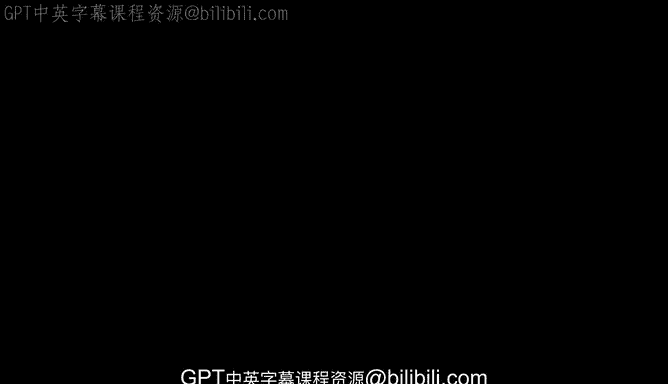
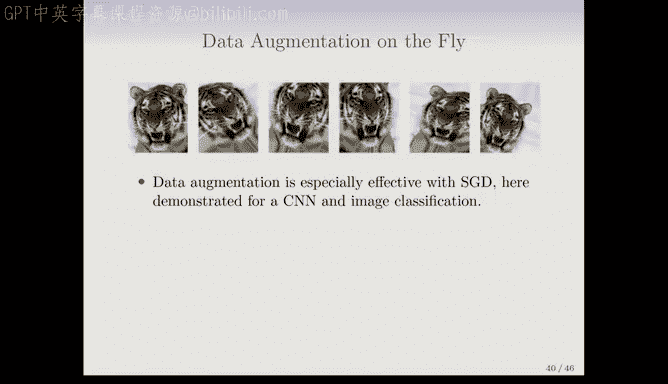

# 斯坦福大学《统计学习导论2023R语言版｜An Introduction to Statistical Learning with R》中英字幕 - P73：-073-Statistical Learning_ 10.6 Fitting Neural Networks.zh_en - GPT中英字幕课程资源 - BV1yU421o7WA

So we got a few more topics。 The next topic is5 neural networks and you see we put the little uphill car there because this is potentially a little bit more challenging can I leave can you leave that Now if you're gonna fall asleep。

 please don't know It's fascinating so。So we put up a picture of our simplest neural network。

We put an objective， say sum of squares and we want to minimize the sum of squares。😊。

And we've expanded F of x a and you see we've got parameters beta and the ws in this simple one。

 we've got training data， we've got n observations， we want to minimize sum of squares。

 that means we want to learn the W's and the beta。From those data， okay？

Turns out the problem is difficult because the objective is non convictx。

And we'll show you what that means in a moment。It turns out， however， despite this。

 the effective and effective algorithms have evolved that can optimize complex neural networks efficiently。

 so let's look at that in a little bit more detail。😊，So here a non convex function。

 we just show you a one dimensional function。And we're going to use gradient descent to optimize this function。

So you can see here。😊，We write the function now， we use the collective term theta to represent all the parameters。

So our objective we write as are of theta。And it's the sum squares。

 and theta consists of all the W's and the beta。 And now we try and depict it in one dimension。

And the way gradient in descent works is you start with some guess for theta and we start off with the gas over year。

And this orange curvior is the function R of theta。😊，So if theta was one dimensional。

 this is a non convex function。Which what that means is。It doesn't have a single minimum。

 it's got this one's got two minis， right it comes down and then goes up again。

 it's got lots of hills and valleys， in two valleys in this case。And。

What gradient desent does is you started a guess。You figure out a direction to move in this case。

 we're either going to go left or right and you move a little bit in that direction。

And you've picked the direction so that youre going in downhill because we want to get to a minimum。

And so you go downhi a little way and you get to the next guess。😊，And you keep on doing that。

 moving downhill， moving downhill until you can't move down a little anymore， okay？

And so in this case。We get down to this point， which is。As far as we know， a local minimum。

 actually in this picture looks like a global minimum。😊。

If we started a little bit to the left of this starting point。

 we would have gone in the opposite direction and got caught up in a local minimum。

So that's how gradient descent works。Okay。So the trick is to find。These directions to move。

 So this in one dimension， as I said， you only go left or right a certain distance。

 But when you're in higher dimensions， you have to decide which direction to move。

In that parameter space and how much to move in that direction。So a little bit more detail。

In the simple， as I said， we reached the global minimum if we start a little to the left of thetaote。

 we would have got to a local minimum。And if the dimensions higher， we have to decide in a direction。

So how to find a direction delta that points downhill， well。

 we need to compute what's known as a gradient vector。And the gradient vector。

Computed at some current point， Theta。Tea。😊，Is the vector of derivatives？😊，Of the function。

Which is a function of this multi parameterameter theta。At each of the coordinates of Theta。So if。

 if the's got。M coordinates。This gradient vector is going to be an M vector。

And consists to what's known as partial derivatives。Now。

It's a fact of calculus that the gradient always points uphill。

So the gradient has components in it and tells you which direction in space to move。

 and if you move a little bit in that direction， you're going to be going uphill。

So that means the way we want to move is the opposite of the gradient so we put a minor sign in front of the gradient。

 and that'll make us go downhill， which is what we want to do。😊。

And then we multiply it by some small number row。 you can see row here is 0。001。

 That's a typical number。And that says， you know， this gradient is going to recommend a certain distance to go as well as direction。

We want to be really cautious， so we want to just go a small little bit in that direction。

To make sure we go in downhill。And because you can overstep and end up the gradient maybe off and if you go the full distance you can start going up again。

 so this row is a way of slowing things down。And so that leads to the update in the parameter。

Theta t plus 1 is theta t minus rh times the gradient。If this is a little beyond your math skills。

 don't worry， this is built into the algorithms that we use and you know this is just to give you for those who understand the's a way of understanding what's going on we go back to the previous picture one of the things that makes this area so complex and it is's actually a very hot area now in machine learning optimization figuring out algorithms for neural networks。

Even if you could you could get the global minimum on the right there。

 it's not clear that's that's the solution you want right remember the example we had with 60。

000 observations and 200，000 parameters the global minimum could be overfit quite badly yes so。

We't even even if we could get the global minimum we often don't want it so there's a lot of study now of the grain assentments to cast a grain asscent that figures out just tries to figure out just what solution does it find because it seems to work well in practice but people don't really understand that yeah exactly。

I think in the early days of neural networks， they would。You knowYou have to start at some value。

 they'll pick some small value to random value to start with。

 theyd fit the network many times starting at different random values and average of solutions。

And that turned out to be a better thing to do than just go to one global minimum。

 I'm saying typically these problems can have thousands of local minimum right and just which one we want and which one the algorithms tend to find is really not clear。

Okay， so there's a gradient。If you thought， if you thought， if you thought this was complex。

This slide's even more complex。Okay， so how do we compute the gradients？

So there's a technique called back propagation。 So again， let's look at the simplest case。

 we see the loss function。R of theta is actually a sum from one to n of R of theta。

Because it's just summed over the observations。And R of theta。

 I've just written it out here is Yi minus f theta of X squared， and in expanded form。

 we can write it like this。Well。When we compute the gradient of r of theta。

The way gradients works is you can compute the gradient of each of these components and then sum them then you get the gradient of r of theta because r of theta is a sum over these n terms。

 you can compute the gradient of each piece and then sum to get the gradients。

 so now we need to be able to compute the derivative of this function with respect to all the betas and all the ws。

Okay， so just a bit of notation， we all let Z KB。The linear combination inside here。

 just for ease of notation。So now we use what's known as the chain rule of differentiation。

So let's first differentiate with respect to a beta。

 so if we first differentiate the summer squares with respect to f of theta and then f of theta with respect to beta okay？

And when you do it in those two steps and then multiply them together， this is what you get。

 this expression of here。For the Ws。We do differentiate with respect F of theta again。

Then if of theta with respect to G of Zk。G of Zk with respect to Zk and then Zk with respect to W。

 So four steps in the chain。And when you do each of those and multiply them together。

 you get this expression over you。And the nice thing here in this example and squared errorlo。

 we see that the first piece in both of them is the residual。😊。

So the residual is telling you what error youre making for that observation。

And what you can think of these multipliers on the residual。

 a way of spreading the residual down to all the different units that are responsible for that residual。

So you propagate in the residual backwards to the activations and therefore the weights in the network。

And。So this is a simple network， but the same idea gets used on the most complex networks。

 And the nice thing today is you can have the computer programs know how to automatically differentiate functions。

 And so we don't even have to think about it。 Just gets done automatically。 Okay。

 so this I agree this is quite technical。 but this is a technical section。

 and that's the idea of back propag。 all that again。 I will not over it again。I guess importantly。

 there's some tricks of the trade。So one is slow learning。

So it turns out gradient descent is a slow way of optimizing。😊。

And a small learning rate row even slows it further。

And so one of the ideas is to use early stopping as a form of regularization。

So even though you've got a very highly parameterized network and if you fit it all the way down till you reach a minimum。

 you're going to overfi， the gradient descent is a nice。

 slow way of getting it and if you stop early， you may end up in a really good spot。😊。

We saw that with the with the。IMDB reviews when we trained the network， there was a figure。

 the performance of the network。On the test data， it peaked very quickly at around 0。

88 and then started going down。 That was those epochs were measuring iterations of training。

What's used pretty much in all neural networks now is stochastic gradient descent。

And what you do is rather than compute the gradient using all the data。

 you use a small mini batch drawn at random at each step。So for example， with MNS， you've got 60。

000 training observations。But you may use a mini batches of just 128 observations drawn at random from those training data。

So you take the 128 observations， you compute the gradient based on them and you make your small gradient to step just using them。

😊，You can imagine that cuts down on the computation dramatically， okay？😊，So we talked of epochs。

 so the epoch is a count of iterations， and it amounts to the number of mini batch updates such as n samples in total have been processed。

RightSo if we use 128， it's going to be 60000 over 128。

 which means 469 mini batch updates amounts to going through。

An equivalent of N the full end training sample，60000。That's an epoch。 In addition。

 we use regularization， so ridge and lassu regularization can be used to shrink the weights at each layer。

And two other popular forms of regularization are dropout and augmentation。

Which you're going to discuss next。So what you do with dropout is a simple little network and you can see the original network and here we've colored some of the units gray。

 we've colored our input unit gray and we've colored two of the hidden units gray。😊，So each。

Mini batch， stochastic gradient tocent update。 What you do is randomly remove units with probability phi。

 maybe 0。4 or something like that。 and scale up the weights of those retained by an amount to compensate。

 turns out you want to do 1 over 1 minus5。Who just remove those units and ignore them。

So in simple scenarios， like linear regression。😊，It turns out a version of this process can be shown to be equivalent to rid regularization。

So as in Ridge， the other units stand in for those temporarily removed and their weights are drawn closer together。

And so that's become a very popular form for regularization of deep N。

 and of course it speeds up the learning as well because you've got less units to process。

It's similar to randomly emitting variables when growing trees in random forests。

 so if you remember in random forests when each time you get a bootstrap sample， you train a tree。

 you randomly ignore subsets or variables， it's the same idea。

And the inventors of Dropout acknowledged random forests and Ne Bman's contribution there。

The other interesting form of regularization is called data augmentation， okay？So here's a picture。

 just two dimensional picture， the orange points are your actual data points。

 you can see the data they just got x1 and x2， they somewhat correlated。What we do is in this case。

 we've randomly added a little cloud of data points around each original data point。

So we augment the data set with random versions of the original data point with a little bit of noise。

 okay？😊，But for each of those。We use the same y value as the original data point。

So we've just perurbed the feature point by these random draws， okay？

So what this does is makes a fit robust to small perturbations in each of the excise。

And it turns out in an ordinary square setting， this is exactly equivalent to ridge regularization。😊。

Okay。So that's just the heuristic that we want to use。In the case for images。So in images。

 what you can do is something similar。Each time you draw a mini batch for stochastic gradient descent。

You draw an image， let's say it's one of the 128 images you're going to draw at random。

 you draw an image， and then at random， you apply some natural transformation to that image。

Like you rotate the tiger's head a little bit。 You enlarge it a little bit。 You change the out。

 You you stretch it。 You maybe change the color or the you。 But these transformations。

All transformations that wouldn't confuse a human， we still recognize this as a tiger。

So you can think of this as as creating around the original tiger。

 a cloud of different versions of the same tiger。😊，But somehow， they all represent that same tiger。

 So that's like adding the random noise。 And， of course， the label for all of those images is tiger。

Okay。And when you do that。It improves the performance a lot。

And you can think of it as a form of rid regularization。In the community。

 they think of it as augmentation。 You're just increasing the training sample size， which， of course。

 is going to。You know that's that's going to prevent overfitting because now you've got a big a training sample size you can fit the model more accurately but through this heuristic you can think of it as a form of rid regularization。

 it sounds like it would be more than dis regulargized but also make it more robust for future predictions right Yes because if the system was presented with a rotated tiger that's not normally recognized。

And and this idea has been around for a while， wasn't about then they called hints， hints。 Yeah Yeah。

 so these， you can think of these as hints you' put in in different versions of the tiger and you're saying。

 by the way， these are also a tiger and you don't， you know， you don't have to get new data。

 you can just do that。