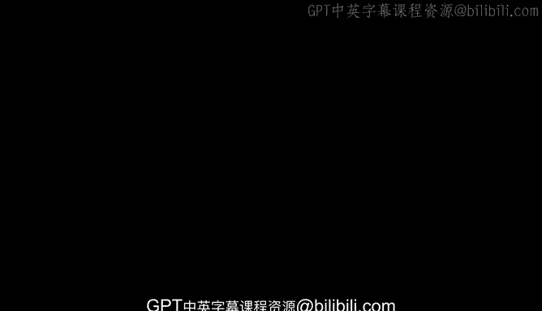
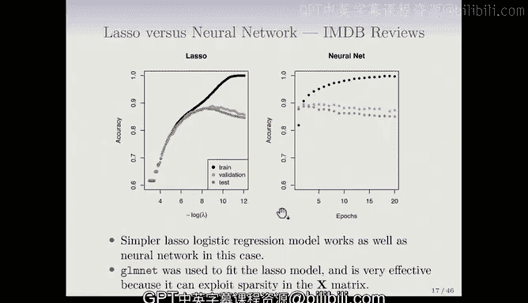

# 斯坦福大学《统计学习导论2023Python版｜An Introduction to Statistical Learning with Python》中英字幕 - P74：-074-Statistical Learning_ 10.3 Document Classification.zh_en - GPT中英字幕课程资源 - BV1u4421A7ZU

Now we're going to move on to a new problem， which document classification。

And we'll use an example as an example， the IMDB movie reviews database。So IMDBs is a corpus。

 there's an app， can look at and it gives you reviews of movies so you can look up details of movies。

And they've also got user reviews so people can contribute reviews to IMDB。

 and you can look at the reviews。Now a review is a document。

 it's usually a short document and it's what people。

 they just say something about the movie and sometimes they're positive， sometimes they're negative。

And。There's a corpus， the IMDB corpus has got 50，000 reviews。And they've been rated。By labelers。

 and they've been rated in terms of sentiment as positive or negative。

So some people read the reviews and decide this is a positive review， this is a negative review。

And so that labels being assigned and half the reviews in this corpus are labeled positive half are negative。

 it might sound like an easy task， right， but an English language A language is subtle right people could be sarcastic and maybe be using words that you know computer might think are positive but actually being it's a negative sentiment。

So that's the challenger really。So we give you an example of a review。

 this has to be one of the worst forms of the 1990s， this one's pretty clear。

 this one's pretty clear。Even to me， you no subtlety here。It's quite funny this one。

The rest of the time everyone else in the theater just started talking to each other。

 leaving or generally crying into their popcorn。So one question is， how do you represent？😊，A review。

 which is a sort of open ended document。I mean， the reviews can have a different number of words。

 how do you represent it and in terms of features right so the goallia is to take these words。

 take these reviews and automatically classify the sentiment of the review。Okay。

So let's talk about feturization and the one we're going to use is known as the bag of Word model。

So documents have different lengths and they consist of sequences of words。

 so how do we create features to characterize the document？So here's what we do。So from a dictionary。

 we identify the 10，000 most frequently occurring words， saying in the English language。😊，Now， 10。

000， that's a parameter which we decide on， and that's what we've used here， you could make it 15。

000， if you like。Then what you do is you create a binary vector of length 10，000。

 and for each document you score one in every position that the corresponding word occurred。

So every time a word occurred， you put a one in that position。In other words。

 the position in this dictionary of 10，000 words。Where that word occurred。

 if it occurred more than once， you just leave it as one in this case。So if you've got end documents。

😊，Now you're going to have an n by P sparse feature matrix， let's call it X。P is going to be 10。

000 here。You're going to have 10，000 variables。For each observation。

 most of them are going to be zero because， you know。

 the review might only have a few hundred words in it。😊，So there's going to be most of the 10。

000 values are going to be zero。So that's how you do it。

We're going to compare a lasu logistic regression model to two hidden layer neural network on the next slide。

 no convolutions here， just a regular neural network。

Now I should just add the bag of words or what's known as unigrams。You can also use diagrams。

 which is the occurrence of pairs of wood。Like very good， that would be a particular diagram。

And so you can see if you've got 10，000 words， a number of bigrams grows you know， as a square of 10。

000， so they get much bigger and in general you can have m grams。

But we're not going to go there today， we'll just stay with the unigrams or the bag of words model。

Well， as a result， we're showing you two pictures here。The one is the result of fitting in less shoe。

And we used the Gmnet program in art to do that。And what we show you is as a function of。

The regularization parameter Lada for the lessu we in fact， we plot against minus log of lambda。

We show three curves， we've got the training accuracy。We've got the validation accuracy。

 we put aside a small data subset of the data to decide。When to stop the Lasux regularization path？

And then we got the test data set， which is in orange。

You can see the test and validation pretty much on top of each other。

So the validation data set and this accuracy you want to get high。😊，So。

You can get an accuracy of close to 90%。Correct。The validation tells us when need to stop in the laux。

Path in Giminate。And then the test accuracy we can see is pretty much the same。Okay。

 so that's using Lau。Here's a neural network。And again， for the neural network。

 we show training error， validation and test error。

But this we put as a function of the number of epochs。So the number of epochs。

 you're going to see when we train a neural network， we use a slow method of training。

 which is known as gradient descent。And the number of epochs is as you'll find out is is the number of times you've been through the whole training set each time。

 and so you can see the training goes through the training set 20 times。

And that can be viewed as a form of regularization。 And you can see as it goes through the training。

 the training error increases much like the less suited。But again， the area said you the accuracy。

 sorry， the algorithm sorry， the accuracy， Yes， and the validation error maxes out fairly early and then starts decreasing because were starting to overfoot。

 So， So why is the neural net doing a little better than Laso here you think。Well。

 it's actually not Trump。 It's not。 It's not。 It looks。 Yeah， it's a little hard to see。

 but it's not。 It's pretty much they're pretty much on top of each other。 This， this number year。

It's maybe a little bit tiny bit。And why it's got many more parameters right Well I was thinking。

 I mean， it's capturing nonlinearities and also interactions right when you take linear combinations and put them together。

 you can get interactions of words right that's true which that's true that also the linear model doesn't capture interactions but you know the fact that the linear model starts overfitting fairly you know fairly quickly and so does a neural network。

So yeah， I mean， I think in the chapter， we concluded that the performance was pretty much the same。

It turns out that glmnet is very effective here， it's very quick。

 much quicker than the neural network in this case。

 because it can exploit the sparsity in the X matrix。😊，The x matrix is mostly zeros。

Glimia1 the LU model can exploit that。

