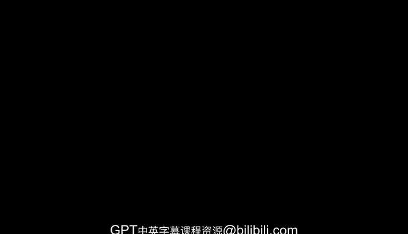
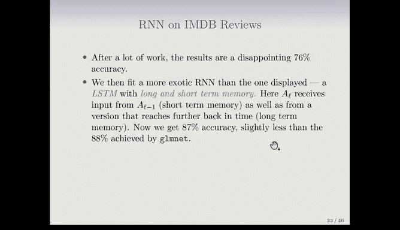

# 斯坦福大学《统计学习导论2023Python版｜An Introduction to Statistical Learning with Python》中英字幕 - P75：-075-Statistical Learning_ 10.4 Recurrent Neural Networks.zh_en - GPT中英字幕课程资源 - BV1u4421A7ZU

Now we're going on to a new topic， which is recurrent neural networks。

So like convolutional neural networks were used for modeling。Images。

 recurrent neural networks are used for modeling sequences。Data that arise as sequences。

So here's some examples。So documents are sequences of words。

And their relative positions have meaning。 So the bag of words model。

 we didn't take the order of the words into account。It was just a bag of which words were used。

 no matter where they could。Here we want to take the sequence of words into account in the order。

Well， time series such as weather data or financial indices。Those are sequences。

Recorded speech or music is a sequence， sequence of notes。Or phonemes。

Handwriting such as a doctor's notes。Is a sequence。Okay。So Rns。😊。

the abbreviation for recurrent neural networks， they build models they take into account the sequential nature of the data。

And in doing so they build a memory of the past。Just to get into notation。

 so the feature for each observation here is a sequence of vectors。

And the sequences of length earlier。And so x1， x2 up to xl， each of these are vectors of numbers。

So it's just like an input feature vector。 but now we've got a sequence of them。

The target Y is often of the usual kind， E G a single variable such a sentiment for the whole document。

Or perhaps a one hot vector for a multiclass classification task。But it's just a single response。

However， y can also be a sequence such as the same document in a different language when you want to do language translation。

It's a more difficult case， we you're going to deal with the simple case and work with the sentiment example first。

So here's a simple recurrent neural network architecture diagram。And。

We showed it first in this abbreviated form， and you can see there's like a cycle going on。

 which emphasizes the recurrent nature。But then we represent it as a sequence。

So here you've got your input sequence， x1， x2， x3， all the weight till Xl。

And as you're going to see， we're going to treat each of our observations as sequences of the same length。

And if they're not， for whatever reasons， the same length。

 we're going to force them to be the same length in what we do here。

But there's versions that don't need that。Now， along with the input sequence。

You've got a hidden layer sequence。So these are activations just like we had before。

 but they march along in step with the input sequence， so there's A1 A2 up to AL。In this diagram。

 each of these A's are also a vector。X1 is a vector of input numbers。

At this first point in the sequence， a1 is going to be a vector， maybe a different size。😊。

Of activation units at this first step in the sequence。

And they all feed into each other or move along with a sequence。Now you've got weights。

 so let's look at the weight set， for example， goes into A2。You get。You get input into A2 from x2。

That's the corresponding。Element of the input sequence。

Then you also get input into A2 from the previous。Hidden Victor， A1。So A2 gets input from A1 and x2。

😊，A3 gets input from x3。And a2。And so what you can see is that these A's are somehow accumulating a memory of what's happened in the sequence。

😊，The memory part is carried forward by these A's。😊，And you update the memory by。

Getting the memory from the previous step。And augmenting the information from the next input。

Vectctor in the sequence， and that gives you a3。The other thing here is that you'll notice is that the same weights are used at each of these steps as we move along。

 and that's where the name recurrent comes from。The same weights。So a single set of weights。

 W going from the input vector to the。To the hidden unit。

And the same way to you going from the previous activation vector to the current activation vector。

We also shown an output。Instead of output units。And again， the same weights。

Go from the hidden unit to the output unit。See， these are known as bees。

And that means we can actually measure an output at each step along the sequence。

 but we typically interested in the accumulated knowledge of the output and so we only interested in the last one。

 which in this case is why。But there are applications where you could be interested in all of them。

So yeah， the parameters that need to be learned are B U and W。So here's some more detail。

Suppose the e element of the sequence as P numbers， P components。remember each input。

Vectctor in this is a vector in the sequence。 And let's say it's got P components。 And let's suppose。

Each hidden unit in that sequence of hidden units has got K components。Then the computation of the。

Kith components of the hiddenoid AL is given by this expression。So there's a bias we intercept。

Then there's a linear combination of the P values of the input vector at that point L。

 and then a linear combination of the activation units at the previous step。

And then there's a non nonlinearity such as value。And then the output layer。For example。

 it's just a linear model。Or if it's a classification， it'll be a softm or logistic transform。

As we said， were often only concerned with the prediction OL at the end of the sequence。 this guy。

For example， sentiment of the document。 I just want to ask， but go back to the picture。

 So if I guess we can see it's different than the bag of words we did earlier in that because of the ordering is definitely taking into account。

 Yes，'re right。 And if we didn't have those those views that。Move from one unit to the next with it。

Would it be the same as a bag of words It still wouldn't be the same Rob。

 but it would certainly be a much more complex network。But it wouldn't be the same。

 so' there's quite a bit of different structure going on yet。

And I should we should emphasize this is a simple recurrent neural network。

 you can get more complex ones， for example。You can have two hidden layers so you have instead of going straight to the output layer。

 you could have another layer of hidden units， a sequence right so this sequence would be input to the next sequence in a fairly obvious way。

And there's lots of other ways you can make this more general。

So if you look at the loss that we're trying to minimize。

If we're only interested in a response from the last layer， this is what we're going to look at。

 we're going to look at the observed response。Min is the output from the last hidden unit。

summed over observations from one to end， say we using in squared error loss。

And if we expand that out。You'll see all the weights that we need to learn is the betas which comprise that B matrix of weights。

 So remember there were weights B， U and W， these are typically matrices of weights that have to be learned and they are the same throughout here。

So there's the B's， there's the Ws， there's the U's。

But this loss only involves their activation at 0 L minus1 in the sequence。

So what about all the other guys？Well， the thing is these A's are defined recursively。

So the a at lay L minus1。Depends on the8 layer L minus 2 and so on it goes back。

So when you come to estimate the parameters， you have to take all the steps in the sequence into account。

We're going to use an RNN on the IMDB reviews。As opposed to the back of wordss model。

So now the document feature is a sequence of words， it's column WL from one to L。

And we typically paired the documents to the same number of words。 So here。

 we're going to use the first 500 words in the document。 If it's longer than 500 words。

 and if it's less， we'll just truncate and paired with blanks up to 500。

 So now we need some way to represent each word as a vector。Well。

 we're going to use a one hot encoded binary vector dummy variable of length 10000。

And that may seem crazy， that's a vector of length 10。

000 and all entries are0 except one corresponding to the position of that word in the dictionary。

 so that's a very sparse feature vector and we got one of those at each of the 500 steps in the document。

😊，So， this is extremely sparse。What we tend to use is a much lower dimensional， pre traineded。

Word in bedin matrixtri。And。I'm going to show you a picture of that in the next slide。

And what this does is reduces the binary feature vector of length 10000 to a real feature vector of dimension some number M much less than 10 k。

 like in the low hundreds。So here's the idea。So here's a sequence of words。At the bottom。

This is one of the best forums， actually the best I've ever seen， right？By the way。

 what we've shown you is the review where we only represent the words in the dictionary of P size 10。

000， so any additional words have being eed and so you don't see them。And so yes。

 this top imager represents a one hot encoding right so this is gets a one in this position and the gray are zeros。

Is gets a one in this position and so on， right？And of course， it's 10。

000 high knot whatever the number in this picture。Here's the wording bedding and you can see it's a much smaller set of numbers and they're not just zeros and ones。

 they're real numbers， so we've depicted them as colors right？😊。

Maybe a heat map of colors that goes from blue， which is cold to red。

 which is hot with yellows and whatever and orange is in between。

And so now where do we get this word em from this new representation。

 so you can see whenever we have a have instead of having this coding we can use these numbers instead。

😊，Well， these word embedded are pre traineded on very large corpora documents and they use methods similar to principal components。

😊，To come up with his lower dimensional representation。

And theyre very clever they take into account things like synonyms so you have if you have。

You don' have a word like male and female or boy and girl。

The relative position between them in this representation and king and queen will be somewhat the same。

 So they're take into account this kind of these kind of。You know。

 semantic meanings of words and also synonyms。So two of the well known embeddings are word tovek and G。

And you can just， these are available on the web， you can download them。

 you decide how many dimensions you want， and you just plug it into your network。Okay。

 so we used an R N N with a word embedding。On the reviews data and after a lot of work。

 the results are disappointing 76% accuracy。 Remember we got close to 89% accuracy。Okay。

 so then we fit a more exotic recurrent neural network than the one that we displayed。

 It's ones known as the LSTM， which stands for long and short term memory。

And without getting into great detail， yeah。AL receives input both from A minus1。

 the previous hidden unit。That's the short term memory。

 as well as from a version that reaches further back in time。

 So you take big steps back in time and get an a。Back from there as well。

 right so that's the long term memory。And when you do that， it takes much longer to train。

 you now get 87% accuracy， which is slightly less than 88% achieved by ClNe。

 and takes a long time to learn now just like in the M data and in the Resnet and all these data bases。

 these data， these IMDB reviews have been used as a benchmark for new RNN architectures。

So the best reported result found at the time of writing was around 95%， and so of course。

 a much more complex network。If you look in section 10。5。1 of the book， the second edition。

 youll see will point to a leader board where you can see who's winning the race and again subject to overfitting and overlooking at the data。

Now this is something we've seen pretty often， right？Deep nets have some spectacular successes。

 but on a lot of problems。They don't do better or even they you do worse than simpler methods and you you don't hear about that very much because's it's harder to publish simple things right that's right。

So just a reminder to not only try deep nets and fancy methods， but also try simpler methods。

Because they often work as well and they're much simpler to understand。

