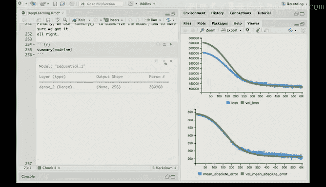

# 斯坦福大学《统计学习导论2023R语言版｜An Introduction to Statistical Learning with R》中英字幕 - P75：-075-Statistical Learning_ 10.R.1 Neural Networks in R and the MNIST data.zh_en - GPT中英字幕课程资源 - BV1yU421o7WA

Now we're going to do the lab on deep learning for chapter 10。

 and we're going to show you how we fit the models that we saw in the chapter。

So we implement deep learning through the careis package in R。Which is a front end to Tensorflow。

 which is the system developed at Google。And。Kerose and Tensorflow implemented in Python。

And so there are package carriess interfaces to the Python code。

So this is quite a different level to what we've seen up till now。So in order to be able to run Kes。

As we do in this in this lab， you need to have a Python implementation on your machine。

 on your computer。So it's a little bit of a learning curve， but it's manageable。On the book website。

There's instructions on how to install Kes， Tensorflow and Python on your machine for all the popular machines。

And this， the care system that we use follows the book by Francis。Charlotte and J J Le。

Called deep learning with R。And and so it may be useful to get a copy of this book as well。

So we assume that you have Keis up and running on your machine if you want to follow through on the slam。

Now， the other thing we're doing in this lab is you'll see there's a lot of text。And。

For the new edition of the book， we've。We've presented all the labs and give code for all the labs in a number of formats。

One of them is our markdown format， which is what you see here。

And this pretty much faithfully reproduces exactly what's in the lab in the book。

So it's a good opportunity to learn the ins and outs of our markdown。

 which is really a good way of writing our code and recording what you're doing and the trains of thought and so on and you're running our markdown in what environment here？

So we running this in our studio itself。 so this is our studio window and it of course。

 understands our markdown。 and you'll see there's a really nice interface for running our markdown。

Okay， so let's get started。 So you see a lot of text。 And， in fact， if you were to。

To knitt this file。It would chuug along， and it would produce。An HTML document in this case。

That when you look at it， it's going to look just like the lab modo， few tiny little。

Maybe differences， but it'll look pretty much like the lab。So yeah。

 we scroll down and the first thing we do is we're going to implement the single layer network on the hitters data。

Which we saw。In the chapter。We tell library ISLR2， so for the second edition of the book。

 we've got a new library which is pretty much includes the old library press whatever additional data sets and maybe functions we need in the second edition and it's called ISLR2 which you can get from Crran。

And then the first few lines are reading in the hit's data。H's data has got missing values。

So we use the function Nit to remove all rows with missingian values， in fact。

And then we also set the random seed and we select a test set。

 which is going to be one third of the data set okay and so to implement this whole chunk。

 I'm just going to press the arrow key here。And。And there it's done。 no output it just does it。

And then we going to fit a linear model， which of course， this is familiar。

 so we use the LM function。The response is salary。So this。

 this is the baseball hitters and celery of the， the batsman。Twiddle dot again。

 means to use all the other variables except salary as as as features。

And we use Gter's minus test ID， so we're going to use the training data。

 so we subset out the test data。And then we do a prediction on the test data。

And then we compute the test error。 So I'll just do it， first of all。

And we see in this interface the the output just appears on on the screen in the markdown。

 So that's very convenient。 So that's the mean absolute prediction error on the test data。Now。

 we used another incantation that we've not naturally used before。 And that's the function with。

 which is really nice。 So with takes as a first argument to data frame。😊。

And then the subsequent expression can use any of the variables by naming the data frame and compute something。

And so that's what we did here， So with Gtter's test ID， so using that as the data。

We're able to just reference L and salary and compute the mean absolute error。So， that's nice。Okay。

 the next thing we're going use is Gimnet because we want to fit a lasso model to the。

 the hitters's data Well getters， right。Lliminate doesn't。

Know about formulas that they're not implemented in Gmnet。 So we need to make an X and a Y matrix。

And so。We use a function model matrix。Which is a handy function。 It can take a formula。 In this case。

 we tell it salary is a response because we want it to exclude it。dot means again。

 all variables and minus-1 means we don't want an intercept。

 otherwise model matrix would normally include an intercept and you tell it the data。

And then we call that X。And why is the salary data？

And we've actually wrapped the function scale around that model matrix， and scale will。

Standardize the columnstone of unit variance and and mean 0。 I thought we normally have intercepts。

 Why are we excluding one now。Good point， Rob。 We do want an intercept in the model。 But Dnet。

 when you give it an X， it expects just the variables and it automatically puts in an intercept。

 So if we left the intercept in， there'd be two constants in the model。

 And you I guess you'd also shrink the intercept， which you don't normally want to do and exactly。

 right。So I've clicked that chunk and that will have run that code。Okay。

 so the next thing is we library glinate。We use a CVv。tlimnet。On the training data， in other words。

X minus test I D comma， Y minus test I D。And we tell C do Glyth that we want to use mean absolute error。

Otherwise， it would used by default means squared error。And then we make predictions from that model。

And we tell it to make the predictions at Lambdabo dot min。

 which is the minimum value on the cross validation curve。And we compute to me in absolute era。

And so we run that code， some message to say that it's loaded the glimnet package and it implements it。

We didn't plot the cross validation curve here， but we we could have。

 I can just jump into my code here and just say plot。CV。Fit。And just run that single line。

And we get the the， the plot of the， the C fit。But we didn't include that in the， in the package。

Okay， so now we're ready to fit the neural network， so。Weload the Keris library。

And now we write some code to build up the structure of the model。Right。So the model is called mod N。

 N。 So it's a structure that stores。The details of what the model is going to look like。

So Keis model the sequential is just some code that says it's going to be a feed forward neural network。

And then。We'll tell you more about the pipe in a moment。We pipe it into。A call to layer dense。

 which tells you that there's going to be 50 units at the hidden layer with radio activation。

And the input shape is going to be the number of columns of x， so in other words。

 it's going from the input layer with number of columns of x to the hidden layer which has 50 units。

 and then we want to we pipe that into the layer dropout where we have a dropout rate of 0。4。

And then into the layer dense， which is for the output unit。Okay。这的是。well let's run that。

And you'll see it waits a while while I's running it。

 because what's going on in the background is the Python。

It gets fired up and there's a whole lot of stuff printed。 might look scary when you see it。

 but there's nothing really bad in that。 And it's just saying that the the Python's been implemented and this model specification has been transmitted to the Python program that's running。

Okay。So let's talk about the pipe operator。 This is not something we've encountered before。

 and it's really useful， and especially for specifying neural network models。

 because it makes the code much more readable because we can basically。

Put in separate lines for each layer in the network， including things like dropout， okay。

So how does it work， Well， we'll illustrate it on a simple example。 So earlier， we used。

The scale command， we made model matrix and then wrapped around at scale。

 which would take the output of model matrix and apply the scale function。

And without arguments scaled by default， standardizes to means zero and constant varianceance。

 each of the columns， okay。But these compound expressions can be a little bit difficult to read。

 right， especially if they get nested a few layers deep。So here we do the same thing。

But using the pipe operator。So we call model matrix。And we want to assign it to X， but。

What we do is we pipe the output of model matrix into the scale function with no arguments。

And what that does is the output of model matrix becomes the first the pipe causes that to be the first argument to scale。

And then any other arguments that are listed in Scalia will be the subsequent arguments。Okay。

 so that has the same effect as doing the scale。There's no need to run it because we've already done the scale。

Okay。Well， good back to the neural network。 So we've set up mod N N and it's got some details of the foot。

 it's got a dropout layer and so on。Now we're going to add further details to Mo in。

That control the fitting algorithm。Okay。So we're going to just follow the the examples given in the Kera's book。

 We're going to use squared error loss。And so again we。

Pippe mod N N into compile loss equals mean squared error。 We tell it the optimizer。

 It's a default optimizer， and we tell it the metrics we're interested in mean absolute error。So。

In this previous line， the pipe operator passes more in as the first argument to compile。

So the compile function does not actually change the R object mod in this case。

 but it does communicate these specifications to the cor chlorronine Python instance of this model that is being created along the way。

So this is sort of interesting what's going on you。 It looks like we。

We create and we're going to fit this modern N in R。 but actually what we're doing is transmitting。

This information。To the， the Python instance on how it's going to fit the model。

So it's a very special kind of thing。That's going on。Okay， now we're going to fit the model。😊。

It's going to use stochastic gradient descent。And we're going to specify the number of epochs and the batch size。

So。The batch size is going to be 32， which means that each time。We do a gradient update。

 we randomly select 32 of the training observations for computing the gradient， the batch gradient。

And we make a move down the radiant。 And was that specified already to batch size them。 No， Robin。

That's， that's coming up。 So this is sort of preamble to that。 But So maybe we should look at it。

Okay， so this is where we're going say it。You can see we've we've actually commented out in the actual lab it says 1。

500 epochs that would take a little bit long， so we we we commented it out and changed it to 600。

 In fact， I'm going to get this thing running right now。Because it takes a little while。

And then I'll tell you about the epochs。So， yeah， so that size of 32。There's 176 training data。

Observations， so if you divide that by 32， is going to be about。5。

Graadian steps per epoch because remember an epoC is the equivalent number of gradient steps so that you've gone through the whole training data set at once。

On the right here， we see actually a progress plot of the neural network fitting。

 This is particular to our studio， where this happens。In the top， we've got the default loss。

 which is squared error loss。The green curve is the validation。

 It's actually the test data in this case。 and the blue is the training。And down below。

 we've got mean square mean absolute error， same story。Blue is training。Green is validation。

They pretty much on top of each other。 the two。 And notice the， the training loss is。

 is is a little bit jumpy。 And that's because this gradient in descent is。

Kind of jump because there's some randomness in in， in the observations used for。

For computing the gradient， hasn't has the reala fit at all。 I that right。

 It doesn't look like it's overfit at all。 Yeah， so we could have actually gone on a bit longer。

And that's an interesting point， Rob。It， it seems often that these neural networks。

Are slow to overfit。 And it's partly， I guess， the learning rate。There's a。

 I forget what the learning rate is， Yeah。 we didn't actually specify it。

 I don't believe it's a default， but it's a small learning rate。

 So that's how far you go down the gradient and each time。 use dropout as well。

 which regularises right and the dropout as well， yeah。There's also a window， yo。

 which shows all the the。More details of each of the gradient steps。

 And you can wade through that if you wish。 But with a plot， it's， it's kind of good now。

 So we'll just。Move that away。It a little， little。Itemia that you can use to open up those those guys。

You can also directly plot the history if you're not in our studio and you run R in a different system。

 you can directly produce a plot and you get something like that which is very similar to the plot we've just seen。

All right。So just a point， so we ran the foot， yeah， we did it with 600 iterations。

If we ran the foot a second time。It would start from where we left off。

Because the Python code has just kind of stopped where it is and if you run it again。

 it'll just continue。The plot would continue， but it would continue starting from the。

 the the point where it has ended before。 We won't do that now。So at the end of the day。

 we can use the predict method for Keis。And for neural networks and we give it the test data and we evaluate the performance on the test data。

And this is slightly different to what we reported in the book because we only used a training sample of size 600。

And it's about the same as the least squares。 I think itre a little worse。 Its Yeah， yeah， exactly。

And the other thing to note， and we point this out in the chapter is that。

Even if you had to run the model right from the beginning 1，500 steps。The second time。

 it wouldn't give exactly the same answer because of the slight randomness in the in the stochastic gradient descent。

 He win the same seed。Well， the seed is a sticky issue with Caris rub because it turns out it's difficult or we haven't figured out how to set the Python seed from inside Kes so that's a slight。

It's a it' a slight issue。Okay。So that's the end of the simple example。😊。

We now move to a multilay network on the M digit data。 This is a bigger， more serious data set。

And these data are available from the CAS package， as are other important data sets for our lab。

There's are actually a dedicated command in Keis called data set underscore MNT。To get the data。

And then we have a few commands to pull off this is an object with a lot of a list with a lot of components。

 and we pull off the X， the Y X test， Y test， these are all designated。Training and test sets。

And make them available。And you'll see that this。60000 training images， each 28 by at。

28 grayscale images。And 1000 test images。 And， of course， the class labels。Between 0 and 9。

 these are the digits。So。The images the。The data， the X matrix is stored as a three dimensional array。

 It's got 60000 by 28 by 28。So we actually want to reshape that into a matrix。

 so we're going to flatten out the 28 by 28。And there's commands in the CAis package for doing that。

And we're also going to turn the response。Into a categorical variable using a kis command 2 categorical。

So this is just to turn the input into a format that the neural network understands。One other thing。

 when you fit neural networks， it's not， it's pretty sensitive to the scale of the variables。So。

 you know， if you have one variable that ranges from0 to 1 and another variable that ranges from minus 500 to plus 500。

It's going to cause some problems with the neural network。

And so it's generally better to scale the variables， maybe to an interval。

 say01 or to standardize them to have， say unit variance。To avoid that sensitivity。

So in the case of these images， each bit is an8 bit gray scale value and the actual numbers。

 if you look at them， they lie between 0 and 255， that's 2 to the eight。Different numbers， right。

 So we'll rescale them to lie between 0 and 1。And that's a simple command。

Just as element wise on X train and X test。Okay。So now the data are already ready for the neural network。

So again， a call to model。A carriesis model sequential。 And now we're going to have more layers。

 So we've got the first is the input layer。 The input layer got 7，84 units。 that was 28 by 28 images。

 and the first hidden layer is going to have 2256 units with radio activation。

Pippe that through a dropout layer with 0。4。Then the second layer is going to have 128 units。

 also value。We'll do a dropout of 0。3。So， that's。Slightly less dropout。

 And then the final output layer has 10 unitss， and the activation is softm。Which。

Turns the output into probabilities for the 10 classes。 Now。

 How do we decide on this architecture like this。256， the dropout there， the three。

 the number of layers， the dropout number of units。s that's a good question， Rob。

 it's actually quite tricky。 You'll see this as we build more and more complex networks。

 these parameters they multiply there's many of them。 and why do we use 0。4 year and 0。3 year。

I think I copied it from the Car book where they use this example， but yeah。

 those are things that can sometimes take a lot of time trial and error to get those right。

 including and also the number of units， although the general idea is that you make a large number of units hidden units and you use some form of regularization。

 So it's better around too many than too few。 Yes， I think that that's the current thinking。

So let's make sure we run that code。 So again， this is not doing much work except just specifying the model through these layers and making extensive use of the pipe operator。

Okay。So we can do a summary of the model and that's nice because you can actually check that you did it right and give you a description of each of the layers and what's in。

And。It looks shocking， but we've got。235000 parameters。We've only got 60，000 training observations。

So this is a case where the neural network is way over parametermetized。😊，But， you know。

 we're going to use regularization。So who knows what the effective dimension is， But nominally。

 that's how many parameters there are。

No， we didn't have to blank that up。If you do the parameter， if you look at the parameters。

 if you wanted to actually reconcile these numbers with the numbers that we see here。

 you have to take into account that there's a bias term。

 which is an intercept in each of the layers in the input layer and each of the hidden layers and when you add those in。

 you can get to this number okay。We're telling that the loss is categorical cross entropy。

That's essentially the multi class logistic regression loss function， in fact， log likelihoodlude。

And。And we give it details for the optimization。 And， and again， these。

 these were prescribed in the Car book。 and one can。

Look up help on these and see what the different options are， but we used basically the default。So。

 get that running。And now we fit the model again， I've reduced。Down to 15 epochs。

I'm using a batch size， we are using a batch size of 128。Which may seem really modest。

 given that we've got 60000 training observations。But the idea is to use many relatively small batches and you may tend to make better progress。

And， and now we tell it to use a validation split of  point2。 So， in fact。

 we're using 20% of the 60000 training observations as a validation set so that we can。

Track the history of the model， as it's going。This think how amazing this is we're sitting here。

 This is running on a MacBook pro just just a laptop。 we're fitting。

 How is it 250000 parameters in 250000 parameters。 And each each movement is means it's processed 60000 observations or a bit less because of validation totally amazing。

 I guess the the query for that goes goes to Google and Tensorflow and all the all the smarts they use。

 both software and hardware。 Yes， it's amazing。 it is amazing。 We're really blessed to have。😊。

Packages like Tensorflow available， and it's used in， you know， all over the place。Okay。

 so here's some details of the machine and and sort of along the lines that that Rob wrote up。

 you know that。Fit in the model。It says it took 2 point It took 144 seconds for the full model。

 if we used all the epochs on this particular MacBook Pro， which is a 2。9 gigHz， was 32 GB of Ram。

Okay。We can score the model for accuracy。And it does an amazing。98% accuracy on the test data。

Which is， is really good。 Again， we use the pipe command here。 So yeah。

 we actually wrote a little function called accuracy。😊。

Which is takes as an argument to predictions and a second argument to truth。And this computes。

The mean。Classification errors。 So it looks to see how often。The predictions are equal to the truth。

We use a word drop because the predictions are come in the form of。

A raisese and we don't want them to get in the way。And so。We run predictt classes。

 we give it X dot tests。 that'll give predictions。For the digital loss。

 And if we just pipe that straight into accuracy。And。When you use the pipe command。

 we only have to name the test set， which is the second argument。

 because the first argument is the output of pre dot classes。And that's how it's used。

So in the chapter， we also report the results of LDA。

Which is described in chapter 4 of the book and multiclass Lo regression。So。

Packages like Limnet can handle multiclass logistic regression just fine。

 but turns out they're quite slow on such a large data set。

And we tried other packages in order to fit the multi class logistic regression on these data。

And we ran into problem， speed， and or other problems with all。

And then it occurred to us that we could actually fit this model using a deep network with no hidden layers。

 which is， is kind of nice。 So here we go， right。😊，So we we just go from input straight to output。

usingsing again， the softmax activation。RightAnd if you do the parameter count here。

 you'll find out that's exactly right for a multiclass logistic regression。

And now we fit the model just as before。And this one looks like I'm doing all。30 epos。

And it's fitting that logistic regression model。 doing a little bit worse， I think。

 is that weren't we up at 90。Yes， before， yes， so we were up at 98 before。

 and so you can see the advantage。Rub of the， of the， the neural network。

Because logistic regression looks like it gets to about 93% on on the test data and。

 and the neural letter got to 98%。 So this gave exactly the same answer as Gimnett if we could run Gnet。

 it would， yes， Well， exactly， It's。 Well， it's an approximation， right。

 It's doing sas and gradient descent。 So without actually getting to the。The global minimum。

 that's a good but maybe who cares performs better。It performs。 Yeah。

 itll perform as well as glimnate。Well， approximately as well， and probably very similar， right。

 it seems like it's leveled off here。