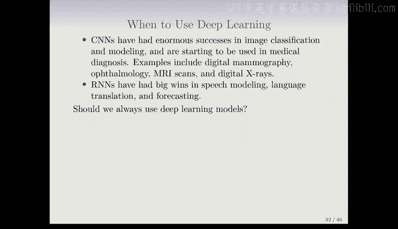
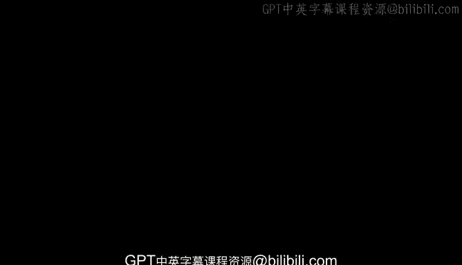

# 斯坦福大学《统计学习导论2023Python版｜An Introduction to Statistical Learning with Python》中英字幕 - P76：-076-Statistical Learning_ 10.5 Time Series Forecasting.zh_en - GPT中英字幕课程资源 - BV1u4421A7ZU

We're going to use an RNN and we're going to address a different kind of sequence。

Problem and this is time series forecasting。So what you' see here is three time series。

And these are financial time series， and they cover the period 1960 to 1990。Okay。

And these are daily time series， daily meaning trading days， that's five days a week。

 five trading days a week。And in the top lot， you see the log of trading volume。

In middle plot you see the Dow Jones return， it's an index。

 and in the lower plot you see a measure of volatility on that day。

And the red line is indicating we' going to use the first part of the data for training a model and we're going to test it out on the slightly grayed out version of the data。

 so it's a training a test set。And this is important when you deal with time series。

Because as you'll see， the data are autocor， so you can't just randomly select some training days and test days。

You need to sort of break apart time like that。There's a period。 I got it a little bit wrong。

 There's 6051 trading days。From 1962 to 1986。 so the log trading volume is a fraction of all outstanding shares that are traded on that day relative to 100 day moving average of past turnover on the log scale so is a。

Definition iss a constructed variable。Dw Jones return is just what it is。

 this is the difference between the log of the Darw Jones Industrial In on consecutive trading days。

That's where the word return comes from， the log volatility。

 this is based on the absolute values of the daily price movements。

 so the goal is to predict log trading volume tomorrow， given its observed values up to today。

 as well as as the observed values of the Dow Jones return and the log volatility。

And yeah we give a reference for these data， they were assembled by Lebarron and Wgan in 1998 and so you can find that reference。

So it's interesting here， we're going to try and predict log trading in volume。

 That something turns out is。You can do a reasonable job doing if you had to try and predict the Dw Jones return or stock prices。

 that would be a much， much harder problem。 I is going to ask you whether you could help me to improve the yield on my portfolio。

Are you the right person to ask for this， Rob， I'm the absolute worst problem to ask。 In fact。

 if you ask me what you could do is is move in the other direction， maybe I'll try it。

So heres the log trading volume。And what we're shown you is what's known as an auto correlation function。

At different legs。So what the autocorlation function does is the following。

V is the variable that we call in log trading volume。We we look at pairs Vt and Vt minus L。

So that means they add a lag of L trading days apart， right。

 So imagine all the pairs you could get like that in the data set。

And we take those pairs in compute correlation。Of those pairs of numbers。

 and that's called the order correlation of lag L。And here we show the ordered correlations of lag。

 one， two， three， four， and so on。And you can see so the log trading in volume has a correlation。😊。

Of。in7。Between values today and values yesterday。Let's lag one。

Not much lower between values two days apart。 So that that's。

 that's what's known as auto correlation。 And when you look at a series。

That's kind of what you see in you。 You know， it does， it's not chaotic。

 This looks much more chaotic。 The the Dow Jones return。

But the trading volume tends to go up for a while， come down for a while， is's a lot of noise。

But those sort of small trends that you see is a reflection of this auto correlation。 Okay。

 so these sizable correlations give us confidence that past values will be helpful in predicting the future。

And this is a curious prediction problem because the response is VT。

 We want to predict the log trading volume at a particular time T。

 but it's also going to be part of the features。 We're going to use values。Of that same sequence。

 it lags back to predict。The value at VT。So it's fair game to use values of the series from earlier days to predict into the future。

 so let's see how we set this up for a recurrent neural network。We only have one series of data。

So how do we set up an originion， So what we do？Is we first of all。

 decide on the number of lag we're going to use， which we call earlier。

 and in our example we're going to use a lag of five。Okay。

And we're going to extract many short miniseries of input sequences。

And they're going to be of the form x1 x2 up to Xl， and remember L is going to be five here。

And what it's going to be。In these elements。Well， yeah they are。

 so we're using VR for for the D Joness return and Z for the volatility。And so remember。

 we need a sequence of length five here or of length L。So they're going to be。V T minus L。

 R T minus L， Z T minus L， those three numbers。That's going to be the first element in the sequence。

 The second is going to be， so that's at lag 5 if L is5。

 then we're going to get those same three numbers at lag four back， lag 3 back up to lag one back。

Okay， so that's how we make the sequence。But， of course。You get these five。

 three vectors if you start time T。If you go to a different time。

 you get a different set of three vectors， so the number of observations are the number of time points。

The features are these lagged versions of the three series。

And the response is the log volatility at the particular time。So we have 6051 trading days。

And with Lhi equals 5， turns out we can create 6046 such X Y pairs。And by x here。

 we mean x is a sequence， right？And a sequence of three vectors。

And it's slightly less because obviously， right at the beginning。

 we can't lag back because there's nothing， you know， there's nothing to lag to。So we just truncate。

And we use the first 4，281 as training data and the following 1770 as test data。

 that's the shaded parts in those initial images。And we're going to fit a recurrent neural network with 12 hidden units per lag step。

 i。e per AO， so each AO will be a vector of 12 units。This is a picture。

Of the log trading volume for the test period。And the black is the observed。

And the oranges that predicted from the Or in。And it looks pretty good to me。Anyway。

 it's it's a little shorter， it doesn't get the highest peaks or the lowest dips。

 but it pretty much follows the sequence you can see that。The r squared is 0。42 on the test data。

One way of comparing that is an r Earth squared of 0。18 for a strawman。

Sman is sort of a natural competitor in this case， that's easy to compute。

And the straw man we use is we're going to use yesterday's value of log trading volume to predict that of today right that should be pretty good right because of that order correlation。

 so we don't expect the straw man here to be useless， but it gets an R square of 0。

18 and we can do considerably better using an RnN。Now， since we've gone into this example。

 we're going to tell you about another way of doing forecasting using a very similar structure and that's known as auto regression。

 and this is just using linear models， okay。So the structures are same， you set up a data set。

And we'll first use the response itself， which is the log trading volume。

 and you create a data set where you have a sequence of the responses。

It goes up to v capital T and goes all the way down and we go back to lag L plus 1 because we need to create lag variables and we can't go further back than that。

And then we build up a model matrix， we've got an intercept we've got the。😊，You know。

 so for each say V。We've got a Vt minus1 is going to be a feature。

 A Vt minus2 is a feature up to Vt minus L。And then if you go to the next time point back， right。

 you'll get the same things but。One time， step back。Until eventually。

The response V L plus1 has features VL VL -1 up to down to V1。

 So this is a traditional auto regression setup where you just got one sequence and you're using laggged versions of that sequence to predict the response。

But of course， we can augment this matrix with lag versions of the logged out Jones return and the volatility measure as well。

So if you look back， this is a very similar data structure to what was used for the RNN。

But now what we do is just a plain linear regression， we do a linear regression。Of。

This response set of response numbers using this data matrix to make our predictions。

 and this is known as an order L auto regression model or ARL。So yes， we'll have， if we got lag。

 say five， we're going to have3 L plus one columns because weve got three different variables and the inter hip is the additional one。

Okay， well just tell you some results here， so for the A or of5 model， we get an r squared of 0。41。

And it's got 16 parameters。Three times 5 plus one。The R and N that we described earlier as an r squared of 0。

42 slightly better。And with 205 parameters。Many more parameters is this is a repeating story with neural networks。

 you can have lots more parameters and you don't pay much in terms of overfitting it's because of the way they fit and regularized。

 you can take the structure for the Aor model and instead of fit in a linear model。

 you can just fit it through a feed forward neural network。Okay， and when we did that。

 we get the same performance as the R inN。You can add another variable which turns out to be really informative for log trailing volume。

 which is the day of the week， was it a Monday， Tuesday or Fridays right and that turns out that all the models improve and you can get an r squared of 0。

46。So that's the end of auto regression， two examples， one using an RNN。

 one using more standard statistical model。A little bit different in structure， performance。

 somewhat similar。So to summarize RNNs， so we've presented the simplest of RNNs。

 there are many more complex variations that exist。

One variation treats the sequences a one dimensional image and uses CNNs for fitting。For example。

 a sequence of words using an embedding representation can be viewed as an image and the CNN convolves by sliding a convolutional filter along the sequence。

 so it's like a one dimensional convolutional filter you can have additional hidden layers where each hidden layer is a sequence and feeds into the next hidden layer。

And you can also have output via a sequence。And input and output share the hidden units。

 so there's something called a seek to seek learning。And they used for language translation。

 so for example， the input data is a sequence of words in an English document。

And the output sequences is the same words translated into German。You've got input is a sequence。

 the output is a sequence。And there's many more， so it's a rich area and there's lots of recurrent neural networks out there。

Again， one can have access to these。 Okay， so we've talked of a number of neural networks。

 networks for images， networks for sequences， networks for just general data。

And the question is when to use deep learning， So CNNs have had enormous success in image classification and modeling。

And they're starting to be used in medical diagnosis， so examples include digital mammography。

 ophthalmology， MRI scans， and digital Xrays。And we talk briefly about using pre trained images to be feature extractors。

AndFor examples like this， where you don't have that much training data。

Orrons have had big wins in speech modeling， language， translation and forecasting。

So the question is， should we always use deep learning models？

It seems they have the capability of taking over any kind of modeling。😊。

Often the big successes occur when the signal to noise ratio is high。So what we mean by that is。

 for example， in image recognition and language translation。

 humans can classify images almost perfectly， especially natural images。😊，That means that。

The information in the input image is enough to get the target exactly。

 so the signal is there's a lot of very little noise。The same is true for language translation。

Youve got large data sets and overfitting is not such a problem in cases like that。

Because overfi means fitting the noise and so if there's not much noise。

 it's not going to be a problem with human populations trying to predict whether someone' is going to respond to a drug based on their genetic profile。

 for example， just seeing the noise ratio are often very low。 Yes。

 theres so much noise and right human populations Yeah that's right and you know。

 a lot of the data sets Rob and I see in for example。

 in the medical school to do with human populations and can be very noisy right。😊。

So for noisier data， simpler models can often work better。So on the New York Stock Exchange data。

 that's somewhat noisy data， the AR5 model is much simpler than an RNN and performed as well。

And on the IMDB review data， the linear model fit by Gimnet did as well as a neural network and better than the RnN。

Granted， there's more sophisticated RNNs now that can do a bit better。

 but a lot of work for quite small gains in that case。So we endorsed the Ohams Razor principle。

We prefer simpler models if they work as well， say more interpretable。I think I also remember。

 I think the successes we've seen with neural networks in this lecture， for example， the the。

The inputs have certain have come from some kind of temporal or spatial structure。

 right in the images。Of course， there's there's a structure in the image in the time series examples or the speech in the the movie review。

 there's there's structure in the inputs， right， There's a time ordering and neural networks have have the capability to model that kind of。

Structure， yeah。That's right now。And of course， the creators of neural networks and the people who work working with now are very creative in adapting to new kinds of data structures right。

 so nice thing about our neural network is it's actually it's kind of a toolbox where you can you can tailor the。

😊，The network structure to the the things you know about the problem， so it's a very。

Very rich way of modeling。

