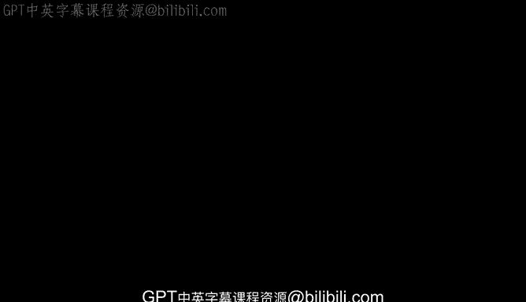
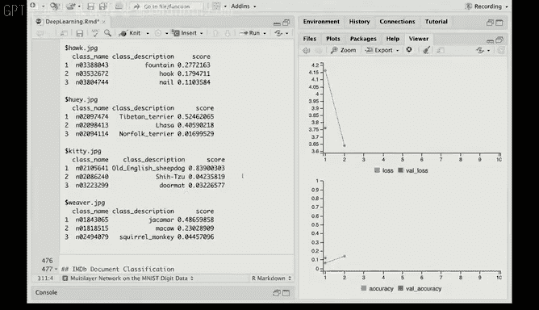

# 斯坦福大学《统计学习导论2023R语言版｜An Introduction to Statistical Learning with R》中英字幕 - P76：-076-Statistical Learning_ 10.R.2 Convolutional Neural Networks in R.zh_en - GPT中英字幕课程资源 - BV1yU421o7WA

Now we go into the big daddy， convolutional neural networks。

Where we're going to work with the CF data， the image data set。And at C4 100。

 there's 100 image classes。And again， this data set is available in Keis。So we read it in。

And we extract just like before。The training and test data is set。And。Look at a summary of， of。

 of what we get。And。As described in the text， there's 50000 training observations。

These are color images and they 32 by 32， but they've got three color channels， red， green and blue。

So this is a four dimensional array then， this x。And。

And we see the range of any one of these channels。Is， again，8 bit。One of them here is 13 to 2505。2。

55。Okay。So the response is a categorical variable。 We're gonna one hot encode that to 100 column binary matrix。

 So in the digit data we got a 10 column binary matrix。 Yeah we go to 100 column binary matrix。

 we love that term one hot， which we learned from her engineering friends， right。

 statistics we used to call categor we call categorical or dummy variables which is so boring but one hots a great。

 youve got to love it。 youve got to love it。 now we're using one hot from now on。😊，The， the。

Machine learning community has a genius for picking。Clever words， like deep learning itself is。

 is a brilliant word。Okay， so we do that and now we see that the response matrix is 50000 by 100。

Of course， it's very sparse。So let's look at some of the training images using the JPEG package。

 which is a package for looking at and manipulating images。So。

We just set up a little framework for doing a little plot in window，5 by 5。

 We're going to look at 25 images。We're going to just sample at random 25 of the images and then plot them。

 and we use plot as raster command。And they we get them。So these images。You know， they small images。

Right， they what， what was the dimension。32 by 32 color images。 So the resolution is not that great。

 but they they。10 different classes， sort of natural images， theyre plants， there's animals， fish。

Trees。In various things。Yeah。Okay， so now we set up the model。Again， using Ke model sequential。

 and now you see the pipe operator really makes things much clearer。😊。

Because there's many layers and we specify each of the layers separately。Okay。

And now were asking for convolutional two dimensional convolutional filters。And each filter。

 remember， each filter was a little。Like a little two by a little two dimensional image。

 in this case， they're going to be 3 by three images， little patches。That we slide along。

The target image。And do dot products as we go in across。Okay。And the first one。

 we'd say what the filters look like and we tell it what the input shape looks like。

 which was 32 by 32 by3。Okay。And then we have a max pooling layer。

 which reduces each dimension of the filtered image。By two a factor of two in each case。

 So what that recall that what that does is it takes each non overlapping two by two block and takes the max。

Because this filter is trying to find hotspots for certain features that it actually learns in the filter。

And then。We repeat this。So we take the output of the pooling layer and we apply another filter。

And you'll notice that we。As the size of these。Of these layers as the size of the images。Get smaller。

 The number of hidden units gets larger。 This is all described in the text So we won't go over it in detail yet。

But we just run， run this code。And again， it's just specifying the model。And now we can do a summary。

 and you can see the details of each of these layers。And。We get close to a million parameters here。

 again， astounding with 50，000 training images。Okay， but if you look here。

 you'll see there's layers of dropout。Throughout。And。Yeah， you know， and so that adds。

 that adds regularization。All right， so。At the end， we have a dense layer of， of size 10，24。

Do we see that， Yes， and then that gets compressed into another dense layer of 512。

 And finally to the output layer of size 100 because there's 100 images，100 classes。

And that's piped into the soft。 you know， that goes through a softm layer。Forfiden。

We'll do 10 epochs here and not even。Because this takes quite a bit longer to run。

 because there's a lot of layers， lots of parameters。And。Is he the wheel spinning？Thiss progress bar。

You can see it in gray。It's not even。 it's， it's working on the first epoch。And。When it's finished。

 you see one set of dots on on the figure on it goes。We're not going to wait for this guy。

 So I'll just stop it。Using that。博蛇。Came up with an arrow， we don't care。If you've got time。

 run the whole model and you'll see。It gets an accuracy of about 46%。

 If you trained it to all the 30 epochs that we were， we intended originally， we'd get 46%。

This is not too bad for 100 class data。But if you search a web currently。

 you'll find that there are instances of CNNs that can get 75% on these data。And it in。

 it slowly increases all along as people introduced different clever tricks and other bells and whistles。

 which means you might not believe it。 We might not believe it's only5%， right， because it's。

If they fitddle with the tests， if they fitddle with the test， so yeah。So， there's a lot of。Yeah。

 there are a lot of tricks。 And yeah， I think that happens， right， You see these competitions and。

 and you see the， the。The， the leaderboard inches up slowly in tiny amounts as people come up with nu trick。

 So is that on the stain of the art for this data set。 So I believe so，75%， yeah。So of course， Rob。

 when you've got the more images you have， sorry， the more classes you have。

 the harder it is to classify。Because the， the flipper coin classifier on 100 clause。Only gets 1%。

Correct classification40 is actually quite good。 So 40 is not bad， yeah。So one nice thing is that。

Some of these deep learning networks have been pre traineded and are available。

Publicly available and you can use them。There's a bigger image data set called ImageNe。

 which has got millions of images and has1 thousand classes for natural images。

And it's been trained with a very sophisticated network and the one we're going to use is called ResNe。

And one can actually use it in classifying images。You can actually use it as is out of the box for classifying images。

 or you can use some of the。Many of the trained layers as a sort of pre trained part of your network and just add layers on top of it。

So this is really handy。So。We what we're going to do is。We've got a collection of images from。

You know， of our own from our photograph album。And we're going to use the pretrain network to classify these images。

So let me just show you the images。嗯。It'ch I've got behind the screen here。So。Here we go。

 This is a image from our photo from a photograph album。 So here's a image of a little Lyso Ao dog。

There's a cat。There's a weaver bird。😮，And。There's a hawk sitting on a fountain。

There's a zoomed in version of thehawk on the fountain。 And here some flamingos。 Okay。

 so there's six images。 And we're going to see if the。Pretrain network can actually。

Classify these images。Okay， so。We read in their images and there's some code to do that。

Nothing too complicated。We need to turn the images into a form that this pretrained network can understand。

 So the pretrained networks expect 224 by 224 images。

 These are high resolution or fairly high resolution images with three color channels。

And then we turn them into a form that this。Nettter can understand。

 And so there's a few commands here that are needed to do that。So we just run that。

So we've got the images in a directory。The same directory we work in so we can just read in the images。

And so now。We read in the pre trained model， which is called Resnet 50。 It's a 50。layyer。

Convolutional network。 how many classes were does it， Oh or maybe that's not relevant。 It's not。

 Yeah， Are there a number of classes in the printer network or Yes 1000 classes。 I see。 So this。

 this is a data set， the imagenet data set。Has 1000 classes in which we've included things like dogs and birds。

 Oh yeah not just your dogs， but species of dogs。 And yeah， so it's， it's quite a， quite a extent。

 comprehensive。Netric， so you can see it's read it in。 We've done a summary。

 and the summary goes on and on。 In fact，50 rows describing all the layers。It's really a。Complex。

 and this would have taken。 This would have been trained on massive computers， I believe。

 at Google and。And taken a long time to train。But we just make use of it。

So we've got our X matrix now， which we preprocessed。

And then we decode the predictions and we ask for the top three。

 so it's going to produce a probability for each of the predictions。

And we ask for the top three and have it print them out。Right， so bingo。

 it' got the flamingo exactly， right。でホく。It called it a kite。Well， that's not bad。

 And the other two guesses were birds as well。 House fch seems a bit of a stretch。

Can we see the picture wanted to call it a kite？The kite is the type of bird。

 Oh actually that as a kite and fly。But in the picture where we you zoomed out。

 it focused on the fountain rather than thehawk。 In fact。

 it didn't see any bird there and so classified that as a fountain。Right。The Lasso Ao。

 it came in second， it said Tibetan Terrier， which looks somewhat similar to the Lasso Apso is a Tibetan dog a species。

And so it got mixed up with the Tibetanterrier， which is pretty good。The cat。

To her horror was classified as an old English sheepdo。Next guest was a shitsu dog。

 and the third was a doormat。Luckily， the cat couldn't understand what we're saying。

And the final one was the weaver bird was classified as a jackcomo， which does look somewhat similar。

 Anyway， I think that's somewhat of a success for the pretrain network。

