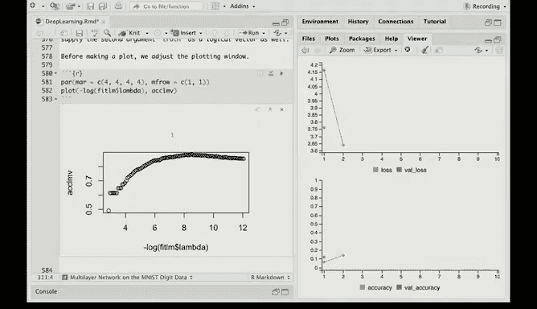

# 斯坦福大学《统计学习导论2023R语言版｜An Introduction to Statistical Learning with R》中英字幕 - P77：-077-Statistical Learning_ 10.R.3 Document Classification.zh_en - GPT中英字幕课程资源 - BV1yU421o7WA

Next， we're going to go to the。IM DB document。Remember the IMDB where the movie reviews。

 and so this is a task in document classification。And again。Caris has this data set。

We're going to use a dictionary of size 10，000 words。Okay。And if you recall。

 the way things work is we build a bag of words model。

Where we score each document for whether or not the words in our dictionary appear in the document。

 it's a binary vector， and we're going to limit it to the 10。

000 most commonly used words in the dictionary， okay。And when you extract the data set。

 we can straight away， indicate that， and it'll truncate。

Each little review to just using those words is third line here is is a shortcut using a kind of a sign operator that takes an IMDB data structure and builds up a train and test list and and also X and Y。

 So these are shortcuts we learned from the Kes。A curious book。

Let's have a look at the indices for the first 12 words in the first document。So there they are。

So the words are indicated by positions in the dictionary of 12000， okay？

So if you want to actually see the words， we write a decocode function。And the decode function。

Needs to take into account certain padding words like start and stop and unused。

 and so there's some details here。 we won't go into it yet now。

 but you can read more details in the lab。And that tells you the beginning of， of that review。

 So it translates the the numbers into the actual words。

 So this form was just brilliant cast in location， scenery， story， direction， Everyone。

 So it doesn't look like English。 But remember， we limited ourselves to this restricted dictionary。

And so now。We write a function。To one ont hot encode code each document in a list of documents and return a binary matrix in sparse matrix format。

So remember this， what this is going to do is。For each document。

 it's going to give you a binary matrix and it's just going to be zeros or ones。

According to which words were present in the dictionary。You see in the last line。

We made a call to the sparse matrix function because this matrix is mostly zeros， right。

 because any document only has。If the documents got。Yeah。50 words or 100 words or whatever。

 There's only going to be 100 at most 100 ones in the document in in in the sparse effect。

 and the rest are going to be zeros。We use a matrix capital matrix package and the sparse matrix function。

To。Store this matrix in in a sparse format。And so this code here is setting things up to do that。

Next， we use the one hot in code function。It's telling it that there's， there's。A dictionary of。

 of length，10000。And。So we'll just run that code。 So all the components of x ring get one hard encoded。

Is that right， Yeah， so this makes these， these matrices that are。I see。 I'm sorry。

 Ive got a little lost in in the code here。 So this is just a function to do the one hot encoding。

 and it returns a sparse matrix。And here we run one hot on the training and the test， yeah。

And so we see。That the dimension of the x that we have out is 25。Thous0 by 10，000。And。

If we look at the fraction of non zeros， we see its。1。3%。

We're going to sample a validation set of size 2000。Just so that we can monitor progress。

And select tuning parameters。So first， we will fit a lesssso logistic regression using a Glymnet and evaluate performance on the validation data。

And we'll， well plot its accuracy。As a function of the shrinkage parameter lambda。

In Ly itll take advantage of this spa matrix format。Because this is a pretty massive X matrix。

 but Linet knows how to take advantage of the， of the sparsity。

 It just knows because X strain is it not tell。 It just， it figures it out。Yes。

 so if one to look at the class of X train， you'd see it would be a sparse matrix。Should we do that。

So let's see。What's it X？And the school。Thank you。M G matrix。 Yeah， so I forget what these things。

 But there's a column spa matrix and。From the package matrix。Okay。So there's a call togimnet。

We tell it to use a binomial because the response， remember， is。The sentiment of the。

 of the document。 and it was。What was it favourable or favourav， yeah。And。

We tell it not to standardize the matrix because the matrix， the features are all binary。

 so they're all in the same units。Then we predict on the。On the test data。In this case。

 the validation data。And。We compute the accuracy。So it get that running。And it's done。

And in this case， we just make a plot of， of the results。And we see the performance on the。

Validation data。And it gets up to about 88%。

Okay。Now we're going to fit a neural network and we'll use two hidden layers each with 16 units。Okay。

So there's a specification。 So this is starting to look familiar by now。And。

We tellll it the optimizer， We tell it the epochs， batch sizes and so on。

 So this is just a standard two layer neural network。There it goes。What do we see there， Rob。

 we see overfiltting pretty quick， pretty quick overfitting， yeah。It。It gets up to about 88。

 just over 88%， 89% accuracy。On， on the test data， but starts over 15 fairly quickly， right。

And we didn't have any dropout， I see maybe that we could have， we didn't have dropout。

 that could have slowed the overfitting， yeah。I do recall trying some dropout and other things here。

 but， it didn't seem to make much difference。We've just shown the validation accuracy。

 well also like to see the test accuracy。So I basically run the program again。

 but this time on using the test data， not the validation data。I won't show that now。

