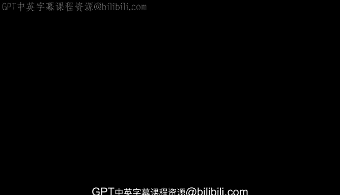
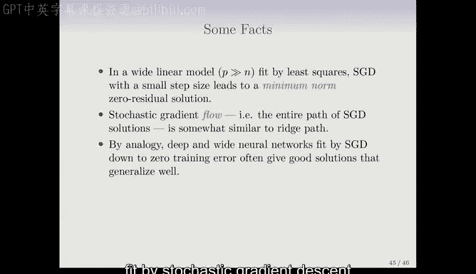

# 斯坦福大学《统计学习导论2023Python版｜An Introduction to Statistical Learning with Python》中英字幕 - P78：-078-Statistical Learning_ 10.7 Interpolation and Double Descent.zh_en - GPT中英字幕课程资源 - BV1u4421A7ZU

The last topic we can discuss is， is a pretty hot topic today。

And it's arisen in the last few years， and it's known goes by the name of double descent。And。

Just to set the stage， so with neural networks， it seems that it's better to have too many hidden units than too few。

Likewise， more hidden layers seem better than few。Run in stochastic gradient descent till zero training error often gives good out of sample error。

In fact， in many of these networks， like image with its signal to noise ratios I， that's what's done。

 They just run all the way till you get zero training error。

 and number of parameters in these networks are enormous。😊，Increaseing the number of units or layers。

 And again， train interval0 error sometimes give even better out of sample error。

 So all this sort of lay out the fact that。It seems like neural networks are reluctant to overfit and you could put as many parameters as you like in the model。

So what happened to overfi in in the usual a bias variance trade off？And so this is。

Set off a firestorm of papers and research。And one of the original papers is referenced here。

 and the title isReconcile in Modern Ma Learn and the Biospher in trade of。Basically。

 the message is from these papers in this research is that the biaspher Str off is all wrong in modern settings where we've had people talk about both of our books and the U shaped error curve for test error and saying saying it's wrong that doesn't apply to neural networks。

's see。Rob and I and others have worked on this and that's why we've added a section in the book。

On double descent， double descent， because many people have now heard of it and we want to give our point of view。

And to do that we're going to do a little simulation。

 which often simulations are helpful for understanding phenomenon。

 so this is very simple we're going to generate data from a sine curve and the feature x is going to be uniformly distributed on minus5 to 5。

And the error is going to be Gaussian with standard deviation 03。

 so you can do the simulation yourself。We have a small training set of size 20 and we have a very large test set and by the way。

 if you do a simulation， there's no value in having a small test set， make it really large。

 you want to find out exactly what the test error is so we're going to fit a natural spline to the data and if you've forgotten about natural splinees。

 these are in section 7。4 of the book。And it's a way of fitting a flexible function。

And there's lectures as well on natural spes in the series。

And we're going to fit with D degrees of freedom。So' going to be what that means is you're going to be fitting in a linear regression onto D basis functions。

 so your prediction is going to be of the form a linear combination of these basis functions with D parameters。

And what we're going to change is D so we're going to enrich this basis by increasing D and see what happens So when D is 20。

 you're going to have exactly the same number of features as you've got training observations right and because these basis functions are all different you're going to fit the training data exactly。

And all the residuals are going to equal to zero。But now we're going to even go further。

 We're going to let D get bigger than 20。So we need to say what we're going to do there。

What we do is。When D is bigger than 20， you can still get zero residual solutions。

 but they're not going to be unique。At exactly 20， you'll get a single solution。

 but when D is bigger than 20， there's infinitely many solutions with zero residual。

 so you've got to pick amongst them。😊，So among the zero residual solutions。

 we'll pick the one with what's known as minimum norm。I。e。

 the zero residual solution with the smallest value of summer squares or beta J squared。

And we'll see why that。How that plays a role。And we'll also explain in a little while why we set up this particular simulation in this kind。

So here's the result， and this shows the double descent curve。So in this picture we show。

On the horizontal axis， the degrees of freedom or D。As we add。Basis functions。Nive vertical axis。

 we show that the error。The test error is in blue and the training error is in orange。

 So sure enough， you can see the training error that's over the 20 observations。As D increases。

 it drops and drops and drops， and at D equals 20， it hits 0。And then， of course。

 thereafter it's zero。And the degrees of freedom we show on the log scale。

 and so you can see things get compressed up here。The test error is what is interesting here。

 the test error。Initially drops。And then starts increasing as we start overfiing the training data。

And this part shows a usual biosphere in Str off， right？Initially。

 error is high because of bias drops down and then error starts increasing co of variance and literally shoots through the ceilinger。

But then something interesting happens。The aistots decreasinging again。

 And so this is the double descent。And it starts decreasing， reaches a minimum。

 and then it seems like it starts increasing again。So what happens？As D increases above 20。Is。

The sum of squares of the coefficients， even though they're more coefficients。

The sum of squares decreases。Because we have more opportunities to fit the data exactly。

 and so we can find a configuration of betas。That have a smaller sum of squares。

So let's say we go from D's 25 to D' is 40。Right。One candidate is the solution we got a D equals 25。

But we've got lots of other candidates because we've got4 and we could set the remaining ones to zero。

 So that's a candidate。 so we can only do better if we're trying to minimize the summer squares of the betas having more betas to do it and it turns out that what that does is by making the summer squares of the beta smaller。

 that means all the betas are getting smaller we're going to have less wgggly solutions。

 getting smaller I guess they're being spread out over more functions and yeah spread out over more functions。

😊，And so this picture shows what's happening。So here's eight degrees of freedom， which。

It's the 8 degrees of freedom that's around here。 That's a pretty good solution。 That's about as。

 as good as we get， right。And you can see it's getting an nice approximating solution。

Here's 20 degrees of freedom。This is the one。So what we're show in here is the true sine wave。

 the actual data points， 20 data points。And we shown the fitted curve。

And we show in the footed curve everywhere。So 20， of course。

 the fitted curve has to go through every data point， which it does， they observe data points。

But what you see is in order to do that with exactly 20 degrees of freedom。

 it has to really stretch itself and the function goes shooting off in all different places elsewhere because the loss is only concerned with the training data。

😊，So it really has to stretch itself to foot the data exactly。

But when you go to 42 degrees of freedom， for example。

Which is where we achieved the minimum to the right of the 20 point。

You can see the functions much better behave， these departures， it's a much smoother function。

 still making little jumps in it， but nothing nearly as severe as it。

And that's because all these these are smaller。And likewise you go up to 80。

 not too much has changed over there， okay？So that's an explanation for what's going on in this little example。

So， here's some facts。So in a wide linear model， in other words。P is much bigger than in。

And you' foot by these squares using stochastic gradient descent with a small step size。

And you keep on going。That leads to a minimum norm residual solution。

So this ties stochastic gradient descent。And going all the way to the solution to the minimum a zero residual solution。

 it actually gets。The minimum norm solution。With the minimum sum of squares of the betas。

And stochastic gradient descent used in the neural network， so by analogy。

By training slowly to zero residual， you get in a more regularized solution。

Another way of talking about this is stochastic gradient flow ie the entire path of stochastic gradient descent solutions is somewhat similar to the ridge path。

So the ridge path is the sequence of solutions you get when you slowly vary the ridge regularization parameter that's called the ridge path of solutions。

And the stochastic gradient flow is a sequence of solutions you get as you go down gradient to sin。

 they quite similar， not exactly， but quite。So by analogy。

 deep in wide neural networks foot past stochastic gradientingcent down to zero train error。

Often give good solutions at general as well。And in particular cases with high signal to noise ratio。

 EG image recognition are less prone to overfi in the zero error solutions and is mostly a signal。

 theres zero error solutions， mostly a signal。Okay， so that's that's a little discussion on on。

And doubleub descent。So we'll end up this just talking a bit about software。

 there's wonderful software available for neural networks and deep learning。

 so TensorF from Google and PyTorch from Facebook and both our Python packages。

So in the Chaer 10 lab， we demonstrate Tensorflow in a CAas package in R。

 which interface to the Python versions of these packages。

And so you can see the text book and online resources for R Markdown and Jupiter notebooks for these and all the labs in the second edition of the book。

And there's a torch package in R which is available as well。

 and it implements the pi torch version of a dialect for fitting neural networks。

And the chapter 10 lab will be available in this dialect as well。

 so if you watch the resource page at www。tatlearning。com。

