# 斯坦福大学《统计学习导论2023Python版｜An Introduction to Statistical Learning with Python》中英字幕 - P79：-079-Statistical Learning_ 10.Py Single Layer Model_ Hitters Data I 2023.zh_en - GPT中英字幕课程资源 - BV1u4421A7ZU

Welcome back。 today， we're going to go through the lab for Chapter 10， the the deep learning lab。

 And we'll see that the this is deep learning。 So it's supervised problems like we've seen through much of the course。

 But the way the code。TheThe code looks slightly different because we're not using psychic learn to fit these models。

 We're using one of the more popular open source deep learning packages， the torch package。

 So we'll see that the you know， the way we set up problems is going to be slightly different to the psychic learn。

 it's going to be a little more complicated。 So we'll。

 but we'll see several examples and we will see enough so that we'll see the the repeating pattern but。

Okay。So as usual we have our imports at the beginning。

 all of these ones up here in the cell we've seen before。

 and then we have some torch specific imports。 Now we haven't includedrch as a dependency to ISLP。

 So you'll have to use PIP to install a few packages。

 There are a few like torch and you'll see below torch vision， torch metrics。

 torch info only four or five and we'll have instruction on the webp page how to do that。

 but we already saw how to install packages with PIP earlier。

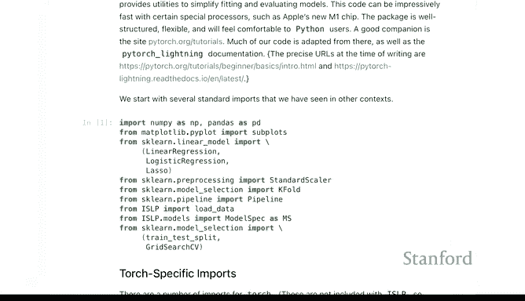

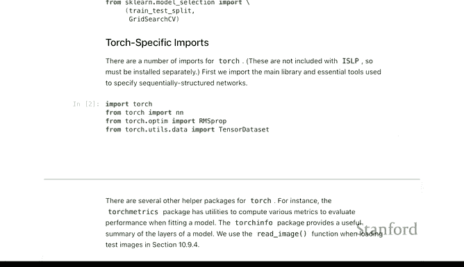

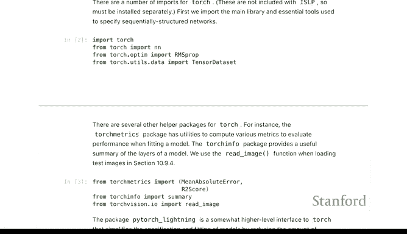

Okay， so。Let's see the one of the important， one of the most important things in this module is this。

And and this N N stands for neural network。 And we'll。

 we'll see later when we specify our loss function， right， because it's a supervised problem。

 we really just have to specify the loss function。 We're going to use this the module part the module class from N N as the as a key thing。

 So that's going to help us set up all the comp all the different hidden layers of the neural network。

And so。So that's going to be one of the key modules， part of that。There are quite a few imports。

 So I don't think we should dwell too much on them。

 Another key concept is this idea of a tensor data set。

 So unlike earlier chapters where we use data frames and lumpy arrays。

 there's sort of specific forms of the data for torch。

 And that's because torch or other packages for fitting deep learning models。

 they will they will use data in a different fashion， right。

 they'll use the mini batch paradigm or something like that。

 So there's a lot of sort of overhead that these packages have written to deal with that。

 So when we will take arrays and form them into tensor data sets。

 and that's going to be enough to tell torch how to get the data to where it needs to go。

 So torchches is a。

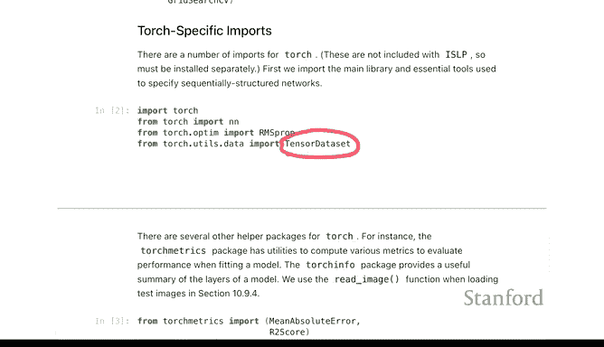

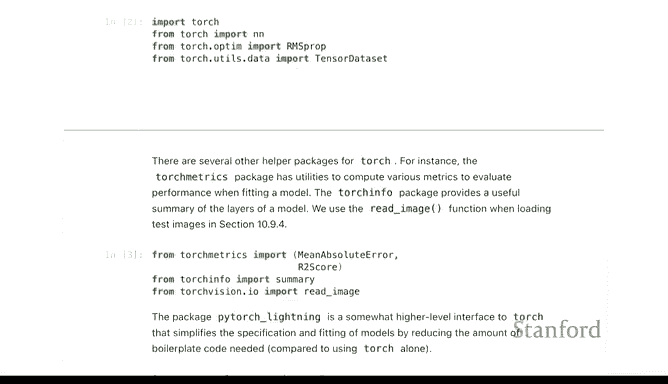

Fairly general purpose， deep learning library and。Just using torch itself。

 if we were to fit the models， it requires effectively writing stochastic gradient to yourself。

 So that's kind of complicated。 There are some helper packages in particular。

 this pytorrch lightning that makes it easier to fit。

 And so there's some sort of common patterns will use this trainer that sort of encapsulates how to once you know what the data is and what the network is how to actually fit a model So we're going to use pytorrch lightning as a helper and we've even written in the ISLP package。

 some helpers for pytorrch lightning and those are these imports we hear from the ISLP torch。

 So I think Jonathan neural networks are quite complex and they can do amazing range of things。

 So fortunately theres a lot of these packages that have been written to help us do it。

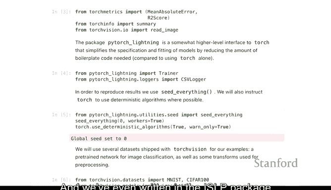

Yes， yeah。 I mean， if we， if we were to do this from scratch， right， like， for instance。

 in regression， we could have written regression from scratch。

 but if we were to do this from scratch， it would just take forever。

 But now we have these great packages that we can use to。

 We're gonna start with the really simple example。 So yes， see how things work。 Yeah， yes。

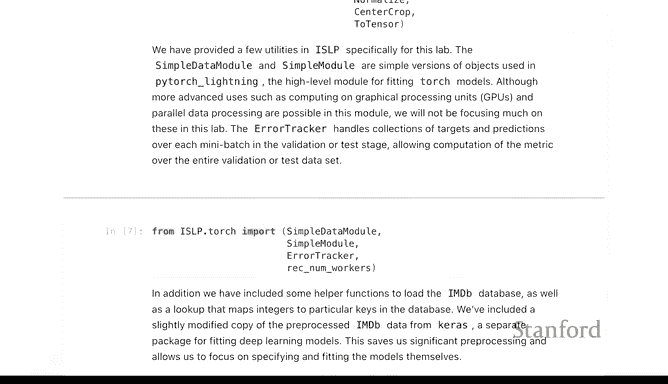

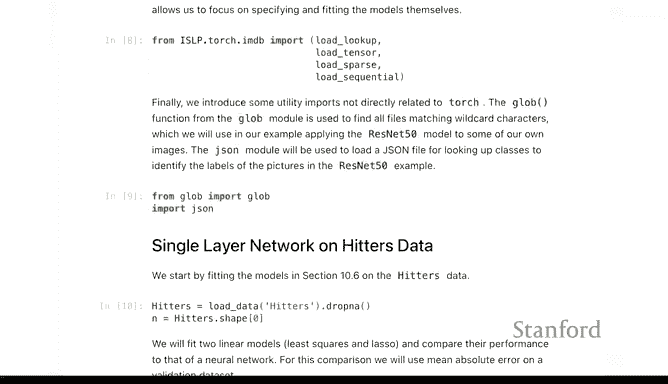

So what we're gonna start with is the hit' data that we've seen in other chapters。

 in particular in linear regression and model selection。 I think model selection。

 we talked about this one， so。One of the things that's。You know。

 that these packages have is like psychic learn， you can sort of change the metric you can use to evaluate。

 So we're gonna use mean absolute error instead of mean squared error。 But okay， so let's。

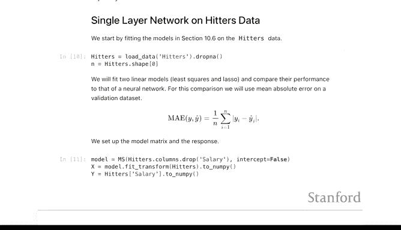

We're going to。Start off somewhere where we were before。

 That is we're going to have a design matrix and a response。 X and a Y。

 like we had in earlier chapters。 And we'll see how this gets transformed into data that torch can read in。

 So this， this X and this Y just like we saw in earlier chapters， we've。

 we've used Mo sp to create them。

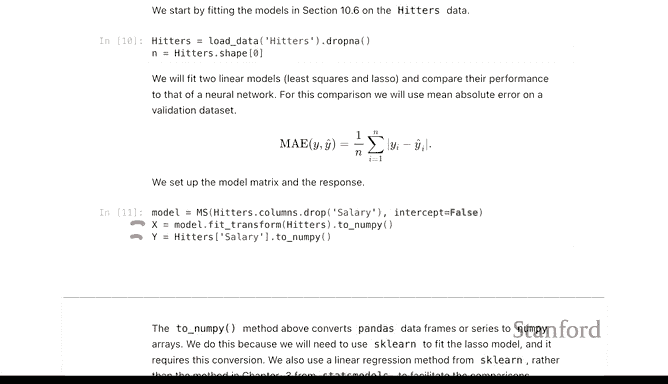

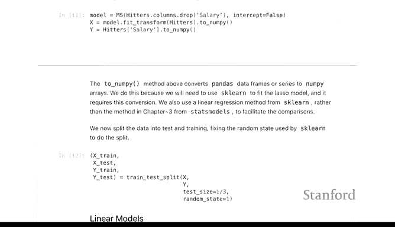

And then we'll also make our usual training and test split and we'll have Torch can take a test data set as well as a training data set。

 even a validation data set， and we'll see how to do that shortly。

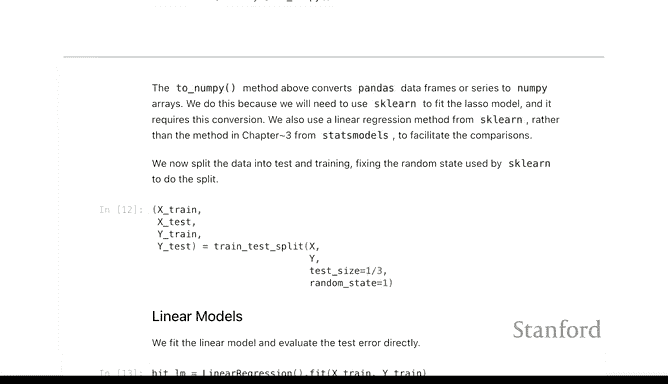

Okay， so we can， of course， fit our linear regression model。 We've already seen that。 We're gonna。

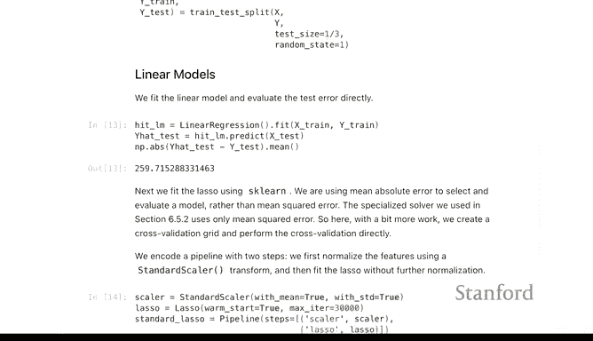

We're just going to use this as a point of comparison to see the accuracy。

 how all these things can do。 So we're going to use a standardized lasso。

 And just before you go on let's remember the the error。

 mean absolute error of 259 for the test data。 Yeah and that's for simple linear regression。

 and then we can compare that to the Laso， the lasso was 25 259 or 257。 very very close。

 and we're gonna to compare that after fitting a pretty simple neural network model。

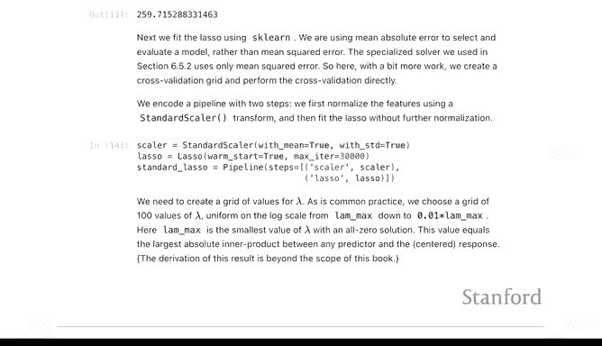

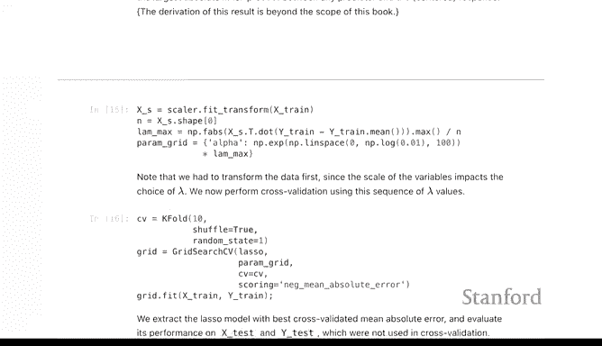

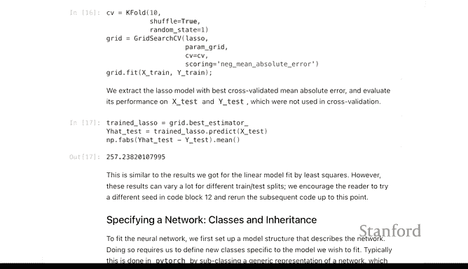

Okay， so now we're going to build our first network and this this is going to use something that we have not touched yet。

 and that's using classes in Python。 So we've written a lot of functions in Python or used a lot of functions now we have to actually write our own classes or more specifically subclasses and let's take a look at what that looks like。

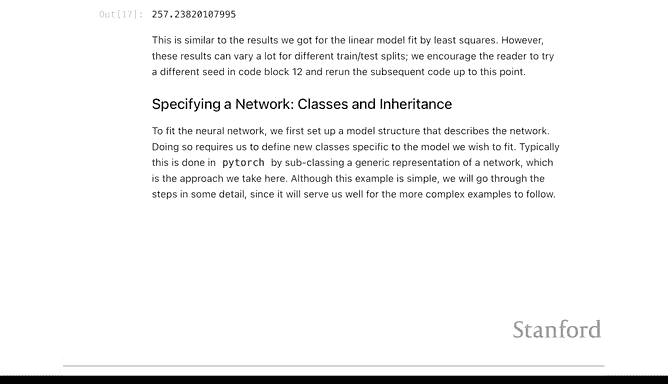

So this keyword class is this is the first time we've seen this in the lab。So what is the format。

 what are we doing here？Were。This bit of code here is actually specifying the architecture of the neural network。

 and this is the way the torch package。Allows you to specify the network architecture。Okay。

 so as I mentioned before， we're going to use this NN dot module object and so how to read this line here is we're making a new class called Hiter's model。

 and that's really going to be a representation of the neural network we're going to fit and it inherits from NN dot module。

And。What's nice about this inheritance is that theres lots of other things there's lots of things an object can do based on its methods here。

 we're going to define two methods。1， this double underscore in knit method。

 This is how the object is created and one the forward map。 And this is really。

 this is what's key for the neural network。 This is what's going to be， you know。

 when we draw a picture like this。 with these arrows。 This is evaluating this forward map。

 I'm just gonna have a very poor， poor man's neural network there。 that network worked there。 That's。

 that's what the forward map encodes。 Okay。So let's look at the key parts of this cell here because this is what we're going to have to write each time we want to fit a new network。

So it's really defining the forward map is all what we really need to do。

 this init method we is where we do some of the setup。So in this case。

 we're going to have a single hidden layer。With 50 units。So this 50 represents 50 units。

There are 19 features。 so this NN dot linear says this defines an object that maps 19 features into 50 dimensions。

 So there's 19 times 50 parameters in that linear map。Plus 50 for the intercept。

 So actually 20 times 50，1000 parameters there， we apply the value function to it。

And then this dropout， you remember this randomly in the fitting process。

 randomly set some of the weights to 0 and then outputs the 50 parameters into a scalar response。

 the one here。You're going to find that these kinds of examples are really helpful because when you want to fit a neural network。

 you'll go straight to an example like this and you'll change it So it matches your own example。 Yes。

 yes。So， okay， and so this， and the sequential here， this is meant to， you know。

 to say that this map is going to be composed of these four things in sequence。Okay。

 so when we actually， now we have enough to define the forward map。

So we actually first we flatten the X， though I'm not actually maybe not even need that in this case。

 but many for the image examples we may need that， and then we apply these fours we defined and basically return again the flattened version of the array。

Okay， so now this is this is defined the mapping from features， those 19 features to an outcome。Okay。

 so we haven't said anything about the response。 The response comes in torch when we relate this to the loss function right。

 so now we have a way， if we give 19 features， we have a way。

 if we know the weights of this network will' get an outcome and to train it。

 we're going to compare to the actual outcome。

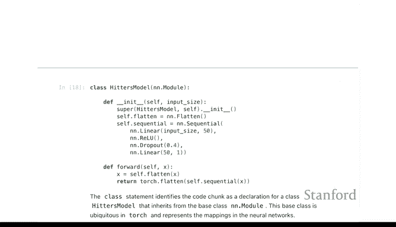

So I guess I should said we get a prediction when we can pass the features through and we'll compare to an outcome。

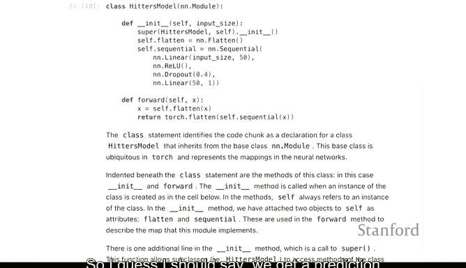

So， I'm just going to。Jump to the part。

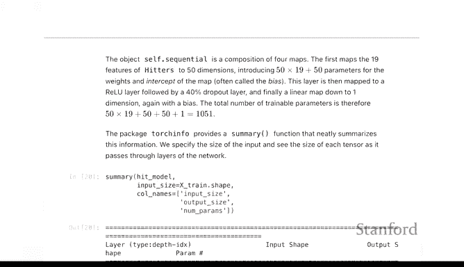

Where that's where the boss I'll just。Actually， let's look at the summary done。 Oh it's interesting。

 That shows you what's in the model。 Okay， yes。

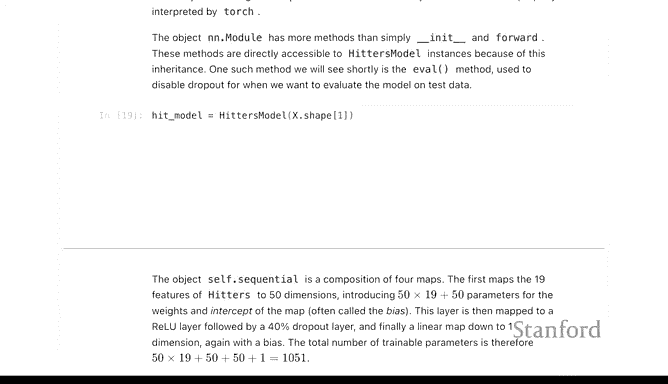

Yes， so to， to actually。In in。Sort of create this object。 We have to like for S K learn。

 you have to construct the estimator， and we've made it。

 So it takes one argument that is the number of features。 This is9， there are 19 features。

 So hit's Model 19， that will fully specify what that network looks like。

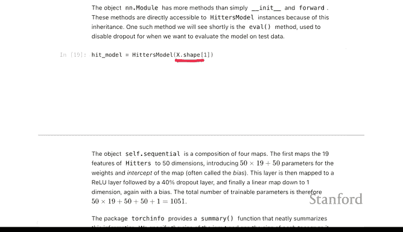

And as Ts Trevor said， theres there's often helper functions you can use to sort of get a sense of what the network is that you specify。

 This is actually very helpful when you get more complicated because， well。

 this is already a simple network。 but enough to to， so the summary function。

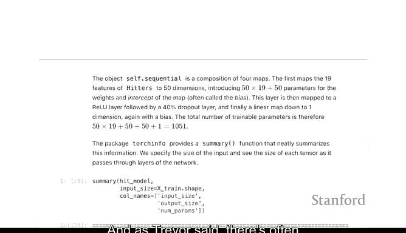

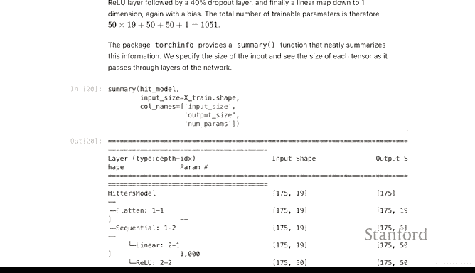

What we're going to do， you can ask for various things in the summary。

 but one of the most helpfulful things is just to get a sense of what each layer expect as input。

 what it outputs as output， and how many parameters are in that layer。

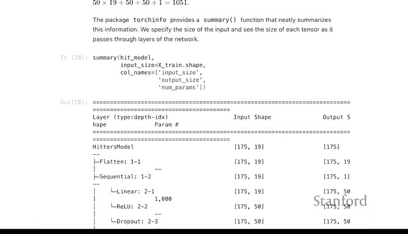

Okay， so looking at our hitters model here， so this 175。

 that's well we told it to use for the number of rows in the input， how many are in our training set。

 So it takes 175 cases with 19 features and produce a prediction of 175 outcomes and you can see sort of in a tree like fashion。

 you can see how the networks are specified。

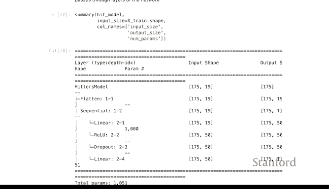

And then if you if you go through each row you'll see you'll see the numbers that you expect to see。

 So we see 19 a few times， and then we see the 5 year at that point。

 you moved up to the hidden layer with 50 units and then the dropout gets supplied there and so on and so eventually you get down to 1751。

 and that's your output。 Yes， and yeah。And if you look at this in a web browser。

 you'll see the actual number of parameters and you can see。

 for instance that this network here will have 1000 parameters that's 50 times 19 plus 50 for the intercept。

 but they've been cut off on the tablet here。

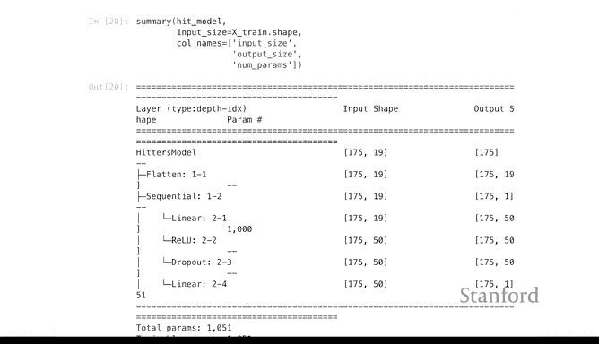

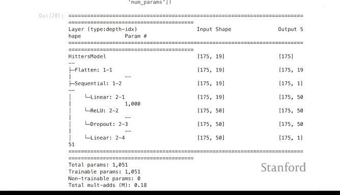

Okay， let's see how well it does， Jonathan。

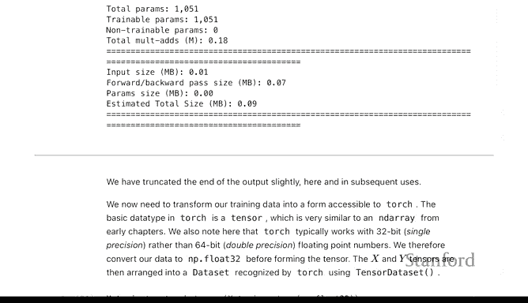

Okay。Let see how well it does。And， I guess。Okay， well， I think， I think we should。

It's important enough to just sort of to see how the data are passed into2 Okay getting excited parameters I was expectinging some good results。

 Yes， that's fair。 But but because as I said， because data is slightly different。 We have to。

 we have to package the data in a way that tort can use it。 And so these X train and X test， Ytrain。

 etc cetera。 are familiar to us， there are numbers And we form different data sets。

 training data and a test test data。 And that's ultimately what is going get fed into into into torch。

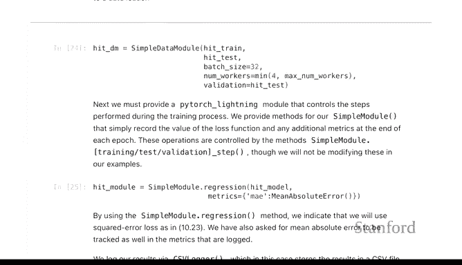

Okay。So。

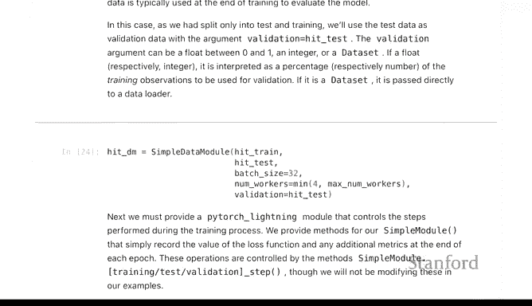

So the way this is specified is we're going to have to it's a bit cumbersome。 I'll admit。

 it's fair to say， but this pattern repeats itself。 So once you can understand the few steps。

 then you can repeat this for other problems so。This simple data module is what's gonna tell torch how to read in the data for stochastic gradienting descent。

 So here we're gonna say we want batches of size 32， and we we give a training data set or training。

 which is wed specified before the test data set。 and we also have an optional validation data set here we're just gonna use the test data validation。

 But you could put a fraction here。 if you want 20% of the training data to be used for validation。

 And Jonathan correct me if I'm wrong with simple data module is a function we provide in the this even easier。

 Yeah make it even easier。 Yes。

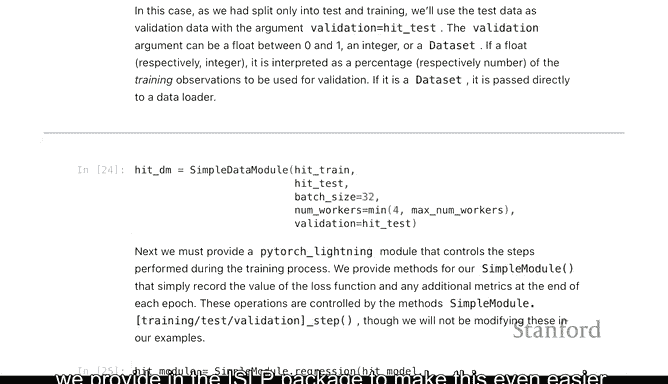

Okay， and finally， as I said， we need to specify the loss。 So we've also made a there。

 there's a few common losses we'll see in the class。 One is regression loss。

 that's squared error loss。 and one is classification。 So this， this part here， if you notice。

 it takes hit model。 And remember， this is the the network that tells us how to make predictions。

 and regression says we're going to， this is how we're gonna use that law in in a regression loss。

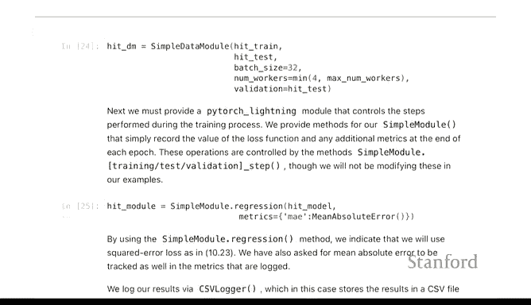

So ultimately， there'll be an argument for the y of the hit train。

 the y train will be compared to a hit model of xtrain through squared error。

 that's what that line means and we'll also track the mean absolute error。Okay。

 so now I think Treor we're just about ready to fit Yes。

 so the last step is to put this all together to run stochastic gradientosent。

 and that's what this cell is doing。Okay， so the last thing we specified was this hit module that specified it was a regression problem and this data module。

 this is what we how we told torch to run through the data with batch sizes of 32 etc now we'll tell if we want 50 epochs and a few details about logging this callbacks argument here This is actually what is going to allow us to make plots as as we go along the epoch so this error tracker is just is another little small helper thing we add in the ISLP package so that in our logs。

 we actually have the loss at every epoch so we can plot those。Okay。

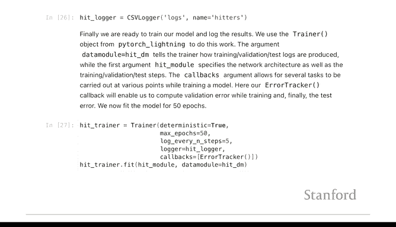

That was a mouthful or several mouthfuls。 Okay， so let's see， let's see how it does。 Are you ready。

 Marina， Okay， okay， so。😊。

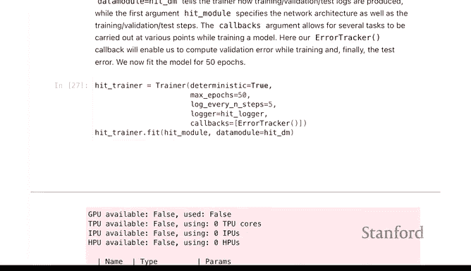

Let's fit it。 And it'll give us a bunch of messages that it's running through the 50 epochs。

 There'll be about 50 lines here like this。 By the， by the way。

 it's tedious to look at all these blue things when it's all finished and done。

 But when you sit and waited for the machine， It's kind of nice seeing these pop up sequentially showing It tells you work is being done。

 your working is been done。

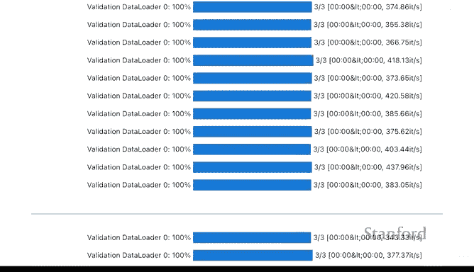

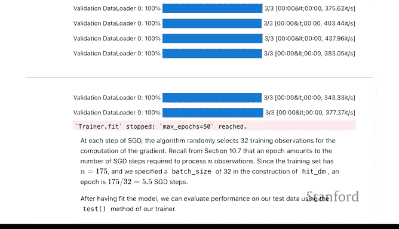

Okay， so let's finally evaluate the。performanceformance。

 I see the number test It means absolutely there are 22229。 And that's I think we had 2，57 and 2，59。

 Yeah， so that's quite a bit better。 Yes， that's quite a bit better。 Yes。

 so even though it is much more complex to specify the model it paid off in this case。 Yes。

 it it may not pay off in every case。 but it has here， we'll see， we'll see if later。

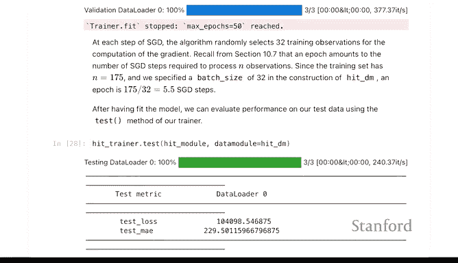

Okay， so now let's make a plot。 So the， the results， when we。

 we constructed something to log the data and it justs makes a a CSV file that we can load with Panda。

 We'll use that to make a few plots。 Let's take a look at the plot the。

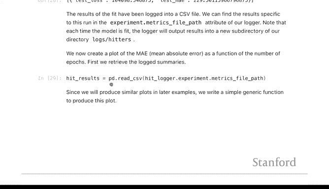

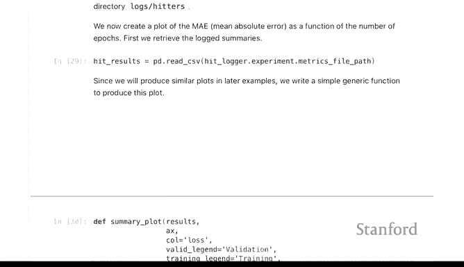

The air as a function of epoch。So here we're going to plot the mean absolute error as a function of epoch。

 and actually well， we maybe didn't need to do 50 epochs here。

 it sort of settled down pretty quickly to。A point， but in this case。

 training validation are about the same。 probably have not overfi too much。

 It wasn't that complex a model， I guess。Notice how it's dancing around there。Right。

 because after each epoch， there's been a。You knowYou've used random subsets of the batches of the data to update。

 so there's a certain element of noise in this。Yes。

 all of these network models use a stochastic gradient or some form of stochastic gradients to do to fitting。

Okay， so that's a basic example that shows you how to go from dumpy arrays to a simple single layer network model。

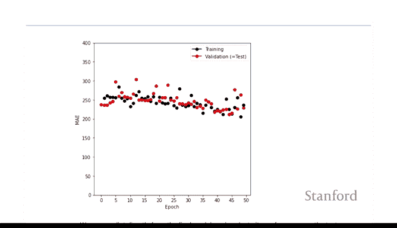

