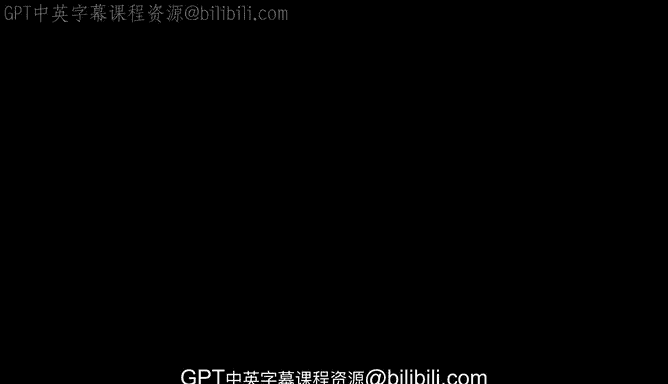
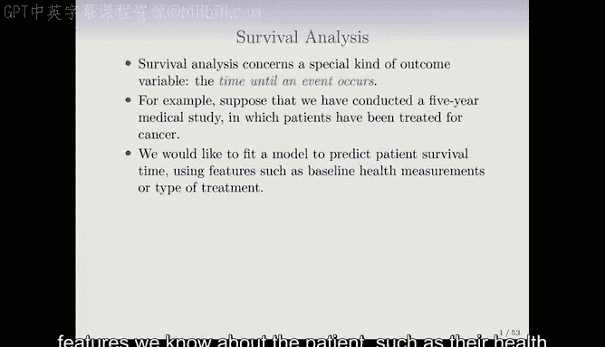
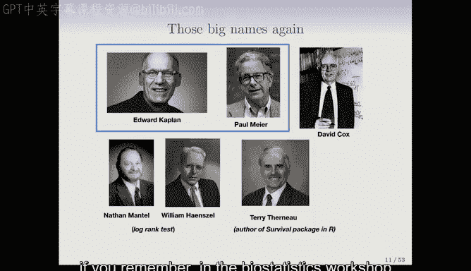
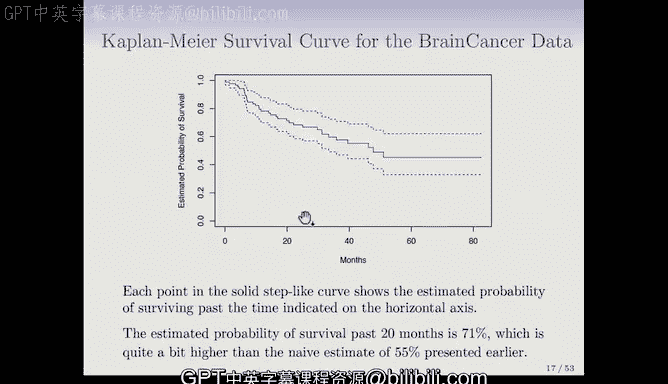

# 斯坦福大学《统计学习导论2023R语言版｜An Introduction to Statistical Learning with R》中英字幕 - P79：-079-Statistical Learning_ 11.1 Introduction to Survival Data and Censoring.zh_e - GPT中英字幕课程资源 - BV1yU421o7WA

Welcome， everyone。

This lecture is about survival analysis。 This is a chop we've added to the second edition of our book。

It's chapterpt 11 of the book。This is kind of a special topic， but a topic that's。

 more and more interest in statistical and machine learning。 So I I think you'll enjoy it。😊。

So what is survival analysis， is it concerns a special kind of outcome？In which the outcome variable。

 it's a time until an event occurs。For example， suppose we've conducted a five year medical study in which patients have been treated for cancer。

We want to fit a model to predict the patient's survival using features we know about the patients。

 such as their health measurements or the type of treatment。

Which so far sounds like a regression problem， which we've covered quite a bit in the course already。

But there's an important complication here。 some of the patients hopefully have survived until the end of the study。

 Such a patient's survival time is called is said to be censored。

And that causes problems doesn't it drop if the observations are cored。 Well。

 it causes problems because sometimes the as high， you know 70 or 80% the patients are censored。

 we don't want to throw away that data。 That's a lot of information。

Because the sort of partial information， right， the fact theyve survived at least five years。

It tells tells us something about their patient and about their features。

 so we want to make good use of that information。So we put here some big names in the field which we're going to cover some of the techniques that they've developed。

 you hear about the Kaplan Meyer curve， which was developed by the gentleman in the top left in the 1959。

The bottom left， Mantel and Hansel developed the log rank test。

 which we'll see as a way of comparing two populations in survival。

David Cox on the top right is responsible for the famous proportional hazards model and actually elsewhere in the course。

 you'll see that Trevor and I had an interview with David in which we asked him about the history of the paper and sort of analysis。

 which was a lot of fun。 So next that module will be in this chapter's videos。

Along with some of the other videos of famous people that we have throughout the course。

And the bottom right is actually looks like a little fish out of water because he's in color。

 Terry Theno was actually a classmate of。Trevor and I at Stanford in the 80s and is responsible for the survival package in our。

 Now， if you knew that we put them up here among these other giants， he'd be quite embarrassed。

But we put them there because we want to emphasize the importance of software， right。

 Soft is really has the details of how to do something。

 And Terry' has done a very careful job of implementing survival analysis of all kinds in the survival R package。

 and has's done this for what 20 or years forever。 And Rob， you said in the 80s。 That can't be。

 That's like 40 years ago。 We can't have been in a graduate school 40 years ago。

 I don't believe it either， but I think it might be true。 I we've been。

 We gonna have to check up on that。😊，Okay， so now survival analysis originated largely in medicine。

 but there's applications in other areas wherever there's a sensorored outcome， for example。

 suppose a company wants to model churnern。At the event when customers cancel a subscription to a service。

 the company might collect data on customers over some time period to try to figure out which customers have the highest chance of canceling this service。

Now， when went does a study， presumably not all customers have canceled their subscription by the end of the time period。

And for such customers， that the time to cancellation。 that's the event here is censored。

So and on that topic， if the company can predict， well， who is likely to churn。

 they can do something， right， they can call you up and maybe give you some special offers to keep you in if it's a credit card or whatever。

 to keep you in the company。Sorov El is a wealth studied topic within statistics and it's been that way for it 50。

 60 years， but it hasn't got that much attention in the machine learning community。

 but it is becoming more and more popular and important。Okay。

 so let's get started here for each individual， which could be a person or an observational unit。

 we suppose there's a true failure or event time。It's called failure if the event is something of a part failing or someone dying or maybe some other event。

 as well， there's a true censoring time for that individual。In the survival time。

 it represents the time at which the the event of interest occurs， such as death。

By contrast that the censing is the time at which the censoring occurs。For example。

 if a patient drops out of a study or the study ends before he or she has the event。

 that's the censoring time。Some notation， that the true survival time will call T。

And the true censoring time willll call C for that individual。

 And what you observe is a minimum of the two。 If the failure occurs before the censoring。

 we get to see it。Otherwise， we get to only know the censoring time。 and we'll call the minimum Y。

 That's our observed survival time。We want to know that survival time is actually a true time of whether it's censored and the indicator delta will use is one。

 if t' is less than C， so it's an actual observed failure or0 if it's censored so you need to know Delta and Y to really understand the nature of the response exactly and so our data typically for a training set consists of n pairs of y in delta one for each observation。

So here's an illustration， and you can see here， so there's four patients and the solid circles are failures or deaths。

 so patient 3 died here， patient one died here。There's actually two different sort of kinds of censoring here。

 This patient was censored because a study ended。This patient was censored because he or she dropped out of the study for some reason。

And these these are both censoring events。Okay。So a closer look at centerensing。

 we have to worry about the answerensoring， and whether that's going to bias our analysis。

Suppose that number of patients drop out of a cancer study because they're very sick。

So they drop out early。Not because they die， they just don't want to come in and be measured and so on。

 they just don't want to come in， maybe they move to a different city to get other treatments。

 maybe they're too sick to come in， lots of reasons right？

If we don't take it into consideration the reason they dropped out， then we'll have a bias。

So the survival time will actually be overestimated right because we'll assume they're censored as opposed to they died if a lot of patients were very sick and were going to die early and we treat them as this regular censored。

 then there'd be a bias。Similarly for comparing and say males to females。

And male were more likely to drop out of this study because they're sick。

We would conclude that males survive longer than females。 But in fact。

 the male advantage there would be due to the fact that a lot of the sick males dropped out of the study。

 So we have to worry about a bias to disensoring。How do we do that， Well， in general。

 when you have to assume that conditional on the features that we observe for each individual。

 the event time T is independent as censoring time。So given the features。

There's no correlation between the actual event time and the sensorensing time。

And the examples above that violate that right， because we said， for example。

 someone if someone's more sick is going to lead them to drop out。

 those two events are not independent。 The censoring and their survival time。

 And this can be a nuisance。 here， I mean， it's very convenient to assume this that make this assumption。

 but you really need to check it each time。 to make sure it's okay。

 And there's not really a way to check it statistically。

 typically you want to talk to your investigators， the people who ran the study you're working with and find out the reasons why why observations were censored。

So it's more of a detective search。 and it's not not so statistical。

 but one needs to make that assumption in order to proceed。Okay， so we have the survival data。

 What do you do with it， Well， the basic item summary one makes is called the survival curve。

Surviv a curve is the probability that the true survival time is T is greater than some fixed number T。

 it's a function of time。It decreases， of course， because as tea gets larger。

 the chance of surviving past T gets lower。So， for example。

 suppose you're interested again the churn example。

 And then if T is the time until customer cancels a subscription to the service。Then。

The survivor function is the probability that a customer cancels later than time T。

The larger the value of T， the less likely to customer more cancer before a time T。

We're going to be throwing a number of new definitions to you。

 So there's going to be few things you're going to have to remember。 So this is one of them。Okay。

 so let's consider the brain cancer dataset， which contains survival times for patients with primary brain tumors undergoing treatment。

The predictions are I've listed them there， GTV， sex， the diagnosis category。Location of the tumor。

And something called Kowsky index and the method of， of radiation used stereo。Now in this case。

 there's 88 patients。 only 53 were survived to the end of the study。Okay。

 now suppose we're want to estimate the probability of surviving past 20 months。Right。Well。

 the most obvious thing to do is say， well， let's look at the proportion of patients who survived past 20 months。

Right。Okay， this turns out to be 48 of the patients survive past 20 months of the 88。

 which thats 55%。So we might think the survival function at 20 is 55%。

 The probability of surviving past 20 months。But that doesn't seem quite right because 17 of the 40 patients didn't survive who didn't survive were actually censored before that time。

So we're calling anyone whos censored a death， and that is very pessimistic， right。

 so that this probability of 55% is probably too low。 It's probably an underestimate。

RightBecause we're treating censored observations like， like they wereess。Conversely。

 if we ignore the sense of observations and if we treat them as survival till the end of the study。

 we would overestimate the probability。 So weve got to find some way to deal with the censoring in sort of unbiased way。

so this is where Ka and I come in。We're now going to present the Kaa myer curve。

 an interesting Trevor and I actually met Paul May know if you remember in the biostatistics workshop in the 80s at Stanford。

 and this paper was interesting。 first of all， this paper is probably the most cited paper in all statistics in history。

But it was kind of a forced marriage， like Kaplan and Meyer independently not working together。

 submitted papers on on what's now the Ka Mere method to jazz at。

 the Journal of the Cis American Cisco Association。 John Tki， the editor。

 famous statistician himself。 Go these two papers and said， these guys doing the same thing。

 They have to write a paper together。 So its kind of a forced marriage。

 They had not even worked together， but。It turned out to be happy ending because now this paper is like a fundamental paper in statistics and survival analysis。

 Juki was quite an authority。 And he say things like that。 Yes， and actually。

 Paul Meyer told us he wasn't very happy about it at the time。 But I think， you know， both。

 both authors contributed and the result was a blockbuster paper。

So I'm just going to show the cap of myer estimate in pictures that the details are in the textbook。

 But here， here's an example。 So I've got five patients here。Okay。

 and so the patient number one died at time Y1。 So how the kamere estimate proceeds。

 it kind of unfolds in time。 One goes to the first failure time， the first death。

And four of the five patients survive past Y1。 So the probability of surviving past Y1 is estimated to be4/ fifths。

Then we move on to the next failure time。 Not we skip this censoring time because it it's not important for this calculation。

 although it's going to come in here。While theres there's three patients remaining 1，2，3。

2 of the three survived past why3。 So the probability of surviving past y 3 is two third。So overall。

 the probability of surviving past y3 is4 fifths from the first times two third from the second event。

 So what this method does is it computes that the conditional probability of surviving past each failure time。

 given you have survived up to that time。So it's a series of conditional probabilities。

 and we just multiply them together， records to survive past。Here， you have to survive past here。

 That's the first hurdle。 And then you have to。Survive the next turtle at Y3。And finally。

 Y5 is the last failure。No one of the one person， the only one person made it is is at risk here and 0 made it pass。

 So the probability of。Of sur pass y 5 is zero。So， the overall probability。Ends up down0。

 So's a very clever way of taking into account the sensoring and using as much of the sensoring information as you can。

 because they go into the denominators of these probabilities。 Right， So this guy。

 he didn't get his own estimate。 But he participated in the risk in in the calculation here。

 He dropped out here。 So he didn't participate here。

 So the censored observations participate as long as they're in the study， basically。

 which seems perfectly reasonable。 So very simple idea， but in retrospect， you know。

 fantastic and often the best ideas are simple。 And here's here's result the result in Kameer curve。

Of course， here we only have five observations， three events， generally you'll have much more。

 and it'll be a smoother looking curve。 And there we go。

 There is such an example for the brain cancer data， here's the copper and myer curve。

Along with standard errors which are gotten from something called Greenwood's formula。

 And you can see it's a sort of stepwise function， which。

 and there's a little step down in each of the failures that occurred in this study。

So the estimated probability at 20 months from the capa Meer is 71%。

 which is quite a bit higher than the 55%， which we concluded before if we assume that censored observations were deaths。

 right？But 71% are a much better estimate， so there's a big difference。

So the Kamere curve is a very important。Summary of the data and any study and survival analysis we'll start with the Kaplanme curve。

