# 斯坦福大学《统计学习导论2023Python版｜An Introduction to Statistical Learning with Python》中英字幕 - P80：-080-Statistical Learning_ 10.Py Multilayer Model_ MNIST Digit Data I 2023.zh_en - GPT中英字幕课程资源 - BV1u4421A7ZU

Let's look at。Another example， and。We're gonna， since we've seen these steps before， they're。

 they're gonna be。A little easier this time so we're going to look at the M is data digit data set so these are the1written digits on postal codes。

 I think they're derived from right that we're trying to classify into the 10 digits class。Okay。

 so as in the Hiers data set， we need to， we need to give the data to torch。 So actually。

 the amnes data is already sort of prepackd for， for torch or almost prepackaged so we can find it with one of the the。

Those libraries， this torch vision data sets has the am data already for us。

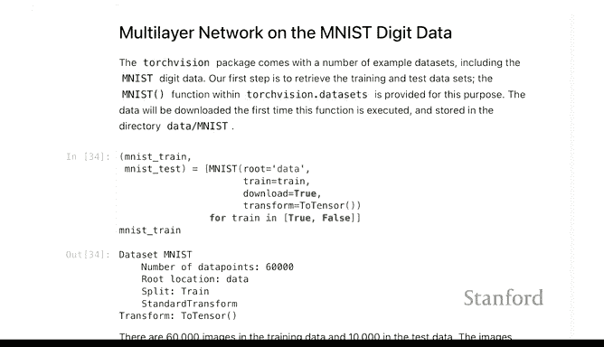

We're going to do a slight bit of preprocessing。Actually， no， oh， I'm sorry。

 That's preproing for the Cf。 So we again， make a data module that tells torch how to load in the data。

 So what this is what will happen in this sort of specifyifies what an epoch looks like。

 There are 256 per batch。 So an epoch goes through， you know。

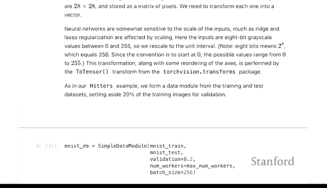

Each of the data points。With a chunk of 256 until every data point has been visited once。

 and then the epoch is finished。

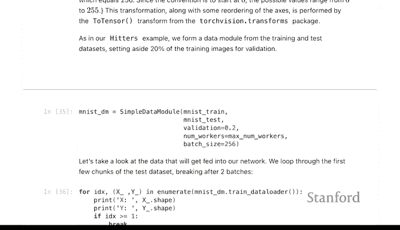

Okay。

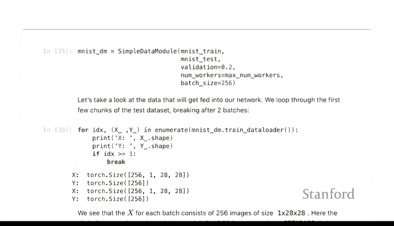

嗯。Let's specify our model now。 So we're going to do now just a slightly more complicated model， but。

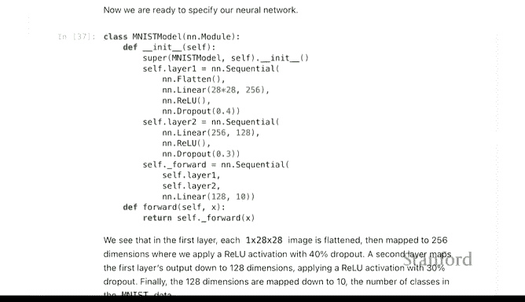

It'll be a two layer model。And oh， I think I missed one important line in the hitterss example that I'm going to emphasize now。

All of these。 So again， we're going to make a subclass of the NN dot module。 here。

 we're going to make it for the MIS data。 You can name this whatever you like。

Probably useful to name it something related to what you're doing。And there's this line here。

 this super line that we also had for the hit's data。What this does is， well。

We inherit from the module class， and we only define here two methods， right。

 the this init method and the forward method。 But this N and up module has many other methods。

 And that's， of course， because this， you know， torch has to use this to fit the model。

 So it has to know how to do many other things and。So this this。

 what we're doing here is actually calling the init method of module on this newly created mist example。

 So this is actually necessary for every time time you make a subclass of NN dot module。

 So the syntax is the same throughout all our examples。 We give the super function。

 which is a built in function， the class name， self。 and self is a keyword here。

 It's the the first argument to every method。 And we call the init method of， well。

 actually N dot module on self。So I just mean you'll have to do that for all your examples。

 Otherwise， you'll have a problem。 Okay， so let's get to the heart of specifying our， our layers。

 We're gonna do two layers。So。The layers are going to be specified much like our single layer。

 So this chunk here is very similar to what we saw for the hitterss data sets。

 We're just going now compose two layers。 So we'll store this as layer 1。

 a similar output is layer 2， and then we'll compose them with the sequential call again。

 So features first go into layer 1， come out from layer 2。And then they get mapped to 10。

 and that's because we have 10 digits here。So just to get the idea。

 the images are 28 by 28 grayscale images。 So in the layer 1， we see the 28 by 28。

 That's the dimension of the input。And， and the hidden layers got 2，56 units。 right。

 we're using a drop pad of 。4。 Then the second layer， of course， must take 256 as the input。

 that dimension of the input layer because that's。The previous hidden there。

 and then it's got 128 hidden units。And then， and specify the dropout。 And then the final layer。

 the output layer goes from the 128。Hidden units。To the 10 dimensional。

Output layer because they 10 digits。 and we use a softm。 Yeah。

 they'll be we don't have the softm here。 The loss function is actually gonna have the softm applied to it。

 But that's similar to the regression example where this just describes know how features get transformed into output and then the loss relates that to the outcome。

 So Jonathan， we can see how easy it would be if you wanted to just add a few more hidden layers you just basically replicate this kind of code and put in the numbers we want。

 Yes， it's really straightforward。 You could if you wanted to have  if you want a 10 layers。

 you could even run a four loop， you don't even have to repeat the same code and we'll do something like that for the CNN we'll have。

 I think five layers or so。 And rather than writing five chunks like this well use Python to make it。

 So it takes a little bit of getting used to the this。 But once you've got it。

 you can basically set up any neural network。 and again， this forward map， that's the key。

 tells how features get translated into in this case，10。The1 scores。

 and that'll get tied to some things。

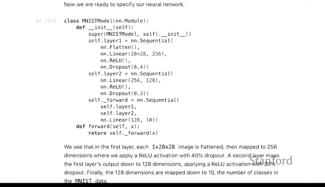

Okay， so then a lot of the rest is going to be almost identical to before。

 that part about setting up the trainer， running the and training it and， etc cea。 But let's let's。

 let's。

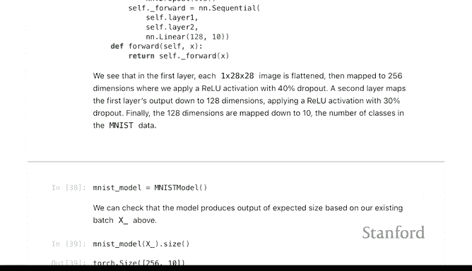

Go quickly rather a little quickly to that。 So we'll again。

 we'll specify the this instantiates the N model。

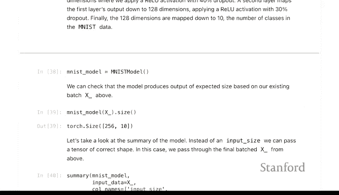

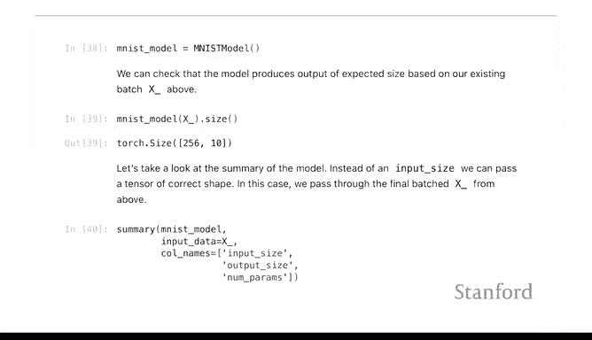

We can look at the summary again。Sum' is a bit longer now because we have two layers。

 but it can be very pretty similar to the header data and we're not going to spend too much time on that。

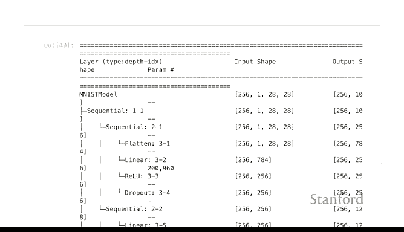

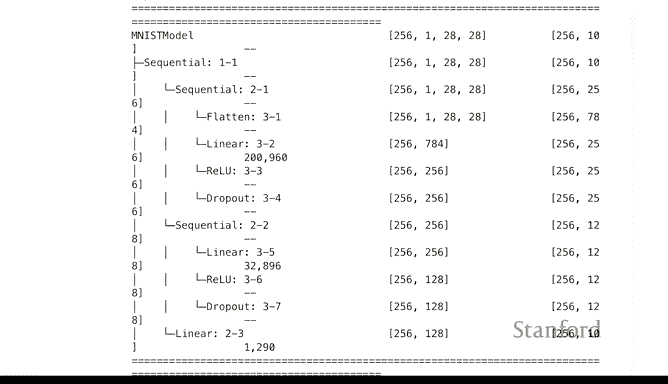

Okay， so here again， we make this module that this argument here。

 classification says take those 10 outputs and throw them into a soft Mac to compare it to the response in whatever data this thing gets fit。

And again， this argument here tells tortch what data will be fit into the classification problem。

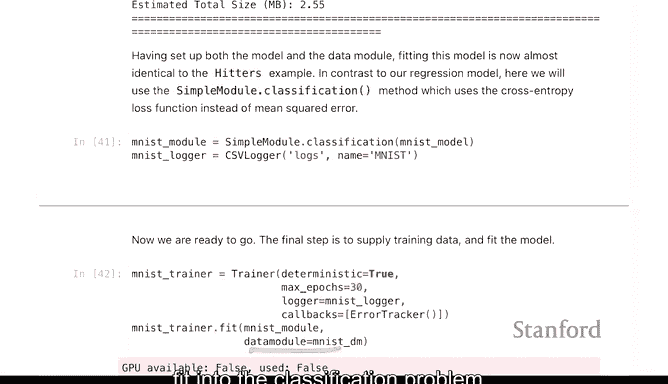

After that， well， this is going to look similar。 There'll be a lot of blue things。

And we could watch them if we were running this live。

Let's make a similar plot to what we had done before for squared mean absolute error and hitters's data。

 let's plot this metric for accuracy for the MIS data。And again， we can see how。

How things progress for。The training and。 and interestingly。

 the validation starts off a little higher than the training data。

 but in the end they're relatively comparable， but that's just luck for the draw。

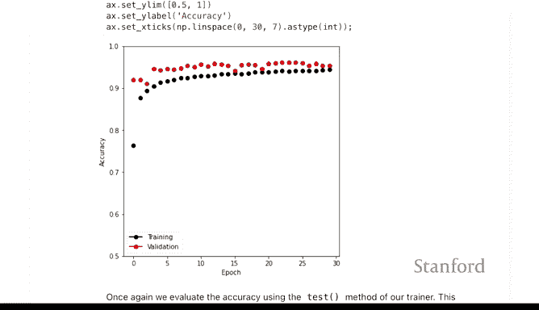

It's about 95% accuracy。 Yes， yeah， here's a， we can evaluate the test accuracy about just over 95%。

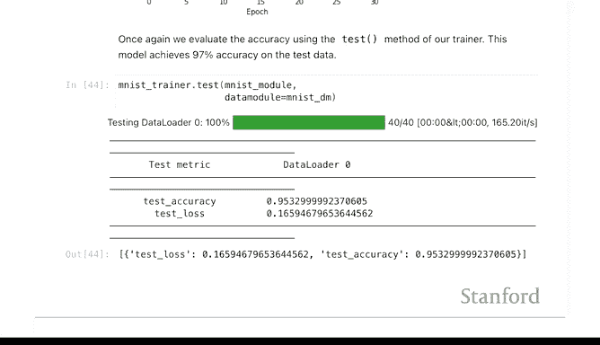

Okay， so the last thing that we will not go over for the M data is how to fit just a very simple。

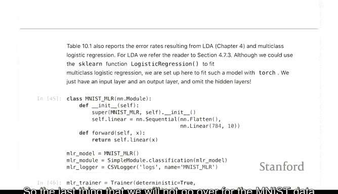

Likeg just multinoial regression model rather than a hidden a neural network model。

 Oh using basically the same code Yes， yeah， so there's just no value。

 no dropout just just no hidden。 Yeah， that's right。

 And that's just the only thing that is different between this one。

 And the previous one is that there was a nonlinear function to get the 10 scores。 Yeah。

 it's just a linear function。

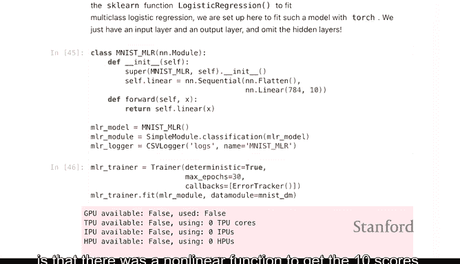

And let's wrap up with just looking at its accuracy。

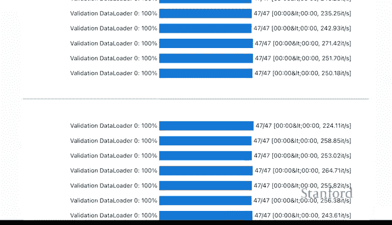

It gets about 90% on accuracy in the test data， that's still pretty good actually。

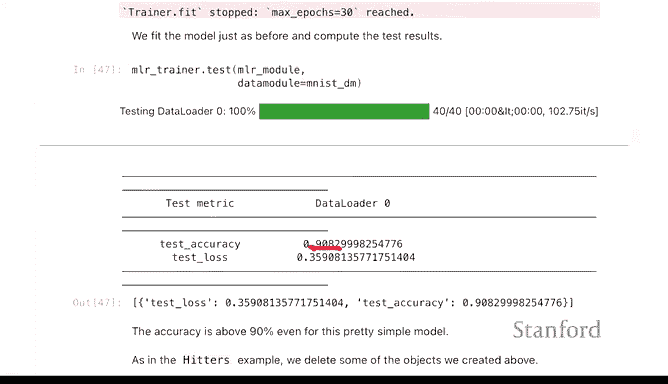

Okay。

