# 斯坦福大学《统计学习导论2023Python版｜An Introduction to Statistical Learning with Python》中英字幕 - P81：-081-Statistical Learning_ 10.Py Convolutional Neural Network_ CIFAR Image Data - GPT中英字幕课程资源 - BV1u4421A7ZU

Our next topic are convolutional neural networks。 These are very popular models for image processing because they they capture local features quite well。

 and we're going to use some data from the C4R 100 data set。

 This is one of these big data sets that are curated by the the deep learning community to sort of compare different models。

 and the 100 cents for 100 data classes。 it's 100 class classification problem。 Yes。

 so for reference， a random guessing here to be about 1% accurate。 Yeah， so okay， so。

So the pattern is going to be similar to the hitters in Ms data。

 we will sort of specify the data sets and then we'll specify the network that is how features are transformed to scores to find the loss。

To find the fitter， and then look at the results。Okay。

 the CFFR data comes packaged in the Torch vision package， which is convenient。

In order for us to fit it if we're going to actually do a little bit of preprocessing。

 this is done here。 all that's going on here is this rescaled to be floating point from 0 to 1 instead of integer 0 to255 and just reorders the arrays so it does a little transpose。

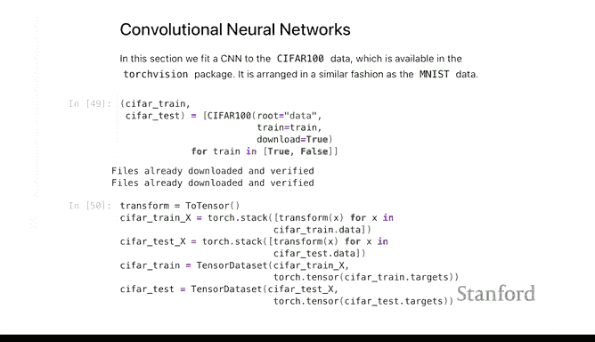

Okay， so then we have our data module， like we did for the other examples。

 we have training data test data and we'll use 20% of training data as validation and each batch will be of size 128。

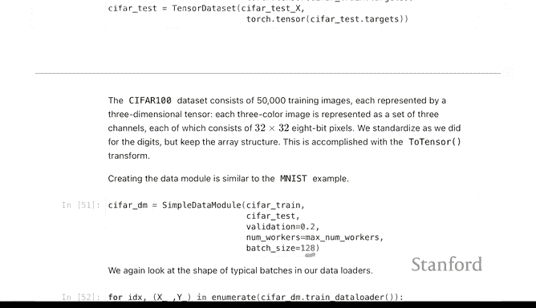

So these， these input images。 it's three dimensional tensor， right， That's right，3 color。

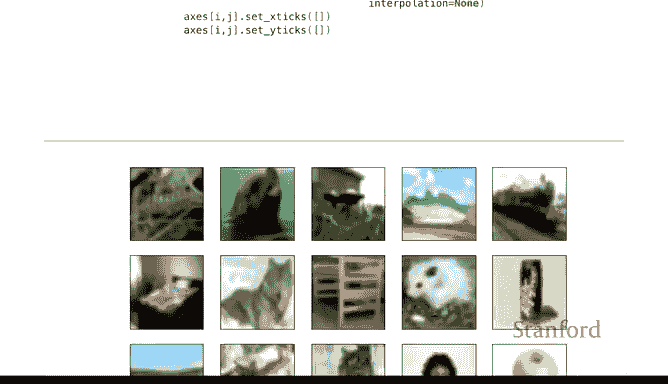

That's yes， yeah， so images， color images are represented as RGB。 So there it's I think。

Trevor is talking about this three here and looking when we look at the different data set。

 So the images are。Have three channels and are 32 by 32。 These are RGB channels。

 There's also RGB alpha， perhaps。 And the Mnes data， actually， this was a one here， but。

So we're showing you what a typical batch looks like yes， we've got batch size of 128 Yeah。

 That's right。 So there's 128 images randomly selected for a batch and then those are the dimensions 332。

32。 Yes， this is just a sort of sanity check to see that we've made the data loader that we understand what the data is looking like before it goes in。

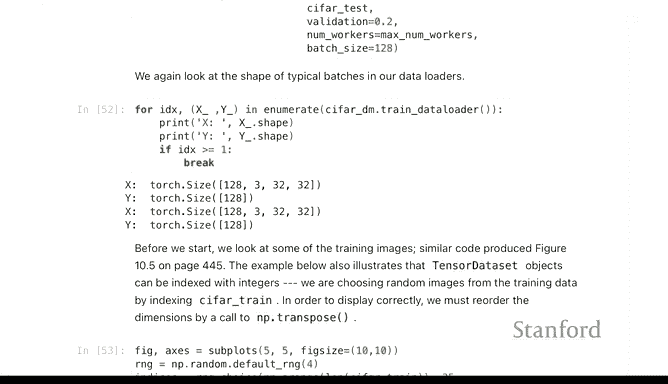

Let's just take a look at， you know， these images to see the resolution is not it's not great。

 It's 32 by 32， but they're still recognizable objects， right， This one is a wolf。

 This one might be bigfoot， I don't know， but。

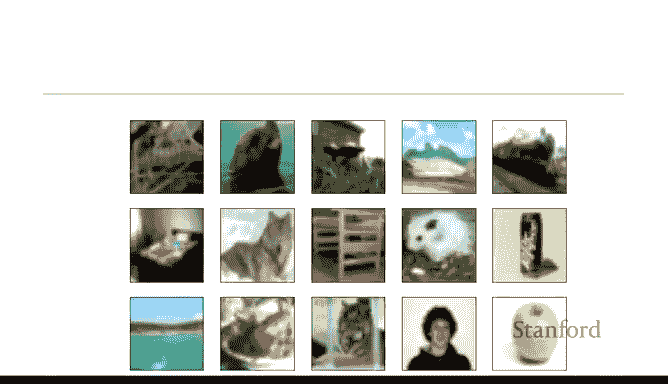

This is an apple。 It's a nice thing about having images as data observations because you can look at them。

Usually， you can't look at the high dimensional data so nicely， but images you can， yes。Okay。

So now we're going to define our neural network。 and what we're going to do is。

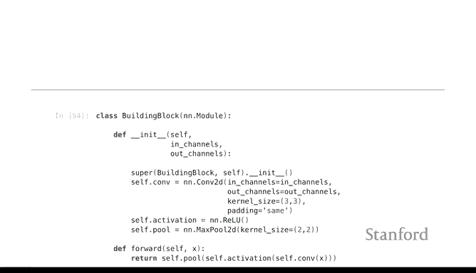

As is common in in these tasks， we'll sort of make a sort of multiscale kind of version of the analysis。

 That is we're going to do a convolutional filter。 That's this con2D from the the NN module and apply the value and then max do what's called a max pool over the output。

 And we're going to do this at several different scale。

 So the way we're going to do this is to define a basic layer that we'll call building block and we'll use building blocks of different sizes in this multiscale kind of represent。

Network by the way， you should have read the chapter on convolutional neural networks before doing this lab because it'll be much more understandable。

 and then you'll understand the idea of doing convolution and pool in that order sequence of those operations。

 Yes， yes， This is， of course， just the lab and。So what we're doing here is effectively making a new type of layer。

 So we've already seen some of the， some of the layers that are in this N N package。

 We've seen like N， N dot sequential N， N dot linear N N dot value。

 These are all the kind of operations that can be done by one of the nodes。And here。

 N N do co of2 D is one of those。 So what we're doing here is essentially making our own layer that we're going to later use to build in our in our Cf 100 network。

Each layer， each of these convolution and max pool layers。

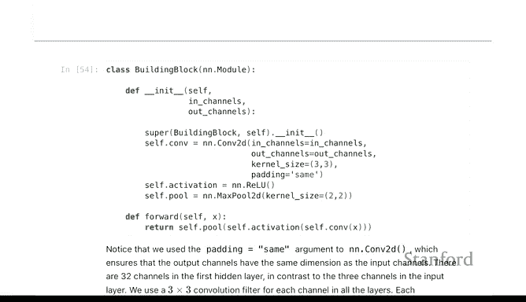

Okay。So what we're going to do is we're going to make a sequence。 as I said。

 we're going to use our building block and apply this。Convolution and max pool on different scales。

 and the scales are going to go as follows。 These numbers here are the channels that are going to be applied for。

For the output of each of each of the building block layer。So input and output。

 I should say the first one is has three channels and we're going to output。32 channels。

And if you one of the things about the max pooling， since we did it a kernel size of 2 by2。

 it will half the size of the image each time。 So we start off with。3 by 32 by 32。

 and then we'll finish with 32 by 16 by 16。And then we'll have 32 by 16 by 16 and 64 by 8 by 8。

 etcter。So once we have this object that can do this convolution and max pool。

 That's what we call building block before， we're just going to apply these in sequence。

 So we have these different sizes。 This defines the sort of scales that we' look at， and we'll just。

Make a layer sequential layer that uses these in in a sequence。

 And here we're using the list comprehension of Python。 We've seen that in the labs before。

 If not on video than in the text of the labs。 And this argument here。

 star that just takes a sequence and gives all of those as arguments to sequential。

 So this is really nice。 Jonathan in in the previous one with an endless。 we did layer 1 layer2。

 But yeah， you can just programmatically specify the thing and just go in a loop and set up all these layers。

 Yes， it's much more compact。 We would have had to have each one might take four or five lines。

 So it would have been 20 lines instead of， well6 or 7。And then at the end， we'll have 256 channels。

 and we're going to have to ultimately output that to 100。256 channels。

 And it's going to be a two by two image。 So at the the final。

The final output after the max pool will be 2，56 by 2 by 2。 We'll output that to 5，12， and then。

Do a value for good measure and output to 100。 that's the number of classes。And okay。

 once we specified our network in that fashion， the training， et cetera will be similar。In this case。

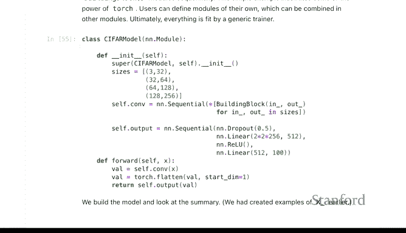

the summary is a little long， but it should be predictable in how to read it now。

 are quite a few parameters now， almost almost million parameters。

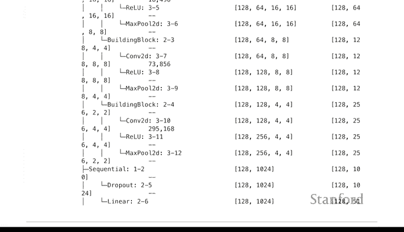

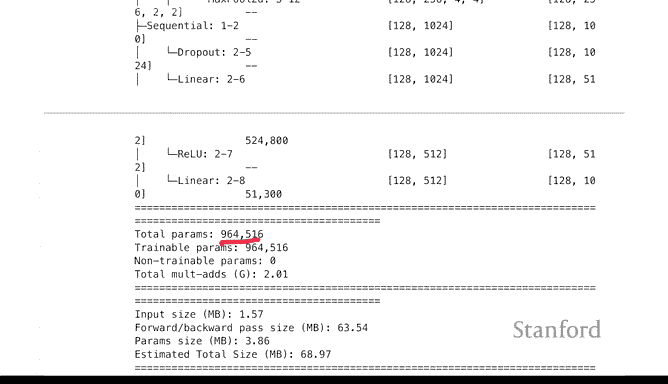

So。We won't dwell on it， but we've used a sort of default training method for all of the up all of the srcchastic gradients operations。

 so far。 torch has several other variants of stochastic gradients。

 So we're gonna use one of those here， but。It doesn't W Well， that just that， that where is the。

 where is the optisr that comes into this。When we tell it's a classification problem。

 we give extra this special optimizer。

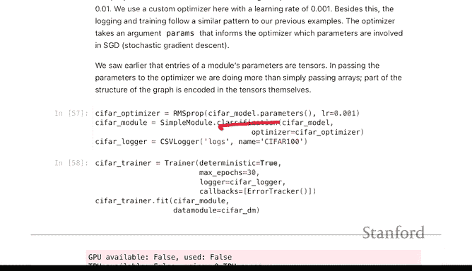

Let's not dwell on that。 Okay， so we'll fit it as we have done all the other ones。

 And let's take a look at how it's done。 Well， this one takes a little bit longer。

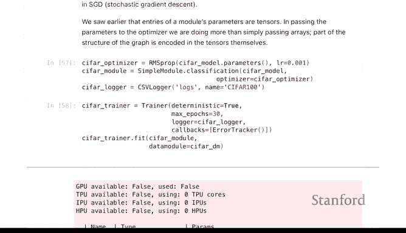

Depending on your hardware， it can be this year。 says it took 10 minutes or so on a pretty modern Mac laptop with an M1 chip。

 but that's not too bad。 We only gave it 30 epochs， and you'd probably give it more， yeah。

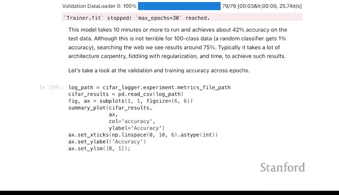

Especially if the accuracy is still improving， let's take a look。

Well looks like the validation Act is a bit leveling out。

 so maybe 30 epochs won't be won't help much。 I mean， anything more probably won't help much。 Yeah。

 training， of course， will get better and better。Okay。

 so store 40% accuracy on 100 class classification problem pretty good Yes。

 compared to the baseline of 1% yes。And I， I think we， I think that the。

 what's the current state of the art in the 70s for this data set， Perhaps I think so。 yeah。

 people tweak and and tune these models forever and increase their accuracy， yes。

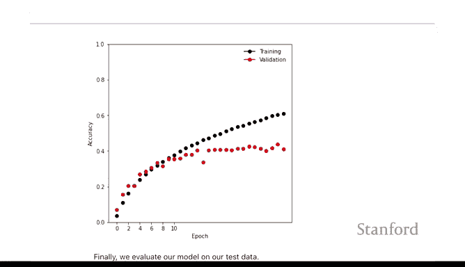

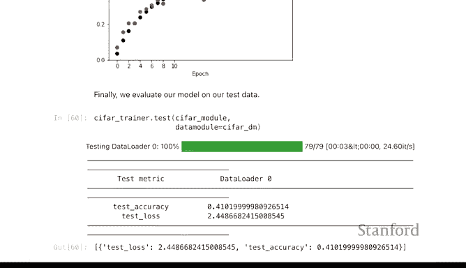

Eventually， they'll be the field will overfit the data， even if no any different method won't。 Okay。

 so the accuracy on test data is about 41%。

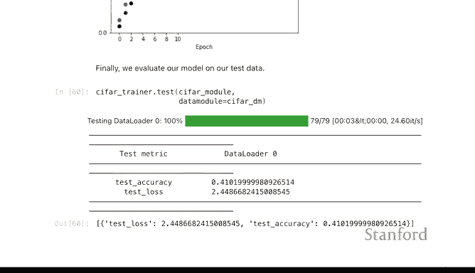

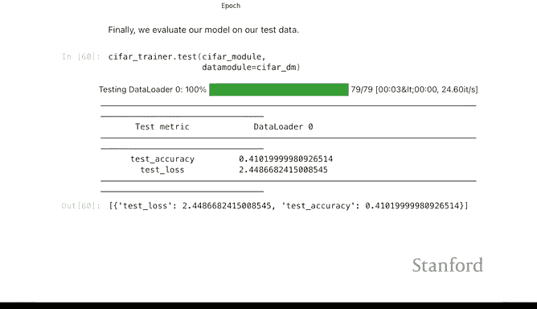

O看。There are a few other topics on convolution networks。 if you have certain hardware。

 there are accelerations you can try。 And finally， one nice thing about these models is that。

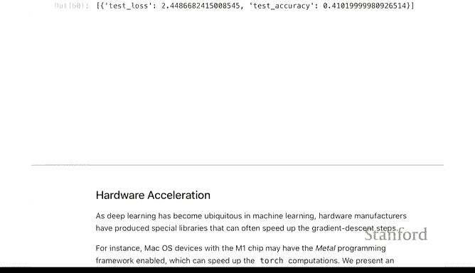

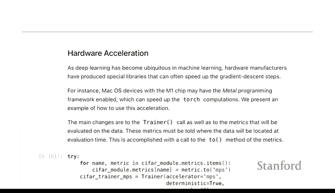

You don't have to just use your own computer sometimes to use them。

 You can sometimes use the work that someone else has done。

 so you can use pretrain models and therch torch data sets include these models called Resnet of various sizes。

 Resnet 50， I think corresponds to 50 sort of max pool。

 I think the 50 is how many how many layers many， convolution max pooling layers。

 And this was trained on 1000。

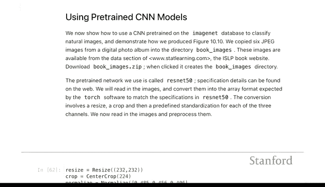

Class image classification problem。So you can now pass in your own images and and look at the the different classes。

 So we have an example here about how to do that that we encourage you to do offline。

 And these are these are shown in the book。 we show some photographs from photograph and actually classified them。

 Yeah I reckon and we we show the code for doing that Yeah。 Yes。

