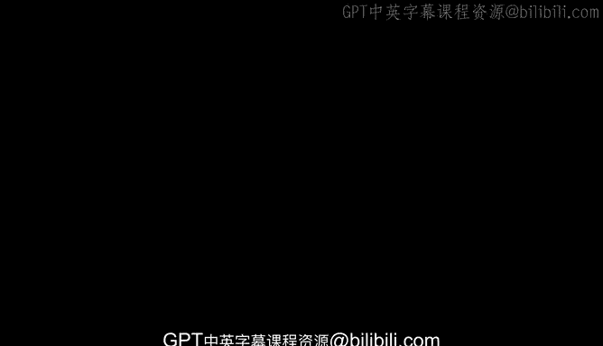
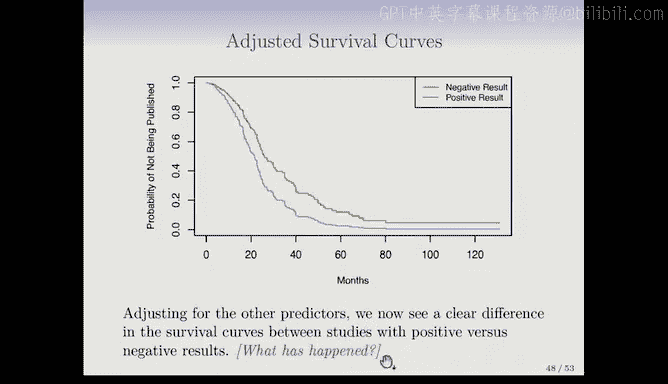

# 斯坦福大学《统计学习导论2023R语言版｜An Introduction to Statistical Learning with R》中英字幕 - P81：-081-Statistical Learning_ 11.3 Estimation of Cox Model with Examples.zh_en - GPT中英字幕课程资源 - BV1yU421o7WA

Okay， so suppose we have the model， how do we estimate the weight， the coefficient beta。

 that's the question。

Well， this was Cox's， I think， really ingenious idea， this idea of partial likelihood。

And the magic of it is you don't have to specify that baseline hazard。

 which we've been saying so nicely as unspecified without one does not have to specify it and can still go a good estimate of the coefficients beta。

And we're going to use what is done is the same kind of sequential in time logic that was used to divide the capmeer curve and the log rank test。

So。If're at a given time Y I， then the total hazard for all the people at risk at that time is just the sum of their hazards。

 right， Here it is。So this is some of all people that were still at risk at a given。

 they hadn't died or been censored by Time Yi。Okay。

And suppose we look at the relatives risk of the person who died at that time versus all the people who are at risk。

 right， So kind of imagine that at a given time， we have a bag of colored balls。

 And with a certain probability， we grabbed one of them。 That's the ball that had the event。

 But we could have grabbed one of the other ones。 So that's what's happening here that the people that are at risk that could have died。

Here's their total risk。 And here's the person that actually we observed to die that time。

 Here's his risk， his or her risk。 I he So you're saying。

What's a chance that the person who actually died was， what's a probability that they died？

the amount of risk， and in the denoinate， you got all the risks that were sort of adding up to the pool。

 exactlyly。 What's the chance ats the actual death。 And the very nice thing is that being a re risk。

 these age0， the base on hazards cancel， and we get a function that's free of H0。

So whatever age 0 is， we don't care。 We get this relative risk。

 So this is the probability of under the model of seeing。

The person die who die of observing the person who died。To actually die。

 among all those that could have died。ok。And notice the cancellation。 So now we simply。

Just like we multiplied the capa member， the capitala Meer。

 we took products of conditional probabilities。 Now we take the products of these probabilities。

 right， which we just derived one for one wrist set。 Now it's for all of them。Remember， any。

 any likelihood is the， the， the product， if you have the sample of independent samples。

 the the product， the probabilities of each of the observed samples。 So， yeah， it's the same thing。

 except the， these。This is the partial likelihood， Exly。 So this is， in a sense。

 the probability of seeing of observing what we observed under the model， which is what likely it is。

And then we're going we're going to find the values of the parameters， the betas that make。

Make this the highest。 So make the observed data the most likely under the model。

 And that's what maximum likely is all about。So here's an example， again， the same example before。

 we have three failures， the gold circles and these censored observations。

And these are the relative risk functions for each of the three failures， just like we saw before。

 only computed at the death times， exactly， just like in Kaa Mari。

 we only compute the conditional probabilities at the death times， but the cored observations。

 they appear in the denominators as well as future death time and you can see them here， right right？

So for the first failure， we compute that relative risk function for a beta。 Second。

 we compute the relative risk function there。 Third， and we take their product。

 And this is the pressure likelihood。 It's just a function of beta。

Which is a P vector of our weights for our features。 and now we maximize this function over beta。

As in the case of a lot of the modelss we've seen like logisticistic regression。

 there's no closed form solution。 So we have to apply an iterative algorithm。

 but have to's no problem。 It's done very。You're easy now on software。

And not only did we get what's called the maximumlyco estimate， the partiallyco estimate。

 we could the other goodies that we've seen in least squares logistic regression。For example。

 we get Pvi as a corresponding diplicoid hypothesispo like beta j equals0。

That's often what we want to know is a feature important。

 iss it contributing to the risk of a patient？As well as standard errors and confidence intervals。

 So all the goodies we seen from an allseverance and regression。

We get them here in partial like we as well。 and P like we。Okay。

 while we've seen the regression method， we have a regression method in hand。

 We've seen the log rank test。Remember in regression， we test for。Qu being 0。

In the case where the regressor is just a single 01。

 what we get is something equivalent to the T test。

We remember this've a linear model and you've only got a single predictor and let's say it's a male。

 female predictor，01， and you test it's coefficient。And what Rob's saying is that's。

 that's equivalent to just doing a two sample T test。 If it wasn't equivalent。

 we'd be pretty upset with because we'd have two，2 very sensible ways of。Of testing the same thing。

 if they didn't agree， we'd be， I think wouldn't be happy。 But in regression， they do agree。

 And it turns out the same thing happens here。Where now we have the log rank test and cox of proportional hazards model。

 And the case when there is a single predictor taking on two values。Well。

 we could either get Fiticcox proportional hazard model or perform a log grain test。Well。

 it turns out there's a bit of detail in the book。To extract a test from the cox proportional houses model。

 there's actually two or three different ways to do it。

 But one popular waste in known was a score test。And happily。

 it turns out that in case of a single binary covariate。

The score test for testing bit equals 0 in Cax' proportional hazard this model is exactly equal to the log rank test。

So just like the T test and regression agree in linear models。And Gasian their models。

The score test for coxs proportionional has this model。Is exactly the same as the log rank test。

 So it's a nice， tidy connection。Okay， some things we haven't discussed the proportional has this model。

 you might have noticed that there's no intercept in the model。 And why is that， Well。

 if you look back at the model， if we put an intercept here， or beta 0 here。

 we'd get an E to the beta 0。Which we could just absorb into H 0 of T， right。

 because that was unspecified anyway。 so I can put whatever。

Whatever I want into here that's from here， I can transfer it into here if it's not a function of x。

And I wouldn't change the model and it would cancel out as well when you do those ratios， exactly。

 so there's no information about it。Right， so。There's no point in putting an intercept because it doesn't contribute。

We've talked about a bit about in the log rank test the possibility of tide failure times。

 right if time is measured discretely like in months。

You might often get more than one failure or death at a given failure time。

 And those are called tide failure times。As I mentioned。

 the log rank test can handle those seamlessly， while the Cox model can handle them as well。

 but it' a little more complicated。 But if you look in the software that which we mentioned the end of the course。

It's all been figured out by。Smart people over the years。But。

 and you might be wondering why they name partial likelihood。

ItTurns out it's not a full likelihood in a sense。 And this is again a much more technical topic。

 but because of the way it's constructed with this unspecified H0 of T。It's very convenient。

 but it's not what's called full maximum likelihood， but it's a very good approximation。

So if you're interested more in the underlying theory of this，I suggestug you read more。

Now we started off talking about the Kaamire survival curves and how the survivor function was sort of a very important summary of survival data。

While from the cox model with covariates， you also are interested not just in the relative risk parameters。

 but also the underlying survival curve。 Now it's a function of T given X。You'd like to say。

 given an individual with certain feature vector， like males or females or males with certain clinical measurements。

 what is a predicted survival curve？And you can get that from the cox model as well。

 The entire predictor survival curve as a function of their features。

 So that's a bit different from regression， right， Usually with regression。

 we just measure the mean of the response given X at any particular X。 Here。

 we get an estimate of the entire distribution， exactly。

So let's look at now at the proportional hazards model applied to the brain cancer data。

 and again here's I mentioned you get a No style table， here are the features。

 here's the coefficients。There's standard errors。The Z statistic。

 which is the ratio and a two side of P value。And again， this is a multivariate model。

 much like the multivariate models we saw in regression。They're all fit together。

 And Knai index is the only one who's got a， actually， not the only one， but。These two diagnoses。

 you the diagnosis was also very significant， high grade goma， right？And again， this is， you know。

 this is one of the brilliant aspects of this cox proportionportional hazards model。

 because it takes this complicated problem with sensoring and so on。

 and it cast it as as a regression problem with all the usual statistics。 It makes it very usable。

 And that's part of the reason it' caught on。😊，And the interpretation is in terms of a relative risk。

 so looking at Kowski index。This x minus this beta of minus。

05 means that the relative risk is exponential of minus。05， which is 0。95。So it's saying that that。

 if you have。Each unit a one unit increase in Koski index corresponds to a。

Decreasing the relative risk of 5%。 So that's something's often confusing to making sure you get the signs of the coefficients。

 their interpretation， correct， right here， it's negative。

Which you might normally think is a bad thing， But actually because it's a relative risk that's being modeled。

Being negative here is good， because this is decreasing in the relative risk。

So that's an important detail to keep in mind。And this just reports the P value。

 which was truncated here， but it's actually was。From the actual table is 0。0027。

Another example of publication data set， which is mentioned in the chapter。

 This is that the time to publication of journal papers reporting the results of clinical trials reported by the NIH。

244 trials， and the outcome is a time of months until publication。

88 of them were not published at all， so they were censored during the study period。

So this many were published and the remainder were censored。 They weren't yet yet published。

 so the outcome is time until publication。Lots of covariates here。

 and I won't read through all them here， but the one of particular interest was whether or not if the clinical trial had a significant positive result was it more likely to be published earlier。

 which is something that I think some people believed。

 so the study was one to look at whether the positive result of the clinical trial。

 increased the chance of it being published more quickly。

And they I want to adjust for lots of different possible， confounding factors。

Here's the cap my curves for the two groups。 so ignore the other features at this point。

 just looking at the capa mire curves。It doesn't look like there's much difference。 And sure enough。

 the log rank test has a P value of 0。36。So this is， again。

 this negative positive result refers to whether the clinical trial reported。

A negative or positive result for the treatments being compared。And。It looks like。

There's not much difference， and that's ignoring all the other features， right？

But when we do a multivariate analysis， again， using cox as proportional hazards model。

What do we have here， We have。A very significant P value for positive result。The standard error。

 coefficient standard error and the Z score， and the impact score of the journal is also important。

And some other guys were marginally important。 So， so what's happened here， Trevor。

 How could it be that these survival curves are so similar， but this is strongly significant。

Must been confounded。So there's some confounding factors here that we had to adjust for， right？

Which is the reason one does his kinds of multivari analysis to adjust for other。

 other confounding factors。 And now the adjustments been quite dramatic。 It now shows that。

A strong positive effect for， for a positive result。In terms of shortening the publication time。Okay。

We can actually go one step further with this multivariate model to produce adjusted survival curves。

So you want survival curves， the S of T given x， the estimated survival curves。

For positive negative results， we want to adjust for the other features。Well。

 when we first plotted those two curves。 and we sort of averaged over the other features。 You know。

 the positive result group and and the negative result group， just averaged over all the features。

 And if those features were differently distributed in those two groups。

 that's when you have confounding。 So now we're going to make sure the features are the same in the two groups when we look at the two curves。

 That means we have to choose some value for those other features。 So and one could use any values。

 but sort of the most reasonable that use the mean。 So we use the mean value for each predictor。

For things which are not categorical and for the categorical prediction of Me。

 which is the mechanism of funding we use the most prevalent category， R01。

So we set the features to some fixed value so we can make now a clear comparison between positive and negative。

I want to look at that。 And now we see a clear difference between the survival curve。

What has happened while you， you already answered that， okay。

