# 斯坦福大学《统计学习导论2023Python版｜An Introduction to Statistical Learning with Python》中英字幕 - P82：-082-Statistical Learning_ 10.Py Document Classification and Recurrent Neural Ne - GPT中英字幕课程资源 - BV1u4421A7ZU

Okay， in this next example， we're going to look at the I M DB document classification problem。 So。

 yeah， the， the observations are actually。Documents， short documents。

 which each one is a review of a movie， right， So we've got sentences in own words and so on。

And there's a sequence to these， the sequential data。

But the first model we're going to fit is going to use a bag of words representation。

 And so in this case， we restrict the dictionary to 10000。Words in the English dictionary。

 and these are somehow the important。Top important 10000 words。

And we're going to score our document for how many times each word appeared in the document。

 That means we'll have an observation vector of light， length 10000， mostly 0。

And to make this easy for this lab， we actually pre prepareded the data。

 and that's where we're going to start。Okay， Jonathan will tell us what we do next。Then you。

 Treor and we'll also compare that to at least one other one sequential model。

 There are various sequential models one can apply to this。

 but we're just going to try and contrast the bagverse to the sequential one here。Okay， so。The。

 the general structure will， will follow a similar pattern to we've seen to the examples we've seen so far。

 So we're going to。

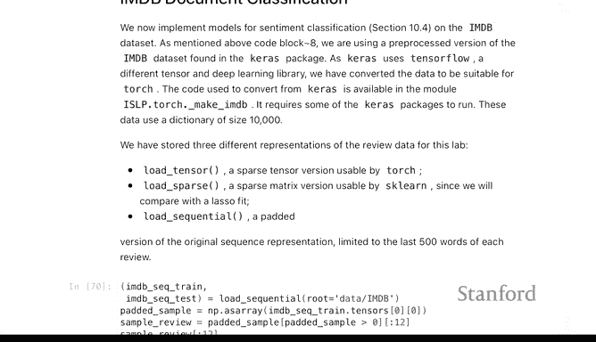

Skip to where we specify our model and it's going to be a very。

 pretty simple model with one hidden layer here。

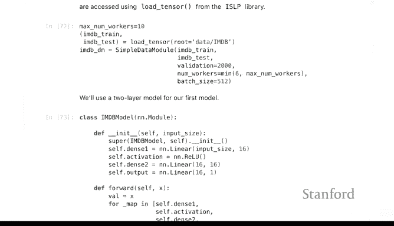

This， this。Our network specification is very similar to the hitters's data。

 recall we have to call this super function so that torch knows well it needs to do this in order to be ready to fit。

Okay， so the rest of the specifying the model and fitting is very similar to the hitters and the。

 the M Nist as well as the C farR data。 So Jonathan， in this case， would input size be 10000。

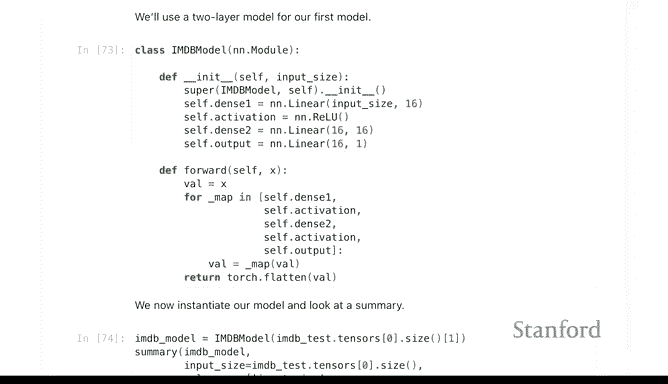

And it's going to 16 hidden units。Yes， that's right。Thank you， yes。

This is where we tell what the input size is。And it says， well， this is the X。The X train tensor。

 and this is the number of columns of it，10000。

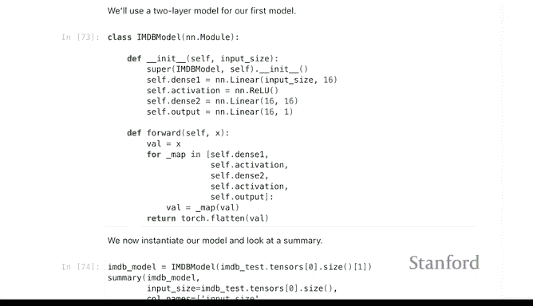

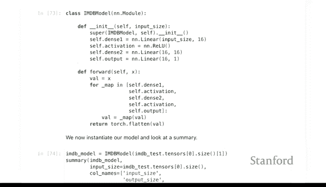

Okay， and you can see the summary here。There are three stop words that are included three stop words。

 yes。Moreally 10，000 features here。

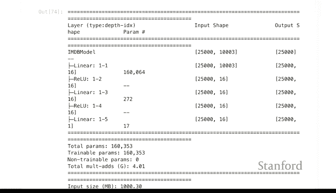

Okay， so let's just。Specifier model again， instead of regression， it's binary classification。

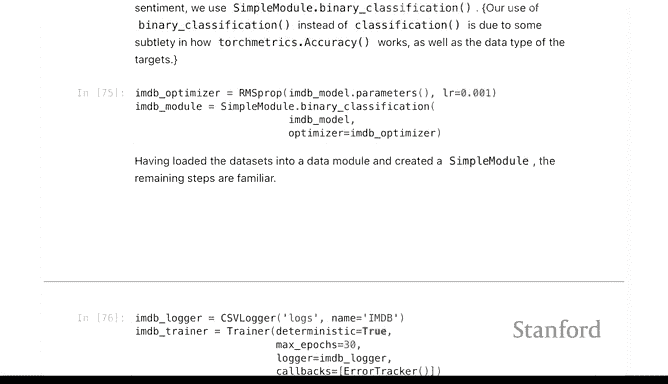

And we can make a similar plot to the other examples and track。

 there were 25000 training examples and 25000 tests。

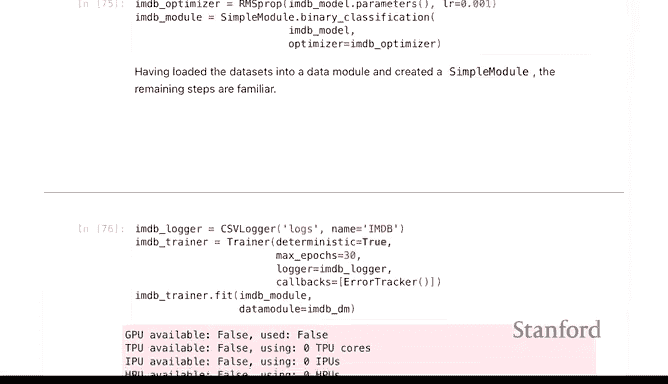

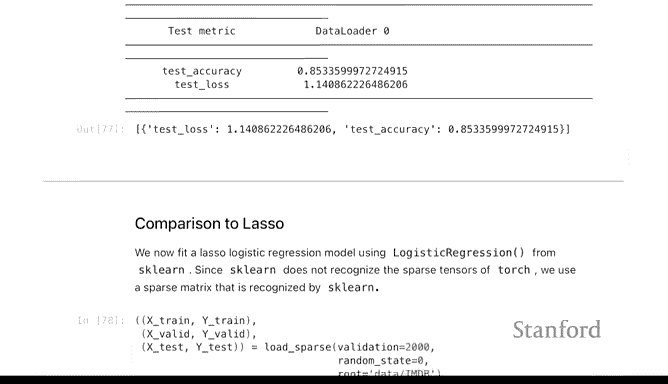

Yes。And we gets achieving in accuracy about 85%。And since this is a relatively simple model。

 the B ofverse model， we can use other methods like other linear methods like or。

Regularized methods like the Lasso。 So the response was sentiment， which just positive or negative。

 Yes， whether someone likes the movie or not， that's right。

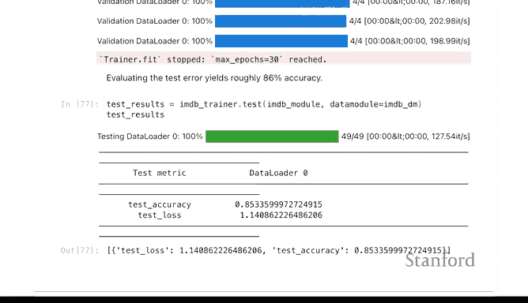

Okay， so we're going to compare this to logistic regression with the Laso。

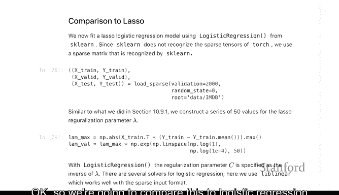

嗯。

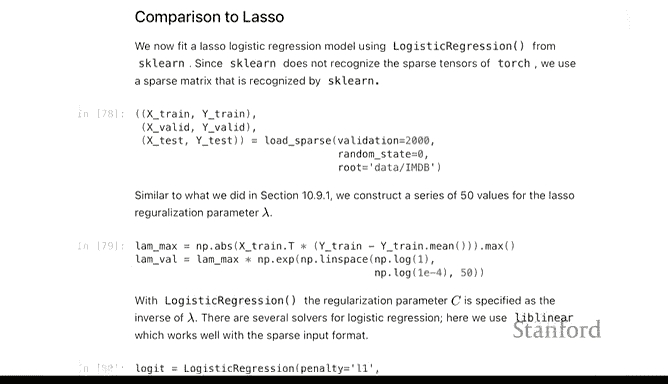

And I guess of note here， we see we're gonna use sparse data representations for the the training and test because we have well 25000 cases in each training and test and 10000 features。

 if those were film matrices， those would be pretty big。 But of course， most of the。

 the data mates are gonna be zeros because the the documents are all short。

 And so most of the words not about diction aren't going be used。 Yeah。

 so if we didn't use sparse matrices here， this would be really。

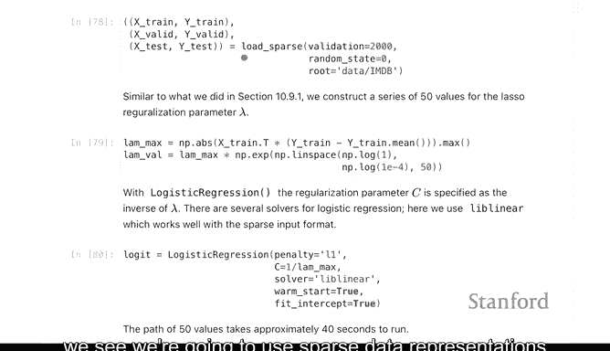

Very memory intensive to load and very expensive to fit。Okay。

 so this is a sort of ideal problem for lessoo as well。 when you've got very wide data sets。

 you know， in this case，10000 and you don't expect all the features to be important for this to， yes。

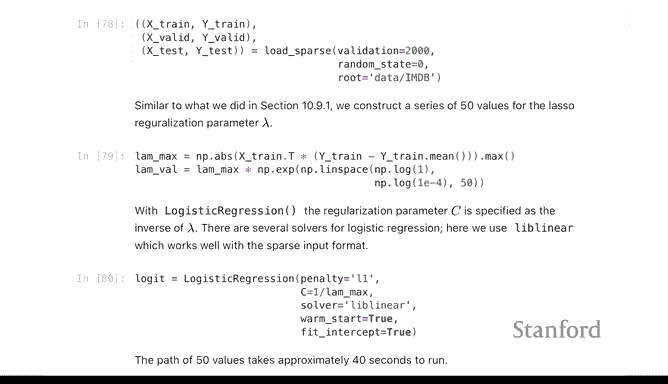

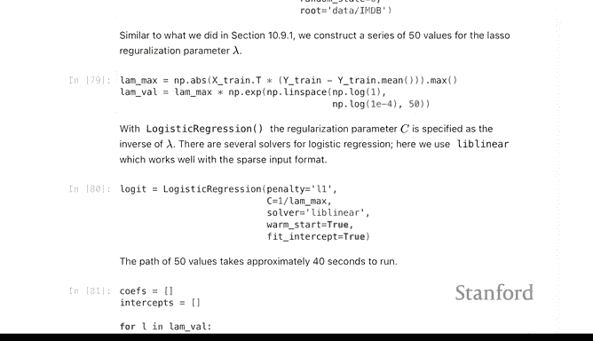

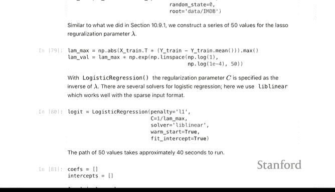

So， let's。See how well the lawsuit does。 We're gonna。

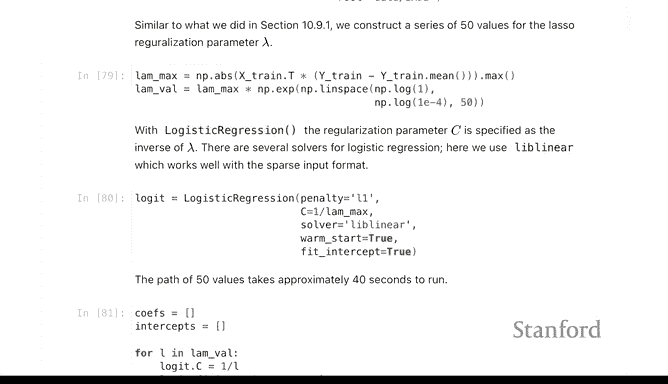

What we'll do will'll， will'll compute the。The solution path and evaluate test data along the solution path and compare that to。

嗯。The test data test score for the neural network as a function of epog。

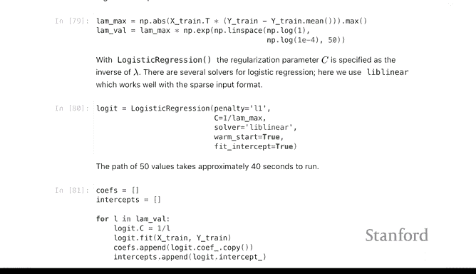

So。

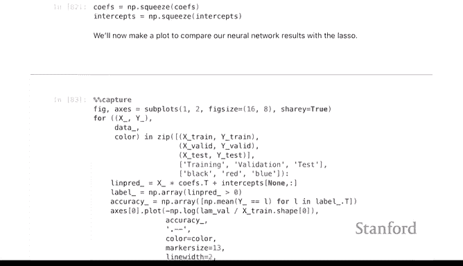

I'm just going to skip to the plot here。啊，所以。A pairair。啊。Training and test her， black and blue。

Between the two methods and so the xaxxes here are different on the left hand side。

 This is the lambda parameter for the lasso， and we see going from a very sparse solution to a denser solution。

 it has an accuracy in the low 80s， which is quite similar to the right hand side here。

 this is our single layer， single hidden layer neural network and what we're really what this example shows is that sometimes the neural network you know is not necessarily necessary to get a good performance。

 And in this case， we do。We have about the same。 and I should say， at the dense end， it's about 83%。

 I think it peaks here at about 88%。 So that're slightly better on test data。 but that's。

 that's not that big of improvement， but still slightly better。

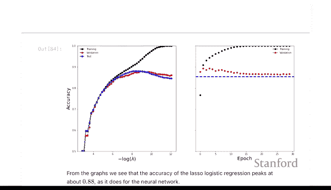

Okay。So we're going to compare these bag of word models to a simple well a sequential model for document for the IMDB data。

 so we're going to use this LSTM。 so long short term memory recurrent neural network and you can read about the structure of that in the textbook。

 we'll see in order to specify it is actually pretty simple。

 we're going to combine that with this embedding representation of of the words。

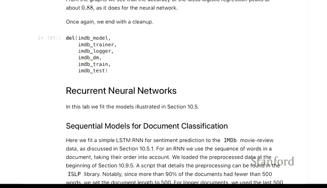

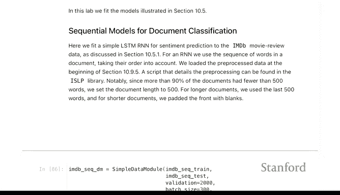

So， okay。And we'll ultimately want to compare the accuracy。 So again。

 we have to construct our data loader for all of these different views of the IMDB data。 Actually。

 there's a different form of the way that the data is represented represented。

 It's for the sequential models， it's important to have a sequential representation。 So each。

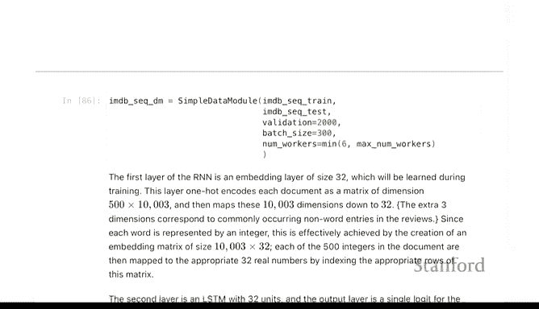

Rather than just reducing the document to the number of。

The number of times each word appears we actually have to track the order of the words。

So in order to set the data up here， the documents were restricted to length 500 words。

 So if a document had less than 500 words， padding was used just。Blanks， and if it had more。

 it was truncated。 use the first 500 words。And。And so a document now is represented as a 500 by 10。

0001 hot matrix that sort of indicates you which word appeared at which time in the sequence of length 500。

So this embedding layer is going to take these 10，000 words and reduce that to 32。

 so then we'll have something like a 500 by 32 representation of a document as we go move along the sequence。

And then we use this LSTM model that sort of tries to track。

 tries to fit a sequential model or some kind of time series model to the data， what using 32 units。

 which we've reduced used the embedding layer to reduce too。

So that's a rather complicated thing to describe， but actually it's surprisingly easy to sort of specify this in code。

Okay， so this is how we're going to specify。Both the embedding and the long term LSTM model in the network。

 So input sizes is again about 10，000， so we're going to ask for an embedding layer of 10000 input and third2 output。

So this actually is going to incur roughly 10，000 by times 32 parameters。

 so that's going to be about 320，000 parameters just for this and then we're going to have this once we reduced just 32 dimension。

 we're going to use this sequential model， the LSTA model， to take account of the temporal aspect。

And then finally， we take those 32 units and we map to one again because we have a binary classification task。

And well， the rest of the fitting is once you specified， the form of the network is， again。

 similar to all the other examples。 Let's just jump ahead and take a look at how this。

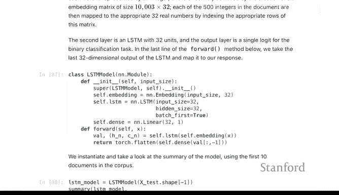

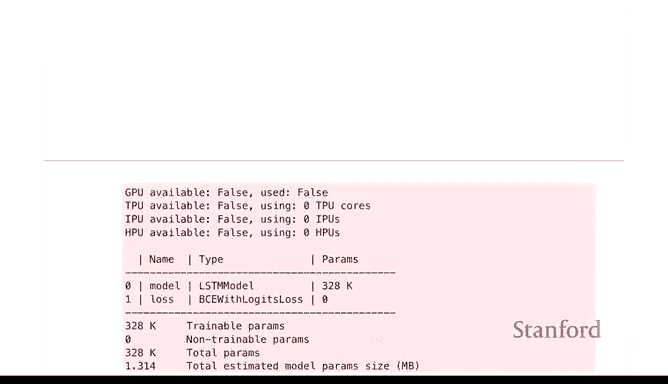

How this model performs。In the end， it gets about test as of 85%。

 so pretty comparable to the bag of words and to the Lasso in this case。

 so we I guess I see a few things with this example one that the torch and other packages have you know it's easy to specify complex models。

 this embedding and recurrent neural network work model。

 but they don't always perform better linear models or other similar models。

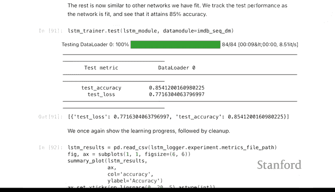

