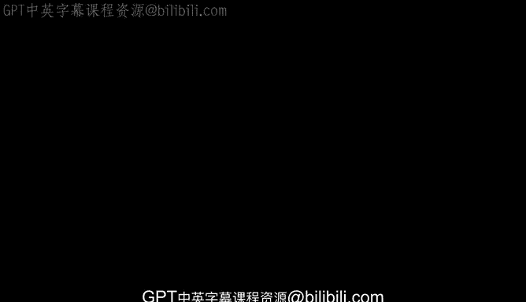
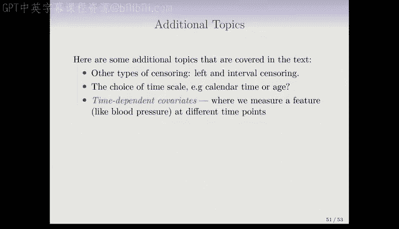
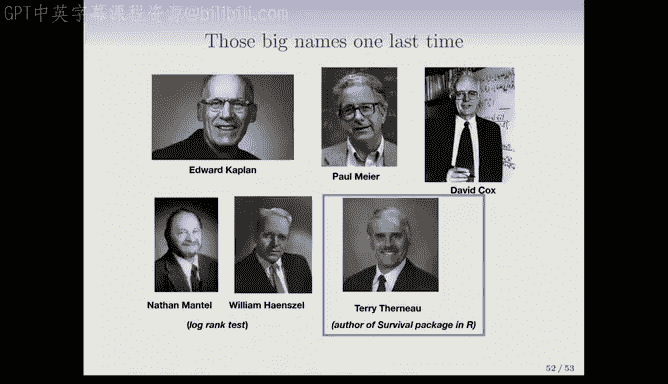
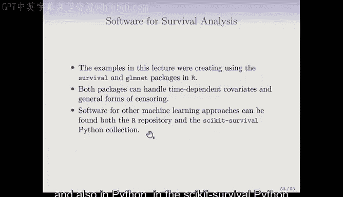

# 斯坦福大学《统计学习导论2023R语言版｜An Introduction to Statistical Learning with R》中英字幕 - P82：-082-Statistical Learning_ 11.4 Model Evaluation and Further Topics.zh_en - GPT中英字幕课程资源 - BV1yU421o7WA

Okay， and actually let's talk about one more goody。

 which is the AU remember we saw the AUC for class data。

 classification data is the area under the curve， it's a very useful measure of the accuracy of a classifier。

Well， it turns out for survival analysis， there's something called the C index。

 which gives you a nice analogy to AUC。It's an appealing method for assessing a fit cox model on a test set。

We're actually any survival model， but we'll show it here for Cox model。So what do we do。

 Well we calculate the estimated risk score for each patient from the cox model。

 So just like the publication data， for example。We got coefficients and for each individual in that case each study。

 we calculate the estimator risk score。Called a hat of I I indexing and observation。

And that was called the C index， or Harrow， Frank Harrow was your mentor of this concordance index。

Compututes the proportion of pairs， for which。Essentially。

 the model gets the order of the observations right。

 So what we're doing here is this is on a test set。So if each test observation。

 we compute the predicted risk and we compute this， think of any two pair of individuals or studies。

One had a longer event time than the other。And for those observations for the model to be correct。

 we like the risk for that the patient to live longer to help to be lower， right。

 because lower risk means you live longer。So this essentially says this is the proportion of pairs that we get in the right order among those that wheat。

 whose order we know。 Now that's kind of a mouthful。 But let me， let me parse this。

 So among all observations for which。Why I is greater than Y I prime。

 so the survival time for patient I was greater than that for Y I prime。This is the proportion。

For which the risk for I prime was estimated to be greater than that for I。 so that this is correct。

 right， If the survival is longer， we want the risk of the patient to live shorter to be larger。

Times Delta I。The Delta is doing here because for some patients， for example。

 we can't determine in the test set。Which one survived longer。 If， for example。

 one patient was censored at9 months， the other patient died at 10 months。

We don't know who lived longer， right， because the one who censored nine months could have lived past 10 months。

So only certain pairs can we actually determine which event occurred first so we we only count up over those that we can compare right。

 so again， it's turn something you need to digest in your。

It's trying to make use of the censoring observations whenever they have information that we can use。

 basically。So yeah， so I say it in a nutshell， it a proportion of pairs for which the model correctly predicts the relative survival time。

Among all pairs for which this can be determined。So again， this， yeah。

 you sort of have to parse the notation， but that's the the。The flavor of it。

And for the publication data， we computed the C index in a gate 。773。 It's over a test set， remember。

Roughly speaking， it means that the model can predict with 73。3% accuracy。

 which paper of a pair of papers will be published first。So it's kind of interpretation。

 very much like the。AU in classification。It's very popular， y。Okay， so that's。

Basically it we I'm just going to wrap up with some topics which are in the text if you're interested in pursuing them。

The sensorensing we talked about is actually the sensorensing on the right。

But there's other kinds of censoring。 there's left in interval censoring。

 which with the information you get on a patient is not just。Trunncation or a sensoror on the right。

 but it can occur other times during the study。And the models we've seen and actually all the statistics we've talked about。

Survival curves， log rank tests， Cox's model can all deal with。Left an interval censing。

 other kinds of censoring。Sometimes the choice of timescale is interesting。

Normally one uses calendar time， but if you're looking at a patient's age and how their age affects their survival。

 you might in index time by age and other other things。 So this is a topic that comes up sometimes。

Time dependcovaris or something which are somewhat unique to this area。

In all the examples you've seen in most examples actually in regression， right。

 you measure covariates or regressors once for an individual， and they're fixed orre a static thing。

 but in some survival study， you follow patients in time and you measure things their blood pressure at different time points。

So maybe it's a five year study and you see them every month。Well at the beginning。

 you get their blood pressure。But every month， you measure the blood pressure and another very nice feature of the cox' models that it can actually can capture the effect of the time varying covariate。

 which you measure。 because remember remember in those risk sets。

 an observation would be in several risk sets as we move along in time。😊。

And they contribution to the risks that involve their features。 Well。

 if their blood pressure is been increasing， that should be reflected you know in future times。

 we see them in the risk set and it turns out to be a particularly easy caxus model because it's sort of a sequential in time construction。

 you just use the current value of X of the feature at a given risk time and it's really quite easy but there's a lot of very nice statisticalal theory that's been also been developed。

With Cox's model and time dependent covariates。And then we talk a bit about checking the proportional hazards assumption。

 which is。Important other things we talked when the book briefly。

 we've talked really about Cox's proportional hazardaz's model。

 which is a linear regression analog of。For survival data。

 But some of the other learning methods you talked about in the course， random forest。

 Boosing and neural networks have their own ways of dealing with survival data。

 some of which avoid the proportional hazardist assumption。

 So these are becoming more more popular and really currently under development。Finally。

 I mentioned Terry Tau， the author of their survivor package， and so let's talk about software。

 while the examples in this chapter were all done using Terry survival package as well as the glimnet package in R。

 and both these can handle some of the things we' just talked about。

 well all the things we've talked about plus time to pennacovaris， other forms of censoring。

And there's other software in other languages， of course， there's other software in R， the models。

 other kinds of survival models。And also in Python in the psychic survivaly collection in other places。

