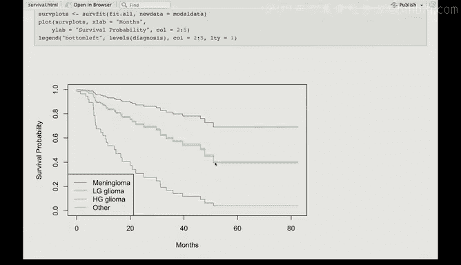

# 斯坦福大学《统计学习导论2023R语言版｜An Introduction to Statistical Learning with R》中英字幕 - P83：-083-Statistical Learning_ 11.R.1 Survival Curves   Brain Cancer Data.zh_en - GPT中英字幕课程资源 - BV1yU421o7WA

Welcome back。 We're now going to do the lab for Chapter 11， the survival analysis chapter。

And we have three data sets we're going to look at and the first one is the brain cancer data。

 Rob do you want to tell us a little bit about the brain cancer data Well。

 it's a data set of 88 patients who suffer from brain cancer looking at their survival how long they survived。

嗯。With brain cancer and looking the survival is a function of sex and most importantly。

 the diagnosis category of brain cancer as well as other other factors。 Okay， great。

 so these data on the ISL or two in the package。And this lab we're going to do a little differently instead of actually stepping through the code。

 we're going to take the output of the markdown， which is a nice HTML file。

 and this looks very similar to what you have in the chapter in the book except it's got the output as well shown。

 the plots and whatever are shown as well。And it looks really nice， so。

The brain cancer data is in the package as we say， and we say names and the the names。

 any particular ones of interest Europe， as I mentioned， the sex。

 looking at potential sex differences and the diagnosis categories potential interest of importance。

And these others are described in the book， I believe this was Kovkin index， which is a mouthful。

We look at the breakdown of sex and roughly balanced， right， male and female，45，43。

And these are the diagnostic categories， different types of， of brain cancer。And status。

 which is how many died。So those are the， the ones are they wrote。

 That's the ones and the zeros are censored， yeah。So。We do make a point here， that。You need to check。

 so status one is deafier。It's very easy to， to code status。

 This is the sensor in variable the other way around。 And you want to make sure you get it right。

 right。So we know there were 35 deaths in the brain cancer data， and so status1 means death。

So the first thing we do is we'll plot a Kaplan Meyer survival curve。As shown in the text。

 And for that， we use a surf foot function。And it uses a formula。And a particular。

Incantation for the response。So there's a function serve， which takes a time and the status。

 So the status is， is part of the。The response， whether it's censored or not。And in this case， we。

 we just。Model it we model it as one constant。 So we just want a marginal survival curve。

For all the data， okay。And。So that surf does that for you。And then you can plot it。

 there's a plot method。And。It， by default， plots the confidence interval for the plots。

 I believe that's plus or minus you standard areas。 think so， yeah， yeah。So that's a default。

 And so there you have the Kaplan My curve。And now， you can。

You can make instead of putting a twiddle one on the right of the formula。

 you can put a stratifying variable so yeah we put sex。

 which is binary and we do it again and we can specify colors for the two sexes and we can put a legend in the plot as well and there we get it。

And you can see when you stratify the default is not to put standard errors because the picture gets little cluttered but you can add them if you want。

 And so you can see if you can figure out how to do that by looking at the surface function and and the plot method。

 And one of the questions we're going to ask pretty soon is are these two different they look to be somewhat different around 40 months。

 for example， but of course， there's variation here and it's a small data set。

 So we'll have to do a proper test right。So it looks like men are doing a bit worse than than women。

 right。So the first thing we do is perform a log rank test to compare the survival times of males to females。

And that was described in the text。And。There's a function served if that does it for you。And。

It's uses the same。Response or object created by serve。

And total6 tells you that you're doing a loging test to test if the males are different from females。

And then you。Print out the results。And it seems like it's not significant。 The P values is 02。

 And one thing to remember with sensor data is of the sample size was 88， Sounds pretty big。

The actual mode of information is really more to do with a number of failures， right。

 number of events， which was only half of that。 So the real sample size is a lot less than 88。

 And that's why we're getting maybe， you know， these。

Although they look the curves look pretty different， the P value is not significant， right。

It says your P value is 0。23， it seems to have got truncated here。Okay。

 so next we're going fit up a cox proportionional hazards model using the Cox P function。

Well start off by fitting using just sex as the only predictor。

 Notice we're using the same formula in several incantations here。 But here we call in Cox P， H。

And we fit the model， and we do a summary of the fit。

And this gives a little bit more detailed summary。And so if you recall， this is fit in a model。

 a linear model where the。The modification of the baseline hazard。Is in this case。

 just a single E to a single parameter， which is is the binary indicator of 6。

And it comes up with a P value of also 02。So is that exactly the same as the the log rank test drum？

 Yes， it is this the score test。The third of those three is exactly the equivalent to the log grain test。

 Ex。And。you can see that here Yeah。 and you can see that here as well。 Yeah。

 these are round it again。 Let's scroll back up to the survival cr。 Remember。

 the proportional hazardous assumption assumes that the relative risk is constant。

Throughout the whole study， right。And it looks like here that and that might be。Viold as well， right。

 Look like the relative risks is pretty the first。5 or 10 months is pretty equal。

 And then the females may have an advantage for。Or the middle period， right。Of course。

 it's hard to tell with such a small data set with that's causing a problem。

And if it was proportional， what would you expect to see。

 We expect to see that the gap would be would start small and would it would widen as you go along。

 I think。 So it means the ratio is constant， right， They， yes， the ratio is constant。Okay。

 so where were we， So we just， yeah， we go down here， and we saw。The log grain test。 Yeah， yeah。

 on the score and the score test equivalents。 Okay， okay。

Now we're going to add some additional predictors to the model。And so we add them all in。 We had sex。

 we add in diagnosis。And these other three variables。And now we fit the model and you get the output。

 when we print the output， you get something like a linear model fit。Accepted for， for the cox model。

 So there's a coefficient for each of the variable。Diagnosis is a three category variable。

4 category variable。And so it uses one of the levels as the baseline。

 and that's men in Geomi as a baseline。And， and so these are all relative to that baseline， these。

 these numbers over here。So， in fact。2。4， thiss E to the coefficient。 That's a relative risk of。

H G gllyoma relative to men and G geoamine。 So remember now。

 So a positive coefficient is good confusing is actually correlates with shorter survival， right。

 because that the risk is higher。R a negative coefficient correlates with longer survival because the risk is lower。

 I think that's often confusing， but。So these， these guys are these categories are worse off than than that baseline。

 right， In fact， all three of them are。 So this is the， this is the mild mildest。YeahWhen。And。

That one's significant。This is strongly significant。 There's a few more。 this world， one more。

 this Kov skin index， K I is also significant。And none of the others are significant。 remember。

 all the things we talked about for linear models and interpreting these multiverte fits still hold here as well。

 right that。These P values talk really referring to if we hold all other variables fixed。

What's the predicted effect of changing that variable I see？Right， so， yeah， right。

 So if some of these other variables are， for example， correlated。

 they could be showing no non significancecause the other ones standing in for it。

 right So these P values are all。What happens if you drop that variable out the model。

 but leave all the others in， exactly yeah。Finally。

 we plot the survival curves for each diagnosis category adjusting for the other predictors。

So the diagnostic category seems to be important， at least one of them is important。

So we want to leave all the other predictors in the model。And when you plot the survival curves。

 you need to。The the output of a Cox P model is for each subject， when you make a prediction。

 you get a whole survival curve。Okay。So we need to specify what the other values of the predictors are。

So when we want to focus on the diagnosis category。

 what we do is we set some typical values for the other parameters。And if theyre quantitative。

 we'll just set the mean value。And if they categorical。

 we'll set the modal value because we need to put some value in for all the predictors。

And one of the reasons we have to do that here is this model is is really is different than a linear model where effective of one variable does not depend on on the levels of the others。

 right， But this model is。In set in a certain way， it's sort of nonlinear。

 So the effect of each variable actually depends on the levels of the other。

 we saw the same thing in the logistic model where we think we saw that。

 or it's true in the logistic model that。When you look at probabilities and the effect of a variable on the probabilities of response。

 it depends on the levels of the other variables。RightRight， and that's the same here now。

 So not only will these survival curves shift up and down depending on the levels of the other variable。

 the values of the other variables， but the shape will change as well， because it's。

 it's not just a shift。 It's the proportional hazard thing again， it's。The slope also changes。Okay。

 so here we have it。And。Sure enough， men in Goma has the best survival history。

The H G gloma is the worst。 And that remember that had the highest relative risk。

And then it looks like algae， glioma and the other are very similar to each other。

 They're almost completely on top of each other。Right。So。That's a result。

 and this plot nicely separates it and illustrates it。

