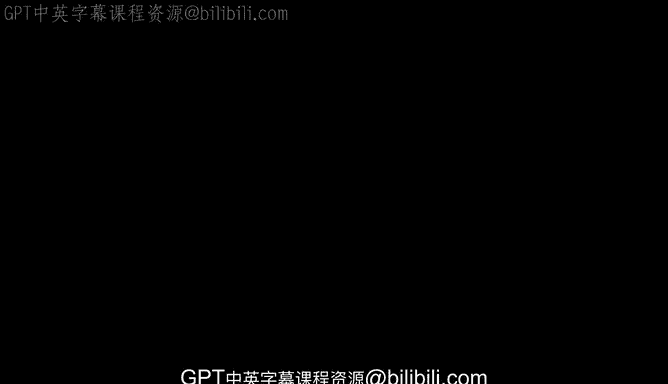
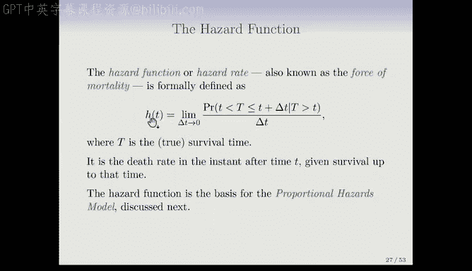
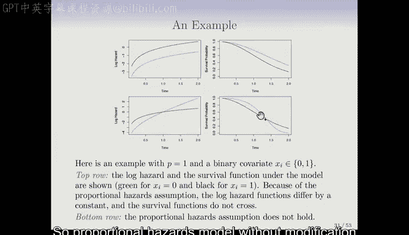

# 斯坦福大学《统计学习导论2023Python版｜An Introduction to Statistical Learning with Python》中英字幕 - P84：-084-Statistical Learning_ 11.2 Proportional Hazards Model.zh_en - GPT中英字幕课程资源 - BV1u4421A7ZU

Now we have an Matttown Hansel， who developed in 1959， the log rank test， which is， as we'll see。

 is kind of the analogy of the T test for survival data。

 So we know we know how to treat how to look at one sample， how to summarize it。 Now。

 let's move up the two samples。 This so called log rank test。 So again。

 we're looking at the brain cancer data。 and we have males and females。

 We want to compare their survival。

Let's start with a copper of my curves。 Here they are。 blue is female and green is male。

 and it looks like there's a slight advantage for females here。The question is， is。

 is it significant， We've only get 88 patients。 So we don't know why this is actually a real effect just maybe within the noise。

So， yes， females seem to fare a little better up to 50 months。But then both the level off around 50%。

How can we carry out a test of the two survival curves Again， it looks like know。

 when we hear two samples， we think of T test。 But again， the sensoring creates a complication。

 So to overcome the challenge we'll conduct what's called the log rank test。

And log rank tax actually is very much has the same kind of structure as Ka and Meer is to。

 is's going to sum up things over the failure times。

So let's call the unique failure times of death times d1 through DK。

Let RK be the number of patients at risk at DK and QK the number of patients who died at DK。

And remember at risk。At DK， well call R 1 K and R 2 K in the two groups。 right in this case。

 males and females。 So so， Rob， the R is the number of patients who died at time Dk。

 So you're assuming that more than one person can die at these times。 I think you said R R。

 R is the number risk at risk。 And Q K right Q K is the number who died at D。

 So it is it is possible， some studies， especially if the time is sort of measured discreterely。

 maybe not by days by month。 You going have more than one patient dying at a given time。

 in the simplest case， Qk will be one will be one。 Yeah， basically。

 but the log rank test can easily can seamlessly handle the case where there's tide survival times。

And this just says the number of patients。The total number of patients at risk are called RK and the hormone died Q K。

Okay， so what I just said is we summarize in this table。Here are the two groups， says and females。

Here's the number that died again normally， there'll be one of these will be a one。

 the there'll be a 0， but it's possible to have。 So this is this is a special little table just for the death time at decay。

 exactly。So we're looking at the whole sort of process， but it's a cross section saying， okay。

 at one time DK， this is what we see。And we're going to have such a table for each decay。

And we said this already， if the death time is unique。

 then one of these is a1 and the others is zero。Okay。

So how do we use this table now to construct a test statistic， to test whether。

The two groups are the same。 Their survival is is the same。 Well， in general。

 if you have a random variable X， what you do is you and you want to test whether。The mean of x is 0。

 What you do is you take x and you center it by the expectation of x under the null hypothesis H 0。

 and you divide by its standard deviation。 So the x here we're going to use is we're going to use the the sum of the。

Numb of people that died in the top left table。 In other words， if they go back here。Right。

If group 1 is much worse than group 2 in survival， we expect to see a lot of ones here and a lot of zeros here。

 and vice versa for group 2。 So you want to see whether the number of the total number of people who died in group 1 at each reset。

😔，Is at large compared to what we expect it to be。If they had the same survival rate， exactly。

So this gets a little complicated and the details are in the text， but essentially。

 we're going to sum up over wrist sets。The number in the top left corner。

 that's the number that died in group one， minus what we'd expect to see if the two groups were the same。

Divided by its standard deviation。And what we expect to see of the two groups to the same is just the total number of risks times the proportion that we're in group one。

RightSo， so R1 K is the total number at risk in in the first group， exactly。

 but the proportion is over the it's the merged groups， right， it's the total deaths。

Irrespective of group。 So that's the proportion overall。 right。

 And so you want to see if it's just divided up proportionly， exactly， yeah。

And that nasty thing in the bottom is a standard deviation。 Yes， the variants。 Yeah。

 the details of which are in the book we only do。Bore you bore you with this right now。

 And then it summed over all the the death times。 exactlyly。 Yeah， right， So you're。

 on the averages the number of people we see in group 1 that die I it more more or less than we'd expect if the two groups were the same。

And is always a case， it's often engaged in statistics when forms a normalized test statistic。

What you do is you say， well， if the sample size is large， this's going to be approximately normal 0。

1 standard normal distribution。 So we we can look at a normal table。

 We can compare the W to a normal table。And to determine whether what we're seeing is departure large enough that we would or would not expect by chance。

And we get a P value from that。Okay， okay， let's see what it does。 Well， not too exciting。

 log rank gave a w of 1。2 And with a corresponding two side of P value of 。2。

Why are we using a2 side of P value here， Trevor。Oh， it's a surprise Christian statistics 101。Well。

 we'd just be we'd be equally surprised if if the male survival time was worse than the females or vice versa。

 And so， you know， we don't want to look at the result and then just test what we see right you know。

 our priori， we weren't we'd be surprised either direction right。

 so it makes the test more objective more unbiased。

 Otherwise we'd be favoring as our hypothesis is okay，So overall。

 we can't reject the naos of no difference survival occurs， because the P value is not very small。

 But as we've seen in the chorus， it doesn't mean necessary there is no difference。

 It could mean that we don't have much power to find that difference。

Maybe our study wasn't big enough， in particular。We had 88 patients， maybe if we had 8000 patients。

 we could there may be a difference，88 patients in total， right Some were censored。

 Many were censored。 That's a good point。 the real sample size and survival analysis isn't so much the actual sample size。

 but the number of events right because the sensorensored observations provide partial information。

 but only a little bit。 They helped in the denominators but we were counting them a number of deaths those were in the 30s。

 total and divided by two groups。 So right quite small。

 That's always important to remember that survival analysis。

 the sample size isn't quite what it seems。So that's a log rank test that's closely related to Cox's proportional hazardaz this model。

 which we discuss next。Okay， so we've seen the one sample and how to summarize it with a Kaplan Meer。

 we've seen the two sample problem where we use the log rank test and now we'll move up to regression。

 which is sort of the more general， more commonly occurring situation。Okay。

 so again we have our survival time and we observe the minimum of the actual survival time in the censoring time。

 Well， again， if you think about it as a regression， a supervised learning problem。

 we would be tempted maybe not to regress Y on X， or maybe since y has a long right tail typically being a survival time。

 maybe log Y。But again， the sensorensing creates a problem。 We can't just do that because we don'。

 We won't know how to deal with the sensorensing。Okay。

So we're going to use a sequential construction similar to the idea you used in the capital Mire curve。

 and you'll see this coming up all the time in arrival analysis。

 you think of it as a process that unfolds in time and you model it sort of time point by time point。

Failure time by failure time。So we've seen that for Kaa Meyer。

 we've done that for log rank and now for discretion。

 one thing that's maybe worth saying the Captain Meer curve。

 you know it's like a distribution function which you just fit to your data， in other words。

 we say it's non-parmetric， it doesn't really make any assumptions right but it does take into account the sensoring。

And from that point of view， it's attractive。 right， And maybe why you bring this in。

 the next method proportionional hazard this model we'll see right now。Carries that theme on。

 Basically， it's got it sort of a semi parametric component， which which makes it quite robust to。

 to departures from， from modeling assumptions。So let's see how this works。 So before we get through。

 we need to learn sort of a new quantity that the hazard rate or hazard function。 I won't you。

Also known as a force of mortality。So what is it， Well， let's look at。 So this is a again。

 it's a theoretical quantity。 This is a。A function of the of the random variable T。

 It's a probability that that T。Falls between T and T plus delta， given T is greater than T。

As Delta T goes there， it's kind of a derivative。 But what it's saying is。

It's the probability of dying in the next instant。From now， given you've survived up to this time。

Okay， so that's why I call the force of mortality， kind of a scary quantity for。😰。

People our age getting up there。Turns out that if you know the survival distribution。

 you can just compute this quantity。 It's just another way of。

Great presenting that right so the survival， the S of T is actually， as Trevor said。

 you can there's a one to one map between the hazard and the survivor function。

 but this turns out to be a convenient quantity for the model that comes up next to aal hazards model。

And this is due to David Cox in a very famous paper in 1972。

Which has now become known as the proportional hazards model。

Okay。So what is a proportional house this model and the point of this section is a regression now we want to model covariates or features and how they affect the outcome。

So there's our features X X J， that's an Xs for observation I in feature J。

 we've got P such features。Now we're going to assume that the hazard for an individual with features X I at time T is some what's called a baseline hazard function that's unspecified。

Times this factor。Well what's the exponential doing here， the hazard function has to be positive。

 right， It's a probability。 So the exponentialent is really the main reason for it there is to make this a positive quantity。

So this hazard now is it's a hazard function。For an individual with features Xi。If x is 0。

 we get the baseline hazard。So what this is saying is the hazard for an individual who's got a certain feature is some common hazard that everybody has。

 times a factor which either increases or decreases his hazard。

Depending on that whether the betos or pods are negative。

And the beauty of this model is that that common hazard。

 we're not going to really make too many assumptions about it。

 It's going to be sort of like the Captain Meyer in a way。 It's just， you know。

 it's going to be a nonparmetric。Exactly， and we'll see how that's done in a couple slides。

So this quantity is called the relative risk for this feature vector， right？The relative risk。

 if we have an individual with these feature values compared to an individual with all zero。

 that's the baseline。The ratio of their hazards is this second quantity。

 that's why it's called the relative risk。If this is 1。2， for example。

 it says an individual with these features。Is 1。2 times as likely to die as an individual with these feature values in the next instance。

 in the next right。Actually， actually， at all time， right at all time at all time。 because that's oh。

's there's no T Depend on T， exactly。And as we've said。

 and Trevor said that what this model is saying is it makes no assumptions about the functional form of the baseline hazard。

Which is very nice。 It means it can adapt itself to a lot of different situations about having to specify。

Exactly the hazard for a baseline individual。Makes it flexible。Again。

 the only assumption is that the features come in as a factor that increase or decreases the relative risk by a constant factor。

 depending on the parameters。 Of course， these parameters were going to estimate from data。

 just like we did in， in regression。 Rob， wasn't one of your very first papers on Cox's proportional hass model。

 That's right。 when I was still a。Graduate student and working at a medical center。

 A doctor I was working with didn't understand the model。 And he said， you should write a very。

 He was British。 He said he should write a very simple explanation of proportional hazards。

 So I wrote a paper called a Pla man's guide。To the proportional hazards model， a lovely paper。

Actually， I'm kind of proud of it though I wasn't beat physicians。 It really is level。 Okay。

 so I should read it and just kid。😊，So here， here's an example of proportional hazards just to sort of reinforce what it's really saying。

 Let's take the simplest case where we have a single covariate and this's 01。

 So it's is a two group case。 right， maybe males and females or whatever， okay。

Here is the hazard function， the log hazard functions and the survival probability for it says here。

 X I equals 0 is。Green and Xcycl one is black。Proportional hazards means the gap between these two log hazards is a constant。

 right？It also turns out to imply that the survival curves don't cross， and we see example here。

As time goes on， they get farther and farther apart。But they don't cross。

So there's the proportionities for the hazard。 the one on the left。

 when you map it back to the survival function， it's a different kind of relationship。 right， It's。

 it's in the book， but it's a little more complicated。 It's。

 since the model is expressed in terms of the hazard than the on the log scale。

 you see this constant gap。Over here， the gap's not content， but it doesn't cross。The the other hand。

 if we had a situation like this where the hazards cross。This groups doing better for a while。

 and then worse later。Then their survival curves also cross and this is a non proportional hazard situation。

So proportional hass model without modification can't really capture this situation。

 so it's a convenient assumption， which is often reasonable。

 it's often reasonable and there are ways to check it and we just talk in the book a bit about that and with references。

 but it's a good starting model it's often very， very effective。

