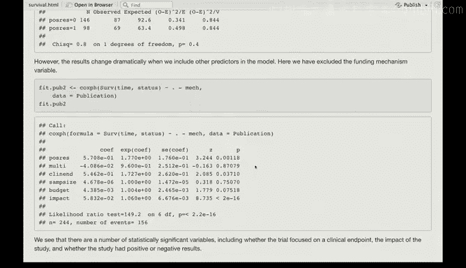

# 斯坦福大学《统计学习导论2023R语言版｜An Introduction to Statistical Learning with R》中英字幕 - P84：-084-Statistical Learning_ 11.R.2 Cox Models I  Publication Data.zh_en - GPT中英字幕课程资源 - BV1yU421o7WA

The next data is publication data。 Rob， can you tell us a bit about the publication data。

 This data was looking at publication of papers that were described in clinical trials。

The outcome is time until publication， and was of particular interest is whether or not the if the study had a positive the trial had a positive result versus an all result。

 whether that led to a faster publication， one might think that's the case。

Or publication at all or publication at all。 Yeah， the time until publication was at length until。

 to the positivity of the trial。 And so censor in， if， if， if， if the time is censored。

 it means never was published。 never published， or I think maybe the。

The study ended before the publication。AtThe end of the the data collection。

 the paper are still unpublished。 So I guess this speaks to the bias in， in published。

Like clinical trial and medical。Papers， right， it's trying to examine whether there is such a bias。

 yeah。The the incantation is pretty much the same。 We've got time and status。

The state is variable here is whether or not it was published。In this case。

 publication date is the endpoint， it's a positive result。It's a positive outcome。 If it's published。

 Pa raises whether the the。The result in the study was positive or not。

 that's the binary predictor in this case。And we produce Kaplan May Co for that。

Sttraatified by negative or positive。And。Sure enough， it looks。 Well， like。

 the curves are pretty close， but it looks like down at the bottom here， at least。

That if it was a negative result， it tended not to get published in the， you know， slightly。

Longer time。Till ever or never publication， Where if the result was positive， it seemed to be。

A little bit of hit。 Some of those papers waited a long time。 They waited a long time。

It's like the medians around two years。 maybe。 Oh my goodness， yeah。Are these statistics just no。

Statistics journal aren' Pe bad。That's， that's， that's a very long time， especially for medical gens。

So now we'll fit the same model using a Coxs proportional hazards model。And。We'll do a test。

We don't do the log rank test here， but we just use the cox model test for this binary variable。

 and we see the P value is not significant。 So， in fact， it's not significant the difference。

And the log rank test will provide a similar conclusion。And there we do the log rank test。

And once again， if we put in other predictors in the model。

We're going to put all other predictors in the model， except the funding mechanism variable。

 Why was that left out。I don't remember， Dr sorry I asked。In the， in the actual lab in the book。

 I believe it's， it's done both ways。 but it's done in both ways， y。

So here we see there's a few significant variables。There's the impact。

 That's the impact of the journal by factor。 Yeah， Yeah， and， and that's。Significant。And。

This is whether it was a clinical endpoint or not， that's significant。And then， of course。

 positive result is now significant in the presence of these other variables。

So that's sort of curious that this often happens， there's often confound in and masking in data。

 and when you put in other factors， then the strength of a predictor can actually come out。

And that's what's happened here。And， and we left with a number of。

Important predictors of the trial again， focused on a clinical endpoint。

And the impact of the study and whether the study had a positive or negative result。

 I see it was the impact of the study， not the journal。

