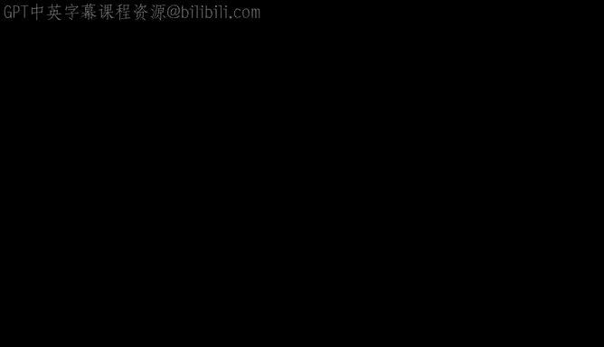
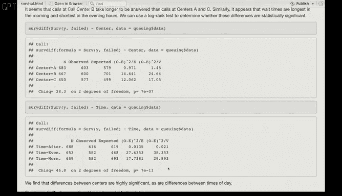

# 斯坦福大学《统计学习导论2023R语言版｜An Introduction to Statistical Learning with R》中英字幕 - P85：-085-Statistical Learning_ 11.R.3 Cox Models II   Call Center Data.zh_en - GPT中英字幕课程资源 - BV1yU421o7WA

Okay， the final example is the call center data。 And Rob， you want to tell us about these data。

 So there's a simulated data set looking at how long a person's willing to wait for an operator to pick up after they've called。

Phone line for asking for help so the response here is the time until the call is picked up and it's possibly censored if the customer decides to hang up before the call is answered and some of the features are the number the number of operators that were available at the time the call was made let's see morning afternoon and evening。

 the time of the day and the center looks like right and looks like there's three call centers A B and C。

And I think we all know about call centers。 I personally hate call centers and they put you on hold and you listen to some horrible music。

 usually scratchy and noisy， and especially if you have to wait a long time。Alright。

 let's look at the design。 So， so here's some code to sample these features。 So we。

We sample each one of them just randomly， right？According to some scheme。

 n is the total sample size of 2000。And we look at the first few rows。

So operators is a numeric number between5 and 15， the number of operators。

And then we have dummy variables for these each of the categorical variables center and time。

3 levels。 that's one heart encoded， not dummy， not dummy。1 hot encoded。

 And because because it's a linear model， we， we。We， we have them each one's relative to a baseline。

 So one of the levels gets dropped out。It's a simulation。 So we need to to。To build a true model。

 So we need， we need to set some coefficients。 We're going to make a linear model in these variables。

 So we set some coefficients for each of these。Variables above you。

And we write a little function to create the hazard， which this is x times 0001。

 So this is just a scaling function。 Let's see some of the coefficients。

 one of the coefficients the coefficients for operators was equal to 0。

04 and what that means is that each additional operator leads to 1。

041 fold increase in the risk that the call will be answered。

 So the time here is the time to the the call being answered。 So obviously the more operators。

 the higher chance that's going to be that will be operated。 be answered。

The coefficient associated with center B is minus 0。3 and center A is treated as a baseline。

 this means that the risk of cor being answered at center B is 0。

74 times the risk that it will be answered at center A。In other words。

 the wait times are a bit longer at centre B。So that gives you an idea of the basis。

We use a package called Coxed and there's a serve data function in there and it allows us to specify the maximum possible failure times。

In this case， which we set to equal to a thousand seconds for a customer。

And so we load that package and you can see it relies on a lot of other packages， print them all out。

Quite a lot。And we called the package and we give it the maximum time。We give it our x matrix。

 we give it the true betas。We give it the hazard function， which scale down the function。

 and it'll generate the data for us， and it gives us a warning。

So it tells us that we had right sensoring， which we expected because we set a maximum to the wait time。

The result is we get the Qing data is a data frame， and it's got a bunch of variables。

The observed data is stored in Quing dollar data and with Y corresponding to the event time and failed an indicator of whether the call was answered。

 failed is true。Or the customer hung up before the call was answered， fail is false， okay？

We see that almost 90% of callss were answered。 You。

 one of the things that's tricky about sing survival data。

 Like if you're doing research and survival， it's hard to know what sort of what the signals and noise ratio is。

 right， like in in linear model， you can look at the。

The size of the beta and and sigma squared And figure out sort of。

How to simulate data of sort of medium single to noise ratio。 But survival data is much more。

Complicated， right so。you know， is is， for example， are these betas large or is a sample size。

Lavs at 1000。 Is that large enough to find effects。

 So it kind of tricky So typically what people would I do at least is I'll start with some settings like this。

 and then I'll produce the data and Fiticcox model as we're going to see right now and look to see sort what kind of P values you get。

 And that's sort of a more sort of C to the pants way to know。You know。

 just how big the singleton noises ratio is Often you sort of， you pick some settings。

 you fit a model， and then things are very insignificant。 And you realize， G I。

 you have to actually make the relative risk parameters larger， for example。And vice versa， you can。

 you can set the parameters as in a simulation。 So anything would do well It's just so easy。

 Yeah So it really is， there's a， there's an art in in creating just the right kind of simulation data。

😊，90% of the people waited for the call to be answered，10% were censored， they dropped out。

So we now plot Kaplan Maya survival curves and well first stratify by center。And yeah we see them。

The curve for the three centers， not very different。Okay。And now we will stratify by time。嗯。

And time was a time of the day whether it was morning， afternoon or evening。And again。

 not too different。And now we'll do。A log rank test to see if Santa is significant。And。

Even though it didn't look significant in the figure， the data sets big enough。

 it turns out it is significant。So this， the center variable was。This one。

 these were significantly different。So one thing you can notice is that the survival curves are very granular。

 right in some of the earlier data sets like the brain cancer data， much smaller data set， big steps。

So the granularity is telling you there's lots of data here and lots of events right and 90% were events。

So what our eye tells us is not a very big difference。 It's turned out to be significant。

 in this case。We probably expect the same thing here。And。Sure enough。嗯。

When you do the the log writingging test on time， it's also strongly significant。

Now we fit a cox proportional hazard model to the data using all the variables。And。We see that。

Center。B was significant compared different from center A。

 but center C was not significantly different from center A。And。

 and both evening and morning were different from。Midday。Right， and so that's it。

So there we have three examples， we fit the Cox model to each， fairly simple modeling process。

 very useful tool for modeling these kinds of data。

