# 斯坦福大学《统计学习导论2023Python版｜An Introduction to Statistical Learning with Python》中英字幕 - P87：-087-Statistical Learning_ 11.Py Cox Model_ Brain Cancer Data I 2023.zh_en - GPT中英字幕课程资源 - BV1u4421A7ZU

Okay， welcome to the lab for Chapter 11 on survival analysis。In this lab。

 we study outcomes which are times to event。So for example， for cancer patients。

 the event is typically death from cancer but for other events， for example。

 we have a publication data set and the time the event there is is when when the document is actually published。

And so there special methods for， for modeling such data。

 And Jonathan is going to lead us off on this slab。Okay， thanks， Trevor。Yes， so as Chavor mentioned。

 it's the specialized methods are really， you know， a slightly different loss function。 So it's。

 it's we're gonna to see methods that look like a regression methods。

 that's the cox proportional hazard model。 but it's not a square error loss and it's not a classification loss。

 It's a special loss for， for time data。 And what' when something is interesting in with these kinds of data is because you track people or or events or observations。

 And some of them don't reach the event。 and or they leave the study early。 So they get censored。

 So censoring is something that one has to deal with， with these kinds of data。Yeah。

 and this is baked into the loss， as you would have seen in the chapter。Okay， so you know。

 as usual for a lab， we start off with our imports of sort of known packages。

 and these should be pretty familiar by now。

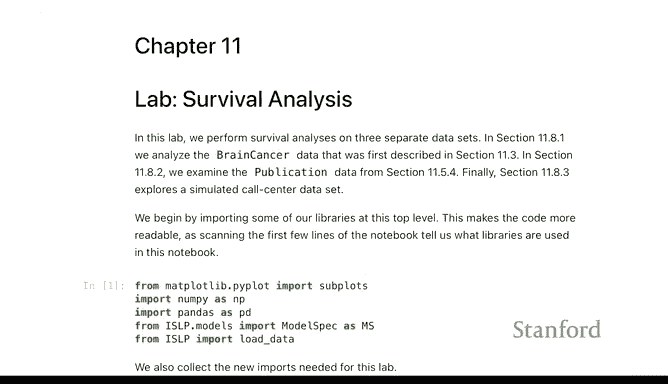

There are some specific packages for。For survival analysis that we'll use and that's in this lifelines package。

 So the topics we're going to talk about today are fitting the Kaplan Meyer curves and fitting Cox's proportional hazards model。

 as well as some test statistics the log rank test you would have seen in the chapter and will also mention a multivariate log rank test。

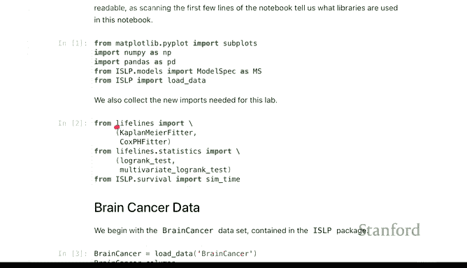

In the call center data， we simulate some time， so we wrote a little utility function here if you specify the hazard function and covariates how to draw time from that distribution。

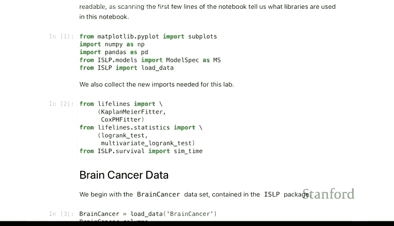

Okay， so our first data set is the brain cancer data set。

And we're going to start off by fitting some simple Kaplan Meer curve to the data。

 so there are several know features in here for each patient one of them is the diagnosis and I think that's the cancer type there's the subject sex。

 this KI is called the Kowsky index a measure developed by physicians to measure somehow the severity of the tumor。

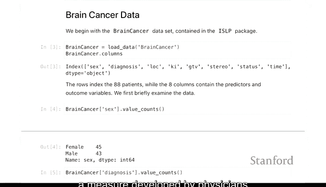

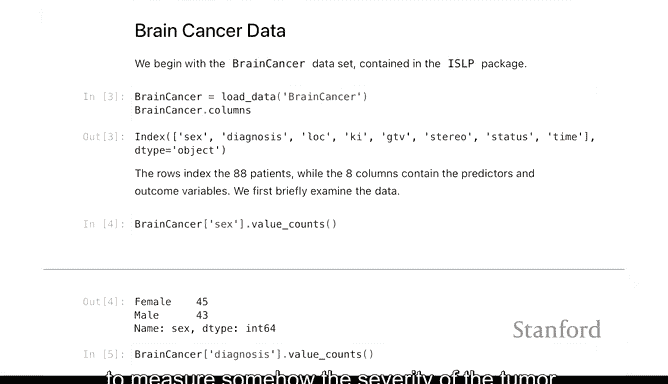

G GV is tumor volume。 And then there's these key variables here， status and time。

 And these are the variables that over and over again， you'll see in survival analysis。

 Time is the time recorded for that subject。 and status。

 this is that censoring variable that Tvor mentioned。 So if an event occurs。

 typically status will be one。 So if in this study， we have a patient and they actually。

 if if the outcome is death， the patient died， then their status will be one。

 But if they were still alive at the end of the study， well then their status will be 0。

 but we would have known they survive at least to the time this time recorded in the experiment。Okay。

 so theyre。88 patients here。 And let's start off by。

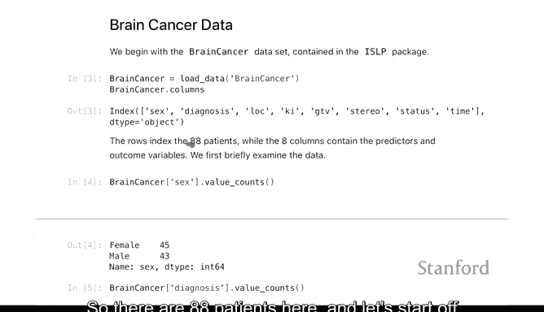

Looking at a simple Kaaplan Meyer curve。Okay， so the the Captain Meyer curve， the。

 it looks something somewhat like。啊。So I can learn an estimator in that you first instantiate it and then you call a fit on it。

It's。You know， I I， I'd have to， would have to look at the package to actually know if it is a psychic learn estimator。

 The Cox proportional hazard model is much closer to a psychic learn estimator。

 The Kaplan Meyer curve is really just an estimate of the。

The survival function or the distribution function of the time data。

 and it takes into takes two arguments。 One is the outcome Y， and the other is the status outcome。

 And actually just looking at this signature， I can tell it's not a psic learn estimator。

 because for those， this would be a set of features。

 the first argument that would be x and this would be y， but that's not how the signature is。

Okay。So it has a plot method。 And we're gonna take a look at it。 Okay。

 so this is what the Kaplan Mere。

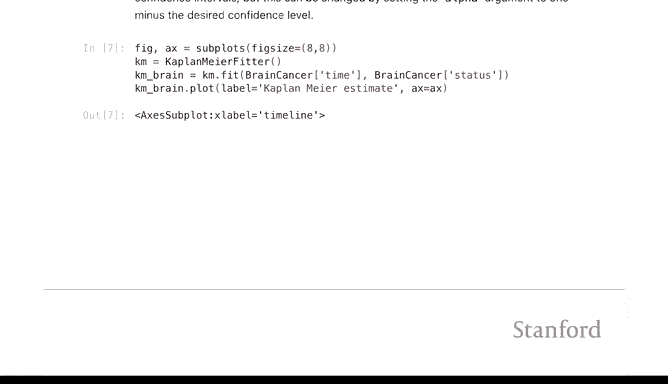

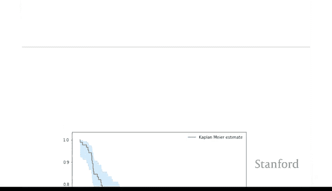

Cerve looks like， and it plots here。 This is。The survival function， S of T。

 and this is the probability or this is the estimated probability that a time is bigger than t。Okay。

 and that's actually a very thin pencil。 I'll also to fix that。

 So that's  one minus the distribution function。 Yes， let's put that in。 You can make the。

It's pain thicker， Jonathan。 Yes， let's see how that is。 And that's well slightly thicker，1 minus。

The distribution function， F of T。Okay， and what we see here。

 we get a point estimate of the survival function and we have error bars here。

 and one thing we note is that as we get to larger and larger times。

 we get wider and wider error bars and that's because well， the way this estimate is produced。

 it's sort of in effect looking at something like the number of people who have survived past 50 here roughly and uses that to compute the variance estimate。

 but there are just fewer who survived to 50 then who survived to 10。

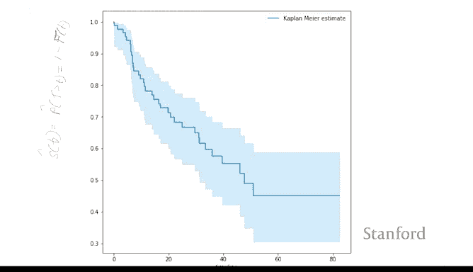

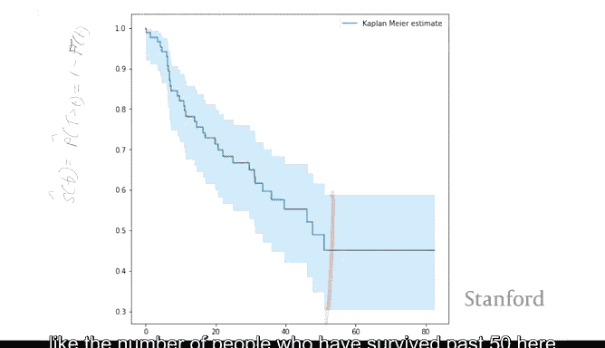

Okay。So often we'll have some categorical variable and that might be of interest。

 And we'd like to compare survival between the two different levels of the category。

 So here we're gonna to do a sort of stratified plot or or plot of the of the Kaplan Meyer curve in in within both sexes for this data。

 we don't have any reason to believe that sex is is an important predictor。

 but we're just showing you how to use a a you know， a predictor to produce， you know。

 a plot to compare the two estimates。 It looks pretty important because it looks like males die much more quickly than than females。

 Yes， on this data。 Okay， Yes， so。

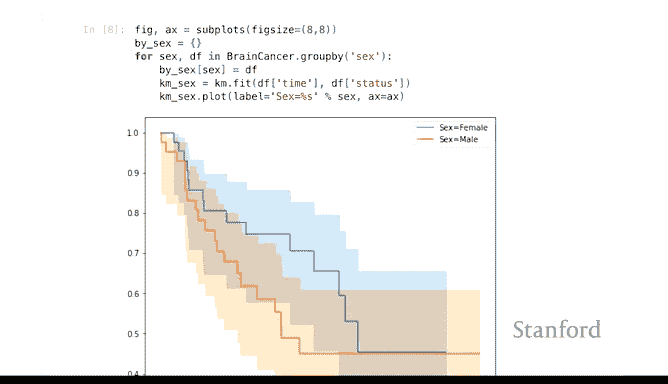

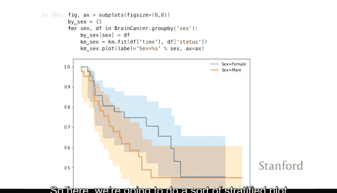

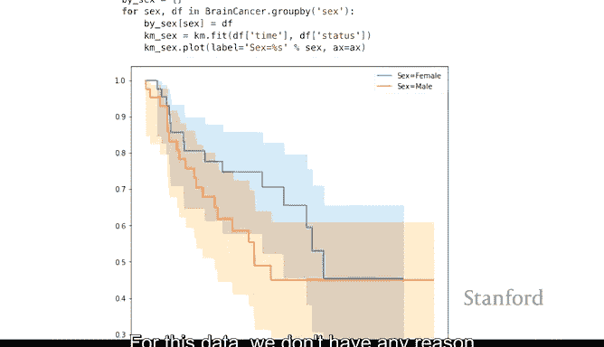

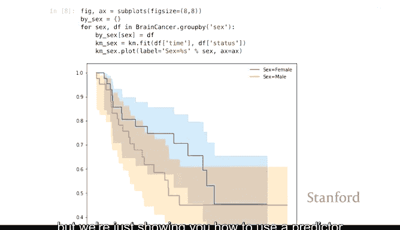

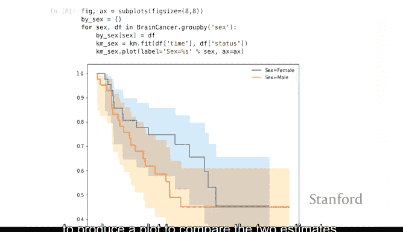

It may be important here， but I just， I don't know。 I。

 I don't know enough about the source of this data to know whether this was an interesting category。

 but that's a good observation。 though， I guess if we should note probably that the error bars are a bit overlapping。

 but theres。Looks like there might be some difference。

 maybe a bigger sample size would elucidate this。Okay。

 so all we're doing here is we're just using this group I of the data frame， and that gives us。

Individual data frames that we can use to fit up in the myer curve。 And we're just plotting those。

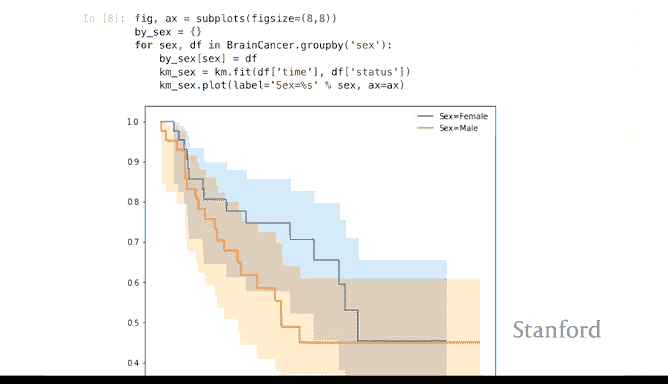

Okay， one thing I've done here is I've sort of， I've collected。

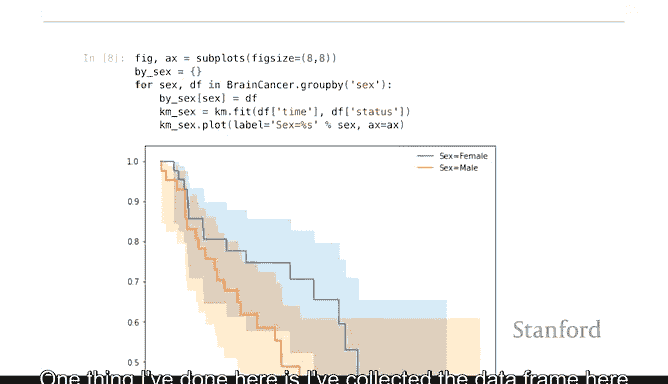

The data frame here in this dictionary bi sex because we're going to use that in a few cells here。

 but this isn't used to making this plot just as we're breaking the data into the two groups。

 I'm going to collect this because we're going to do a test to see whether there's a difference in survival between male and female that'll settle it。

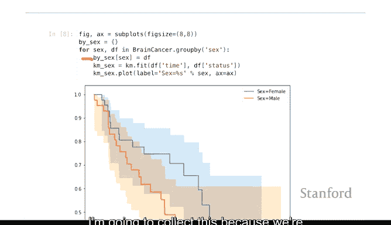

Yes， let's see what the P value is。

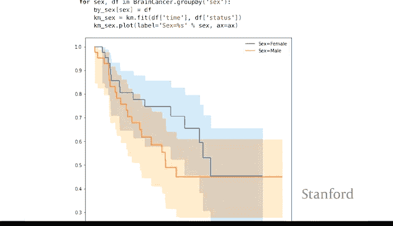

Okay， so for a categorical variable with two levels， you know。

 the a common test used to to test whether there's a difference in survival is the log rank test and the log rank test basically takes。

 you know， the information needed to fit two Kaplan survival curves and that is。

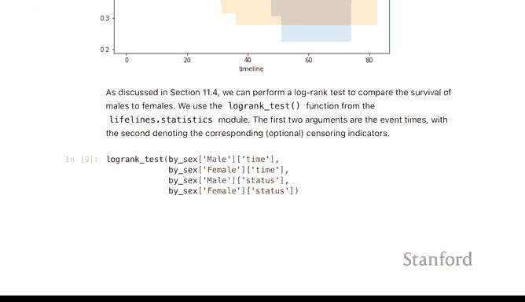

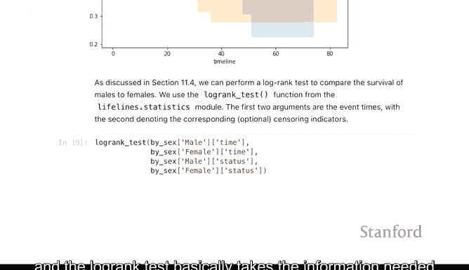

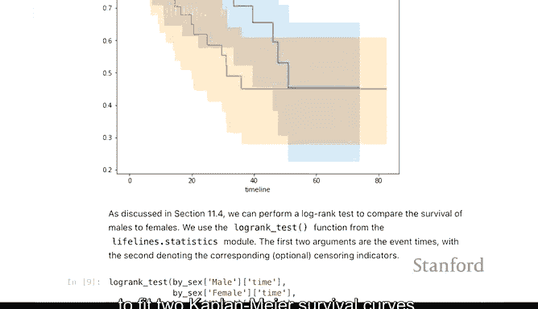

For the one group， say the male， it takes the time and the status and the other group， the female。

 it takes its time in its status， and it gives you some overall test to test whether there's any difference in survival。

 It's not specific at any particular time， but somehow averaged over all of the time points And the way this test looks the way the test is constructed。

 which you might have read about。

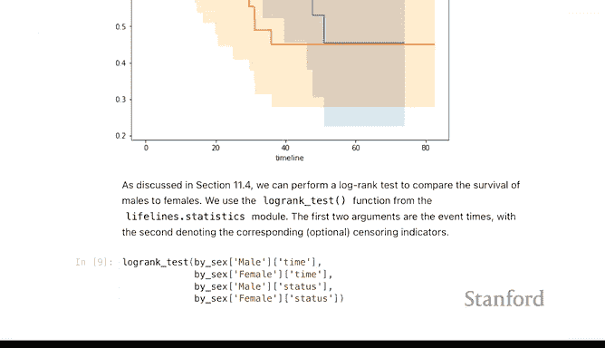

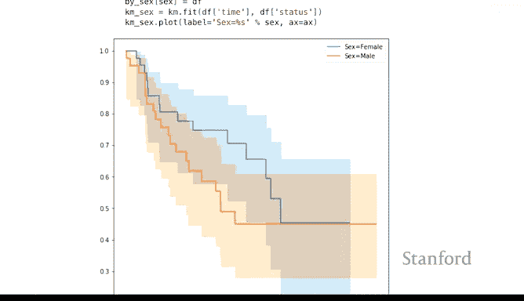

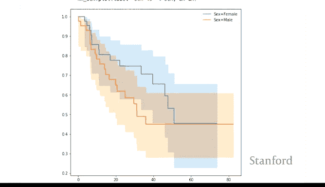

In the chapter is that it sort of looks at compare survival。

 makes a little two by two survival at every time point and sort of pools these in some fashion。

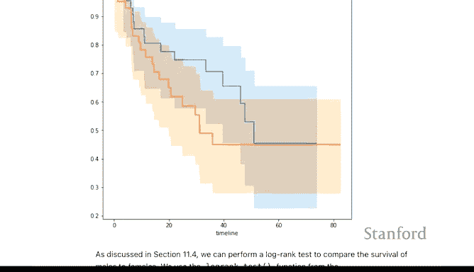

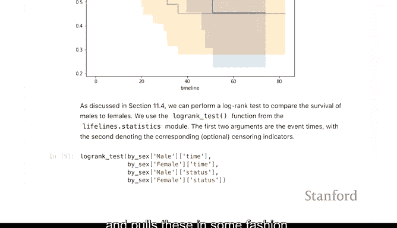

Okay， so the log rank test， these are the results。Oh good。 the P value is 23%。 Okay， so we。

 I'm saying good for the male。 Yes， yeah， I I， I guess we're okay here。

 So if this P value is really small， that would be， you know。

 strong evidence of a difference between survival and male and female。

 It doesn't seem to be in the Not that you'd want any of these cancers。 but no， no， yeah。O。So。

You know that if we have one categorical variable， the log rank test can be used to compare two groups。

 but often we have other covariates。 And for that， we need some kind of regression model。

 That's this cock proportional hazard model is the sort of default regression model for time to event data。

 and it's fit a lot like。

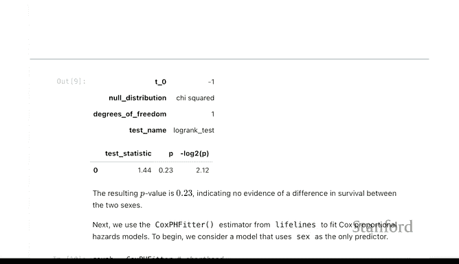

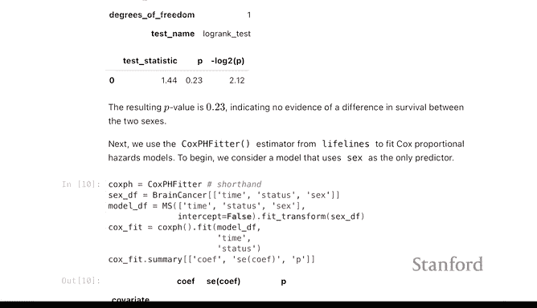

Our other models， except the response again， is this， there's an event time and an event status。

 Okay， so let's say in this first model， we just look at 6。

 the same one we used with the Captain Mayer test。That's right。 This is just a simple model。

 But later we'll have other features。 Okay， and and look at and notice the P value is exactly the same as in the。

23。 That's interesting。 I wonder if that's related。

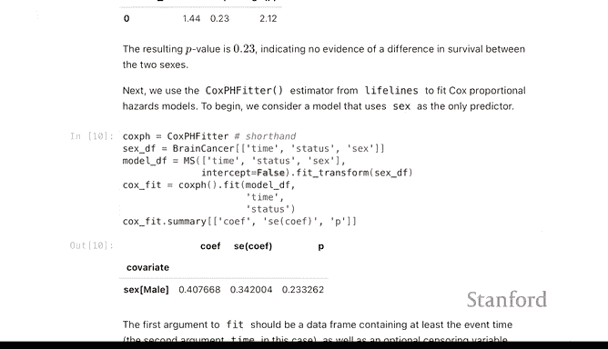

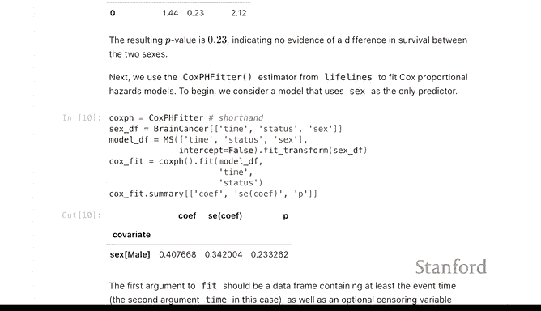

Actually， it's， this is， this is a， you know， a well known fact when you have a。

 a cox regression model with a single categorical binary categorical variable， the。

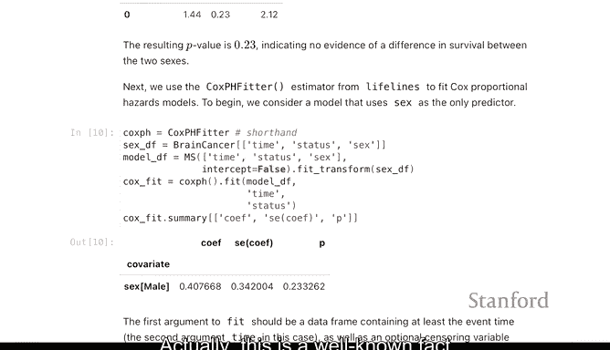

The， the， the test， actually， this is probably， this is the wall test。

 It may not be exactly the same1。 I think the score。

 it's called the score test exactly agrees with the log rank test。 but the wall test。

 the score test and the likely ratio test。

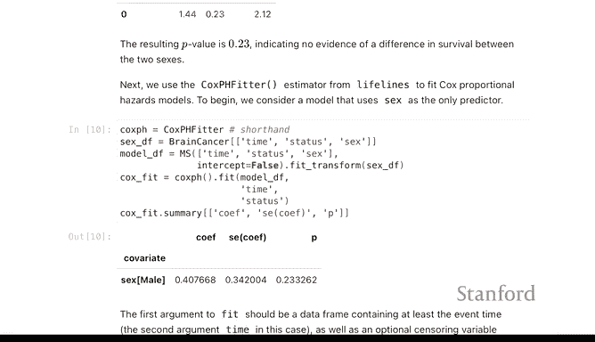

You would learn in some other class are often very similar。 We're not going to dwell on those here。

 but we're not surprised that this is 0。23 so you can think of this cox regression model as somehow a generalization of the log rank test if you were to test for we might include something like the Kowsky index and there would still be a P value for sex allowing for the effect of the Kowsky index that would be different than the log rank test but so in that sense the cox model kind of generalized the log rank test。

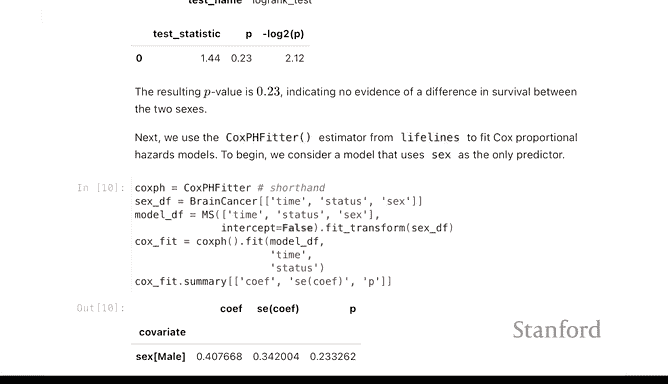

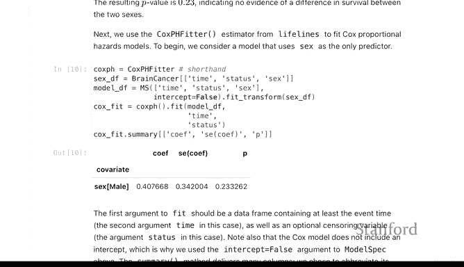

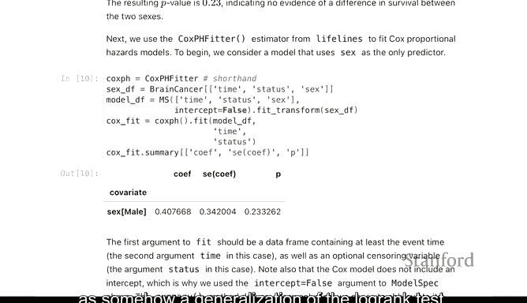

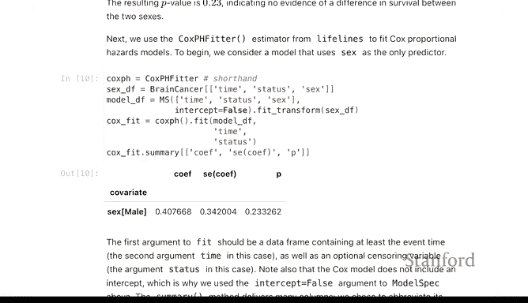

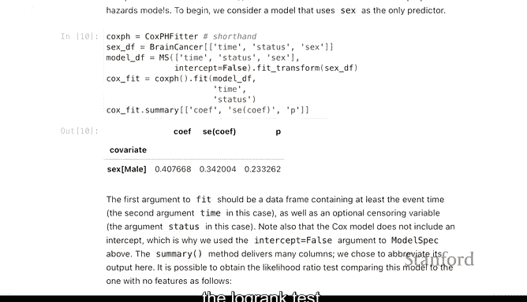

Okay， let's just take a quick look at how this is fit。 Where we make a design matrix。

 It's a regression model。 So we use our model spec that we've done before。 And so when we call。

Called the fit function on the cox proportional hazard model object。 We give it a data frame。

 and we have to indicate here two columns。 This is。

 these are the two variables that specify the outcome， right， This is the， the time variable。

 and this is whether the， the observation is censored or not。

So this looks like a psyt learn estimator， except psyic learn estimator would just have x and Y。

 This again， has a little argument。 that's because we need two columns to specify the response。

 but other than that， it looks kind of similar。

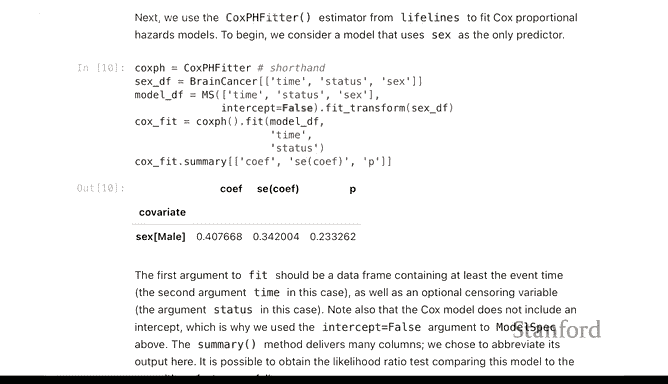

Okay， so we can also actually directly compute the log like the ratio test。

 and that's another test similar to the score test and similar to that walled test and its P value is also 0。

23。

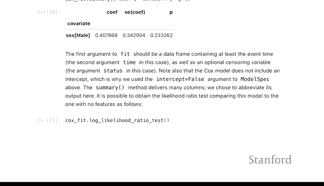

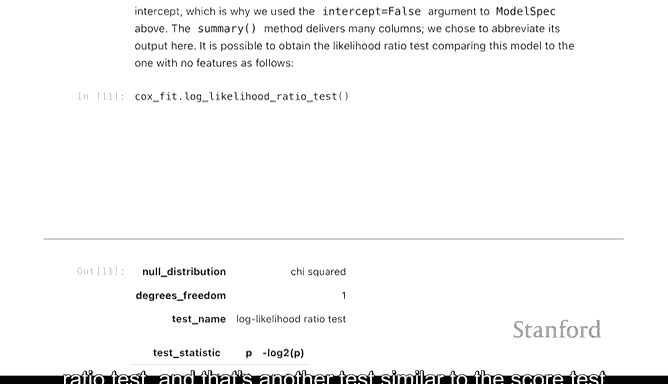

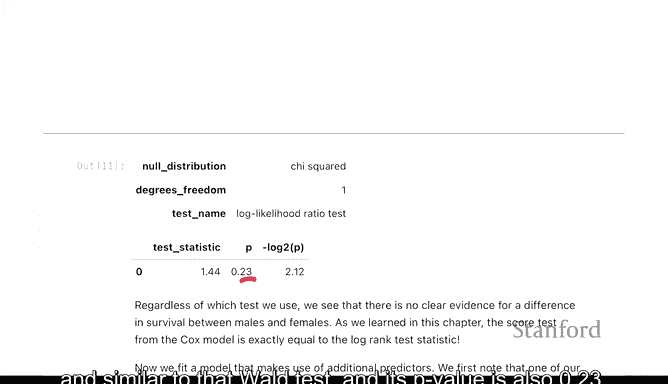

That's related to the fact that the score the likely live in the world test are often kind of similar。

 The score and the log rank exactly the same so they Yeah， yes， yes。

 this one is not the score test though this is that's what I mentioned。 Yeah， yeah。

 the score test is the。 Yes， yes， so， you know， this class is not all about these different kinds of tests。

 But it's， you know， youre， you'll hopefully move on to do some more statistics And seeing some of these facts is helpful And this is just a numerical example of that。

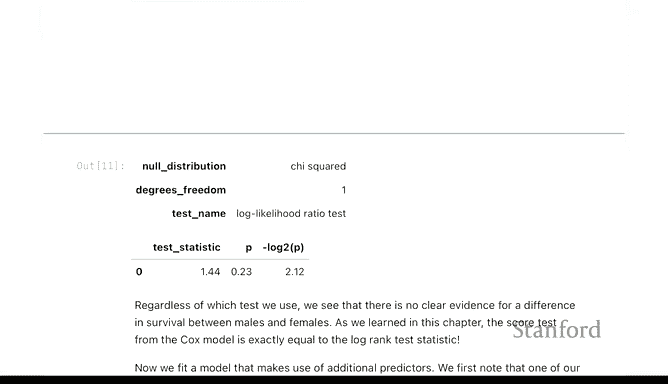

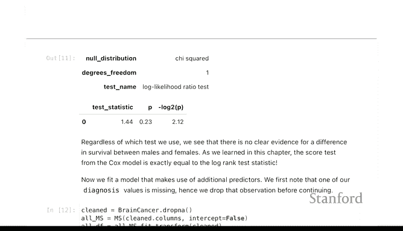

Okay， so we're gonna fit， you know， a more complicated regression model just。Because， you know。

 there might be other。 well， there， th， there。There are other features other besides just the sex of the patient that are likely important for survival。

 and we'd like to understand how they affect survival。

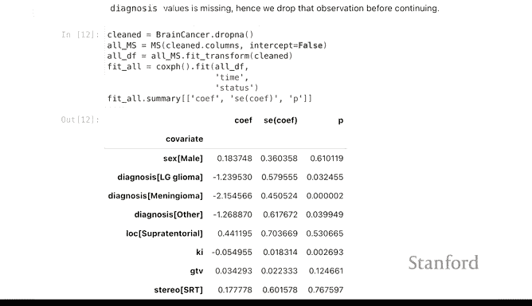

So it turns out that some of the。

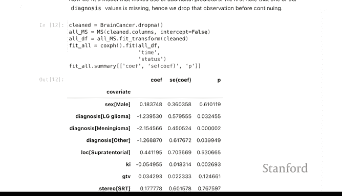

Some of the one of the diagnosis values is missing。 So we have an incomplete data set。

 We're going to remove that with the drop N A method。 and then we're going to， you know。

 make a design matrix as we've done for regression before。 And then the rest of this。

Its to just the same as the cell above， except now instead of having just sex。

 we have all these other variables。

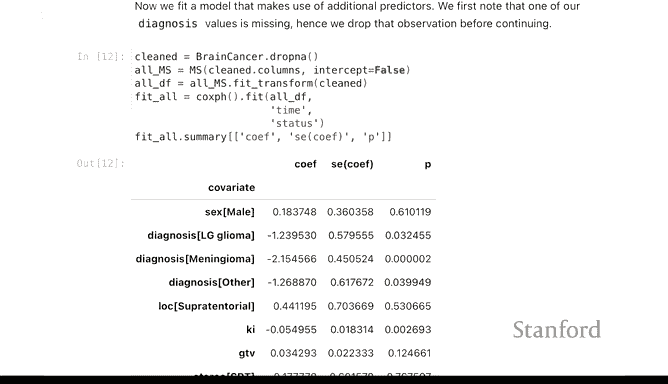

And you can see these this diagnosis group。 This is the the。The type of cancer。And you can compare。

 So， so let's just pause for a second to think about what the sign of these coefficients mean。

So the way the coefficients should be interpreted are， you know， well， the the simplest。

 let's just do write out what， what the hazard rate looks like for， if I just had a single predictor。

 very， you know， roughly speaking， the hazard rate for。Let's make a bigger pencil。好的。Oh。

 I guess I can do that。Yes， hazard rate T and X is something like。Some baseline hazard， right？

And E to the beta times x。That's very poor handwriting。

 but that's not just because I'm writing a tablet。 I have poor handwriting。

So so and what is this hazard rate， this is sort of some instantaneous measurement of how quickly you're going to fail So if beta times x is positive。

 that means you're more likely to fail at that time whether if it's negative you're less likely to fail so if we have a negative coefficient like this Kowsky index here K has a negative coefficient。

 that means if I have a high positive value of Kowsky index。

 then the beta corresponding that will be negative。

 and so all other things being equal having a higher Kowsky index is sort of associated with longer survival。

Okay， so you can use that similarly， we can see that maybe men in geooma have perhaps longer survival than gliooma here。

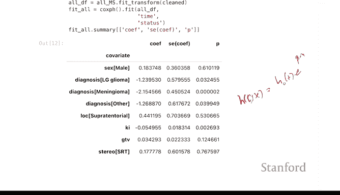

Okay。So。We have these different categories of diagnosis， different cancer types。

 We might want to now make something like the Kaaplan Meyer plot that summarizes the survival curve for within these each of these groups。

 But of course， within each group， all the other features are varying right There's going to be men and women in every diagnosis group。

 there's going to be people of different age， people of different Knasky index。

 So to plot a survival curve， we have to kind of pick a typical value。

And so we're going to pick we write this little function here that's going to。

 pick a typical value for each of the features， having fixed that。

 then we could change the diagnosis and for every different diagnosis。

 we'll get different survival curves。

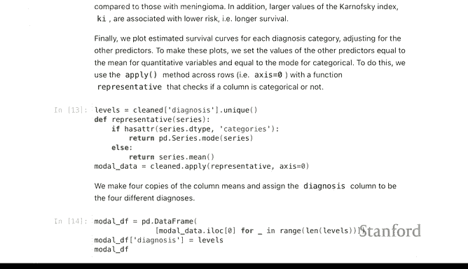

So that's what these two cells are doing。

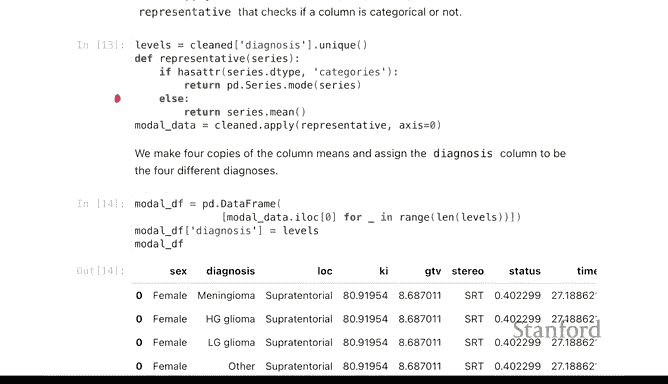

And。

We can look， let's just take a look at the the plotted survival curves。

So for each of the four diagnose， there's a typical value for all the other， all the other variables。

 And this is just。

Well， the cox model， it specifies a model for this thing we call the hazard rate。

 which is this instantaneous rate of failure。 And from the hazard rate。

 you can get the survival curve。 So this just plots the estimate of the survival curve for four different sets of covariates。

 The only difference between these is just what type of diagnosis。

 If we changed the sex or the Knasky index。 All four curves would move in unison。

 They wouldn't look all the same。 But this gives some idea about， know， relative differences。So。

 we see that。The， you know， I mentioned earlier that men in Geoma had a more negative coefficient。

 so it might be associated with。survival。 and we see that at the end of the study。

75% rough or 70% are so are survived compared to the gliooma and HG gliooma is looks very。

 very severe really aggressive。

