# 斯坦福大学《统计学习导论2023R语言版｜An Introduction to Statistical Learning with R》中英字幕 - P87：-087-Statistical Learning_ 12.2 Higher order principal components.zh_en - GPT中英字幕课程资源 - BV1yU421o7WA

Okay， so we've seen how to compute the first principle component and the description was that it provides you know a summary of the data that's got the most variance。

 Well， you can go further if you've got P variables。

 you can now ask for a second principle component。Wwhichch also has large variance。

 but unless you want to get the same one as the first。

 you have to put some constraint so the constraint。

 the natural constraint is that this second variable will be uncorrelated with the first。

 so it's going to tell you different information about the data and subject to being uncorrelated。

 it's going to have large there's largest variance so that's a problem which we can phrasing pretty much the same way it's going to be a linear combination。

 we've got it now indexed by two instead of one， there's a sub2 there and and subject to that constraint of being uncorrelated。

 we want it to maximize the variance。

Now there's some interesting math that comes with this。

 it turns out that being uncorrelated also means that the alphas the fees are bigger pardon that define the principal component as vectors。

 right those are the loading vectors， so the fees for the second component。

Defins a vector that's orthogonal to the fees for the first component。 So it's just the property of。

 of the solution。 And so we can characterize that。

Lack of correlation as ortho foggonality of the fees。

And the solution turns out also comes from the singular value decomposition of x。

 So the second principal components defined by the second right singular vectors。

 and there's going to be a third component of fourth component and so on thats that。Sequially。

 maximize variants subject to being uncorrelated with all the previous ones。

And it turns out that you can have it most n minus1 or p principal components。

 so n is a number of data points， sometimes p is bigger than n， and if that's a case。

 then be restricted by n， but otherwise we just restricted by P， the number of variables。

So we get a complete decomposition of the data matrix in terms of its principal components。

So as an illustration， we're going to show you an example using some data on USA arrests。

So for each of the 50 states in the United States， weve got there number of arrests per 100。

000 residents for each of three crimes， assault， murder and rape。

 and we also have measured the urban population， the percentage of the population in each state living in urban areas。

So there's 50 observations， so each of the principal components are going to be n vectors with length 50 because they derive their new variables and we'll get at most four principal components and each of them will be described in terms of loaded in vectors of length p equals 4。

。In this case， we actually standardized the variables before we did the principal components to have means0 and standard deviation1。

 that's a fairly standard practice and we'll get back to that in a moment。

 but let's first look at the results。

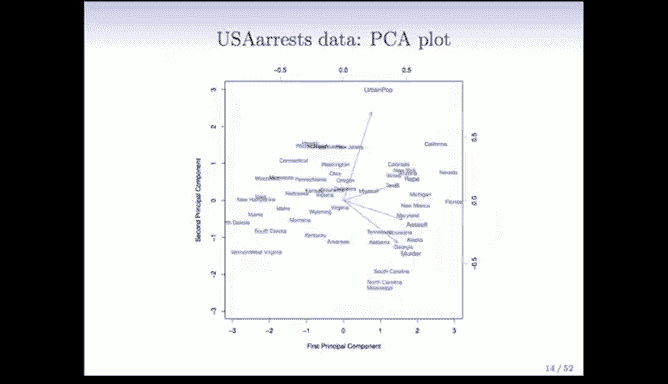

So here the results， this picture is called a byplot and it's a way of displaying the principal components and the loadings in a single plot。

So each of the blue。Well， they're not points， but marks on the picture is， is a state。

 And so their names are there。 The origin is at the center over here。

 So everything's been centered with respect to the origin。And on the plot as well。

 what we see are the load in vectors。 So this plot is the plot of the first principal component along the horizontal axis here and the second principal component and the vertical axis。

 So we plot the first two principal components， which is fairly standard because you know。

 those are the most two important ones。And and so in order to understand the principal component so each observation。

 which is a state has a score on the principal component。

 and so some are large and positive and some are negative， and then to understand these scores。

 we look at the loadings。

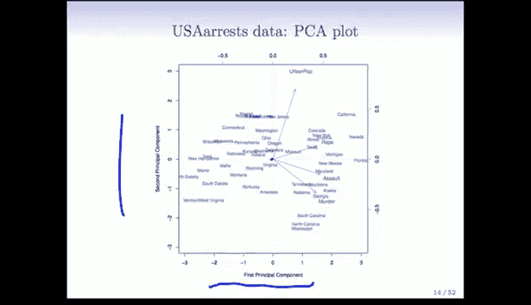

And so the loadings are plotted as vectors yet because weve got for each variable。

 we've got its loading on the first principal component and the second principal component。

 so that allows us to plot it as a vector in the space。

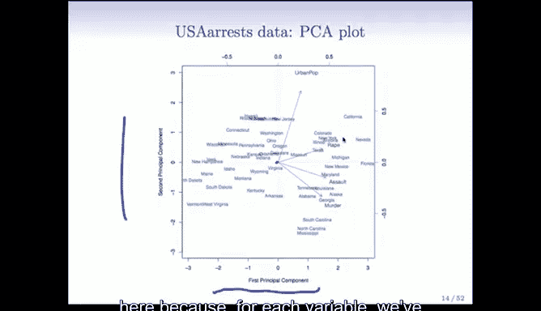

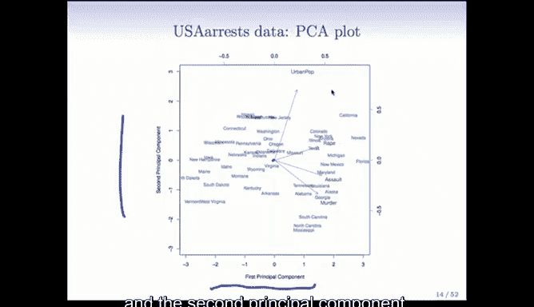

And what we read from this is that the first principle component is got positive loadings。

 large positive loadings on rape， assault and murder。

 So all of the crimes are positive loadings on the first principal component。

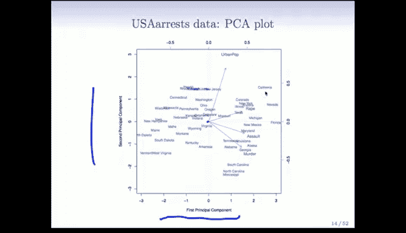

So that tells us that this direction on the positive side is loaded up on all three crimes。

 So roughly about the same amount。 okay， and so this is a。These are going to be high crime regions。

 these are going to be low crime regions， and so now you can look at where the states's life。

 for example， Florida is sitting right out on the first principal component。

 so that's a high crime area。And， and so on。 So you look at the positions where states project to see how they relate to the principal component。

Now， the second principle component seems to get largely loaded on urban population。

 So this is a high urban population。 This is low urban population。

And you can even interpret things like rape seems to be on the positive side in high urban populations than in low urban populations so again this bipl is a picture that lets you both display the first two principal components and also display the loadings and give you a way of interpreting in the pictureir what does it mean for like the minus3 what is that？

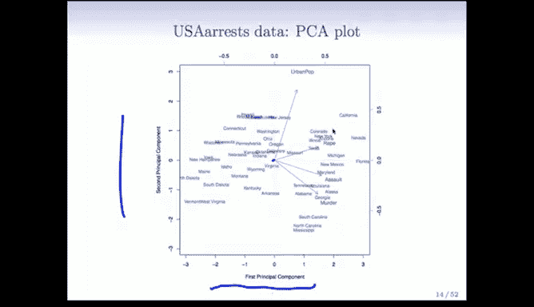

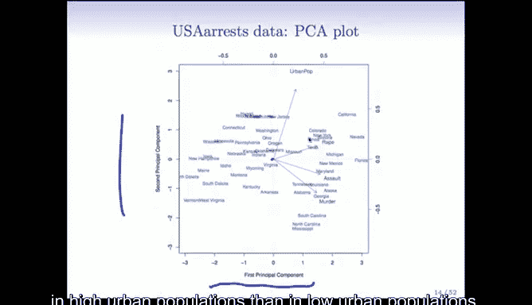

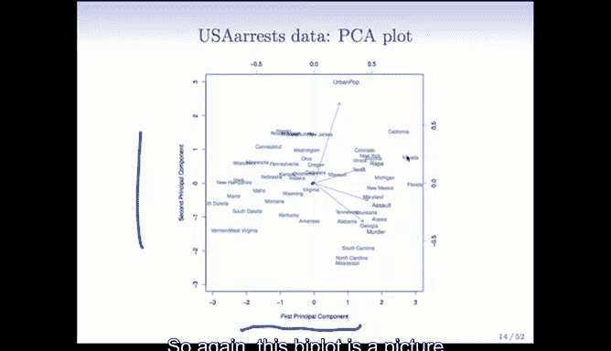

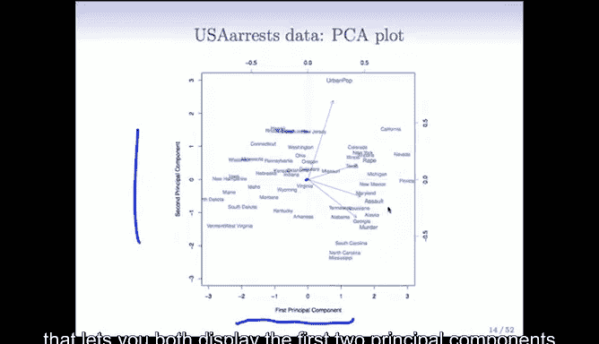

Well，-3 means that you low down。 the actual units are somewhat standardized units。

 but it means you on the negative scale in the crime rate。 So these are are low crime areas。

 And so some of the extreme low crime crime areas are if I can read the text Maine is a low crime area。

 New Hampshire Iowa， Yeah。

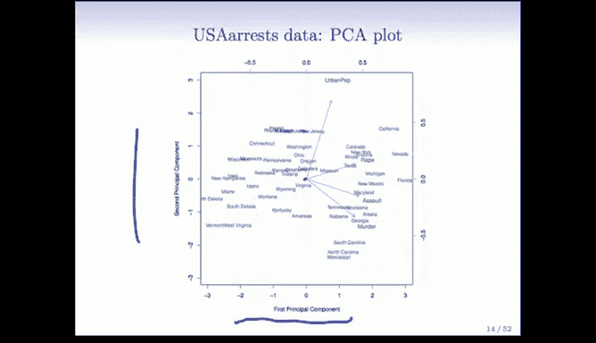

Okay， so here are some details that explain the figure which which you've just gone through and you can read it in your own time。

Let's customary also to produce a table of the loadings and so this just summarizes what we saw in the picture。

 so we see that in the first principle component， pretty much equal loadings on murder assault and rape。

 whereas urban population as somewhat of a lower loading is the second principal component。

 urban populations got a high loading and。Murder has got quite a high loading as well。 So oh。

 that's a negative loading。 And， but rape was a slightly positive loading。

So you can actually look at the numbers， but it's often better and more useful to look at them graphically。

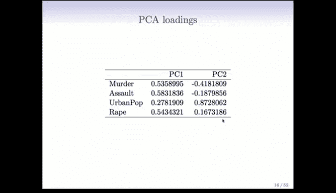

。Okay so that's a primary use of principal components to come up with summaries of the data that's explain mostly what's going on there's another review of principal components and that's in terms of approximating a cloud of data by a low dimensional hyperplane and it turns out these two views are equivalent to each other so here a data it's an artificial data in the left- hand plot we see some points they meant to be visualizing them in three dimensional space。

And what we've shown you is a two dimensional hyperplane that's meant to approximate those points。

Now， the points are colored， but that's just。To help us explain what's going on。

 this seems to be like a clustering but。What we see is that this hyperplane sort of passes through the middle of these points。

And we ask him for a hyperplane that makes。That gets as close as possible to the points。

 And what we mean by that is that if we take each point and compute the shortest distance to the hyperplane and sum the squares of those distances。

 we want the hyperplane that gets closest to the data in that sense。

And it turns out that the hyperplanes defined in terms of the two largest principal components。

In other words， the direction vectors that define the hyperplane。

 you think of having two direction vectors in the hyperplane。

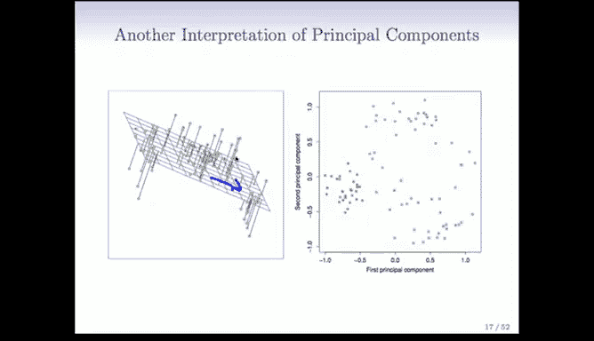

It'll be orthogonal to each other。 Those are also the two direction vectors of the largest two principal components。

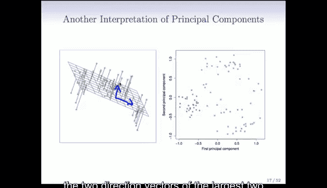

And this sort of makes sense getting closer that we've got three， mean three dimensions there。

 so we've got three variables。To get closest to the data， to find the plane closest to the points。

Were asking actually that the projection of the points in the plane are spread out as much as possible。

 That'll be a characteristic of the solution。 In other words。

 spread out means as much variance as possible。 So that gives you an intuition of why that two principal components also characterize this solution。

 I'm confused here。 We you described of being close to points sounds to me like like least squares regression。

 which we covered earlier。 So it's a difference somehow。 that's a good， that's a good question。 Rob。

 these squares regression is also fine in a hyperplane that gets close to the data in some sense。

 But there close is defined just in terms of distance from the hyperplane to Y the response。

 which was a supervising variable。 But here we don't have any why。😊。

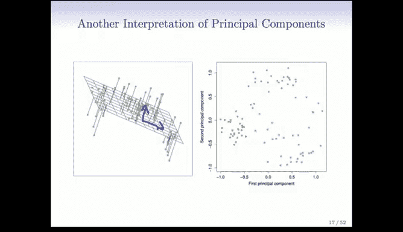

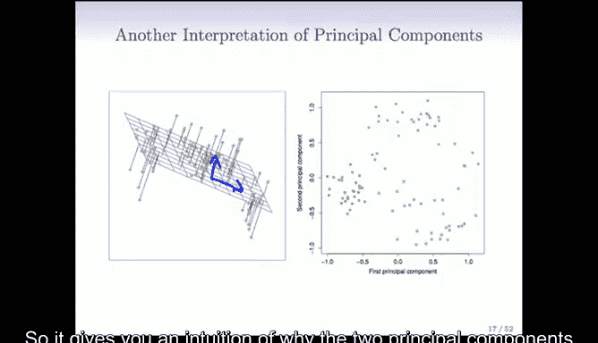

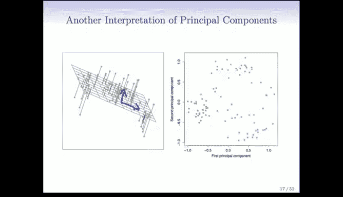

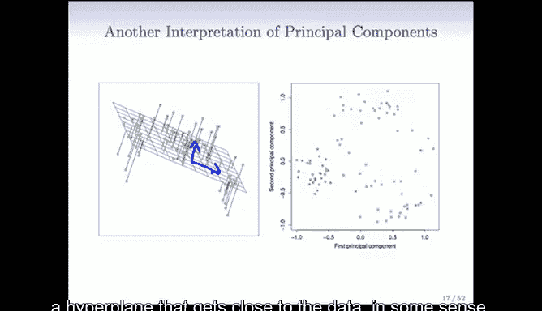

So yeah， it's shortest distance of， of the hyperplane to， to the X's themselves。

 Could you draw a picture into as scatter plot。 Did you show this。

Should I draw a scatter plug to show this So a distinction between those。 Okay。

 so for linear regression， we have Y。 And well， I can only draw 1 x。

 Maybe I can draw a second x in the picture。 So that's x 2， x 1。This is x1。

 and we got a whole lot of points。

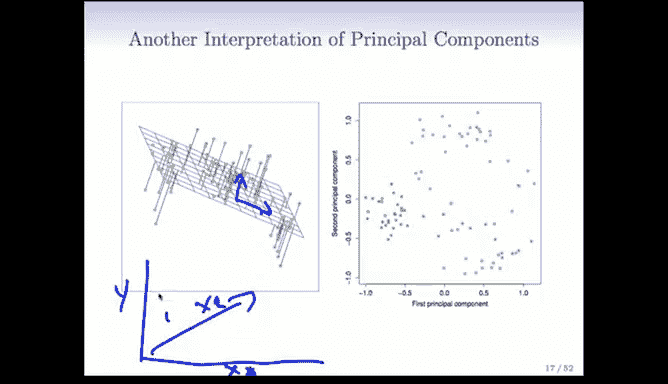

And now we find a hyperplane。

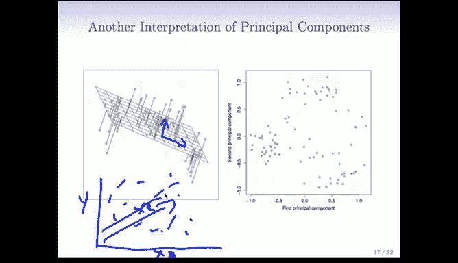

， but in linear regression we focus in just on this distance over year。

 which is not perpendicular to the hyperplane。 It's just distance in the wide direction。

Whereas in principle components here。😊，There's no special variable。 That's a why。

 And so we define distance in terms of the perpendicular distance to the hyperplane。

 How's that picture of。lot bad than I could have done， but。Okay， all right。

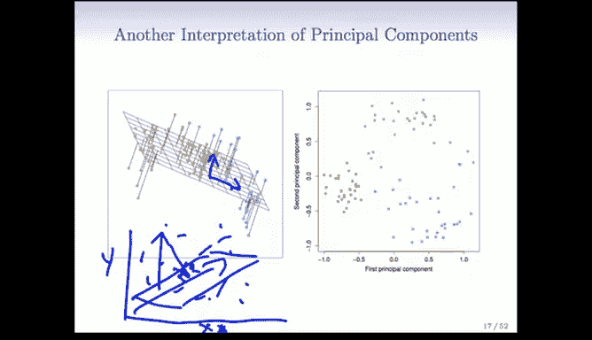

So this slide here just describes what we've just gone through in detail。Now。

 I deferred this point scaling of the variable matters。

 So here's our first two principal components in our by plot again。

 but this was computed when we standardized each of the variables to unit variants。

 What if we didn't do that。

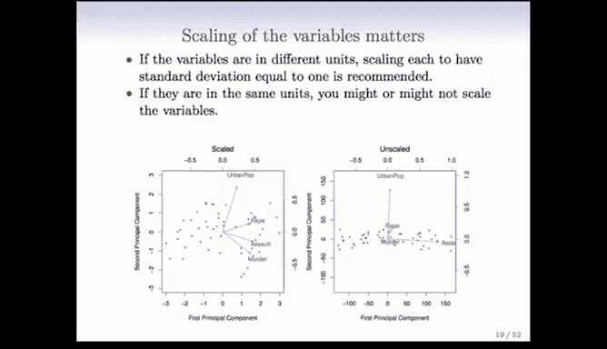

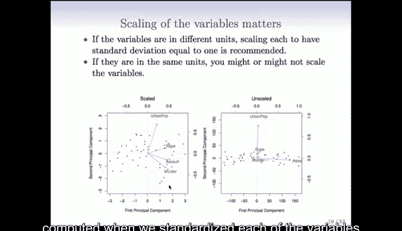

Well， you get a very different picture then。嗯。The the picture。

 the first principal component seems to be mostly assault。

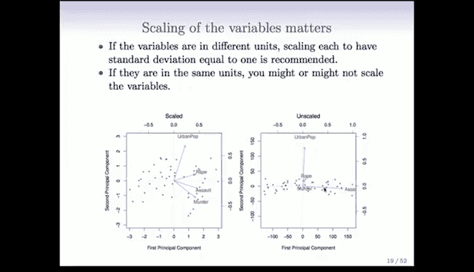

Well， it turns out that the variable of salt had by far a much bigger variance in the original data set than any of the other variables。

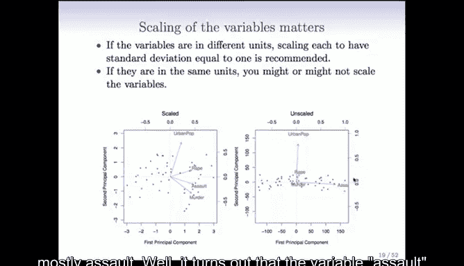

It's just the units in which it was measured。 And， and so it just dominates the the first principle component。

 And， you know， if you have variables that are actually measured in different units。

 it's quite easy to have one variable that just。On its own has a way bigger variance than the rest。

 and it will dominate the principal components。So if you want to avoid the， the effect of units and。

 or just individual variables having big variance， then you standardize the variables and。

In that case， what you're dealing with is is variables all measured on on an equal scale。

 and now you can really see。

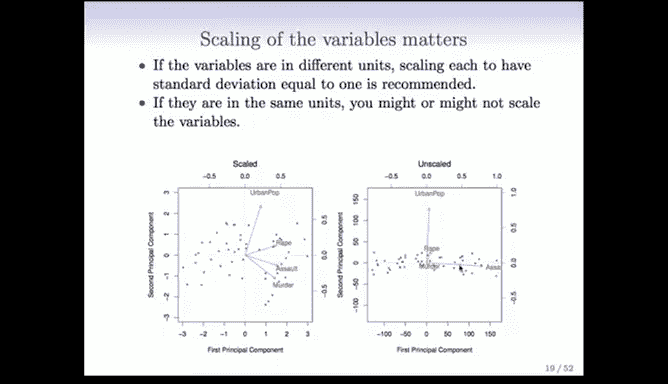

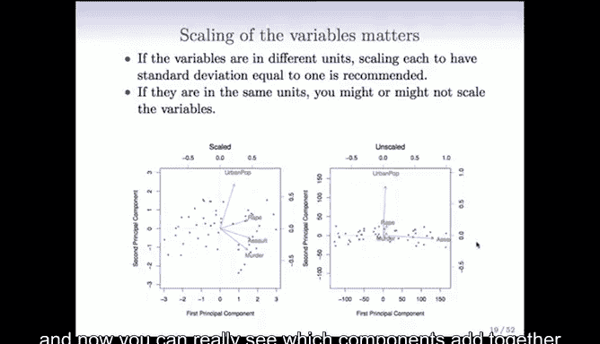

Which， which components add together to give you large variance。

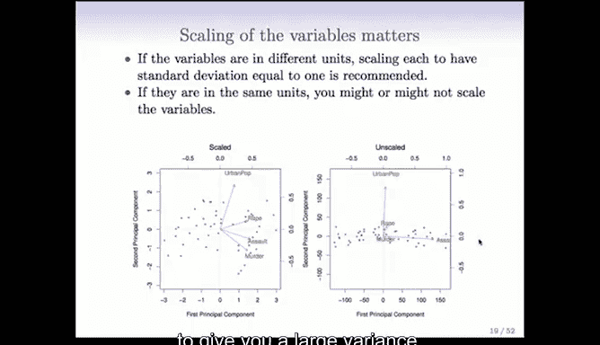

So。It is also associated with principal components， a decomposition of variance。

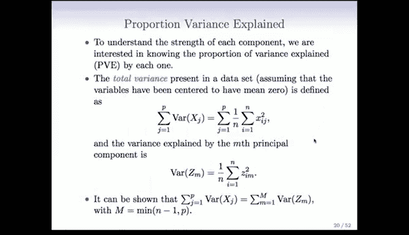

So we start off， we got our variables and we can talk about the total variance that's about to be explained。

 which is the sum of the variance of all the variables and if the variables have been center to have means0 that's given by this expression over 1 over n summation X Ij squared is just going be this going to be the variance of the J variable and we sum that over the P variables。

And the variance of the， of the m principle component is going to be the sum of the Z I M squared。

 Again， the the Zs are are going to have mean0 because the original x is that mean 0。

 they'll inherit that property as well。 So this is an expression for the variance of the m principle component。

 okay。Now it can be you can show that the sum of the variances of all the x's is the same as the sum of the variances of all the Z。

That's just a mathematical property。

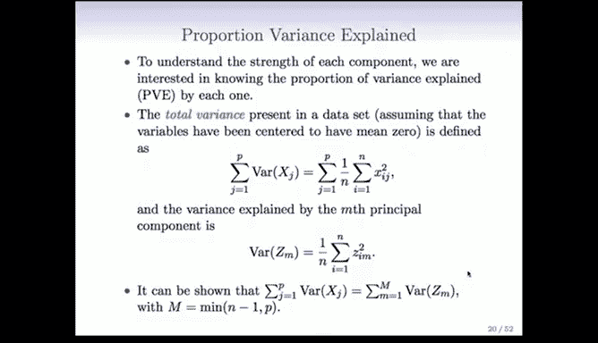

And so we can talk about the proportion of variances explained by looking at the variance of an individual Z relative to the。

 the sum of the variances。 And that's gives you an idea of the importance of。

 of each of the components。

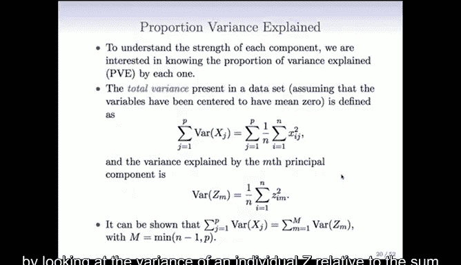

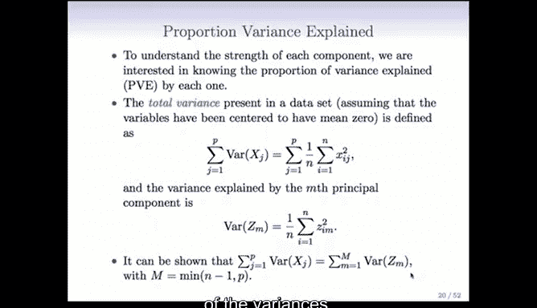

喂。So and that'll be a quantity that's between0 and one。Because the sum of the variance of disease。

Is in the denominator。 Okay， so this left plot on on the on the crime data shows the proportion of variances explained by each of the principal components。

 So the first one explains about 06 of the variance or 60% of the variance。

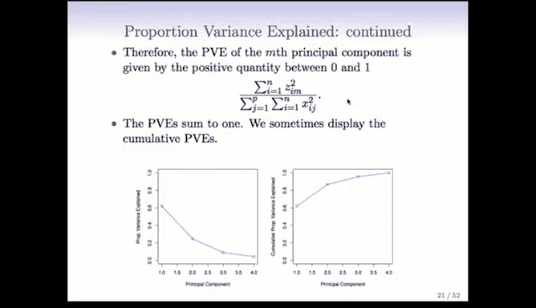

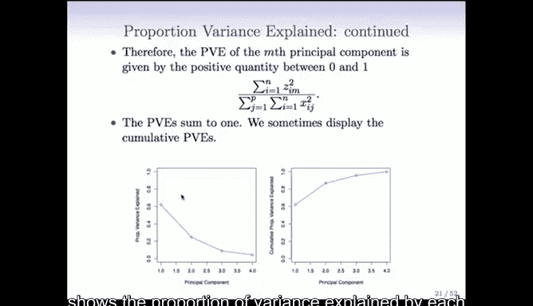

The second component explains just over 20% of the variances and so on。 So these necessarily。

 necessarily decrease。

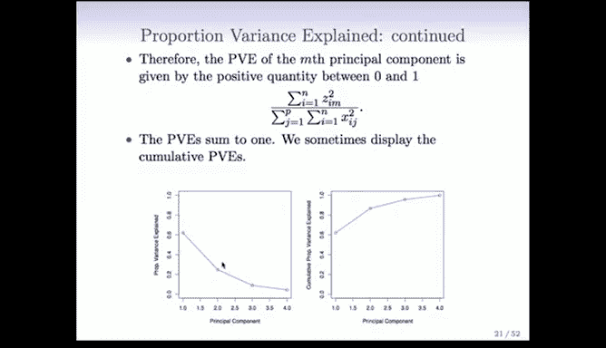

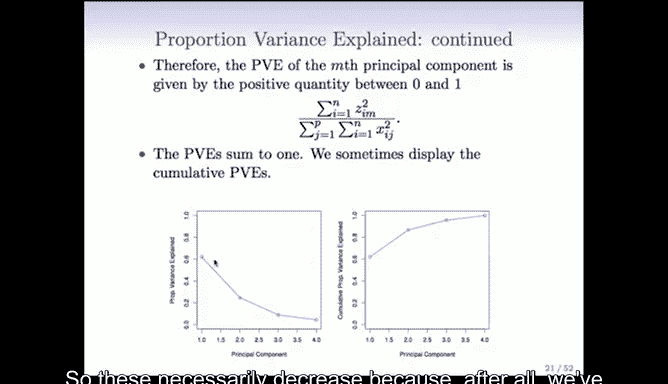

Because after all， we've been asking for the first principle component to explain the most of the variances。

 The second one has to be uncorrelated with the first。 And so these necessarily have to go down。

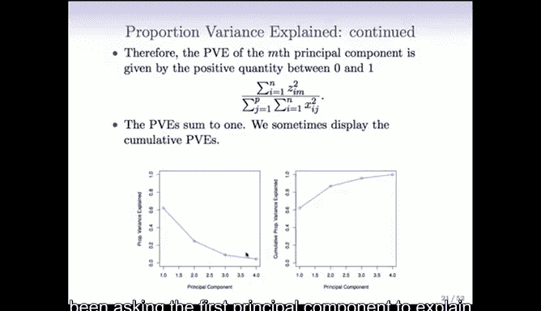

And sometimes we plot the cumulative percentage of variances explained， which is。

 in this case this is the percentage of the first principal component of the total variance。

 this is the percentage of the first two and so on。And the idea is。

That we want to know basically when to stop how many components we need。

 And so we're gonna be happy to stop if we've explained most of the variance。 So if we've。

 let's say the first two principal components explain 95% of the variance。

 we'd be happy to stop there。 Yet， it looks like we need the first three principal components。😊。

Because there's no real hard and fast rules in how many components you need。

 So this percentage variance explained is a one way of sort of getting a feeling of when you've got most of the the variances explained。

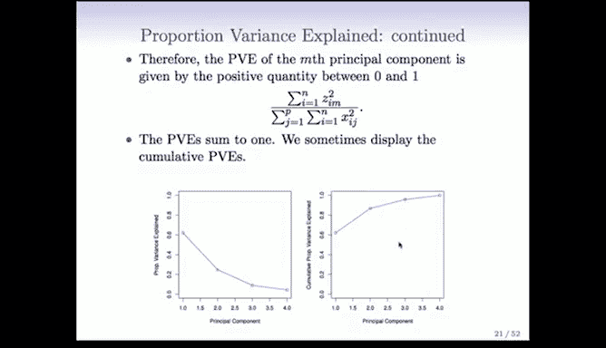

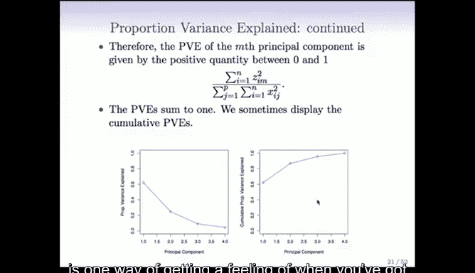

So the question that just come up is how many components should we use and so there's no real simple answer one thing you might think is why not use cross validation is that available for this purpose well it's not really and you might think why not？

We use cross validation in regression。 It was very useful there。 Well， we don't have a response here。

 cross validation was used when we had a response， and we could see how well we were predicting the response when we we left some data out。

 but we don't have a response here。 So there's no supervising variable to help us。

So does that mean cross validations completely ruled out。

 well not really one of the uses of principal components which we touched on earlier in this course was in regression when you had a lot of variables。

 you could use principal components to reduce the data to a few important variables。

I。e。 the first few principal components。And use them in the regression instead。

Well now you can use cross validation because we do have a response in that case。

 and so you might decide how many principal components you need to use in the regression and use principal you could use cross validation to help you decide that。

 but there you have a supervising response。Okay。And as I mentioned in the previous slide that's sometimes called a screen plot and you can look for an elbow in the screen plot so if which is the percent variance explained plot right so if your percent variance explained looked like this。

 if this was one and this was zero and if the first one was up there。

 the second one was over there and then the rest were all down here。

You'd say， well， two principal components seems to be explaineding a lot。 that there's a big elbow。

 yeah。So if you look for elbows in the screw plug， that's often often helpful。

。

So that's the end of principal components again， principal components one of the most useful tools we have in applied statistics it's used all over the place and it' got many other applications as well which which we won't touch on yeah so it's a very useful tool in the next session we're going to talk about。

The second most useful tool or another very important tool， which is clustering。

 and well tell you about two different methods for clustering。

