# 斯坦福大学《统计学习导论2023Python版｜An Introduction to Statistical Learning with Python》中英字幕 - P88：-088-Statistical Learning_ 11.Py Cox Model_ Publication Data I 2023.zh_en - GPT中英字幕课程资源 - BV1u4421A7ZU

So we're going to move on to our next type of data and this data is is thankfully a little less grisly。

 It's talking about the time it takes to have a clinical trial published。So。

So as we mentioned earlier， this is， you know the。While survival analysis often used in biostatistics。

 literature for actual survival time， That's why the term survival is in the in the title。

 It's a general use purpose for for timed data。 And so here we're gonna use the data that's not actual survival。

 just how long it takes to get a。A paper published。Okay。

 so one of the features we're gonna look at on a categorical variable is this pause res feature that stands for positive results to so when a。

What， whether the clinical trial。Finished with well。

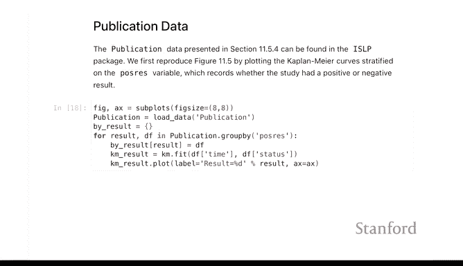

A positive result， maybe for a treatment or a negative result for a treatment or depends on what they studying。

 the trial was successful。 The trial was set out to， to establish establish something。

 and either it did or didn't， yes。

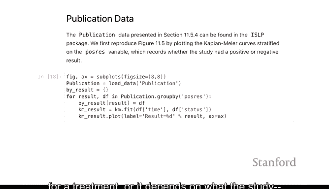

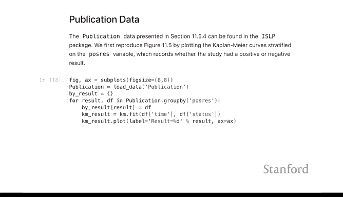

Okay， so let's take a look at these。So， the。We have result equals0。

 that's a negative result and result equals1 is a positive result。

 So we can see that negative result， some of them just never get published and that's you know kind of well known in the scientific literature that its it's hard to publish negative results because well so in this this example a high hazard is good because。

It's the time to the event， which is publication。 yes， yeah。

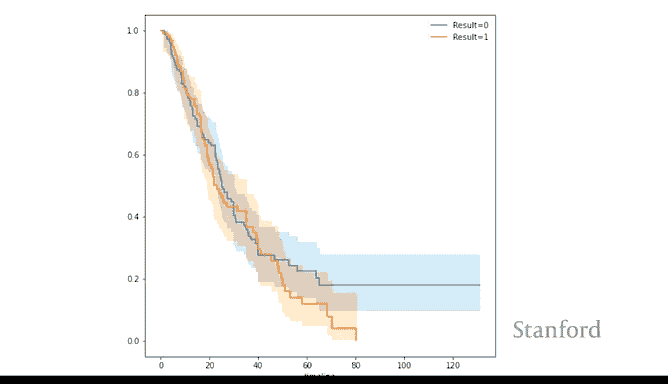

Okay。

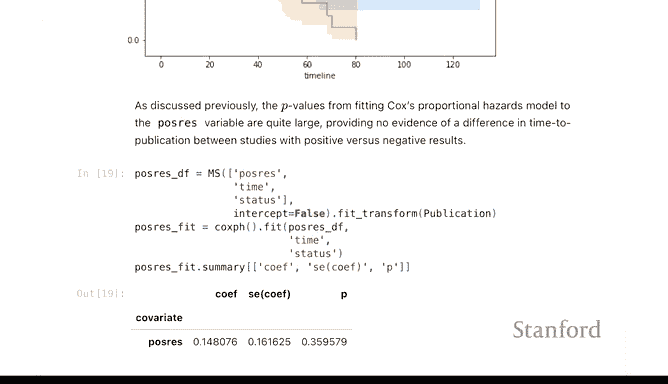

So， again， we can fit a cox model if we wanted to do a log rank test or something close to it。

 we could do it with a cox model。 So this is very similar to what we saw before。

 looking at sex for the different。

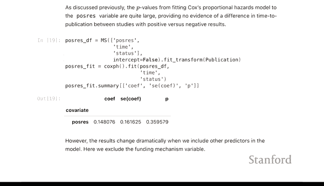

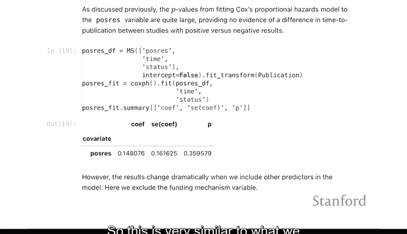

Survival in the cancer data。 So that P value is not significant and you can sort of see from the plot that。

 you know that that。

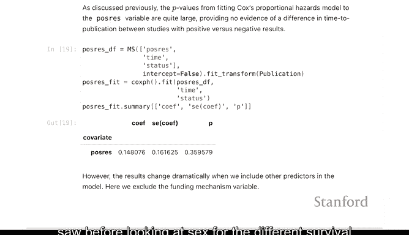

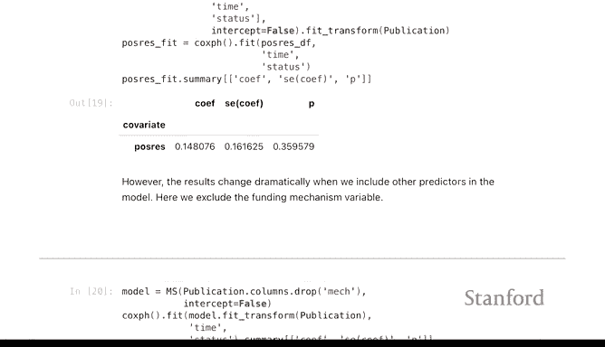

Even though it looks like there's a bit of separation， the standard areas are are quite wide。

 And yeah， and for this， this region here， there's not much difference。 Yeah， So if， you know。

 if we had。

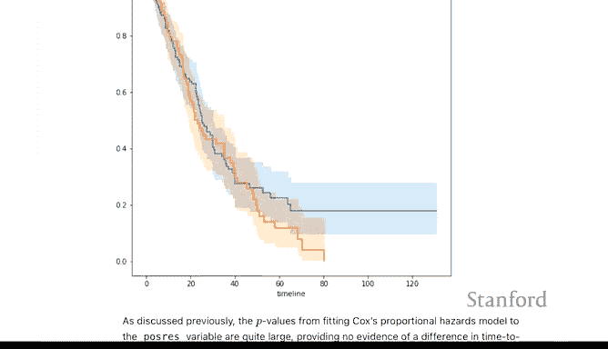

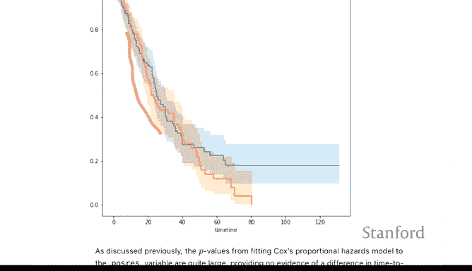

Come up with a hypothesis that there's a difference in this period。

 we might have had a significant P value。 but the co， the， the cox， the log rank test looks at the。

 the entire survival curve。

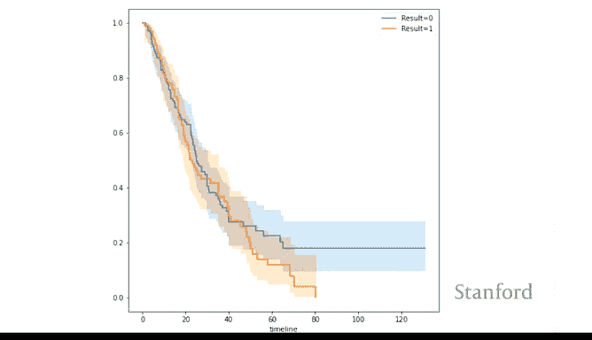

Okay。嗯。Okay， so now。

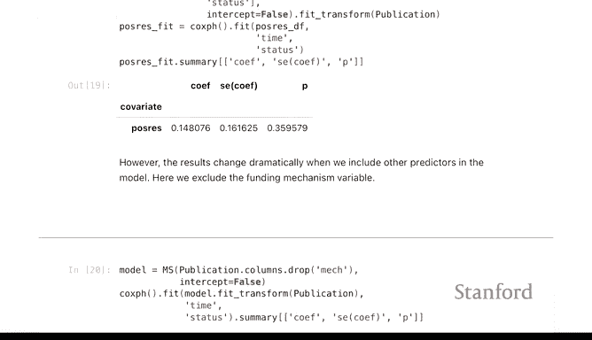

We're going to include some of the other。Other features。

 So we're going to drop this Me is the funding mechanism used。

 I guess that's whether it's NIH or privately funded or NSF and Fiticcox model。

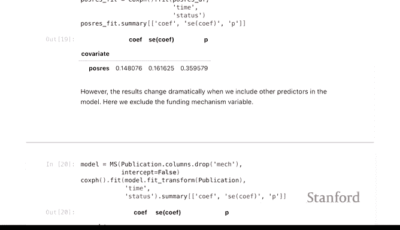

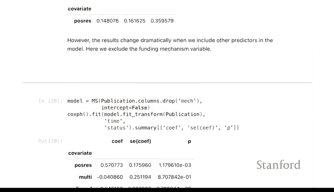

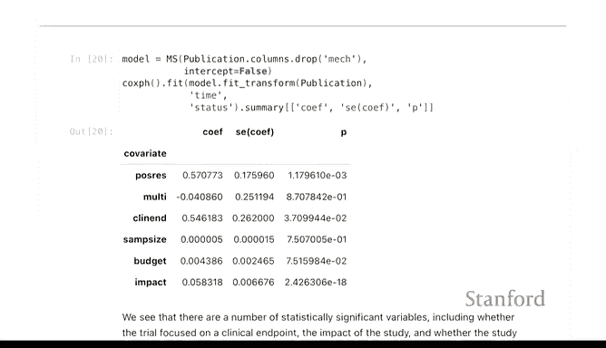

And then， okay， so now the。Let's see。 Well， there's some significant things there， Jonathan。 Yeah。

 pause has become significant now impact。 So this is a measure of the。I guess this is post ho。

 Once the paper is published， you can measure its impact and studies that were published relatively quickly and some are associated with having high impact。

 that's what we can glean from this one。 And similarly。

 now the the effect for positive result is stronger。 the P value is smaller。

 So that's interesting that happens sometimes， know when you look at a variable just on its own。

 it might be not significant because there other things going on。

 confounding factors that interfere with the variable。

 And now when you put in these all these variables now looks significant。 Yes， yeah， yeah。

 like in a linear regression context， allowing for these other variables can reduce the extra variation。

 And then the difference can can appear more significant。

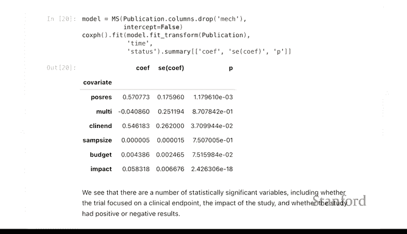

Okay。

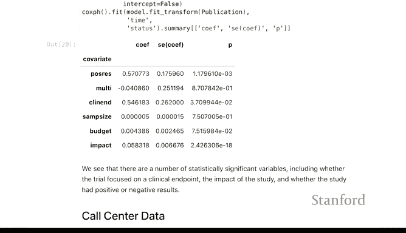

And。So there's a third example， which is on call center data， and this is simulated data。

And the analysis is very similar to what we've done。 And so we'll， we'll leave that one for you。 Yes。

 I' we'll just note that there， the one new thing that in this， in this call center data。

 you'll see is that we， there's a multivariate log rank test。 And thats。

 you can work by analogy with the log， the log rank test is used when you have a categorical variable two levels。

 here， we have a some categorical variables with three levels。 And for that， instead of a。

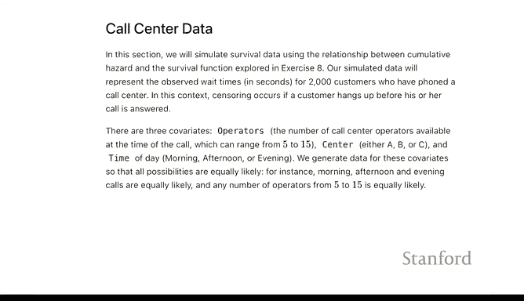

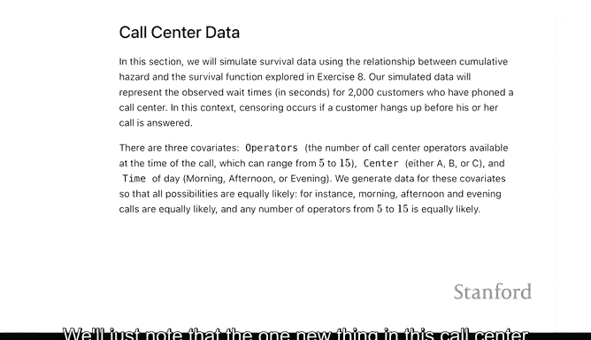

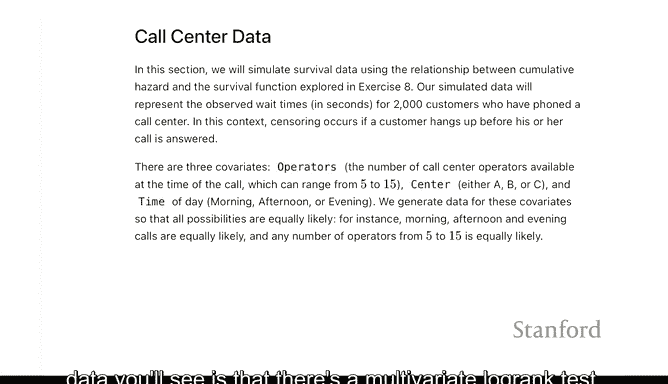

You know， the two by two table of the log ranks， there would be a 2 by3 or a 3 by two table。

 And that's the multivariate log rank test， but。The interpretation is quite similar。

 so we'll leave that for you to do offline。

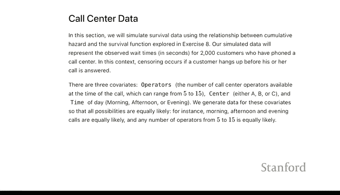

