# 斯坦福大学《统计学习导论2023R语言版｜An Introduction to Statistical Learning with R》中英字幕 - P88：-088-Statistical Learning_ 12.3 k means Clustering.zh_en - GPT中英字幕课程资源 - BV1yU421o7WA

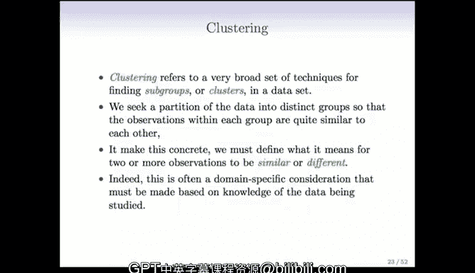

Okay， well welcome back。 the second method of this section is clustering。

Wwhich refers to a broad set of techniques for finding subgroups or clusters in data。

 so we're trying to segment or partition that the data into subgroups that are similar to each other。

 and of course we'll have to define what we mean by similar or different in order to do the partitioning and in a lot of cases the way we decide to cluster we decide on what similar different depends on the context。

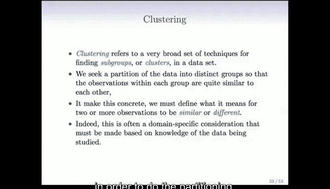

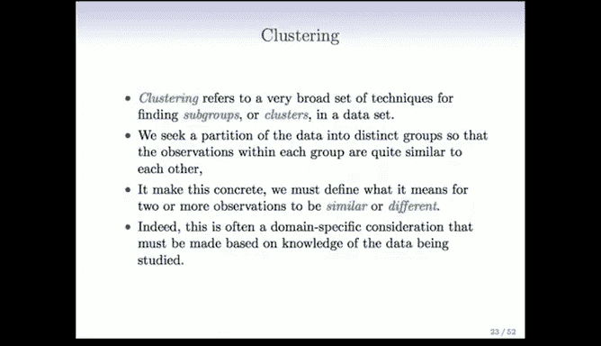

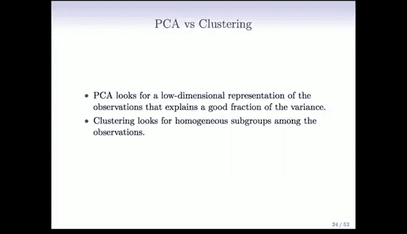

So how does principal opponent analysis which we just discussed， how does a contrastive clustering。

 well PCA， as we've seen， looks for a low dimensional representation or view of the data that explains a good fraction of the variance right so we saw the PCA plots and we from it we drive new variables which could be used for other methods like supervised learning。

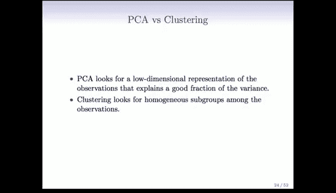

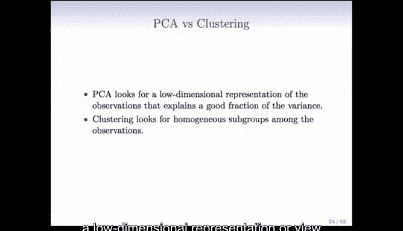

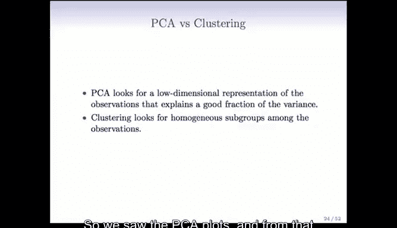

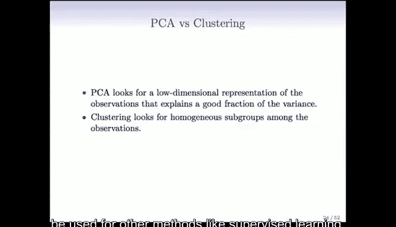

Clas， on the other hand， looks for homogeneous subgroups of the observations。

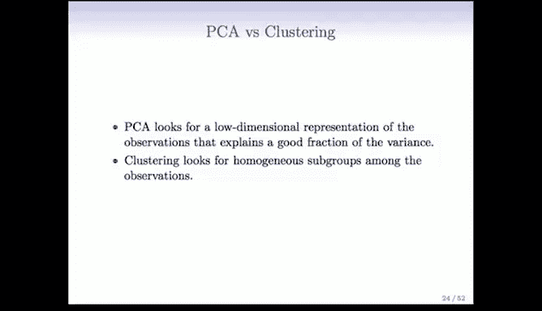

So not looking for variance but is looking for similarity among observations。

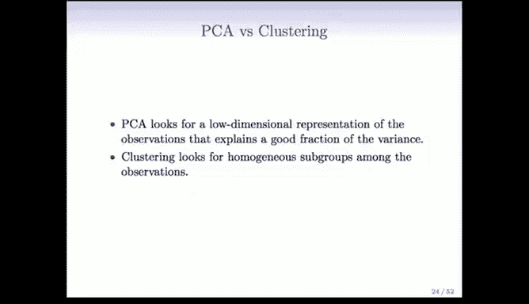

For example， if we're trying to try to do a segmentation of a market， suppose for。

Each of a number of customers we've measured things like their income， their occupation。

 how far live to the closest urban area and so forth。

 and we want to segment them or group them into customers that are similar with regard to these features and why do we want to do that because maybe if they're similar with regard to these features。

 then the kind of advertising we use for that subgroup will be important so we use a certain kind of advertising for one subgroup like maybe young males who have a lot of money。

 one subgroup， another subgroup might be like me young okay？

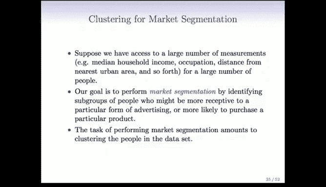

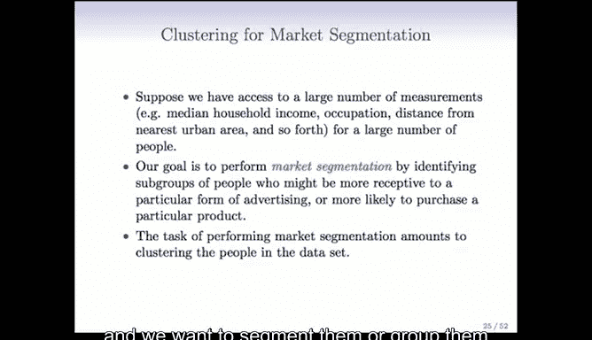

Another group might maybe be housewives who in their 50s who their children have grown up and they had to travel。

 for example， who may want to advertise a different way to that subgroup。

So that the task of segmenting that kind of population is a key application of clustering。

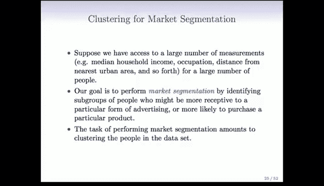

So we're going to talk about two clustering methods in this section。

 although there are lots more as in most areas of statistics， there's many。

 many ways of doing things， but the two most important methods which we'll talk about are K means clustering。

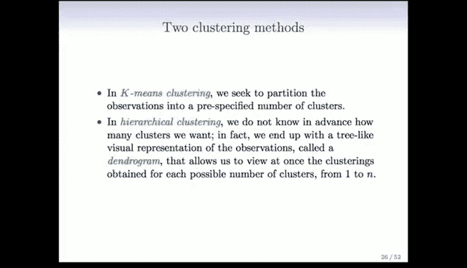

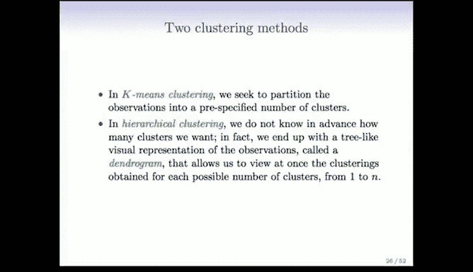

In which we first while predeeffinine K the number of clusters。

 and then we we'll see there's a way of grouping the observations into the K groups。

 then of coursell have to define what K is， this number of subgroups。

 and that's going to be important and hard difficult choice。

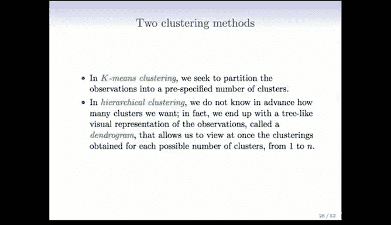

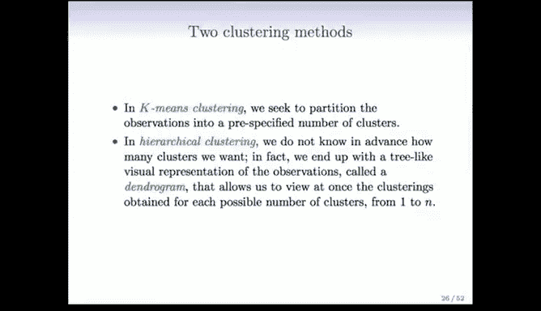

And the second method is called hierarchical clustering。

 which we don't pre specifyify the number of clusters k。

 but rather we do we group the data in all numbers of clusters。

 and it's done in a hierarchical a gllomberative fashion。

 and this is nice because we get to see the clustering for all numbers of clusters K。

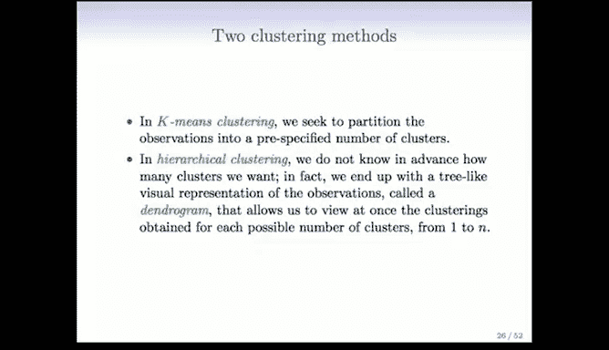

Then let's start with the simplest method K means clustering。Before we describe it。

 let's see an example of the result of Ka's clustering。 so this is some simulated data and。

It's been simulated basically in two groups。Which are。The upper group was two features。

 and there's a group at the top， some space in between and a group at the bottom。

And now when we apply K means clustering and we have to pre specifyify K。

 again we'll see the procedure in a few slides。But when we press up pre specify k equals 2 and we run the cluster algorithm。

 it produces。The the groups indicated by the two colors， blue and gold。 so with K equals2。

 it's found approximately the right clusters， although you might argue well。

 is this point actually belong in the upper cluster rather than the bottom cluster。

And that's not something which you can answer just in a quantitative way， that's a subjective call。

In any case， it seems to have found the two clusters pretty correctly。

 but if I were had to specified a k equals 3， it would be forced to find three groups。

 and the three groups K means clustering found or indicated here by the green， the blue and the gold。

 So what's done is it's broken up this apparently homogeneous cluster into two clusters。

Similarly with k equals 4， it finds the blue， the orange， the purple and the green， right。

It's broken up this bottom cluster looks I can do three clusters。

 although it's borrowed some points from the top right there。

So you can see that the effect of K means clustering。 Well。

 first of all you can see the effect of K is really important， because you use K to be too large。

 It's going to be forced to break up groups like this one， which。Are fairly homogeneous。

What's also interesting Rob is that variables that are somewhat responsible for clusters， like。

 for example， the second variable that we have over year also tend to have high variance because you know if they separate the data in clusters there tends to be variance So there's some connection between principal components in clustering in the more abstract sense so let's actually drill down in the details of K means clustering。

 well first of all， we have to define sumitation for clusters or sets。

 So we'll call them C1 through C and there are sets of indices of the observations。

 So the indices are1 through n， those are n observations。

 each of these C's is going to be a subset of one through n。

 and the subset is iss going to be a partition of1 through n。Now， as if we want to get formalistic。

 we'll say， well， the Cs， their union is one through n。 So if we concate them all together。

 they make up one through n。 So they're a partition of one through n and there's no intersection。

 So there's no overlap between the clusters。 So that's just a fancy way of sayingre we're going to break up the points one through n into K groups which are non overlapping and cover the whole set。

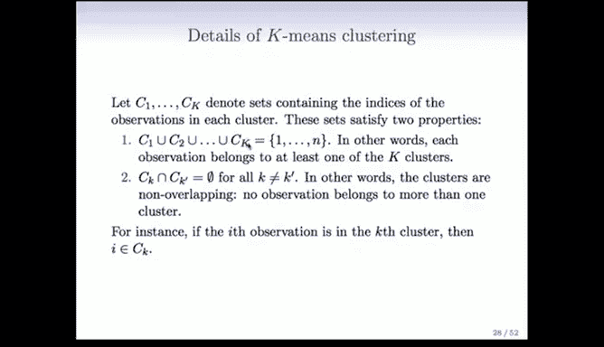

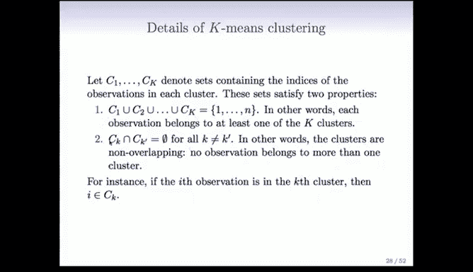

Okay and again， if the I observations in the K cluster。

 then I will be a member of the indices for group K。

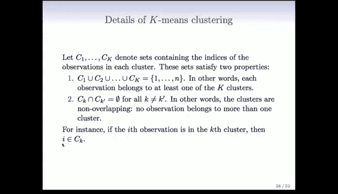

O。

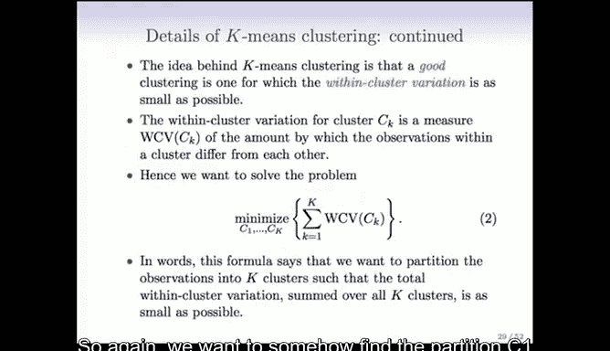

So again， we want to somehow find the partition C1 through CK which is a good clustering。

 well what would do you mean by good clustering， okay K means clustering defines good clustering to be one in which the within cluster variation is small。

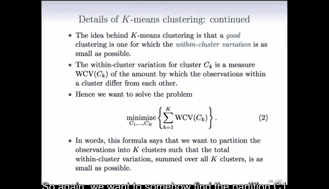

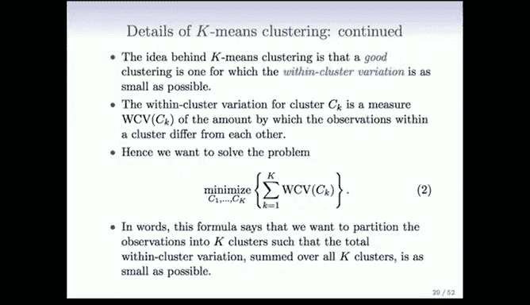

嗯。So let's get back to this picture。If you ask me well， divide this into say two groups。

 well the notion a K means is going to use is say， well。

 I'm going to find two groups so that within each group， like within the gold。

 the variation is small within the group so that the points are close together。

 similarly for this group， the points are close together。It's kind of a very intuitive definition。

Let's call the wind cluster variation of the cluster of C WCV for wind cluster variation of CK。

 iss the total variation for example， we could use square distance。In the two directions。

 matter of fact， most of the time， we will use square distance for Ka means clustering。So then， well。

 if we put it all together， if we define the variation within a cluster to be WCV of CK。

 we want to find well， the total variation adding up overall all clusters is here。

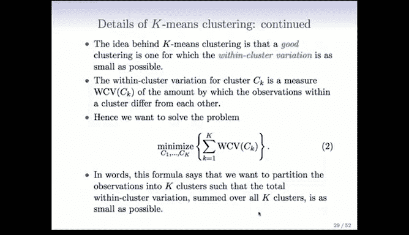

And we want to find the partitioning C1 through0K to minimize the total within cluster variation。

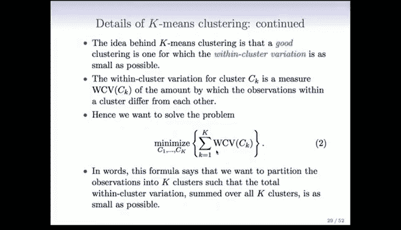

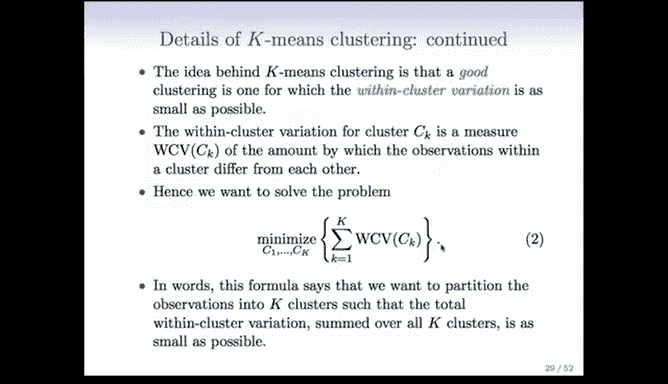

嗯。So we're going to assign the end data points to k clusters so that the total within cluster variation summed up over the K clusters is as small as possible。

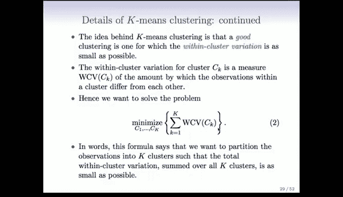

。So I said this on the previous slide， but here's in detail。

 we normally define within cluster variation to be the Euclidean distance。

 the pairwise square distance between each pair of observations in the cluster。

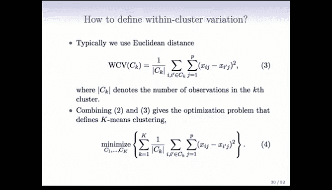

Add it up over the P feature so that this is the Euclidean or squared distance between observations I and I prime。

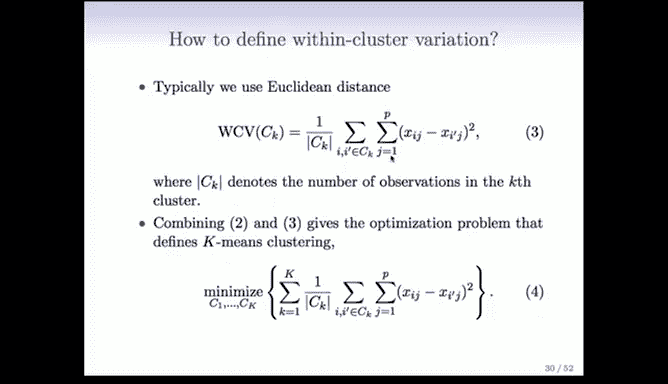

And we sum it up over all II prime in the cluster。 So now this is the total pair distance of every between every pair in in the clusters CK and we're going to。

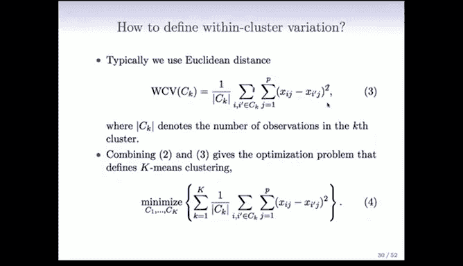

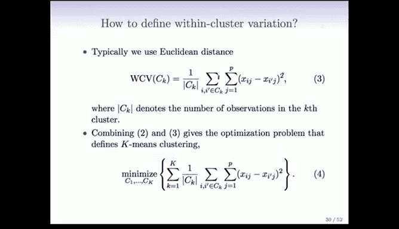

Minimize the total of this over K， the total variation over all clusters。And that's。Here it is。

 So here's our optimization problem。 Now。 Here's the within cluster variation。 and we're going to。

We're going to find the clusterings you went through the that minimizes that。

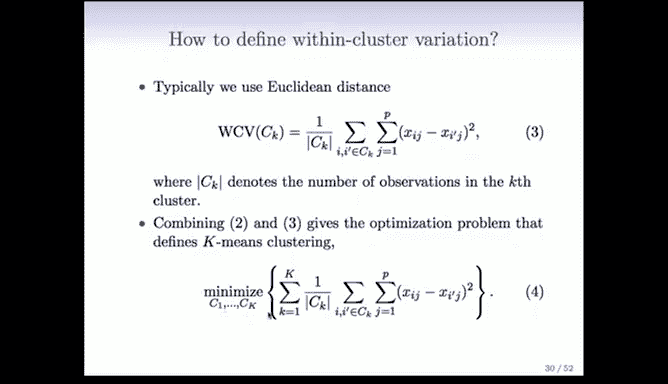

Yeah。So we have a criterion， but let's actually talk about the K means algorithm and then we'll sort of circle back and see why minimized the objective on the previous slide。

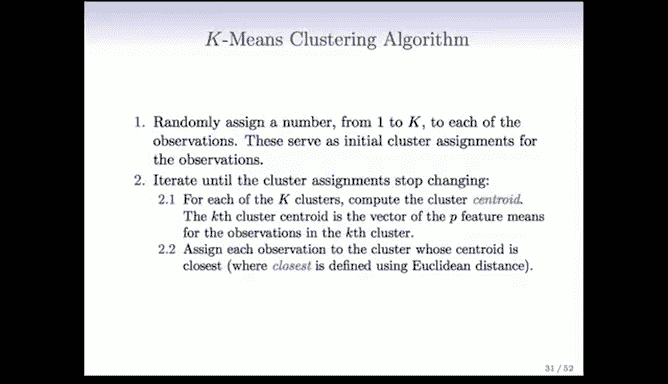

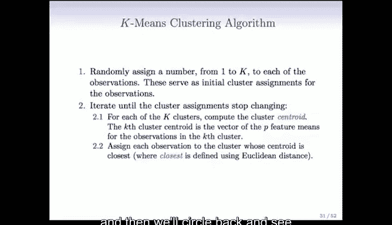

So how Ka means clusters works。 Well， it's got the word means in it。

 So it's going to use a mean somehow。 So it's it's actually an alterating algorithm that。

 first of all， we assign。To each observation a cluster from 1 to K。 So maybe K is fixed。

 we have to decide ahead of time， I'm going to pick K equals for example 2， or K equals 3。

 and we'll worry later about how to choose K an important value。 but let's fix K for the moment。

 So if each observation is assigned to a cluster when through K。

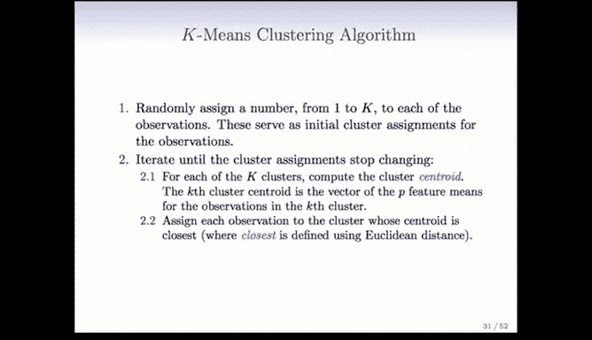

And then we have two steps which we alternate back and forth for each of the K clusters。

 on the one hand we compute the centroid， that's the average value for each feature of all the points in the centroid in the cluster。

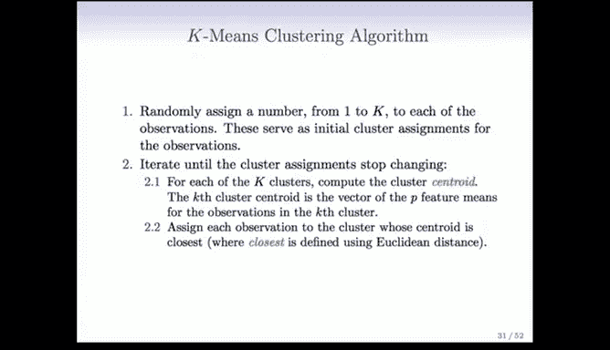

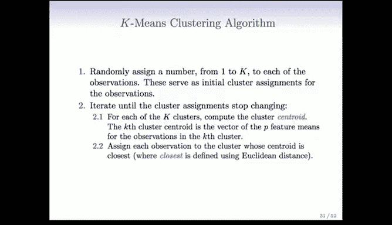

So it's the mean of in the vertical and horizontal direction of the points in that cluster。

So having compute the centroids for each of the clusters on the other step。

 we assign each data point to the closest centroid。

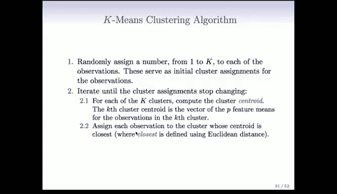

And then having done that。

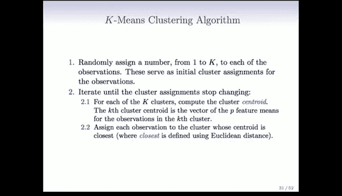

We have。A new set of cluster assignments C1 through ZK， we go back and we compute new centroids。

Use the new centroids you complete new assignments and we alternate it back and forth until hopefully this thing settles down and the solution is the K means clustering the solution we want is the assignment appoints to the groups。

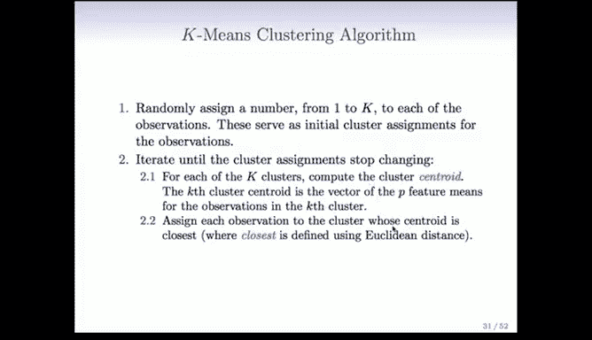

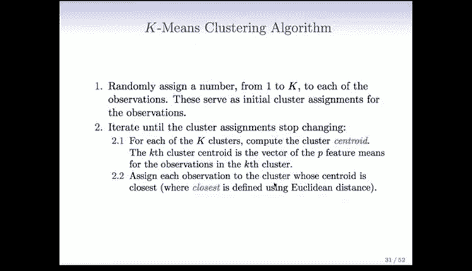

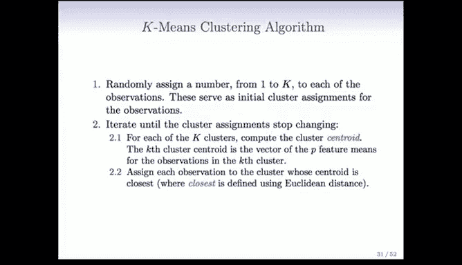

So。Let me， actually。

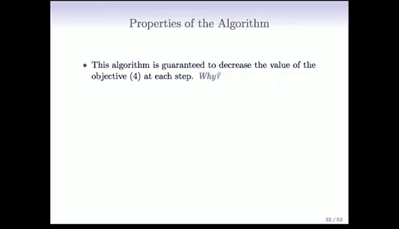

I'm going to show an example。 well let's see an example。

 then we'll go back and see why that algorithm actually minimizes the objective that we wrote down。

 So here's an example， actually the same example we have before。

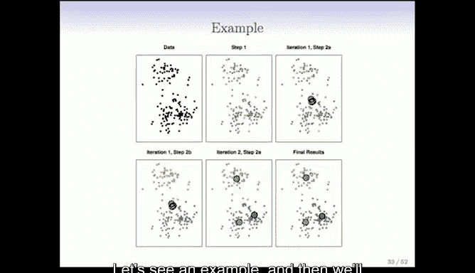

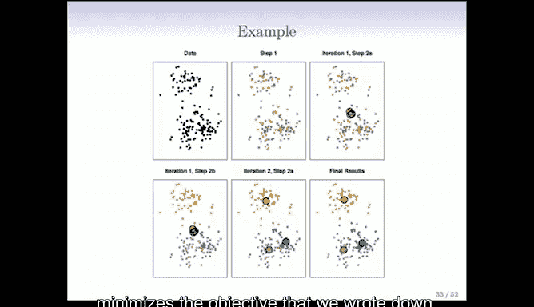

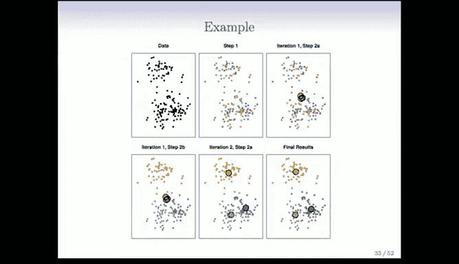

Here's our data， okay， again， it's unlabeled data right， and we've chosen k equals 3。

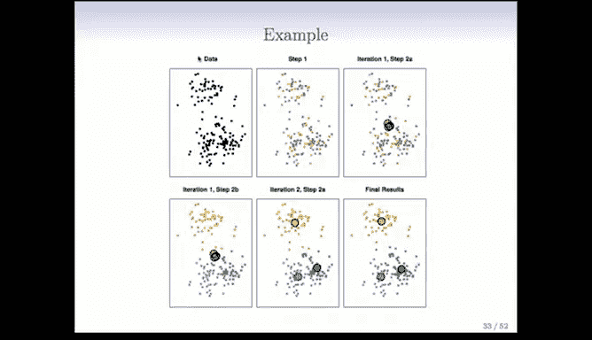

So in the first step， we're going to assign points at random to clusters。

 so we'll indicated by the colors。And so each point is assigned to a different color and you can see the assignment the grouping is not very good yet。

 in other words we like we're thinking that this is one group， and this is another group。

 but we don't we're nowhere near that clustering at this point。

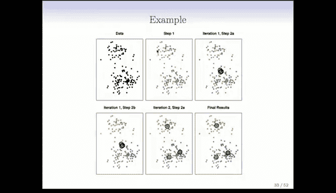

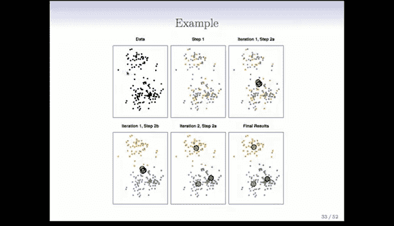

The first step we compute the centroids so that these are the average of the horizontal vertical direction of all the points in the gold。

Green and blue。Groups， and then here， the cents are pretty much on top of each other because the assignment was random。

 So there's no real grouping yet。But don't fear the Kaus cluster will work its way to a good solution。

 so now we take the centroids and we find the closest points to each of the centroids。

 so each point is we ask each point， are you closest to the green， the purple or the orange centroid。

And now we color the points accordingly， so this is the partitioning step。

So even though those first three centroids were pretty much on top of each other。

 they weren't exactly and so that defines a fairly nice partition of the data already。

 Yeah it it's on an almost almost perfect job in terms of well you see we'llll get to the final iterate and then given this new assignment we we find the centroids again but all the centroids are going to move a lot now right because look who the points are so for example the average of these gold points is way up here So here's the new gold centroid new purple new green now the centroids are sitting really right in the middles of the clusters。

And。The algorithm will now continue and make a few refinements。

 and here's the final cameine solution this for this example， very intuitive algorithm。So。

Let's go back。 Maybe they have this objective function， which is a total within cluster variation。

 we want to minimize， right， you want to find the partitioning that minimizes this within cluster variation。

 Well Ill get the question is， have we does this algorithm that we。

Wow down， does it achieve that。But you can actually see that the algorithm will always decrease the value of the objective of each step。

And you might think about why that is。Well， the key to it really is that。

You can write the variation， the pairwise variation as the variation around the。

Component wise means， right？

So， and this is really the key to k means clustering。 You think about it。 we really didn't。

 we didn't care about the centroids。 All we cared about was the clustering wheel K means clustering is done is it's it's it's。

It's put in there， it's changed this。

To an equivalent expression of all the centroid。And now Caman's clustering finds both the component。

 the component。

C13 K as well as the centized x bar。What it does in each step is it minimizes over CK on the one hand or minimizes over the cent on the other hand。

 and each of those steps is going to decrease this criterion and hence decrease this criterion so if you have sameoids。

Then。When you come to update the assignment of each point， it's going to go to the group for which。

This distance is smallest for fixed entriess and on the other hand。

 if all the assignments are fixed we know that the sample mean is minimizes the sum of squares and so that's why each of those tips necessarily makes the criterion go down So this is very slick。

 we start it off with the problem of involving one set of variables we it we added another set of variables which we think it make it harder。

 but it actually makes it easier right because now because when we do the joint optimization over both sets of variables。

 we get to the answer for the ones we care about the question。

So that's just the detail of the previous figure， which we talked about。 Now， oh， sorry。

 I missed a point here， which is that it's not this algorithm although gives you a local minimum。

 It's not guaranteed to give a global minimum。

Why not？ Well， what does that mean， Rob a local minimum local minimum means that。

Well， the point is is that you could start the algorithm from。

Okay okay， the local medium I guess， means in calculus it means that the derivative of the function is 0。

 it doesn't mean that it's the lowest point of the function。 So if a function is not convex。

 you can have a place where the derivative or there's a valley which is flat。

 but it's not the lowest value in the whole function。So this algorithm will get to a local minimum。

 we'll get to a place get to a valley of the function we're trying to minimize that it won't be the lowest value necessarily。

 so we can think of this function that we're trying to optimize as being like a big valley that it's got lots of little subvals or little ponds or whatever and you know any minimum is one of those and we can get stuck in one of those right so in the optimization where the idea this idea of a convex function。

 which has basically iss only one valley So if you find a minimum it's a global minimum but this function is not convex in other words it can go up and down and have more than one valley and the Kames algorithm will land you in a valley。

 but not necessarily the lowest valley there's a function is not convex。

So actually here's an example， this for the same did。

 here's an example where we start the algorithm from six different starting configurations。 remember。

 our starting configuration was we signed each point at random to one of the clusters。

And this is actually a good thing to do with Ka means clustering is since we're not guaranteed to get the global minimum。

We start the algorithm at more than one place and we just examine the value of the criterion at the end in each case。

 remember starting the algorithm was this random assignment of points to the number of clusters you're using。

So when we start the algorithm from different places we get actually quite different solutions。

 no worry about the fact that the colors are chosen differently like these these are gold and these are green。

 that the coloring is arbitrary， but the partitioning is quite different and we typically we pick the lowest value。

 there's see this guy， well these looks like we got three different solutions。

 three or four different three different solutions right。

 I guess the ones you colored in red at the top all have exactly the same distance so they actually all the same the colorings are different but as Rob said。

 the colorings arbitrary so these solution， these four panels give us the solution with but the top left and the bottom right are actually different solutions again right。

Okay， so that's K means clustering and we'll actually talk a little bit about the end how to choose K。

It would also be an issue for hierarchical clustering， which is a topic of our next segment。

