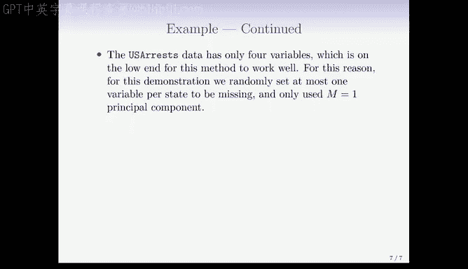

# 斯坦福大学《统计学习导论2023R语言版｜An Introduction to Statistical Learning with R》中英字幕 - P90：-090-Statistical Learning_ 12.5 Matrix Completion.zh_en - GPT中英字幕课程资源 - BV1yU421o7WA

Welcome back， this is an additional section。😊。

In this chapter， that's based on some new material in the second edition of the book。

And it's called matrixtri completion and missing values。

It's often the case that data matrices X have missing entries， which are often represented by。

NA not available， so this is a nuisance since many of our modeling procedures。

 especially multivariate procedures such as linear regression and GLMs， require complete data。

As do principal components。However， sometimes imputation is the prediction problem。

And we're going to see that in the next example in what's known as recommender systems。

So one simple approach when you got missing data is mean imputation。

 so you replace the missing entries for a variable by the mean of the non missing entries。

So if x is a matrix， that means in each column which represents， say a variable。

You replace all the missing entries by the mean of the non missing entries in that column。However。

 this ignores the correlations amongst the variables。

We should be able to exploit the correlations when imputing missing values。

 and clearly if you just use the meaning for each variable， you're ignoring the correlations。

We also need to assume that the missing values are missing at random are missingness。

Should not be informative。So we're going to present an approach that's based on principal components for imputing machine values。

Just tell you a little bit about recommender systems。So what we have here is part of a spreadsheet。

Which shows customers who rented movies from the Netflix movie rental company。And along the top。

 we see names of movies。You can see Jerry MaGuire， Oceans， wrote to Podition and so on。

And most of the matrix are little gray dots， which means that customer didn't see that movie。

But the places where they're numbers。The customer was asked to rate the movie after they saw it。

With a rating between  one and 5， I， I think one was the worst and5 is best， right，5 was yes， right。

 and with other numbers in between。And so you can see there's a few threes and fours and ones and fives。

 right？So。A very small fraction in this data set， they were actually。

 this was a data set that was put out there for a competition。

And it actually was one of the it was really the start of these online competitions。

 prediction competitions。And the data had 400，000 users。So we only shown nine customers yet。

And over 18000 movies。 so it's a massive matrix。But only 2% of the matrix had numbers in it and the race were missing。

 Well， that competition was around 2005 Trev， right， Yeah。

 and there was a first $1 million first prize for the first team that could get。

Could improve upon the existing system by at least 10%。

And it caused a huge excitement in the machine learning and statistics communities。 As I recall。

 we won that， right， No， we don't win it。 Well， actually， we did。

 we would go into it thinking we might win。 But after a few months。

 we realized this was really hard that the data was so big。 It was just harder to。😊。

To get anywhere where that we got， I think we got down to maybe close to what the current system was。

 but we didn't going anywhere near the finish line。Yeah。

 so the thing was Netflix themselves had a recommender system。

And the goal of the competition was to make predictions for movies that people hadn't seen。

 what their rating would be。And the winning team was the first to beat the Netflix。

Recommend a system by 10% in Ro mean square error。 It took about three years for someone to win three years。

 and there were approximately 40，000 teams all over the world submitting entries to this competition。

And the methods that were used were very， there was a huge variety。

 but the method we're both to show you is actually the basis of a lot of assistants use the method we're going to show you right now as its first step。

 exactly。So that's why the method we're going to show you is one of the important techniques out there it's worth knowing about。

Okay， so let's get into the details。And。The idea is we're going to use the principal component model to do the imputation。

In Section 12。2。2 of the book， we gave an interpretation of principal components in terms of matrix approximation。

You see there that we've got sum over the rows and the columns。

And we have the difference between each entry X Ij。And then。

An internal sum over the number of components。 So yeah we， we're going to use M principal components。

Of a product of terms AIM， BJM。Ma look rather technical because it is。

These As and Bjs are elements of a matrix。 So we have a matrix A。

 which is going to be n by M N B in the number of rows， and we have a matrix B， which is P by M。

 which。P being in the number of columns or variables。

 and these are the entry individual entries of those matrices。

And what this is basically saying is that we can approximate a matrix x by the product of these two matrices。

 and this is shown element by element， and we want to minimize this over A and B。Okay。

 so this this is a。Another interpretation of principle components。

Because it can be shown that for any value M。The first M principle components provide a solution for A。

So these are the principal component scores， the。And for the bees。

It's a principal component loadings。So principal components give us a solution to this problem。

Now we say provides a solution because I think it should be evident that I can alter the solution by multiplying all the A's。

By some number， let's say is。Say bigger than one and divide all the bes by the same number。

 and I'll get the same solution。 right， So there's some arbitrariness here。

 multiplicative arbitraness， but。The principal component is one such solution， okay？

So that's just an interpretation of principal components as a matrix approximation。

 best matrix approximation， the terminologies of rank M。

But what do we do if the matrix is missing elements， well。

 this is where the technique arises for imputing missing values。

So what we do is impose instead a modified version of this approximation criterion。

 The outside looks the same we want an A and a B。But now， of course。Some of the X I Js are missing。

 So what we do is we just sum the sum of squares over the I J pairs that are observed。

 and we've got this little symbol script O， which is a set of all observed pairs of indices I J。

 which is a subset of。Of the possible， all the possible n times P pairs。

 So we still got the sum of squares。 but， of course， only over the elements that we observed。

But importantly， the A and B are still these full matrices。So once we solve this problem。

We've got a solution， we can estimate a missing observation Xj。Using。The same sum。

That we had before element y sum for the pair Xij， but now putting in the estimates for A and B。

 so it seems simple we can also in doing this we not only impute the missing values but we can approximately recover the m principle component。

 scores and loadings as if the data were complete。So Rob it's both a method for computing principal components when you've got missing values。

And for imputing the missing values in the matrix。 Now。

 you mentioned in the beginning that using mean imputation is maybe a good start。

 but it doesn't exploit correlations。 How does this somehow capture correlations？ Well， look。

 I think Robert captures correlations in the same way as principal components do。

So principal components。Exploit the correlations when finding linear combinations that maximize variance。

And in terms of these approximations， you know， the principal components。Well。

 let's suppose you've got some rows in the matrix or columns in the matrix。

That let's think of columns that are correlated with each other。 Well。

 if one of those columns are got missing values， you might think you should be able to do a regression of that column on the other columns。

To impute the machine values。And that's exactly what's going on in this matrix in this matrix completion problem using those correlations。

 And I guess going back to the movie example， you're hoping that。

Customers respond to similar movies in a similar way。 That's a， that's a good point， Rob。 Yeah。

 you know， so even with this sparse number of entries here。It's just as Rob says。

 what you're hoping is know that there are enough customers who've seen a movie that you haven't seen。

Who've got scores for that movie， and as long as those customers have overlapped with you。

In some of the other movies you've made， you can find out to what extent you agree with them and use those correlations to fill in the missing values they' exploringing both similarity in customers and similarity in movies at the same time。

 yes right。That's exactly right and that's of course。

 due to the wonderful symmetry in principle components。

We can now give you an algorithm for solving this problem we've shown what we'll do if we can solve it。

 and now we're going to tell you how to solve it。And it's an extremely simple algorithm。

 it's an iterative algorithm， and it goes as follows。

You start off you could create a complete data matrix ex toolder by filling in the missing values with any method。

 say， mean imputation。Is a good start。And then you're going to repeat these next three steps until the objective fails to decrease and this is the objective it's the same one we had on the on the previous slide。

 So what you do is now you've got X tillde is a complete matrix。

You solve the matrix approximation problem for a complete matrix。

And we know we can do that using principal components。

 so we use the principal components of extilder。Now， what you do is for each missing entry。You again。

 replace the entries in the matrix X tder， the missing entries with the current approximation that you've just computed。

 Remember， in the beginning， we just put in the mean values。 Now， we've got a better value to put in。

 And so we replace those entries。 And then we see how well we do in this， this quantity will。

We'll get smaller each time we do that。Then we go back and do it again。😊。

So you keep on filling in with your newest guess and then you solve the full matrix approximation and get new guesses。

 and this will converge and this quantity will bottom out and finally level off and then you'll declare yourself done。

Then you'll return the missing entries in XIJ。Very simple， just iterative principal components。

So we'll use the USA arrest data as an example。So it's a small matrix， this one x has 50 rows。

 a states and four columns which are the different types of crime， so there's murder。

 assault rape and then there's the variable urban population percent of the population in that state that lives in urban areas。

 right？So this data set is complete， so we artificially made some elements missing。

 we selected 20 states at random and for each we selected one of the variables that were random and set is value to NA。

So that means out of the 50 states， we now had 20 states where there was one element missing in one of the variables。

 all selected at random。And we used M equals one principal components in the algorithm。

 So we just use a single principal component to do the imputation。

And what we show in this plot is a plot of on the x axis is the original value and on the y axis is the imputed value。

And since the variables for which they was missing were missing。

 we selected them randomly for these states， what we show you yeah is the 20 states for which are missing values。

 the color is what variable was missing， and we just show the imputed value versus the original value。

And you can see there's a bit of noise， it doesn't get perfect， but there's a correlation of 0。

63 between the original and imputed values。And what's interesting is if you're used for the complete data。

 if you use the first principal component。To approximate these same values。

 you'd get a correlation of 0。73 or 0。72， something like that。

So the fact that we were missing these guys and were had to estimate the principal component in the presence of missing values didn't degrade the solution much。

This was a small example， only four variables， which is on the low end for this method to work well。

 and so for this reason， and for this demonstration we randomly set at most one variable per state to be missing。

 and we only used M equals one principle component。

In general， in order to apply that algorithm， we must select M the number of principal components to use for the imputation because we don't know in advance what's a good number going to be。

You can imagine if you make it too big， you may overfit。

In the training and not do well on the prediction。It turns out there's a way of doing this automatically using the same method。

So what you do is randomly set to any some additional elements that were actually observed。

And select M based on how well these known values are recovered。

So this is very close to the validation set approach that we saw in chapter5。So again。

 even though youve got some elements missing in the matrix， you make a few more missing。

And just did random。And then you run your algorithm。

But for those that youve artificially made missing。

 you know their true value and so you can see how well you're doing and you'll get something like a cross validation curve。

So there's a package in R called soft Iute which implements matrix completion algorithms and can manage really large problems。

 in fact， Netflix scale matrices。 So if we'd had that in 2005 would have if we'd had that if we had a shot。

 we might have had a better shot。So that's it on matrix completion。

