# 斯坦福大学《统计学习导论2023R语言版｜An Introduction to Statistical Learning with R》中英字幕 - P91：-091-Statistical Learning_ 12.6 Breast Cancer Example.zh_en - GPT中英字幕课程资源 - BV1yU421o7WA

Welcome back。And in the last segment of this section。

 we're going to see an example of how a se clusterstering applied to a study of breast cancer。

So this is the last part of the segment， this is an example which actually Tra and I are both involved in。

Actually， 10 years ago now， with a postdoc at Stanford in oncology， Theres Sorely。

 Thereres had measured gene expression。From gene chips for about 88 women who had breast cancer were being treated for breast cancer and gene special measurements for about 8000 genes。

 so what that means is for each of the 88 patients。

 there's a quantitative measurement for each of 8000 genes。

Whi measures how much that gene was expressing how active it was for that woman。

 and this is a very common kind of study now where people look at gene expression to try to understand the basis of diseases like breast cancer and figure out whether there are subtypes of the disease which should be treated in a different way。

 so this is quite large the amount of data or 88 patients，8，000 features。

She used the group used average languageage with correlation metric again。

 because this is the case where genes are in the same units in a sense。

 but they're measuring the same units， but。The actual level of gene expression wasn't very reliable because it varies across the way it's measured。

 but what more thought to be more important was the shape of the relative expression of different genes for the same patient。

 so that's why we use correlation metric。And did highcoquesting of the samples of the 88 patients。

Now， when Tse first used the full set of genes， the cluster she got out wasn't satisfactory Now what does that mean Well again it's very subjective but。

It it wasn't very informative to Terz and her collaborators。

 so rather they use a subset of the genes called the intrinsic gene。

 so this is a way of choosing most more informative subset of genes。

And I won't go into detail except to say in words， in this particular study。

 these women were given chemotherapy， and there was actually a sample taken before and after for each woman。

And gene expression measurements were available before and after。 So what Theres did was she。

 she defined what called intrinsic genes。 So for each woman for each gene。And for each woman。

 we look to see which genes had the smallest variation within a woman。Within a woman。

 as opposed to between the 88 women。And the ones that the smallest variation were defined to be the intrinsic genes of 500 most the 500 genes was the lowest variation。

 The idea being， again， this is a biological concept was that。Genes。

 which didn't very much in a woman before and after chemotherapy compared to between woman variation。

 were thought to be intrinsic to her cell biology。So they were thought to be the ones that could could best drive the clustering and separate the women in terms of their biology and maybe the response to treatment。

 They varied a lot between women， but little within women across the two repeated measures。

 So doing that we we got the following clustering。 So what do we see here。 first of all， this is the。

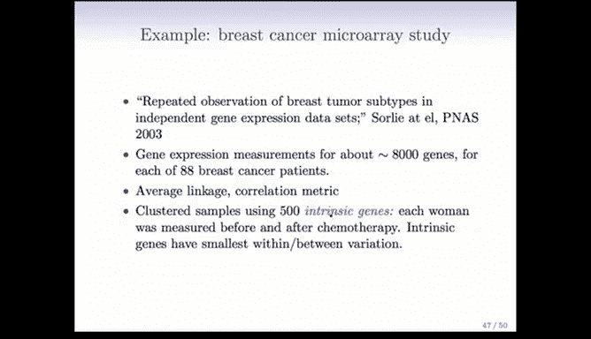

Here are the 500 or so intrinsic genes。 and this is called a heat map。

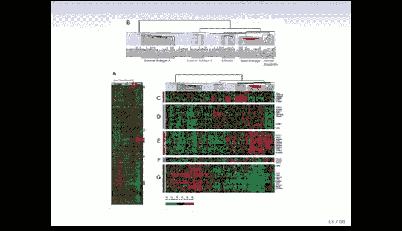

And this is a common display for this kind of data。 So what do we see here。

 each row of the heat map is a gene。500 so genes， each column is a woman， one of the 88 women。

 and each pixel is displayed as either。Green， which is negative。

 so the gene expression it's normalized， so it runs from something like minus5 to plus 5。

 so green would be negative and red is positive。 so green means the gene expression for that gene for that woman is lower than average and red means it's higher than average。

And what's been done here is we applied hierarchical clustering to the columns as the women in the way I just described。

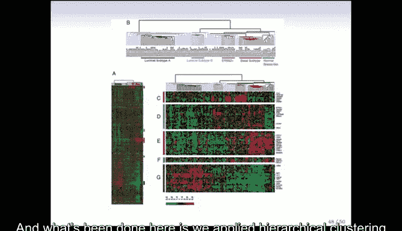

In addition， howchole was done to the rows， the genes。 and it is done in both directions。

 And that's why this picture looks， it's got it has patches of red and green， right。

 because it looks because we've sorted them， basically， we sorted the。

We've done hi cluster clustering， and we sorted the observations by the order of the leaves in the tree。

 both for genes and both and for samples。

And that's why， if we just display the data in the order， we， we obtained it。

 This picture would not look so nice， it it would be。

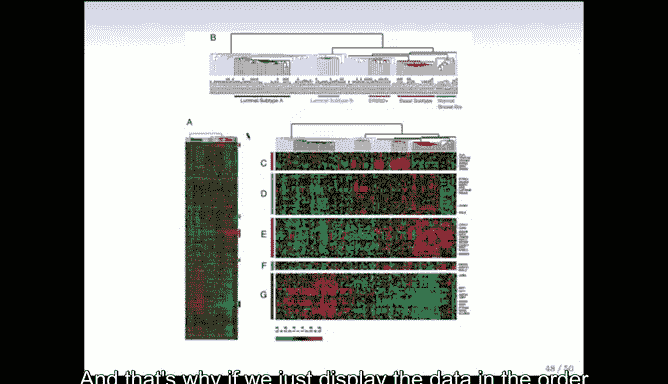

A checkerboard pattern and would look very random， but here looks much more structured because of the clusterings been applied and the ordering of the leaves has been used to reorder the rows and columns。

Just to。

This actually， this kind of display was actually used first at Stanford in the genomics labs and around the time the gene chip was invented。

 which is also done partly here at Stanford。 And I think this has become very attractive just because it's just it's a nice way just to see all the data if you have if you're given a data set of 88 observations。

 women in 8000 genes， that's a lot of data just to even look at And so the first kind of challenge is how do I just make a display so I can look at all the data and see that the gross patterns。

 And here this actually a very effective display is one of the pioneering if it's in the labs Patrick Brown and David Botstein gene expression really started。

 So it's kind sort of funny to think that a pioneering。

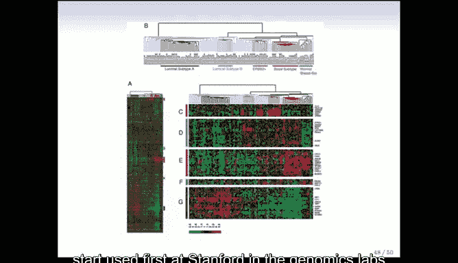

Pieace of science is actually display， but that's often the case， right， some very simple things。

 which might be seem trivial， actually can have a lot of impact。 just in this case。

 just the ability to to look at。To arrange and display the data informatively was very useful。

 and it's still used a lot today。 So here's the full heat map and then the clustering tree is at the top。

This is here， and it's been expanded out here。 and it's。That's been divided into one， two， three。4。

 five， six， seven， eight clusters， the gray is just basically an unknown group。

 but the other clusters have been labeled by names。Like normal， basal， ERB2， luminal， A luminal B。

 these names were chosen by Ts and collaborators based on the genes that we're expressing in the groups。

 so now if we look at this picture。

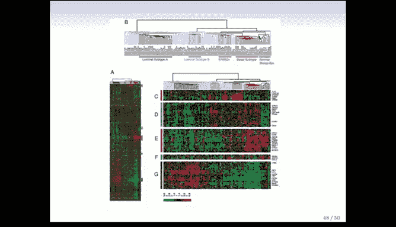

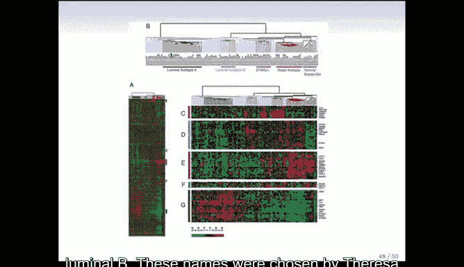

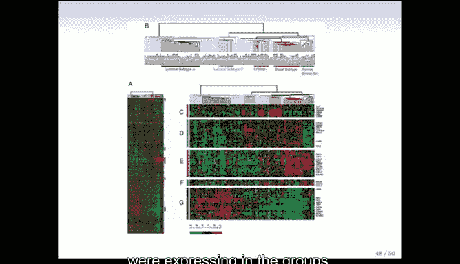

What we've taken is the same clusters and we've just taken subsets of the rows。

That's these five groups， and。

These are genes which are expressing highly in one or more of these key groups like for example here。

 let's see。

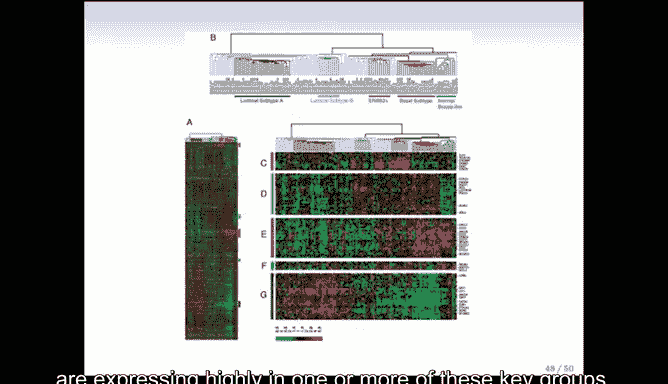

This block of sea genes is expressing highlyly in the。Red group and the blue group。

 this block of D genes expressing highly in these cluster， et cetera。

 So then the oncologist will look at this and they'll try to understand， well。

 how are the So these groups are different with respect to these particular genes。

 What do these genes do in the cells and。

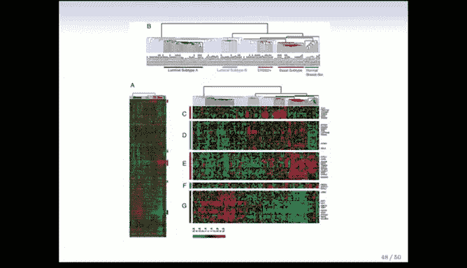

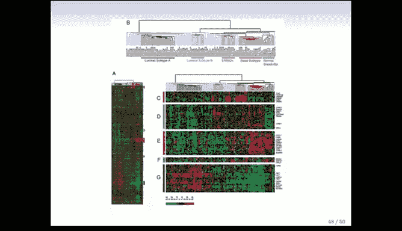

What does it tell us about at least these subgroups？In particular， as under the。

The last display of this， if you look at these subgroups and you look at the survival of these women。

 these are what called capammire survival curves。

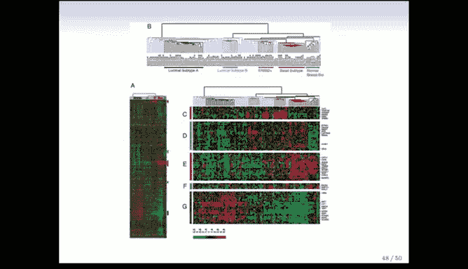

these women were treated for cancer and followed up to see and hopefully recovered some didn't and the survival curves of the groups are given here so for example。

 the basal group I believe they and the purple which groups are those basils。

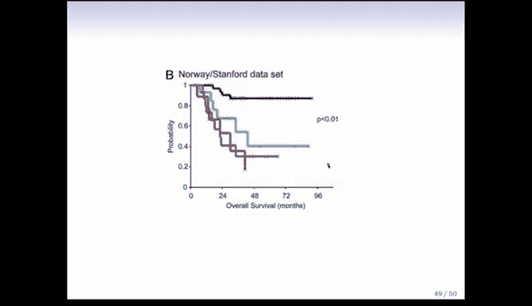

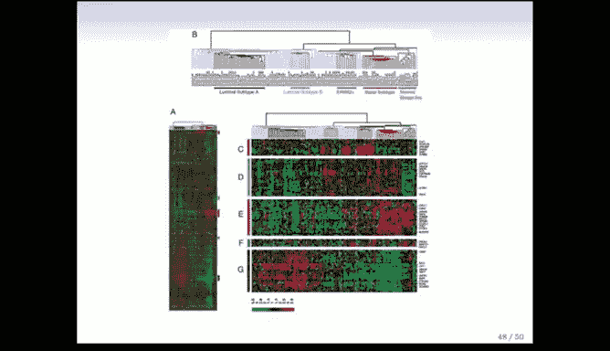

Basil and Urby2。Are doing not nearly as well。 Then the probably survival is much worse as the。

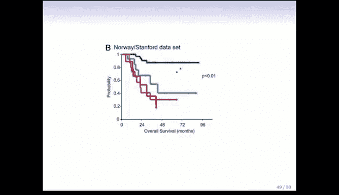

This group did that group， the luminal A is doing much better。

 So because the survival is quite different， the scientists were really wanted to find out how are these groups different in with respect to what genes and that gives us a clue as to how other other diseases might be different in the different groups。

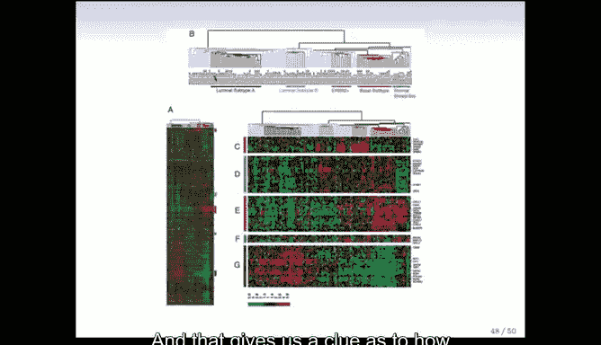

So that's an example of clustering for in a real scientific problem that's of importance。

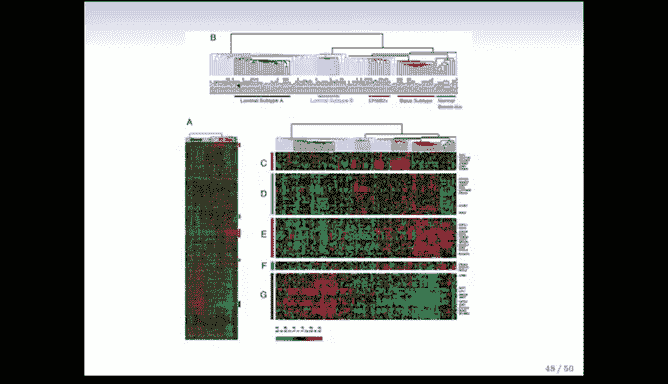

Yeah。So just to wrap up this section now， unsupervised learning is what has been the topic。

 we've talked about principal components and clustering and they're important in general for understanding the variation and grouping structure for a set of unlabeled data。

 so they can be useful for themselves just by themselves that we saw for example in that last example。

 or as a preprocessor to choose a linear combination of features for supervised learning。

And we also saw that the problem is an intrinsic harder than supervisor in because there's no label there's no gold standard so we we can't use prediction error to figure out how well we're doing we've just shown you two techniques in these presentations。

 principal components and clustering and those are part of a big tool by a bag of lots of other techniques some of them are listed here like self-organ maps in the independent component analysis。

 spectral clustering and many more many more of these are covered in our book elements of statistical learning in chapterpt 14 and even beyond that there are many others as well。

