# 斯坦福大学《统计学习导论2023R语言版｜An Introduction to Statistical Learning with R》中英字幕 - P92：-092-Statistical Learning_ 12.R.1 Principal Components.zh_en - GPT中英字幕课程资源 - BV1yU421o7WA

Okay， today we're going to do our session on unsupervised methods。 So in particular。

 well look at principal components。K means clustering and hierarchical clustering。

So these are all pretty straightforward methods， and we'll just demonstrate on a simple example。

 so you get the gist of it。So。We're in our markdown， again， in our studio。

And here we have， we're going to start off with principal components and we'll use a data set that's in Arc called the USA arrest data。

And let's just have a a look at it。 The dim names。 we see there's a， each row is a state。

 and there's 50 states listed。

And each column is a crime category。 So there's murder， assault。

 And then we've also got urban population percentage and， and rape。

So。

We're going to do principal components of those。

Let's first just have a look at the data。We look at the means and the variances of the variables。

 so the means are quite different。

And， and the variances are very different。 Now， principal components is about variance。

 And so the mean shouldn't play a role， but the variances of the individual variables will play a role。

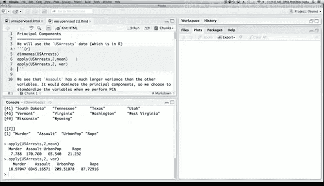

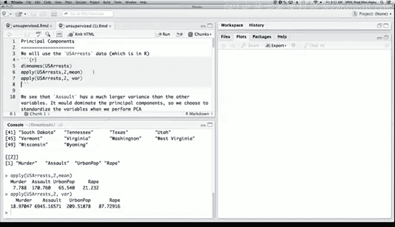

After all， we're looking for linear combination that the largest principal component is the linear combination that maximizes the variance。

And if you've got a single variable that dominates with respect to variance like aier。

 it'll pretty much eat up the first principal component。

 And so you won't get anything meaningful out of the data。

 And these variances are largely due to the fact that there's different units。

 the measure each of the variables is measured in different units。

So all that's to say we're going to standardize the variables before we do principal components。

 we standardize them all to have unit variances。So PR comp will actually do that for you if you set scale equals 2。

 and so here we make a call to PR comp and assign the result of PCca。 out。

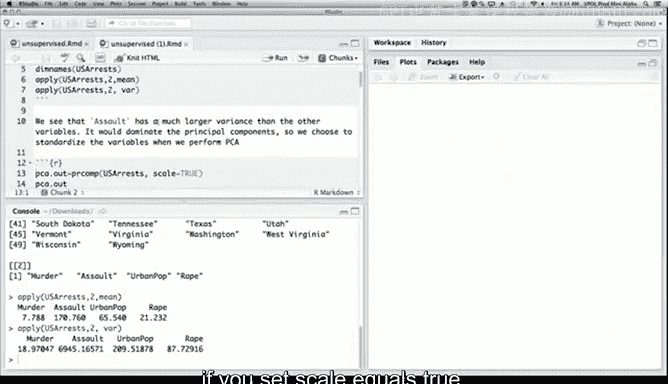

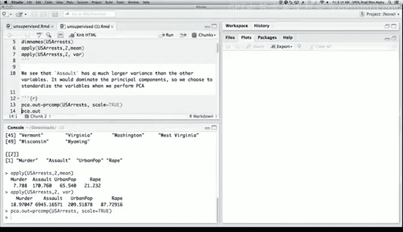

And then we can just print it as usual。And。

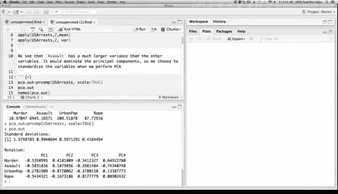

And we see a summary。 The standard deviations are actually the standard deviations of the four principal components。

 There's four variables， so we can find four uncorrelated principal components。

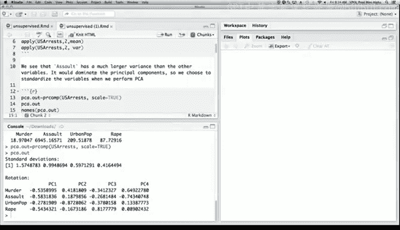

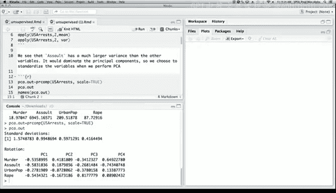

And these standard deviations are always decreasing。

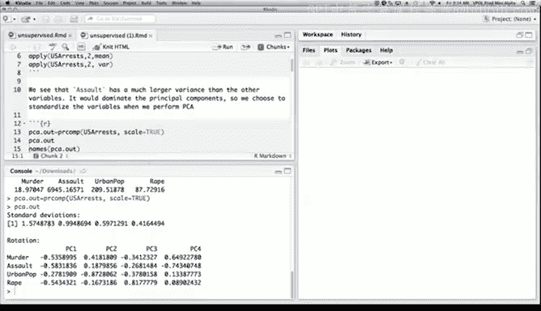

So you can see them the largest is 1。57， then it drops to 0。99， the smallest is 0。41。

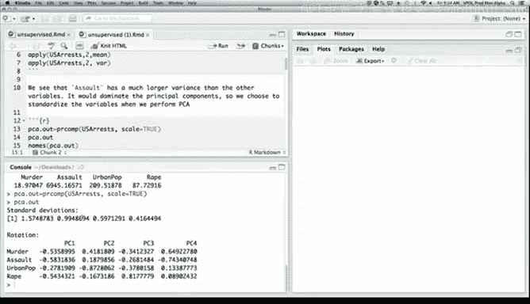

And then what's called the rotation。😊，Other loadings。 So the first principal component。

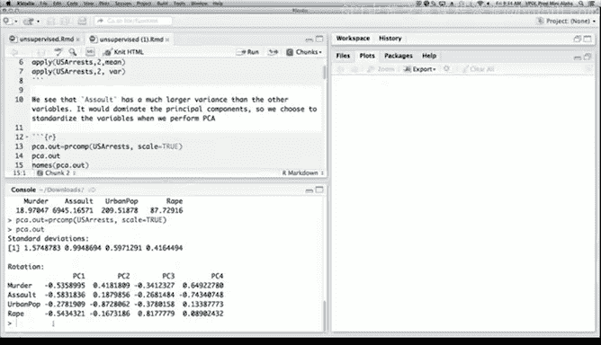

Is。Pretty much loaded equally on the three crimes。

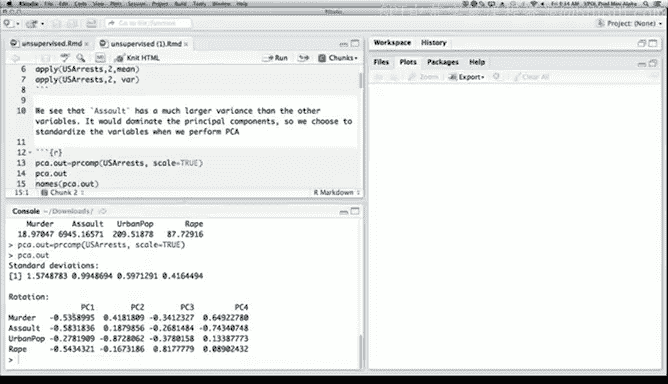

And it's got a lower loading on urban population。 So it seems like the first principal component is just a measure of how much crime there is。

 It's just essentially an average of the three crimes。

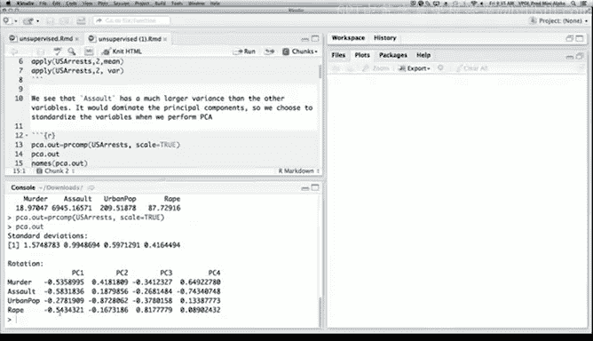

Now notice the signs are all negative well the principal components don't care about sine because the variance of a negative variable is the same as if you multiply it by -1。

 the variance doesn't change so we can easily just flip these signs and we get the same principal component。

 just the signs changed。

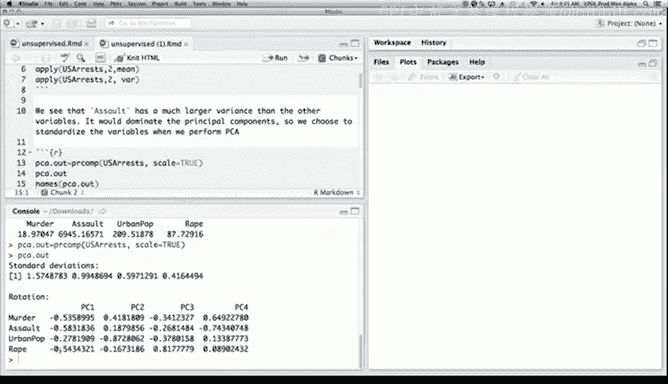

And then you'll notice the second principle component is more heavily loaded on whether the the state has a high urban population or not。

 So it seems like the first two principal components。

 So one is to do with the total amount of crime and the others to do with the urban population。

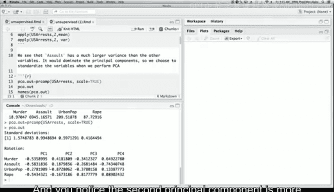

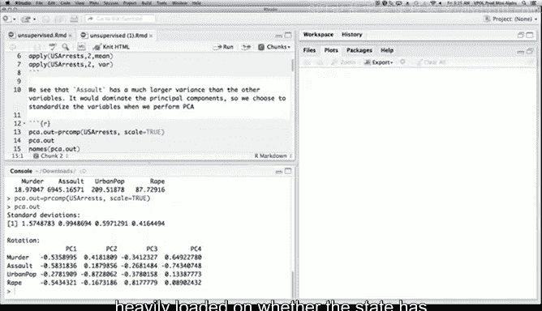

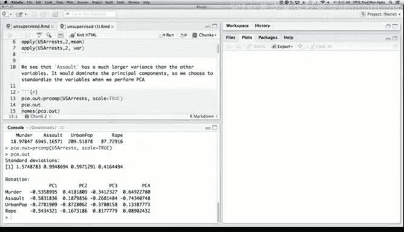

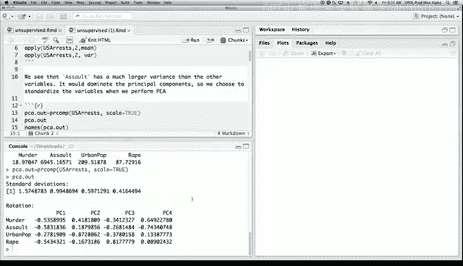

So。So that's what happens when we print。 Of course， you can。

 you can do help on PR comp We used to that by now and find out more about exactly what it's it's given you and what the components on the object。

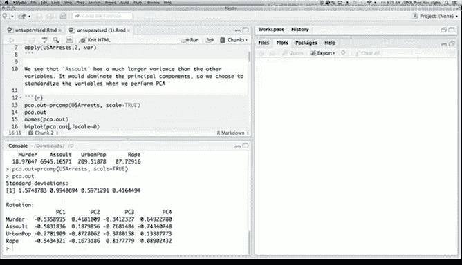

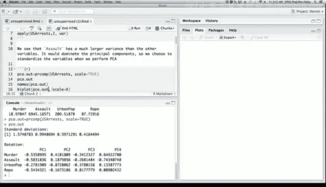

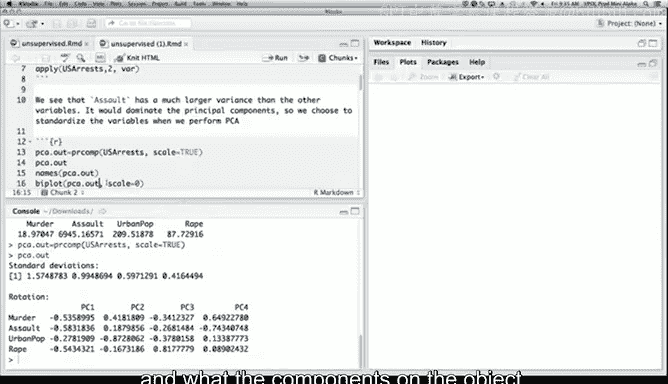

But there's a very useful way of looking at principal components， and that's a bypl。

And so yeah we do a bipl。And。We notice that the fonts are a little bit big。

 So what I'm immediately going do is change a fontier and make it a little bit for smaller。

 I user the C， E X command， and I'll make it 07。嗯。ItMake it。6。

And there we can see things a little bit more clearly。

 So it's made a plot of the first two principal components。

 And so since the observations are the states， we see a position for each of the states in this plot with an actual name of the state is written out。

And then in red， we see superimposed on this plot， the directions of the loadings for the principal components himself。

 the direction vectors。And so here we see that this first axis is largely due to the three types of crime。

 murder， assault and rape。Right and so here's the one direction。So remember。

 the component was negative。 It had negative loadings。

 And so negative scores mean negative times negative is positive。

 So these are the states in this and that have got。Overall， high crimes。

 So we see Florida over there， Nevada， California， Michigan， New Mexico。

And in the other end of the scale are other states with with， with low total crime。

 It's a mainine North Dakota， New Hampshire。So this first axis is really to do with the amount of crime in the state。

 and then the second axis we saw was mostly loaded with the loading was mostly urban population。

 and so this access is really about whether the state has got a large urban population or not。

And that also had a negative loading， so。New Jersey has got a high urban population。

 Arkansas is on the lower side。 Mississippi， North Carolina， much lower。 Okay， so one plot。

 and you get to see you get to a nice summary of the principal component。

 So this is called a by plot。The word by mean in both the the loadings and and the principal component scores are put in one plot。

Okay， so principal components very popular， I encourage you to learn more about them， use them。

 and incorporate them in your data analysis。