# 斯坦福大学《统计学习导论2023Python版｜An Introduction to Statistical Learning with Python》中英字幕 - P95：-095-Statistical Learning_ 12.Py Principal Components I 2023.zh_en - GPT中英字幕课程资源 - BV1u4421A7ZU

Okay， now we're going to do the lab for Chapter 12， which is unsupervised learning。

 and we in particular， demonstrate principal components in clustering。

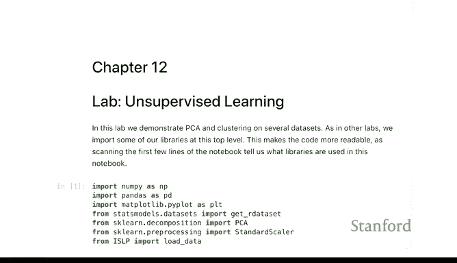

So at the beginning of the lab， we import libraries just like we've done before and by now it's very familiar。

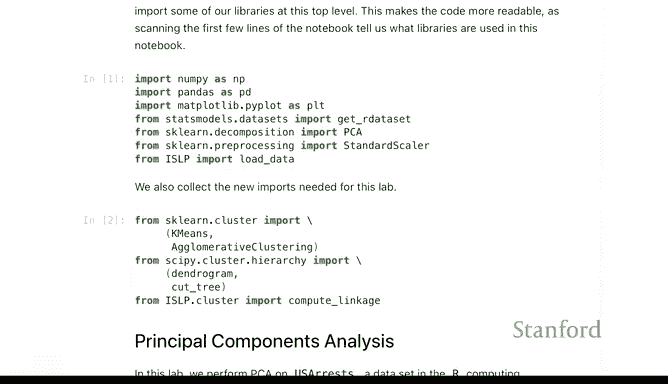

And some new， some new libraries and functions。That get imported as well。

 including some that are have been made for the ISLP package。

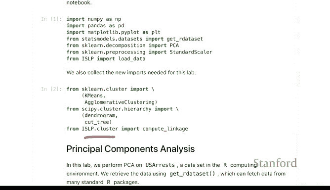

For the principal components we're going to work with the USA arrest data。

 which is actually a data in the R computing environment。

 and there's a nice Python function called get R data which can be used to get retrieved data from our packages and that's what we use here。

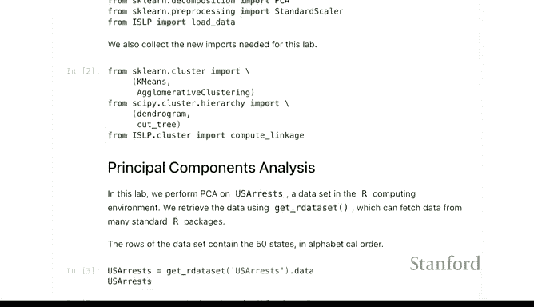

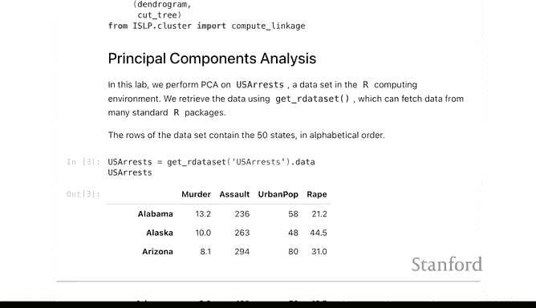

That's quite a nice feature in that you can compare methods in both R and Python we're not talking about R in this course it's nice to see to be able to compare them and R has a lot of free data that's built in as well and you can see it delivers a data frame。

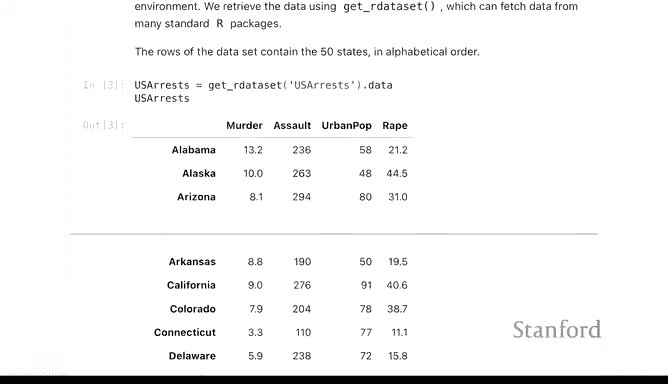

And its's only got four variables which we use to demonstrate principal components。

 principal components ideally know is used to reduce very wide dataset when youve got lots of variables。

 lots of correlations， but yeah were just using four variables。

And the four variables look at different crime rates in each of the states in the country。

So the Rosa states， and the crime is broken down by percent of crimes that are murder， assault。

And rape in each state。And。Actually not percent， but rates of some kind rates of some kind yes。And。

 and then there's also。A fourth variable， which is a percent of the population in the state that's urban。

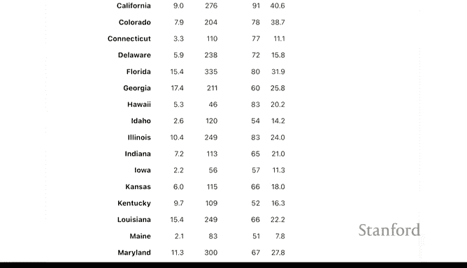

So this。There's the 50 states。嗯。

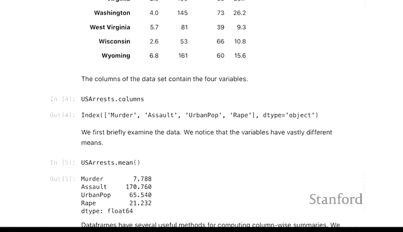

So the columns are the four variables。We can compute the means of each of the variables。

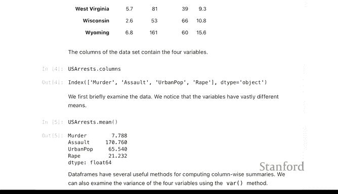

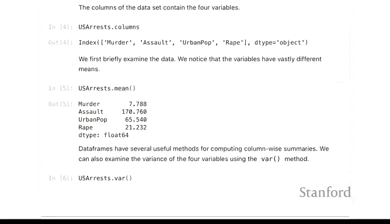

嗯。We can also examine the variance of the four variables。 I noticed that some。

 there's quite a bit of difference in the， in the variance there。

 I' wonder if that might make a difference in the， in the principal component， yes。

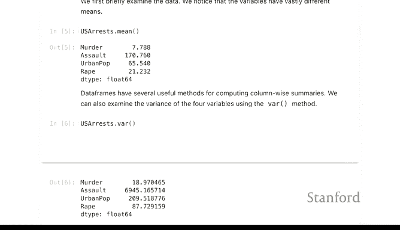

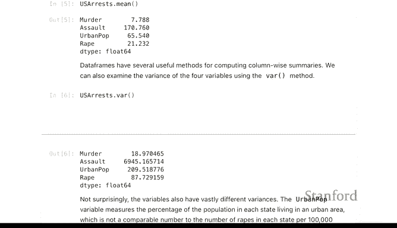

So principal components like red regression and lessU， it's an unsupervised learning method。

 but it's sensitive to the scaling of the variables。

 it's looking for linear combinations of the variables with large variances if we just used it on the data as is you can see the assault variable which has a large variance on its own。

 it's going to get a lot of weight in the components because it's got high variances。

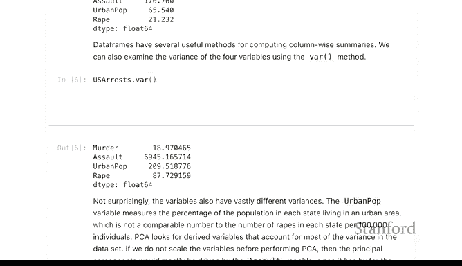

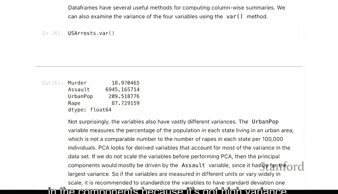

So。What we usually do is standardize the data， and we're going to use our standard scalar again。

With standard deviation and with means。 So we're going to center the data and and standardize to have each of the variables have unit standard deviation。

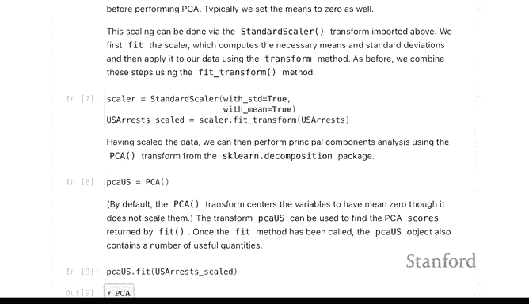

And we。So we've defined the scalar and then we do a foot and transform on the USA wrists and we give us over a new data frame。

 USA riskss underscore school scaled。Now we're going to perform principal components on them。嗯。

And so， we define。

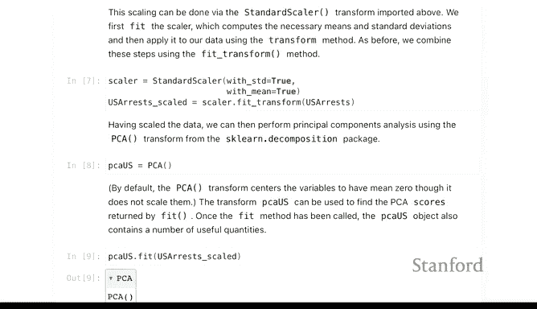

PCA US as this PCA function from SK learn， and we fit it on the USA risk scale data。

 and that's computed our principal components for us。

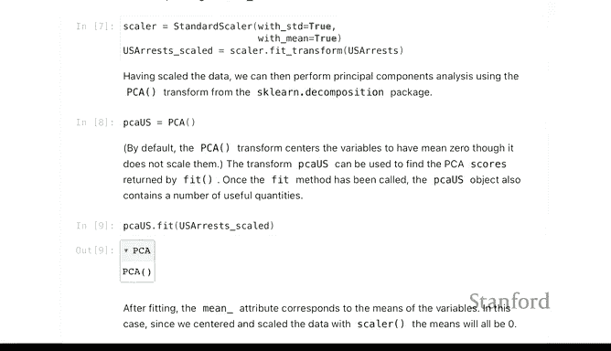

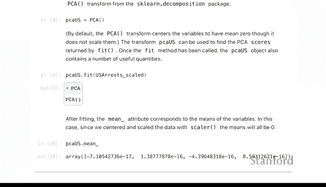

Tv I noticed here that the fit method， it just seemed to take an X matrix。

 and I guess that's because this is a transformer instead of an estimator like a classifier would have or a regression would have a label。

 right。I see。 good point。So that reminds you that principal components is unsupervised。

 so there's no response。

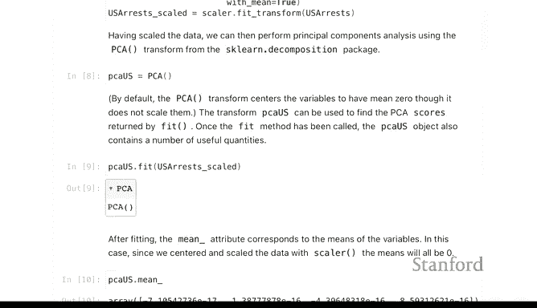

嗯。

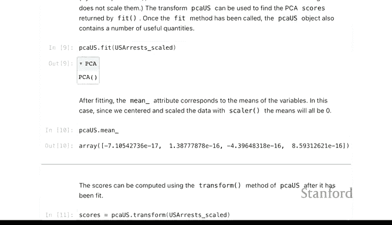

We can compute the mean。

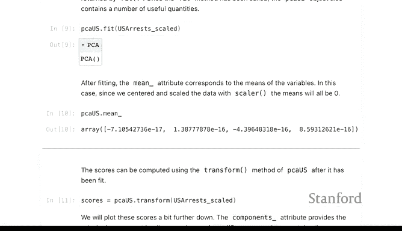

Of the， of the principal components。Oh， this gives you the means of the variables。

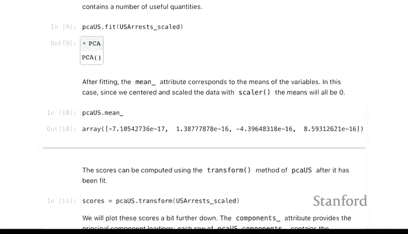

And we see that they're all0， as we expectca we did the same trend scaling。

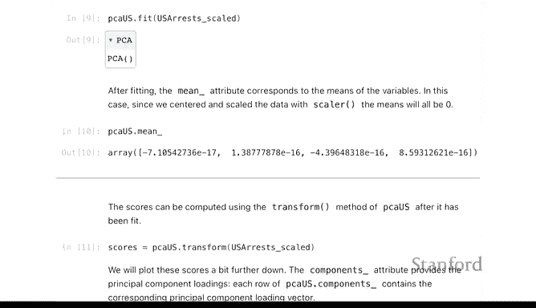

So I think what a PCA might， if you had not standard it itself。

 it would standard it for us and we might see non zeroro， but we already removed the mean。

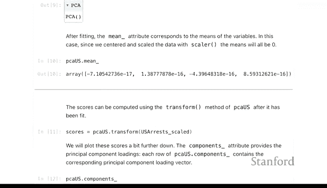

So now having computed the principal component， you can extract things such as the scores。

 Those are often what we're interested in and。

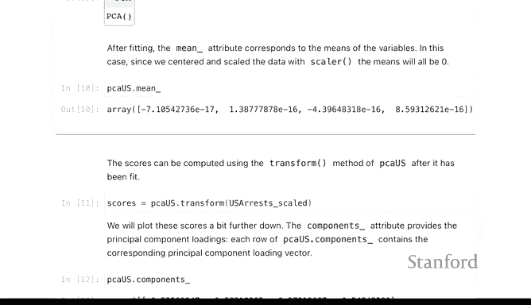

And， and we。Get those by。Using the fitted principal component model to transform the data matrix that we。

 the data frame that we provided。 that gives us the transforms to the principal component scores。

 okay。

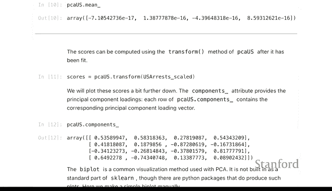

And。And and then the components。Are the direction vectors that define the principal components。 Now。

 we've got four variables in our data frame so we can get at most four principal components。

 And yeah， we've computed them all。 And the rows of these components are the direction vectors。

 So how much weight to give to each of the four variables。

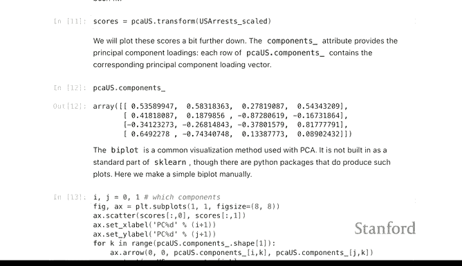

um。So each， each row is a different principal component。

So one of the things we like to do with principal components is plot the data and in particular plot the leading principle components and it's often common to make a two dimensionmenal plot because that's something you can visualize nicely and so yeah we set up some code for doing that。

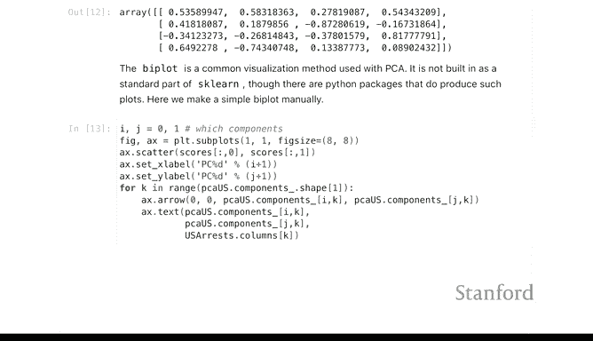

With and label in the axes and， and so on。 sure I think this one。

 you might see this called a bypl in some places。 is that right。 It's called a byplot。 Yeah。

 and let's just look at the plot and， and you'll， you'll see that that code produced this plot here。

 And the reason it's called a byplot is because it's both plot in the principal components。

 It's also plot in。These little line segments here is showing is representing the coefficients of the directions。

 so you see them both in one plot。Now。So that's the code for producing this plot。

 If you look in the textbook， you'll see the by plot for the same data。

That this picture is upside down relative to that picture。And that's because。

The scores in the principal component， you can multiply any of the scores for any of the components by -1。

 and the variance doesn't change。 and principal components is all about variance。

 So principal components。It， it is。Gives you a solution up to sign flips on each of the components。

So we can redo this plot by flipping the sign on the second component。And we do that。

 And that gives you a picture that looks exactly the same as the one in the in the book。

 We've also applied a bit of scaling to to the little line vectors to make them occupy more of the frame。

 the plott in axes。 So I'm wondering how to interpret。

 So it looks like the urban pop is sort of vertical。

 So maybe this axis is separating population states by how urban they are。

 And then the left right seems to be sort of like a。You know。

 a violent crime or not access is that happening。 It's exactly right。 Yeah。

 and that's exactly what you do， Jonathan， you look to see for each of these， these variable lines。

 how aligned they are with either of the coordinate axes in these plots。

 And that helps you name the plot。So， so in this case， it gives you a very nice interpretation。

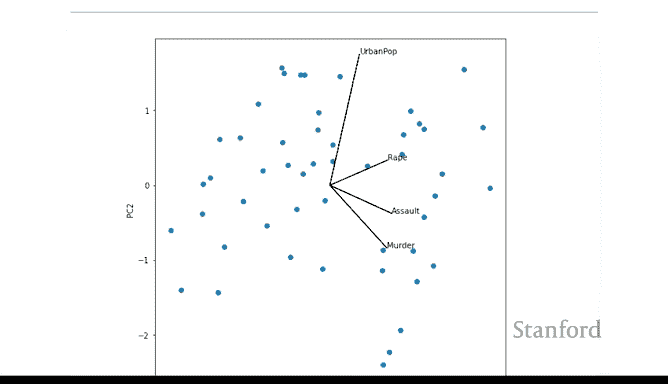

嗯。And。

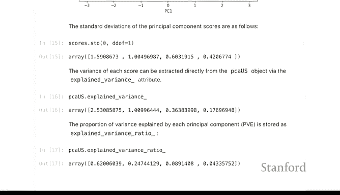

There's various other things you can extract from the fitted principle component object。

 one thing people like to look at is how much variance is explained by the components because you're trying to do a data reduction and so were interested in the variance。

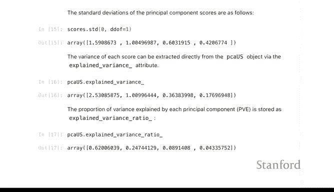

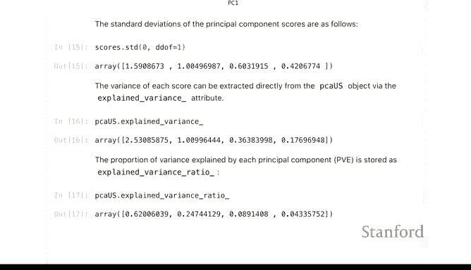

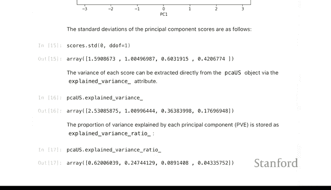

And， and。Not the and so what we what we have here is this actually computes the variance of each of the components。

 and they necessarily must be decreasing because the first principal component has maximum variance。

 the next one， second maximum and so on。And because the data was standardized。

 these variances must add up to4 because。The original variances， the， the， the。

Well one for each of the variables and a property of the principal components is that the sum of the variances of the solutions give you the original sum of variances。

What's often more interesting is the percent variance explained and so that we've computed at the bottom here。

 and you see that the first principal component explains 62% of the variance。

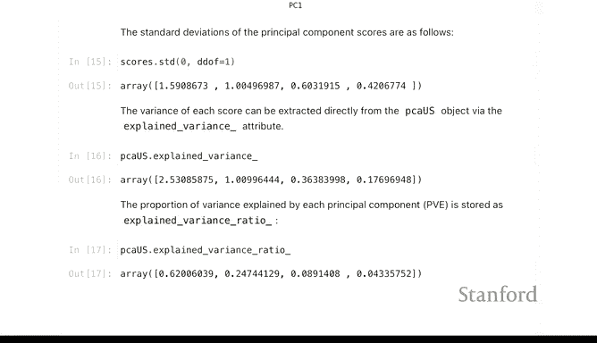

TheThe second principle components explains a further 28% of the variance。

 and then the remaining two principal components explain much less quite small， yeah。

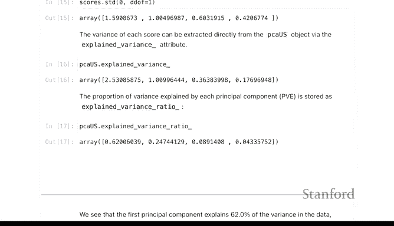

So we're going to make a plot to show both the variances explained and the percent variances explained。

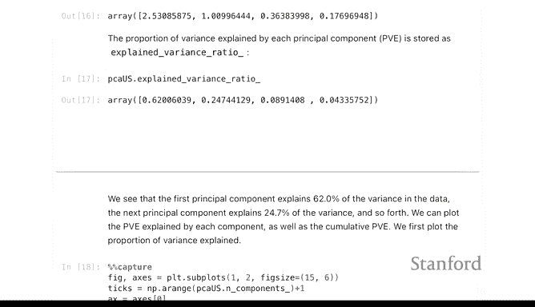

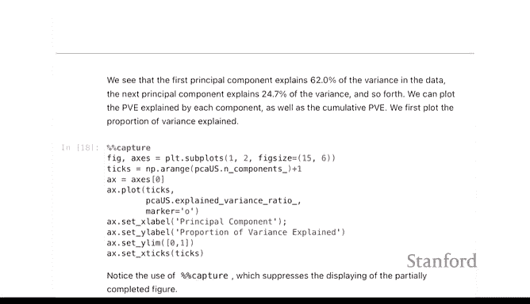

And。And this plot is going to have two subplots， because we're gonna have two plots in a row， okay。

And so we， what we've done here is we first produced the first plot。 that's code for the first plot。

 which is proportional variances explained。And then in the second plot。

 it's going to be cumulative proportion of variances explained。And we want to plot them both。

 And so what we've done here is we've used this percentage percentage capture。

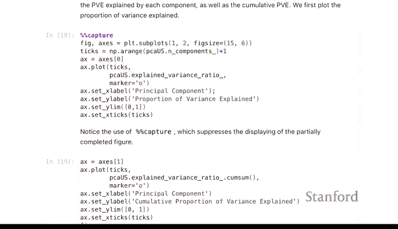

Which lets you produce a plot， but not display it right away。 Just hold it。

 and then you can add your second plot， and then you can display the whole figure。

 which you just do by typing fig。 And so then you see the two plots。

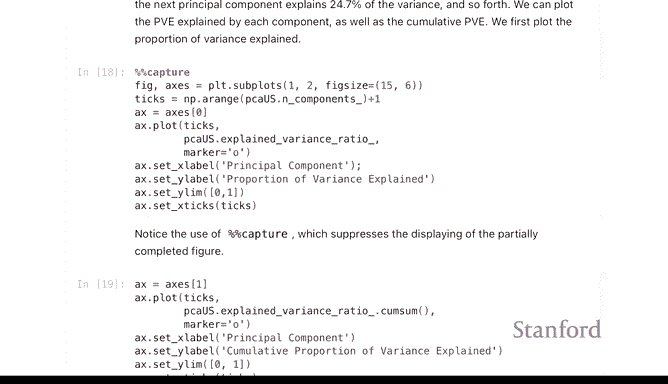

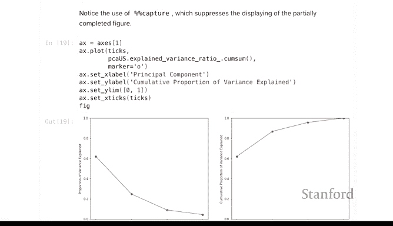

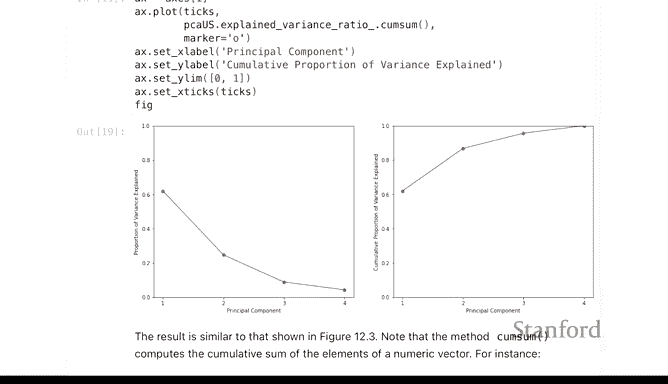

I guess without that capture， we would have after the first line， we would have seen。

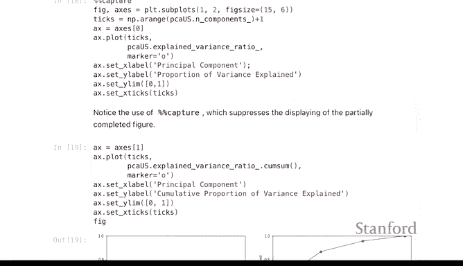

2 plots。 Well， the one on the left would be have the the variance ratio。

 but we wouldn't have filled in the second one would be blank。 Yeah。

't we haven't plotted anything to that axis。 So this is， that's a way of doing both。

 And I'll just say one， the， this percent percent。 These things are called magics。

 So there are various。

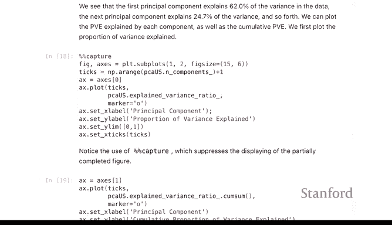

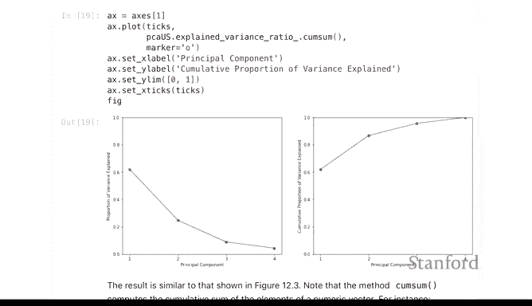

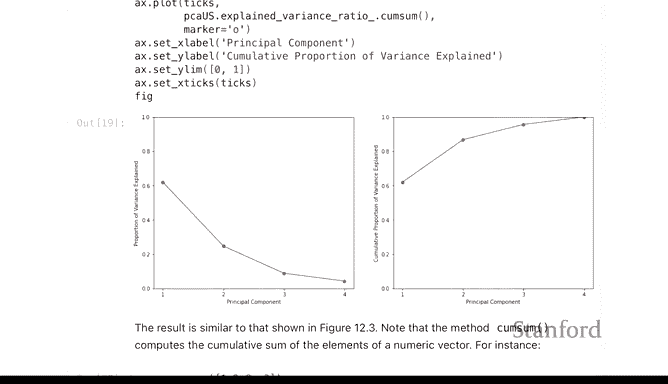

Their percent percent capture is one of them。 but they， theyre often， there's some handy ones。

 And actually， we mentioned R a little bit earlier。 You can actually run。

 There's an R magic that you can run R code in Python。 We're not gonna talk about it today。

 But that's this， these magics of the of I Python。😊。

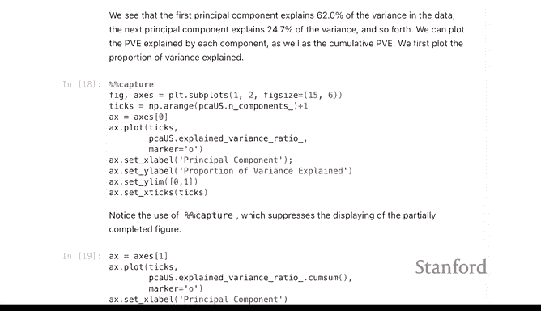

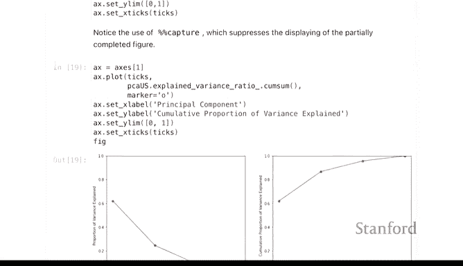

Okay。So that's that's the end of principal components。

 We're going to leave you to read the section on matrix completion。

 where you can use matrix principal components as a means for filling in missing data in in a data matrix。

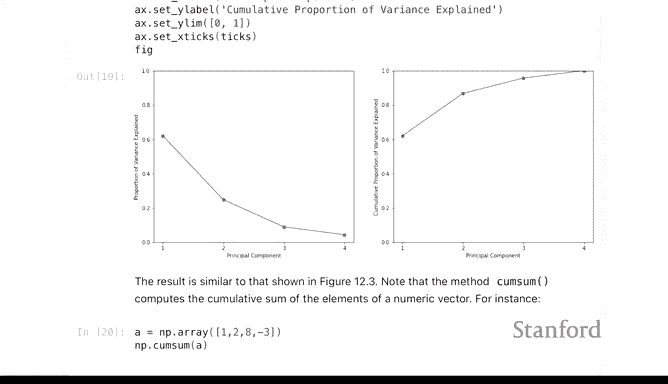

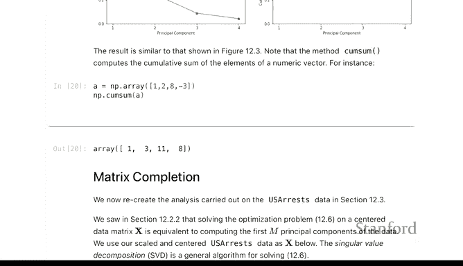

But you can， we leave that for you to do on your end。

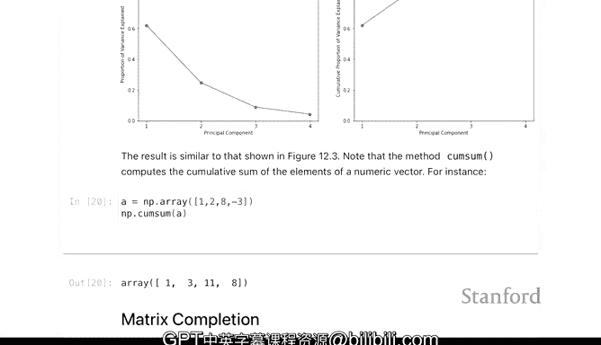

