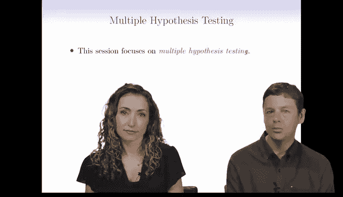
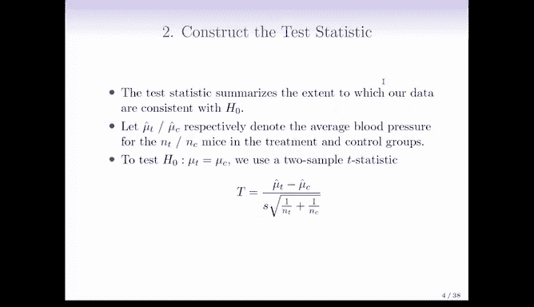
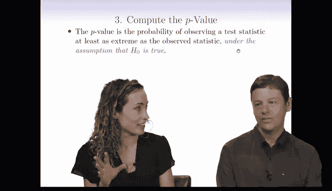
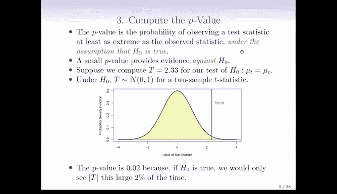

# 斯坦福大学《统计学习导论2023R语言版｜An Introduction to Statistical Learning with R》中英字幕 - P95：-095-Statistical Learning_ 13.1 Introduction to Hypothesis Testing.zh_en - GPT中英字幕课程资源 - BV1yU421o7WA

Hello， I'm Gareth James， I'm a faculty member at the USE Marshall School of Business and I'm also one of the coauthors on the introductionuction to statisticaltistical Learning book。

Hi， I'm Daniela Wton， and I'm a professor at University of Washington。

And I'm also a co authoror on Inuction to statisticalal learning。

And Trevor and Rob have asked us to present the section on multiple hypothesis testing scene。

 so we're very excited， aren't we Daniel Oh， I'm excited。

 this is extra fun for both me and Gareth because a very， very long time ago。

 we were both PhD students of Robin Trevs。 I was a student of Robbs。 Gareth was a student of Trevor。

And if you're wondering what Rob and Trevor are like in real life， then I can tell you。

 Rob is exactly the way he comes across in these recordings， like he's just like a very friendly。

 big teddy bear。Greeth， what's travelrevor like。Pretty much the same， similar。Close， this is。

 this is kind of like the old days actually doing sort of Labour unpaid for your advise。 So。

 but seriously， we're， we're very excited about this session。 And I。

 I think it's a very important topic。 So we're looking forward to present， you know。😊，Yeah。

 multiple testing is a topic that I really love to talk about because。

It kind of isn't as flashy as some of the topics in introduction to statistical learning。

 multiple testing and really hypothesis testing in general is something that's been pretty well understood in statistics for quite a while。

 but it's really important and if you misunderstand hypothesis testing and in particular if you mess up your multiple testing。

 you can very quickly end up in a situation where you have spurious findings that aren't going to be reproducible that aren't going to hold up to further scrutiny。

And so really understanding the fundamentals of multiple hypothesis testing is just incredibly important to performing any type of data analysis or statistical learning。

And multipleip hypothesis testing has been around as a sort of classical idea for a long time。

 but it's become increasingly important with the advent of enormous data sets。

 so instead of doing three or four multiple hypothesis tests we're now doing tens of thousands or even larger numbers and so the issues that are associated with multiple hypothesis testing have just become larger and larger and there's been a big research field over the last 20 or 30 years on addressing some of those issues and we're looking forward to presenting some of that material here。

All right， you want to get started Gary Yeah so I'm going to make a start by talking about just what is multiple hypothesis testing and then Daniela is going to give a very quick overview of the basics of hypothesis testing we're going to assume here that most of you have seen a standard hypothesis test before so that'll just be a sort of review of those ideas and then we'll go through and talk about some of the classical methods for addressing hypothesis testing and then finally Daniela is going to finish up with some of the more modern approaches but first of all let's let's talk about what is multiple hypothesis testing So I'm sure most of you are familiar with the idea of a standard single hypothesis test where we might be trying to test say a null hypothesis like expected blood pressures of mice and the control and treatment groups are equal versus an alternative that they're not equal and we know how to do that So Gareth what does that say on the slide each with a little zero under it so H sub zero that's that's。

Res the null hypothesis。 And then we usually have an H sub or an H sub A to represent the alternative hypothesis。

 So how do you pronounce it H sub 0。This is， in case you're wondering in the audience。

 we we actually had an argument about this like two years ago。

 So this is just an opportunity for you to see that I'm right。

 At least if you have an American accent。 Those of you with different accents， all bets are off。

 Yeah， and Danielle and I almost never have arguments， but occasionally。

 just So how do you pronounce it， though， You haven't told them。😊，啊哦。Oh， I say H not。

 and Garreeth says something else that's hard to say with an American accent H， you say H not。Okay。

 not on video。😊，Okay and then the topic for today's session is when we have not just one hypothesis test。

 but let's call it m different hypothesis tests and as I mentioned historically we've had values of M like three or four and had to deal with relatively small numbers like that but these days we're often trying to deal with values of M and the tens of thousands are even larger and just as one example on the slide here we have H nt zero the expected value of the J biomarker among mice and the control and treatment groups and so the idea here is that we might have many。

 many thousands of biomarkers we're interested in testing for a difference in each one of those biomarkers between the control and treatment groups and once we do that everything becomes a lot more complicated than when we're dealing with the single null hypothesis and the biggest issue is that it's very。

 very easy to end up。With a very large number of false positives。

 situations where we reject the nu hypothesis conclude that there's something interesting happening when it's really just a function of the large number of tests that we're doing。

 So I'm going to turn it over to Daniella now and she can give you a quick overview of。

Hypothis testing in general。Okay， so hypothesis tests。

 This is just like a quick reminder because we are sort of assuming you've seen some of this before。

 but basically a hypothesis test gives us a way to answer a yes or no question。 So， for example。

 is the true coefficient beta J and a linear regression model equal to 0。

Or does the expected blood pressure among mice in the treatment group equal the expected blood pressure among mice in the control group？

So when we conduct a hypothesis test， there are four major steps first we're going to define the null hypothesis。

 which I call H not and Gareth is being kind of cagey about how he pronounces it。

 but he pronounces it differently。And also the alternative hypothesis。

 I'll talk more about what those mean in a couple minutes。

 We're then going to construct a test statistic that is going to quantify something about the data。

The aspect of the data that we're interested in， the strength of the data。

 how much it tells us about the nu hypothesis。Then we're going to compute the P value。And finally。

 we're going to use that P value to decide whether or not to reject the null hypothesis。

So what do each of these steps mean？All right， well。

 the first thing we're going to do is we're going to divide the world into a null hypothesis and an alternative hypothesis。

 So the null hypothesis H is really boring。 It is just the default state of belief about the world。

 The null hypothesis tells us that nothing interesting is happening。 Nothing to see here move along。

 So， for example， maybe the null hypothesis for a linear regression model is that the true coefficient beta j equals 0。

😊，Or maybe the null hypothesis is that there's no difference in the expected blood pressure between mice in the control group and mice in the treatment group。

So the null hypothesis is super boring and it's like if the null hypothesis holds， then it's like。

 okay， it sort sort of like the default situation and it's what we start off by believing。

 we start by assuming the null is true and look at the data to see if the data can convince us that we should switch from the null to the alternative right exactly。

So the alternative hypothesis tells us that there's something different or unexpected going on。

 So the alternative hypothesis， that would be something surprising， something interesting。

 It's what we want to discover。 So， for example， maybe the alternative hypothesis is that the true coefficient beta J in the linear regression model is nonze or maybe the alternative hypothesis is that there's a difference between the expected blood pressure of mice in the control group and mice in the treatment group。

😊，I sometimes think of this in terms of criminal trial where we have a null hypothesis that the defendant is not guilty。

 they haven't committed a crime and the alternative is that they have committed a crime and the default assumption of course。

 at least in the US is that people are innocent until proven guilty。

 so we believe the null hypothesis unless evidence sort of beyond reasonable doubt is presented to the contrary right？

So the next thing we're going to do is construct the test statistic。

 and the test statistic summarizes the extent to which our data are consistent with HO。

So for example， going with wanting to see if the expected blood pressure in the treatment mice is the same as the expected blood pressure in the control mice。

 we can let mu T hat be the observed average so the sample mean of the blood pressures in among the treatment mice。

 and Nt is the number of treatment mice and similarly mu hat C is the sample mean for the blood pressure in the control mice。

 and NC is the number of mice in the control group。So to test the null hypothesis。

 that mu t equals mui， in other words， the null hypothesis。

 that the population mean of the blood pressure in the treatment and control groups is equal。

 we're going to construct what's known as a two sample T statistic， and we're calling it capital T。

 so there's a numerator and a denominator， the numerator is just the difference between the sample mean in the treatment group。

 minus the sample mean in the control group。And then the gennominator is something that's sort of like not terribly important for us right now。

 but it basically you can think about it as like the basically it's the standard deviation of the numerator。

 It's an okay way to think about that denominator。 Yeah。

 and so T is basically telling us how many standard deviations we are away from zero So a number like one is not surprising。

 a number like three or four might be pretty surprising。 And if the null is true。

 So like if there were no noise in our data。Then we would expect mu T hat to be exactly equal to muy hat。

If the null is true， if the null is true， right， but in real life， even if the null is true。

 mutT hat minus PC hat isn't going to be exactly equal to zero。And so T will tend to be pretty big。

 either very large or very small。 if the null hypothesis does not hold。

 but if the null hypothesis holds， we'd expect T to be like not too big in absolute value。

But one of the problems with a test statistic is that we don't actually know necessarily what counts as a larger or small value intuitively further that this is away from zero。

 the more information we have or more suspicious we become about the null hypothesis but the P value is what's going help help us make a final decision whether we believe the null or not Gareth if you're jumping the gun that's on the next slide I was just trying to preview what was coming next so the next thing we're gonna do is compute the P value And so the P value is I think if I had to say I don't know what Gareth but like the most misunderstood ideaN statistics there are so many Yeah there are so many it's actually kind of a race to the bottom。

 but I do think that this one would when that race to the bottom So the P value like I would say like 90% of P value definitions that I see written are like not correct。

 I think this definition is correct。 What do you thinketh。

I think we're good。 Yeah， we'll check with Travon Ro afterwards。 you know。

 they're going to start busting into this recording to let us know we got it wrong。 No。

 I'm just kidding guys， we got it right。 The P value is the probability of observing a test statistic。

 at least as extreme as what we observed if H not holds。😊。

Yeah this is key that it's under the assumption that the null hypothesis is true。

 sometimes the P value is misinterpreted as something like the probability that the null hypothesis is true。

 which is absolutely not great right so the P value is telling me if we live in a universe where the null hypothesis holds。

 then how likely are we to see such a big value of the test statistic。

 either very big or very small if it's a two sided P value？

So a small P value provides evidence against HO and the reason it gives us evidence against HO again is because this is the probability of seeing such an extreme value of the test statistic if the null hypothesis holds。

 so if that probability is very， very small， then there's a good chance maybe the null hypothesis doesn't hold。

We are at least very suspicious。 we're right， we should be suspicious。

So in the example of our treatment mice and control mice where we're very concerned about whether their blood pressures are different。

 if our T statistic equals 2。33。Then in order to interpret that 2。33。

 we need to know something about what the T statistic would look like under the null hypothesis。

 and it turns out that under the null hypothesis， that T statistic would have a normal 01 distribution or at least approximately approximately a normal01 distribution。

 and that is what is shown here， that yellow distribution here is the normal 01 distribution。

And the blue line shows you the observed test statistic of 2。33。So now we can say， okay， well。

 under the null hypothesis， we would expect our T statistics to fall anywhere in that yellow distribution。

 And in fact， it kind of is like way out at the edge of the yellow distribution。

So we're a bit surprised here。 Yeah， I'm becoming a little bit suspicious that this。

No hypothesis might not hold。And in fact， here， the P value equals 0。

02 because under the null distribution， we're only going to see a statistic that's this large and absolute value。

2% of the time。 So 。02 of correspond to 2%。So there's two possibilities here。

 either the null hypothesis is true and we just got kind of unlucky with this test statistic and that happens one in every 50 times we perform a hypothesis test or one in every 50 times because 2% because of the2% exactly so 2% is one over 50 so if we perform this hypothesis test 50 times and the null hypothesis was true each time we might expect about once to get a T statistic this extreme right So the other possibility of course here is that the null hypothesis is not true right。

So how should we interpret a P value of 002 I mean it's a matter of like how surprised are you by a1 in 50 event if a1 in 50 event is like well I mean that could happen if you did a 50 times it would happen once then you shouldn't think that a P value of 0。

02 is too compelling right because that's just a 2% chance right so this doesn't in any way guarantee that the null hypothesis is false on the other hand one in 50 is a relatively unusual occurrence but the concept here is that the smaller that that P value is the more sure we feel that the null hypothesis is in fact not true exactly。

