# 斯坦福大学《统计学习导论2023Python版｜An Introduction to Statistical Learning with Python》中英字幕 - P96：-096-Statistical Learning_ 12.Py Clustering I 2023.zh_en - GPT中英字幕课程资源 - BV1u4421A7ZU

Okay， so I'll take over for this this next part of the lab。 So the the next part of the lab。

 we're gonna talk about clustering and focus on two two main kinds of clustering that are， you know。

 likely the most popular clustering。 one is k means clustering and the other one。

 which is a a sort of top down clustering and then hierarchical clustering。

 which is a bottom of clustering。Or divisive kine means versus a glloorative hierarchical。Okay so。嗯。

Now。K means is going to be fit using something again from psyit learn。 It's an unsupervised method。

 So because it's from psyit learn， we're going to fit it using the fit method。

 but as we saw for principal components。When we actually fit K means。We're gonna just。

 we're not gonna have a response。 It's just gonna be fit on the， the， the set the。

The set of features。 So here we generate some data。 We'll plot the two cloud。 we。

 we sort of made two natural classes in the data we'll see in a minute。

 and then we're going to fit K means。Here with two clusters， So K equals 2。

 and we have this argument here， n in it， which is how many random starts to try to try and find an optimal clustering。

 And of course， we use the same random state to reproduce our results so we each time we run the code we'll get the same answer。

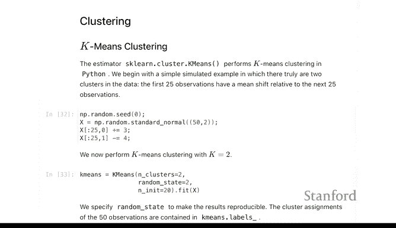

Okay。

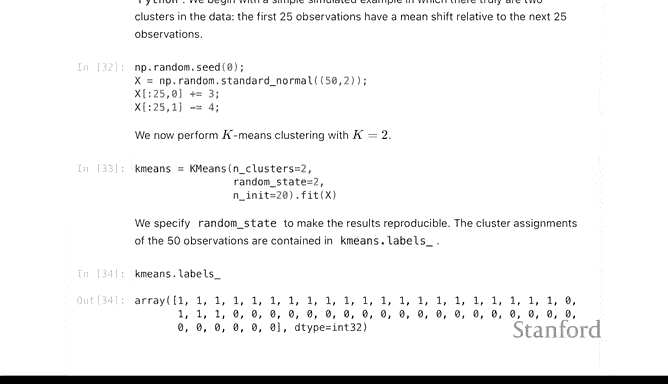

One key thing after you have run K means is you want to see what points are assigned to what cluster。

 and that's the label's attribute。

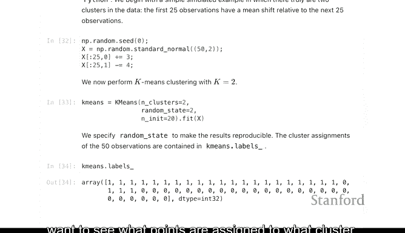

And okay， so that's an array here。 we can see that as。

We had kind of constructed our data in two classes and it sort of perfectly separates them if we look at how this data is constructed。

 the first 25 are sort of in one class， the next 25 or another。

 and it's kind of perfectly found that for us。

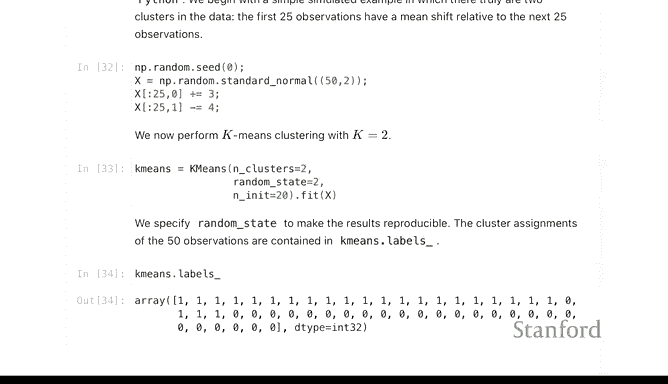

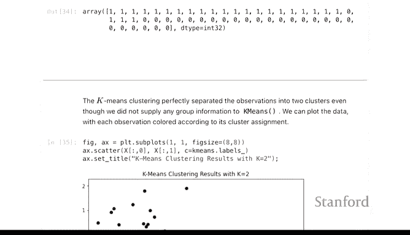

Okay。So let's make a plot of the K means plotting by label。 Nice choice of colour。 Yeah。

 as you choose。 well， you know。

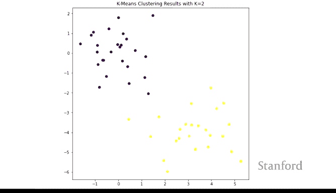

I must say， I think， I think Python chose that for。 I'll leave it at that。 But yes。

 I think it looks better in the book。

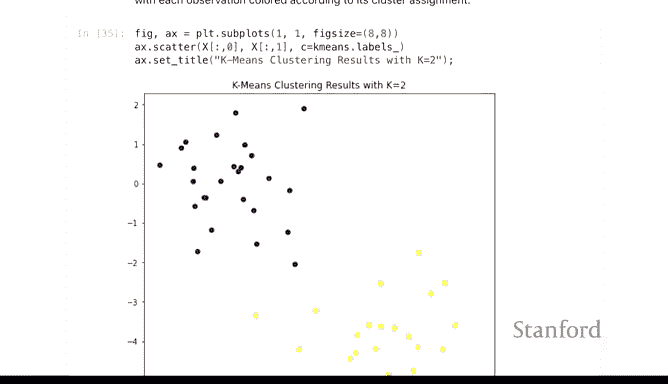

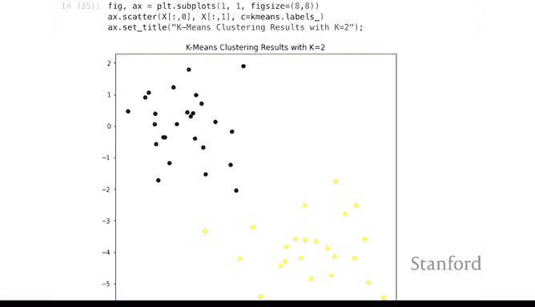

Yes， on the， on the， on the monitor here， the yellow is quite hard to see， but。

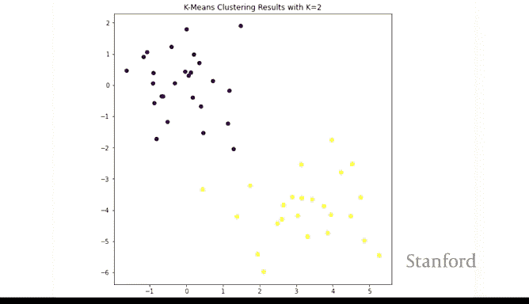

So we didn't。 So I'll just go back to the， the， the， the plot here。

 So we made a scatter plot of our data。 And here， the color argument that C。

 we coloured by the label。 And so this data was。Was constructed to be very separate。 And。

 and Ka means does a great job here at separating them。 But， of course， in practice， you know。

 we don't really know that our data is nicely separated and we don't really know that two is the right amount。

 So we could try fitting。

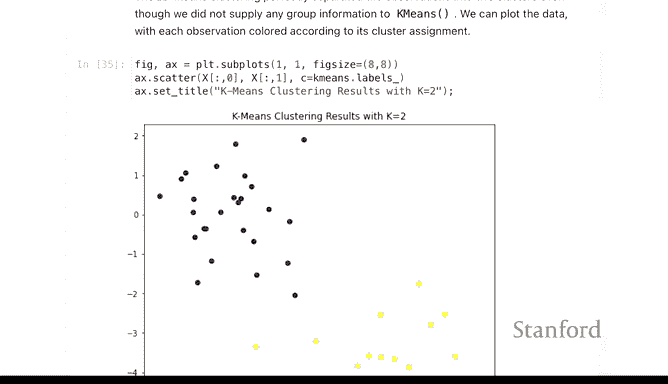

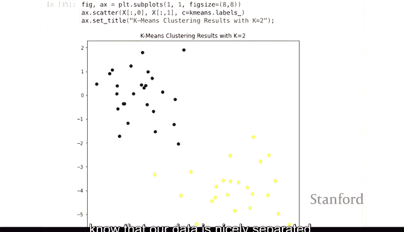

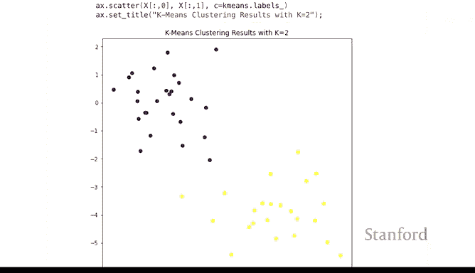

You know， we might have to try it。 K means with。Other numbers of clusters。

 So let's just look at what happens when we fit three clusters to our our data set instead of just the two。

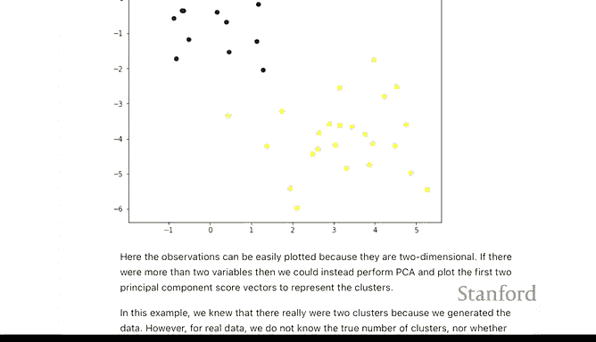

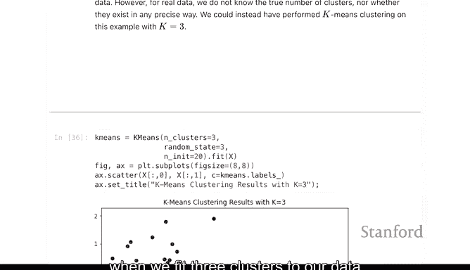

Okay， so this plot is essentially the same as before， except the， the estimator here。

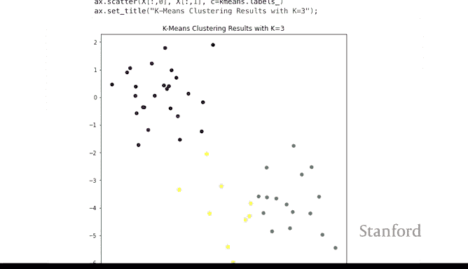

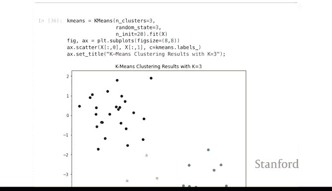

The camemi estimator has three clusters。 So the colors， there are going to be three colors。

 One of them is still that yellow that was hard to see。 But there's a yellow cluster over here。

 and then a green in a blue。

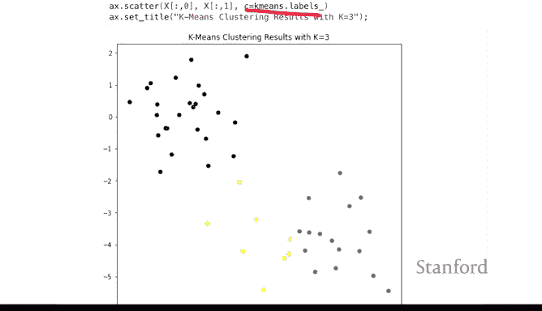

And we can see here。It's， it's hard to say that this is， this doesn't seem as good as the one before。

 It seemed to have。Actually， not even split。 Sometimes you might see K means would split a big cluster into two。

 but it's kind of taken a bit off the edge of each。 Sorry。

 let's a bit off the edge of each of these clusters。 And this is a very toy data set。

 we can actually see it in two dimensions。 It's rather hard to visualize what's going to happen in higher dimensions。

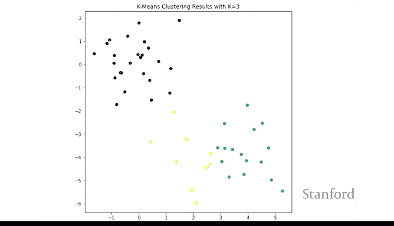

Okay。So。One of the arguments we talked about in the esator is this end ended argument。

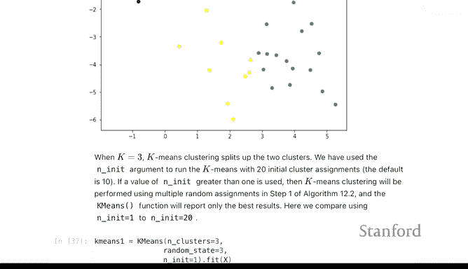

It's。Recall that the way the Kames algorithm runs as discussed in the lectures is that there's an initial random assignment to clusters and then。

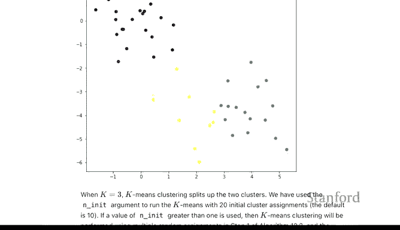

The kmi's algorithm tries to incrementally improve the within cluster sum squares。

 That is to make it as small as possible by swapping points between clusters。 However。

 every different initialization could result in a different solution， so。

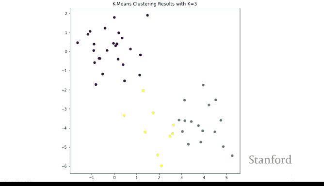

We encourage you to run many， and that's what this init argument， and init argument does， it runs 20。

 and it takes the one that has the best within cluster summer squares。

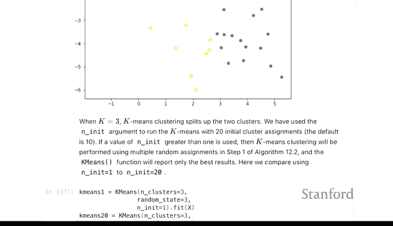

So here we'll just compare using one fit to 20 fit on our data。

 this data is pretty nicely separated even with three clusters， it makes some difference using 20。

 we got roughly 5% improvement within cluster sum squares。

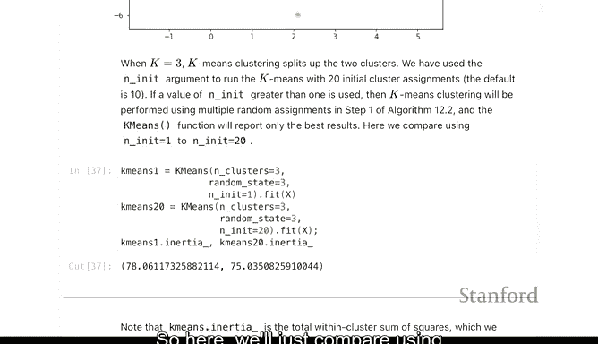

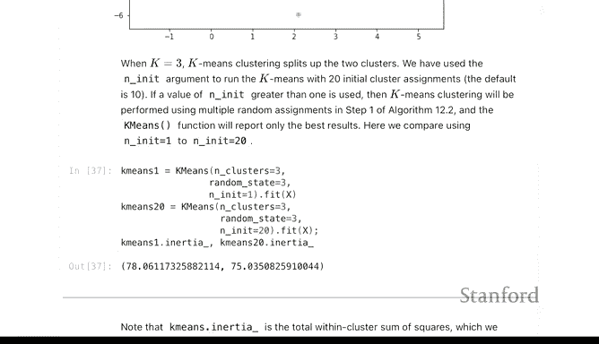

Okay。So the other clustering type of clustering we're going to talk about is hierarchical clustering and remember the main difference between K means in hierarchical clustering is in hierarchical clustering。

 we start with small clusters and build them up as you know as we go along the path。

 whereas K means just directly tries to break into a fixed number of clusters。

So in hierarch clustering， one of the biggest choices you have to make is is the so called linkage。

 And remember， that's the rule that's used that that decides how clusters are merge。

 The three main linkages are complete， single and average。 and， you know， I would say rule of thumb。

 completete is kind of。You know， often has nicer clusters than the other two。

 We'll see an example later about single has this deficit that the there's often no in the denogram。

 which we'll see in a moment， but there's not a nice place to break whereas it complete sometimes has a bit better place。

Okay。Well。In terms of the code， it is again a psyit learn estimator。

 though its not well its not it's an unsupervised estimator。 So again。

 we fit it with just a set of features X。

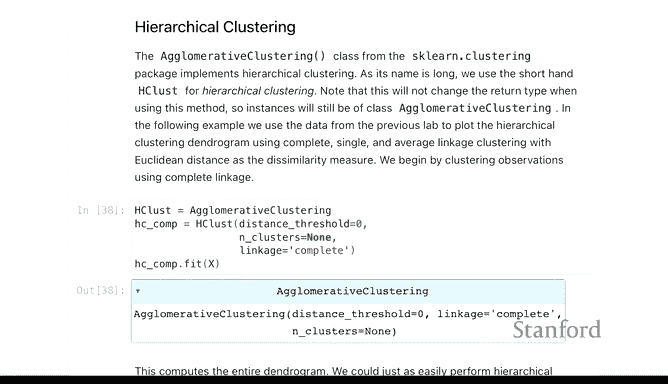

Okay。

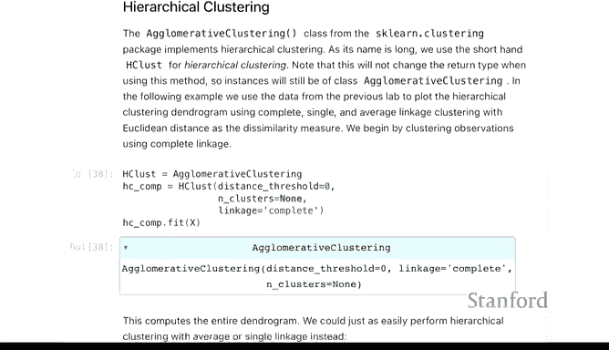

So this has fit something that we can use to produce a denogram。

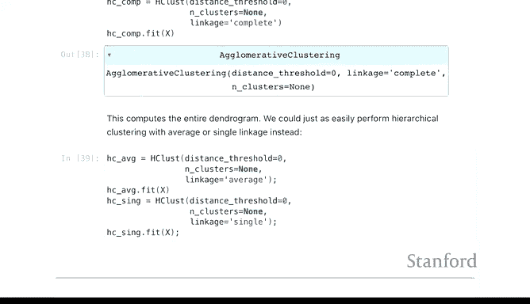

And we'll see how to plot denogram a little bit later。

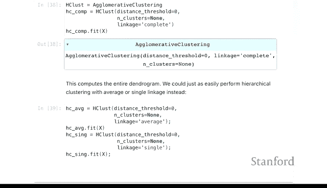

So we'll also here just for completeness， we'll use the other linkages and we'll plot their genograms as well。

 so the difference between these three methods is just the linkage。And let's compare the genderogram。

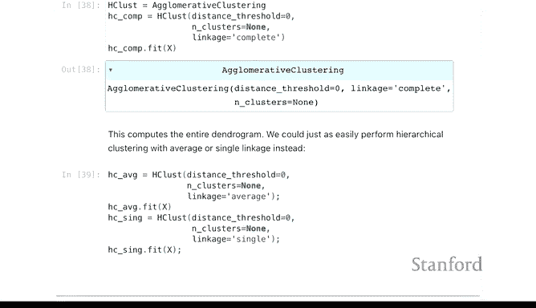

So。To fit hierarchical clusterluing。We need some notion of distance。

 K means actually needs data points themselves to fit。

 but hardluing can be fit just using a distance matrix and doesn't even really have to be formerly a distance matrix。

 it's something like a distance matrix and just we're just showing you here how to fit such methods。

 such clusterings。Instead of using fitting on X， we're going to fit on a distance matrix。

 So this is a distance matrix between all pairs of observations in the data frame。 Yes， all pairs。

 all rows in the data frame right often like for principal components。

 we are looking at the variance covariance of the features。

 That's one of the important things in principleable components here。

 this is a distance matrix of the rows or the cases in the data set。 So we had 50 observations。

 So we'll have a 50 by 50 distance matrix。And。That's the only information needed to fit higher clustering so we can fit it with the distance matrix。

 So here instead of being like a matrix that has cases and features， this is just cases by cases。

 so 50 by。

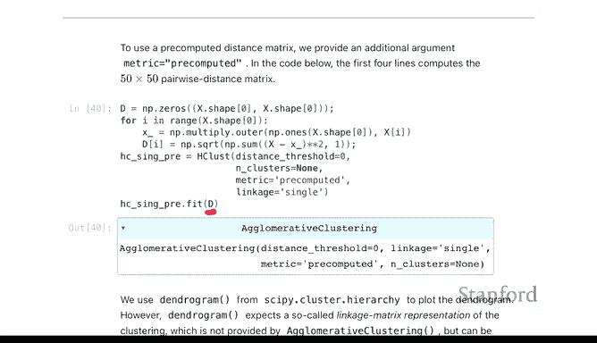

Okay， let's plot our first denogram。 So we're going to plot the dendogram for the complete linkage。

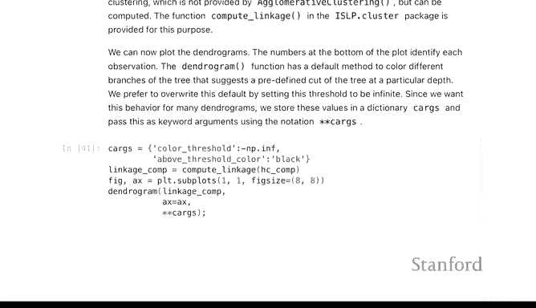

um。And so one of the things you'll often want to do is cut a denogram that every well。

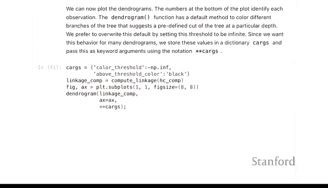

Let's look at the picture。 Then I'll go back to what what one of those arguments。

 So here's a picture of a dendogram。

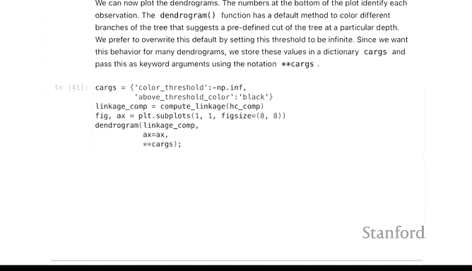

呃。And the points here， there are 50 individual points。 we can see their labels。

 they're relatively small here， but nevertheless， these are the individual labels of the observations。

 then each height here corresponds to some value in that D matrix where these two clusters were merged and for average。

 so for complete and single， it is always a value in the D matrix。

 for average is going to be some function of the values in the D matrix， but roughly speaking。

 this is the distance at which the clusters merge for all of the linkages。

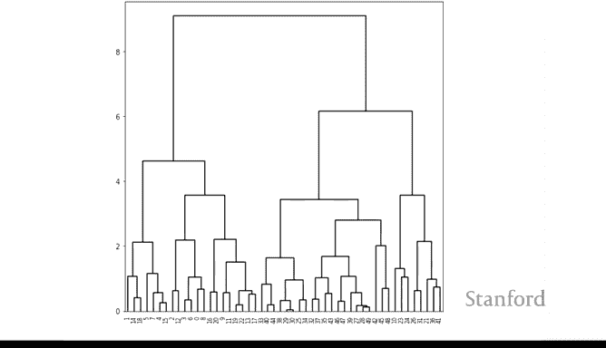

And so here we can see we know this data has two classes or two natural classes because we constructed it that way。

 so if we were to cut this denogram here，That would break this into two clusters。

 And so any cut to the denogram。Is related to a cluster。

 And that's what these arguments up here are related to。 So there's a。

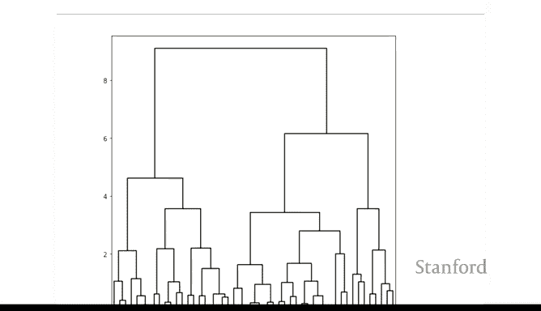

A threshold we can use to cut the plot of the denogram。

 such that anything below will be broken into different colors。

 So here I've put the colors a negative infinity， so there will be no cut。

 and everything above the threshold is black。

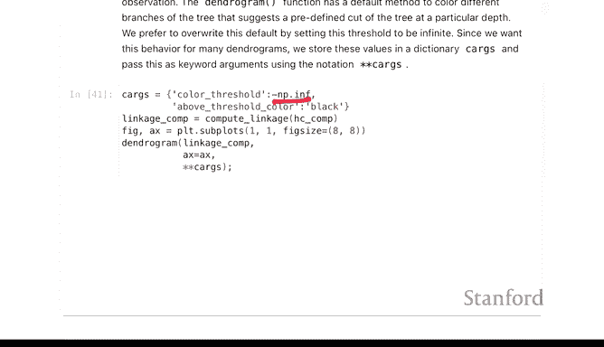

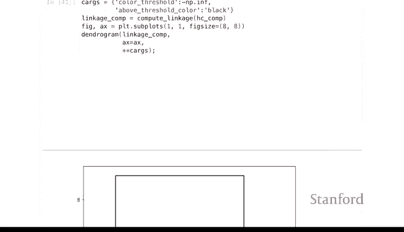

And that's why we got this picture。We'll see some cuts in just a minute。

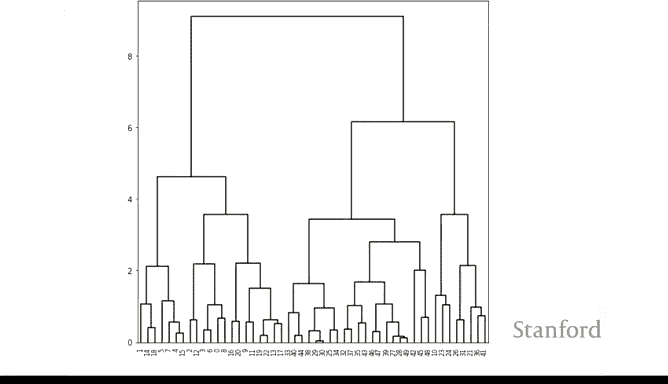

Okay， so if I change the color threshold here， I'm going to color it， change the threshold to4。

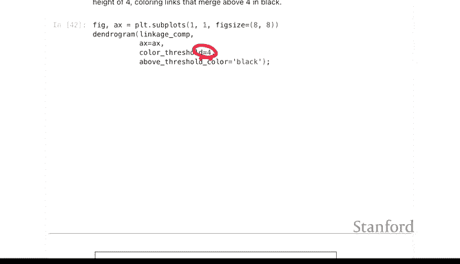

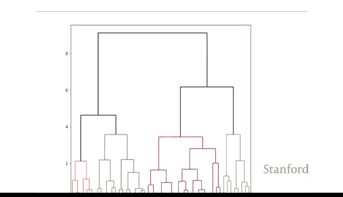

Oh， so。That effectively is put a line here， and now we can see separate clusters we can see。

 so cutting here cuts these four branches， and then there are different subtrees。

 Each subt corresponds to a cluster。So， you can。Specify a value to cut like when you actually fit the。

Fit the fit the cluster you can specify for， or you can also specify a number of clusters because there's I think there's what n minus-1 clusters as you go up the tree and so you can specify and they sort of。

They're ordered by the heights these things occur at， so if you want to cut with five clusters。

 there is some value here you can cut and get five clusters and you can use the the secular estimator to get that as well。

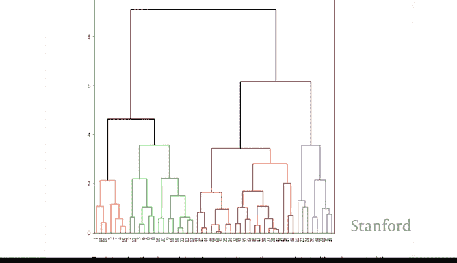

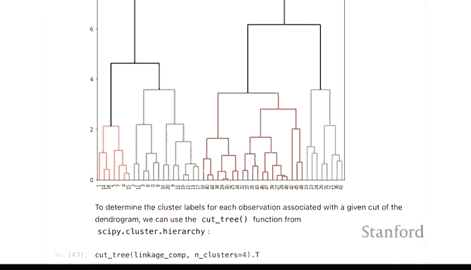

Okay， so the function that does this cut is this function called cut tree here we specified four clusters and it's actually going to be equivalent to having cut at4。

 but I also could have cut this at 4。1 or 3。9 and that would get the same number of clusters so you can there's also an argument here where you can put instead of a number of clusters。

 you could put an actual distance number。

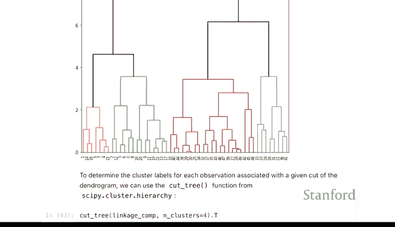

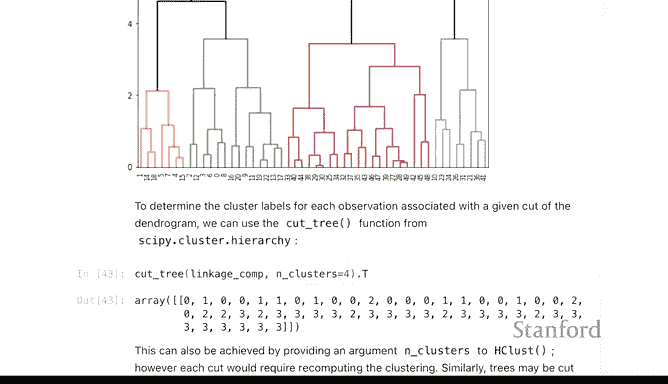

Or do we do the height， get the height of five？

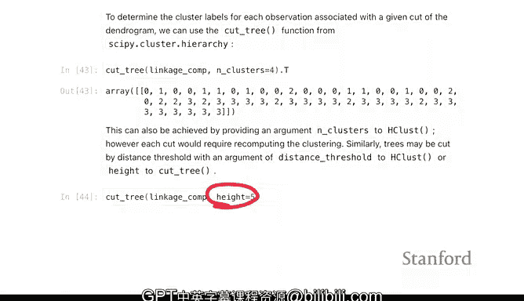

