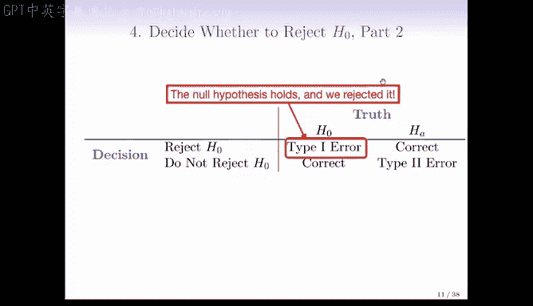
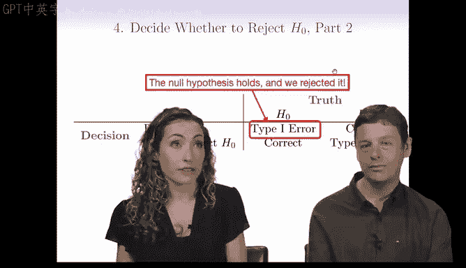
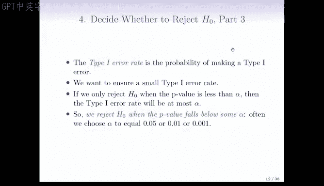

# 斯坦福大学《统计学习导论2023R语言版｜An Introduction to Statistical Learning with R》中英字幕 - P96：-096-Statistical Learning_ 13.1 Introduction to Hypothesis Testing II.zh_en - GPT中英字幕课程资源 - BV1yU421o7WA

So now we have decision time。 we're going to need to decide whether to reject the null hypothesis。

 So as we've said， a small P value suggests that such a large value of the test statistic is unlikely to occurcur under the null hypothesis。

Okay， so a small P value gives us evidence against h0， but is it enough evidence。

 well usually we need to have a binary decision， we need to either reject the null hypothesis or else fail to reject the null hypothesis。

 I should mention we never accept the null hypothesis because we're testing the null hypothesis we either reject it or we don't。

But the right vocabulary isn't to accept the null， it's just a fail to reject the null。So okay。

 our P value is small。 That gives us some evidence against H n。

 Should we reject thell or should we not reject it， Well， if it's really small。

 we want to reject thell hypothesis， and that would correspond to making a quote unquote discovery where we've discovered something new and interesting about the world。

 hopefully。But how small is small enough， so like should we only reject the null hypothesis of the P values below 0。

00001， or is it enough to reject the null hypothesis provided that the P value is below 0。01？

So oftentimes 5% or 0。05 is used as cutoff for rejecting a null hypothesis。

 but that's kind of just an arbitrary number that people use and I always tell my students that the reality is that how small that cutoff should be depends on how bad it is to make a mistake here and in particular what's called a type 1 era which I think Danielle is going to introduce soon and we'll talk about this more in a minute but that cutoff of 0。

05 is very field specific and it's like by no means a gold standard in any way。So okay。

 the thing we need to be thinking about when we're doing hypothesis testing is this table。

 so this is like the table of truth， so we have rows and we have columns and this two by two table。

And the columns tell us what reality is。 So the leftmost column corresponds to the truth being H n。

 So the null hypothesis really holds。 And then the rightmost column is under the alternative H A。

 which is the alternative holds。 so the null does not hold。

And then those two possible decisions we can make。 Those are shown in the rows。

 either we reject the null hypothesis or we do not reject the null hypothesis。

And of course in reality， we never know which column we're in。

 we know which row we're in but not which column we're in exactlyact because the rows correspond to a decision that we're making。

 it's my choice whether or not I reject an null hypothesis。

 but I have no insight into or I don't know no certainty about which column I'm in。

So there's sort of four scenarios that we can be in here。So the first scenario here。

 this corresponds to the null hypothesis holding。And I decide not to reject HO。And this is great。

 This is a good place to be， because it means that there was nothing interesting in going on。

 And I didn't reject the null hypothesis。 Nothing to see here。 Let's move right along。 This is good。

😊，In my courtroom example， this sort of corresponds to the defendant being innocent and they're not convicted。

That would be good。Okay， so this is another thing we can be happy about here。

 the null hypothesis does not hold。And we rejected theal hypothesis。So here Gareth。

 how's your defend doing well， guilty and convicted， so we're happy about that as well Well problem。

Maybe some people might not be， I guess it depends on what the crime was and that type of thing。

We don't need to get into that probably。Okay， so now here this is what's called a type 2 error。

 and here the alternative hypothesis holds， and we decided not to reject the null hypothesis。

So this is known as a Ty 2 error。And in this situation， the。Well， actually Gart。

 you tell us what happened to your defendant Well， guilty， but he got off for it。

 So this is a situation or she they they okay。It could be for example， that the defendant was guilty。

 there was evidence of guilt but not overwhelming evidence and of course on a jury where we're instructed that we should not convict someone and elsewhere where to sort of have evidence beyond reasonable doubt and a hypothesis test set is similar to that。

 we may have suggestive evidence， we may have a test statistic that's relatively large or a Pvalue that's relatively small but not small enough to actually be sure enough to reject the nu hypothesis exactlyact。

All right， and then finally， the fourth scenario。Here the null hypothesis holds。

 but we rejected the null hypothesis， and this is known as a type1 error。

 and type 1 errors are what we try to avoid when we're doing a hypothesis testing or to put it a better way。

 It's not that we try to avoid then we try to control them and saying that we try to control them。

 that's a statistical way of saying we want to make sure we're not making too many type 1 errors。

 So what's the type1 error in your courtroom example， Dareth Well， this is the worst one right。

 this is the innocent person， she's innocent but convicted of the crime。 So in this example， finally。

 we have someone who's innocent and convicted of the crime and that's the woman in this example。

All right， let's move on so the type1 errors and type two errors are both mistakes we want to ideally avoid both of them why is it the type1 era that you chose to say this is what we really want to avoid this really has to do with the asymmetry between the null hypothesis and the alternative like the null hypothesis is codifying like our default state of belief about the world and there's got to be like a lot of evidence for us to change that default state of belief so if we rejected the null hypothesis we're saying like wow。

 there was just like a ton of evidence that's causing us to change our minds about how the world works change our entire understanding of the world there must have been a lot of evidence and we don't want to drop conclusions like that willy nily and that's why type1 errors we really need to be careful about it's sort of like if the rejecting H is like the headline in the newspaper that's like vitamin C cure cancer That's like you rejected H h is that vitamin C does not cure cancer if the headline is a vitamin。

cures cancer， somebody rejected H2O and we really， really。

 really want to make sure that they are right， we do not want that to be a type 1 error right so in medical studies we are most worried about a type 1 error because it suggests that some treatment or drug or whatever it is to looking at is somehow has a beneficial effect that in reality it doesn't and obviously that can have a large impact。

But then a type2 error is also an issue here in practice we would like to have both small type1 and type2 errors but the reality is that to minimize one error。

 you actually tend to make the other one larger so there's always some sort of tradeoff between a type1 and type2 error and sort of the standard setup is that we believe the type1 error is worse than a type 2 error so it's not that we ignore the type2 error we still want it to be relatively small but we concentrate more on the type 1 error Yeah and just to wrap that thought up if you're familiar with the idea of power which we're not going to get into today。

 the power of a hypothesis testing procedure， the power is one minus the type2 error so that's how probability of a type 2 error one minus the probability of type2 error。

Great， okay， so the type 1 error rate is a probability of making a type 1 error。

 And what we're going to want to do is we're going to want the type 1 error rate to be small。

And it turns out that there's a really easy way to do this。

 if we only ever reject H to0 when the P value is less than alpha。

 then the type 1 error rate will be at most alpha， so if you feel in your heart that you want your type 1 error rate to be no more than 0。

05， then you should just reject ven hypothesis whenever the P value is less than 0。05 and so on。

Or if you want your type 1 error rate to be 0。01 or 。001。

 then you should re the hypothesis whenever the P value is below 0。01 or 0。001。

Or the physicists will sometimes choose much， much smaller P values here because they like to be very。

 very about what they're doing。 Well， the way that I would think about that as well is like think about like what your sample sizes if you're like running some kind of a study and your sample size is like 20 or 30 or 40 it'll kind of be hard to accrue enough evidence against HN to get a fantastically small P value。

 but by contrast， if you are like Google and your sample size is like every。

Click on like the Google do co homepage in like the last four days。

 you have a fantastically large sample size， or similarly if you're a physicist and you're studying like subatomic particles or whatever。

 you might have a really really big sample size and then you can afford to use an alpha that's like10 to the negative six or something that raises another issue here that if your sample size is large enough it is actually relatively easy to end up with a very small P value but only a very small difference say in the means between the control and treatment mice。

 let's say we found a million mice line around somewhere we perform these hypothesis test we're very likely to get a very small P value。

 but that doesn't bias assuming that the alternative holds As that the null hypothesis doesn't hold but the reality is that the null hypothesis almost never exactly holds So if there's a very very small difference between the control and treatment mice if I have a large enough sample size I'm almost certain to get a small P value even if there's a very。

Very small difference。 So sometimes people equate a small P value with telling us that there's a large effect going on。

 And the reality is that if you have a large sample size， it might only be a very small difference。

 You're just sure there is a difference。 but we don't actually know how big that。

 Yeah that's absolutely true。 And this is sort of the difference between statistical significance and practical significance。

 So often if the P values below， let's say 。05 or 。01 or。001 or whatever threshold someone's using。

 They'll say that it's statistically significant。 Well。

 that doesn't mean that it's practically significant or scientifically important。 Garreeth。

 just before we leave the slide I want to hear more about this scenario where you found a million mice lying around。

We just started remodeling our guest house， so all right， Los Angeles， I guess must' be a thing。

