# 斯坦福大学《统计学习导论2023Python版｜An Introduction to Statistical Learning with Python》中英字幕 - P97：-097-Statistical Learning_ 12.Py Application_ NCI60 Data I 2023.zh_en - GPT中英字幕课程资源 - BV1u4421A7ZU

Okay， the last section of today's lab is going to apply clustering and principal components analysis PCA methods to one of the data sets in the ISLP package。

 so this is our microwave array data set and it has the feature that it's going to be more data than we saw in our earlier examples。

 we've only looked at toy data sets and with four features for the USA arrests and we generated data for clusters as well。

Okay so this data is quite a wide matrix， there are 64 cases and six roughly 7，000 features。嗯。

So in the cases of different types of cancer。 Yeah， these are different different tuours。

 and we have some biological measurement， a microwave measurement on each of the。

7000 different measurements on on each term tumor。 So what in clustering here。

 we're looking to see whether。In terms of these microwave measurements， whether they different。

Tums are related。 So we might expect， you know， if we knew that。What kind of cancer they were。

 which we do here。 We have labels for each of them。 We might expect that， you know。

 breast cancer tumor behave similarly within themselves and leukemia behave similarly within themselves。

 And we're going to try and see whether that's that happens。 So often in。

When doing clustering or PCA， we might have some label that's held out that we don't use to fit these unsupervised methods。

 but we can， you know as at least a visual validation。

 we often will color points in a principal components analysis by the label to see whether it this PC analysis。

 reconstruct somehow these labels and there's，If， if you look around online。

 there's actually a really nice。 What is it， is it November， Is that the the genetics article。

 There's a really nice。Coloring of a principal component analysis of。

 of genetic data in Europe that reproduces the map of Europe。 That's an example of。

 of one of these things。 November， I think， is the author， is。Okay， moving on。

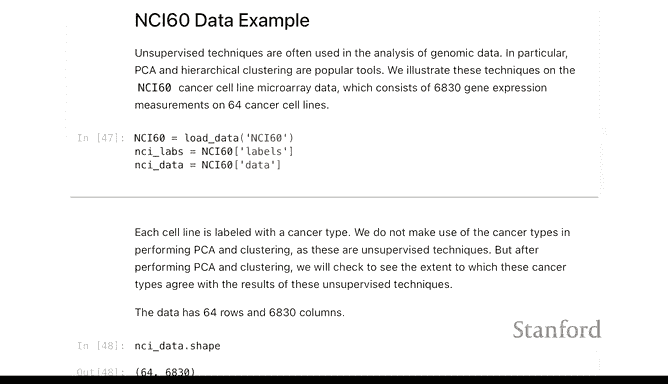

So。We have 64 rows and 7000 features。 Now， if we run PCA。Well。In the USA arrest data。

 we had four features， and we got four principal components。So， you know。

 we might hope that we'd get 7000 principal components， but， of course。

 that's not going to be possible， right， So PCA is only going to give us， well， the minimum of。

 I think。The number of observations， -1 and the number of column the the and the number of columns of the data。

 So we're gonna get 63 principal components is it most。 Yes， yeah， we won't have to keep all of them。

 Yes， yes， of course， it could be less。

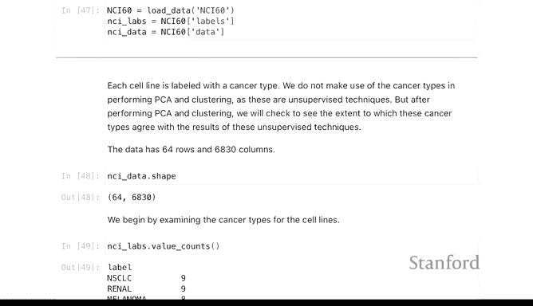

The mathematician speaks。

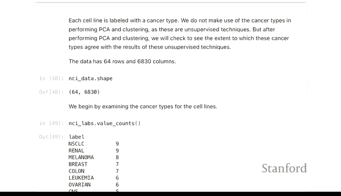

Okay， so here we have a summary of the the different the the labels so we can see there there are。

 I think 13 different。Kinds of cancer tumors。 And they're broken down。

 Some of them have names that are interpretable to， to。To many of us。

 and these are very sort of specific ones。

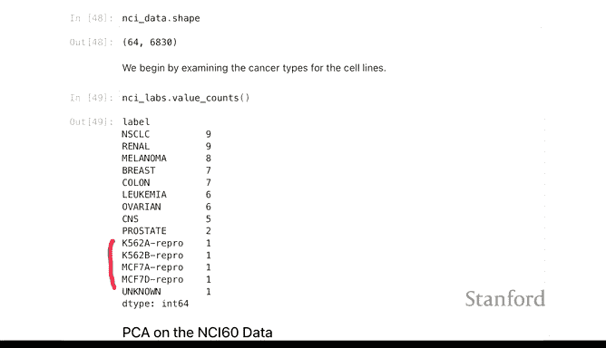

Okay。So let's run a PCA on the microray data。 we're going to scale the data， though in this case。

 since all of the measurements are in the same units， they're all the same kind of assay。

 we may not need to scale it， but just it's common practice to scale it。

 so we're going to continue with that。

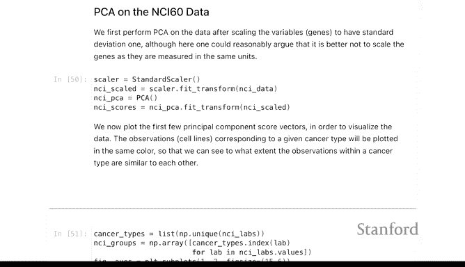

Okay， so let's see。We can， we can find the the principal components scores using the the fit transform method。

 and we're going to again make a scatter plot。

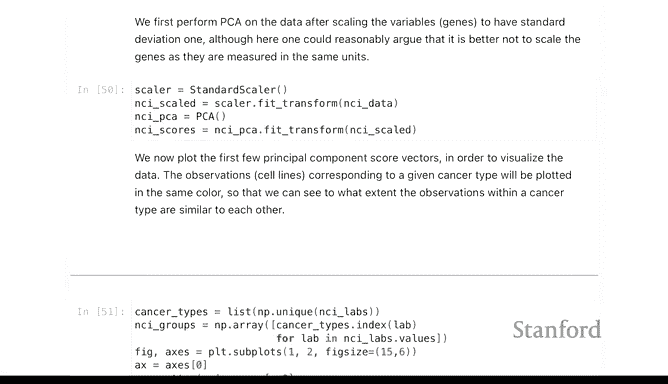

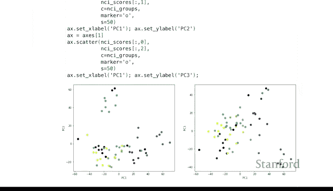

And as I said before， it's common practice。 If you have a label to somehow to label the， the。

Plos in a， you know， this is something like the by plot we saw before， though I haven't indicated。

 I haven't added the。The， the vectors here for the， the， the， the directions in impact。

 that would be pretty dense right there。 would be 7000 vectors or so so。

Oh this is again the piece this is the first and the second and this is the first and the third and what we're looking at here is try to get a sense of whether there is clustering in these principal components and there's you know these green ones are in similar location for the first two there's some evidence of clustering again the color map is not maybe not optimal because I can' actually tell whether this this blue is different from that blue just by looking at this so probably best to make a better color map if you can't。

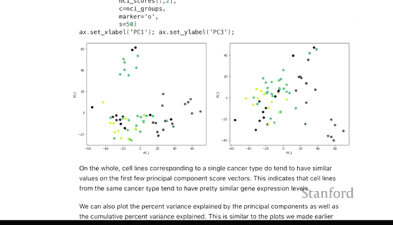

So there is an argument to the scatter plot that would allow us to change the color map。

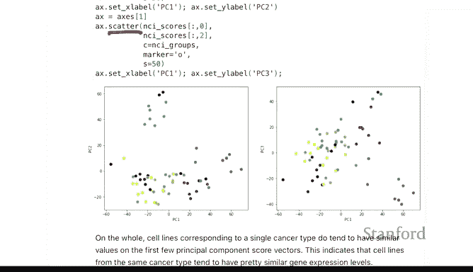

Okay， so let's take a look at the。

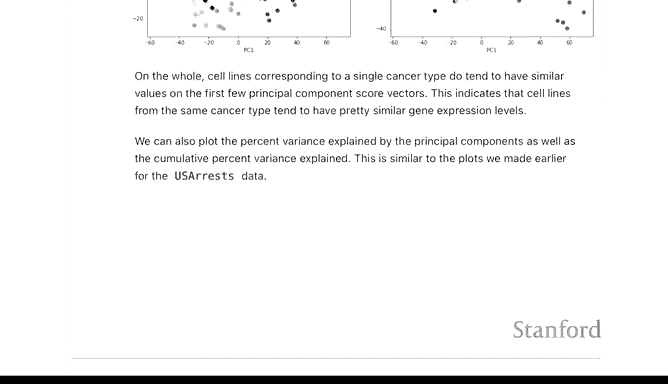

The sort of similar plot we saw for the USARS data we're going to plot the percent variance explained and the cumulative percent variance explained。

 So remember for the USARS data， I think the first one the first principle going had 60 odd% of the variance explained so here well 15% and that's actually still quite a lot for 7000 variables right if was sort of completely randomly to spread it would be know one out of 7000 or so。

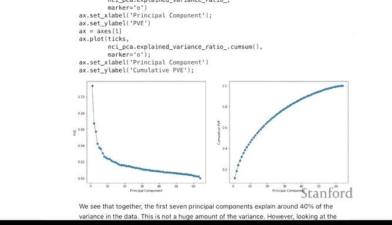

So now inevitably， if you're going to use these principal components for more than just。

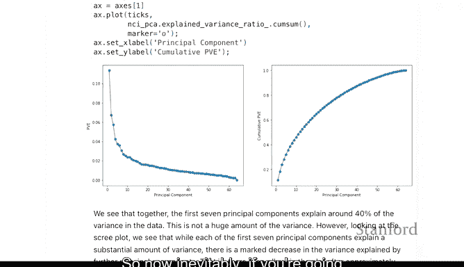

Looking at plots like this。

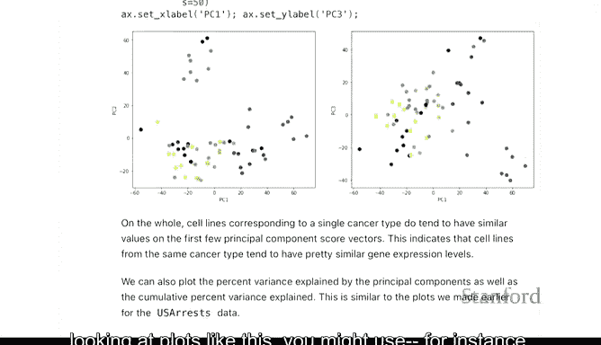

You might use， for instance， you might use principal components in regression like we saw in the end of the。

 the lab of chapterpt 6， though we didn't cover it in the video。 It's， it's。

 it's contained in the textbook。 You'll want to。Choose number of principal components。 though。

 for principal components regression， we can， of course， use cross validation。

 But the way people often choose the number of components is by looking at a plot like this。

 This thing is， this is called a screen plot。 And so， you know， people will look for some break。

 some bandon an elbow of this as， as a way to choose the number of principal components。Though。

 you know， there's a lot of discussion these days about how to do this， you know。

 in in a theoretically justified way， but practically speaking。But this would I might take8 or 9，6。

 Yeah， something。 Yeah， when it as it， as it's decaying like this， there's not really， you know。

 a big difference between， you know， there's not a change in， big change in the rate as you。

Dig as you in improve， increase the number of components。We don't have a theoretical answer for that。

 but this is just an eyeball。You we have the first seven principal components have about 40% of the variance。

So that's we can see here， that's about somewhere around seven。

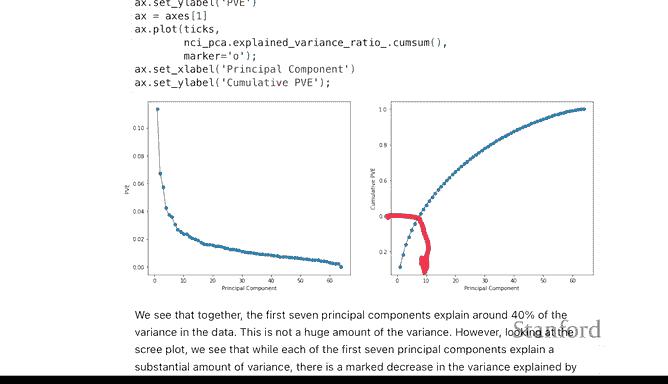

Okay， so after having run PCA on this micro data， we're going to take a look at clustering and。

As in the principal components analysis， you know， in a practical sense。

 what we're looking for is when we plot a denrogram say from a clustering and cut it somewhere that looks like a reasonable cut。

 what we'd like to see is that the corresponding clusters。Corspond to the different cancer types。 So。

 and this hierarchical clustering is very popular in the genomics community because the data is so big and wide。

 hard to look at。 It gives them one way of looking at the data and became very popular。Yes。

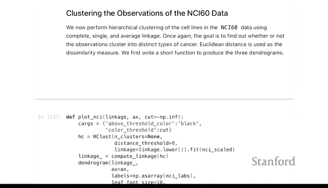

So before we cut a denogram， we're just going to compare the different linkages。 so we're going to。

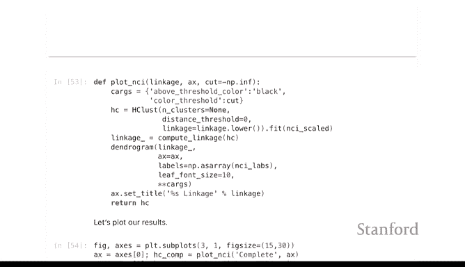

Make three plots， one for the complete linkage， one for the average linkage and one for the single linkage。

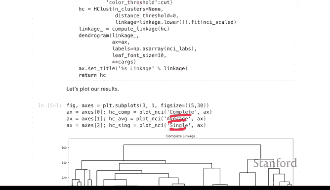

And。Let's see。 I'll just scroll through the three of them。

 and then I'll come back just so we can see the difference。 So let's， this is the complete linkage。

 And we note there are a few， you know， few longish bars。

 So a bar like this or is an indication that。

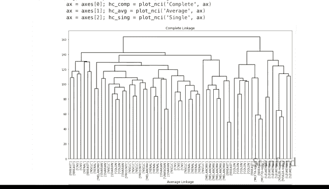

You know。This cluster， it was far away from the next cluster it was merged with。 If this is really。

 really long， then the cluster， a cluster that is。That it emanates from was far from more than one it has finally emerged。

 So that's an indication that this is a good place to cut the denogram。 And by the way。

 because we know there are some cancer classes underneath this。

 You might expect to see a bunch of well defined clusters at the top of this picture。

And then not much below。 Yes， that's kind of what we see in yet。 Yeah。

 you can see here there's there's a group here。 These are the colon cancers。

 And they're sort of they kind of correspond to this cluster here。

 This group over here is mostly leukemia。 And that's kind of if I cut somewhere around there。

 So that's what complete linkage look like。 And let's look at the other extremist single linkage。

 And then I'll talk about average。 So this is single linkage。 And compared to complete linkage。

 there's really no place， you know if we cut anywhere around here。

' the results are going to be very sensitive。 They're going to change a lot。

 So there's no natural break。 And this is this is a common phenomenon in single linkage called chaining。

 And so what happens is many of these merges are just adding on a little bit to a bigger cluster。

 So this sort of set of like if you look at these values here， these are all merging single points。

 And quite far along in the clustering process。

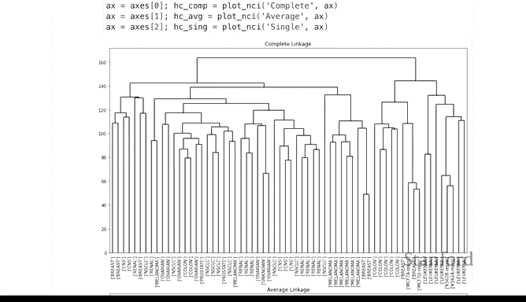

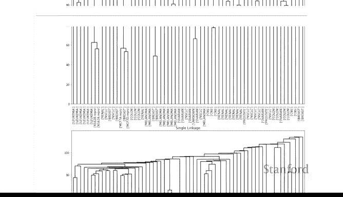

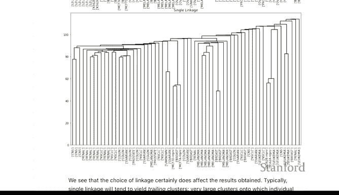

Compared to。The complete linkage， they were about halfway up the tree when those single points were merge。

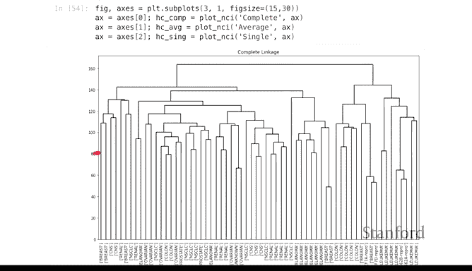

An average linkage， it unfortunately got a little cut in the page here。

 but it's sort of in between the two。 there's， you know， maybe a few places， a few clusters。 I mean。

 this range here might might produce some some clusters。

 but it's not exactly as clear as complete linkage。

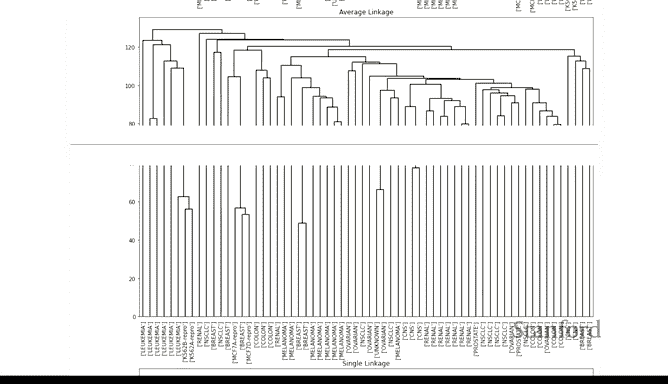

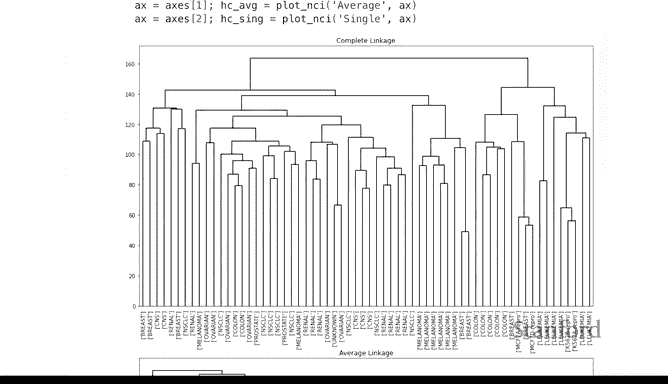

Okay， so now we're going to cut。 So it looks like if we cut somewhere around here， there are pretty。

 you know， that's a。There are some nice looking clusters that we can see by eye and we'll color them and then we'll take a look at the labels to see if we recovered things like this colon cancer group and this leukemia cancers。

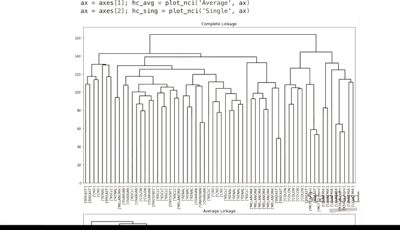

So， I'm gonna。Cut the dendrogram。

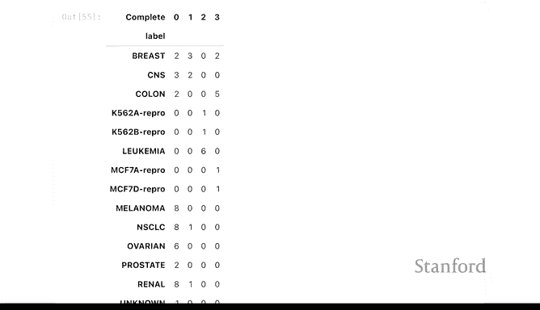

呃。We're going to cut at the level， 140。

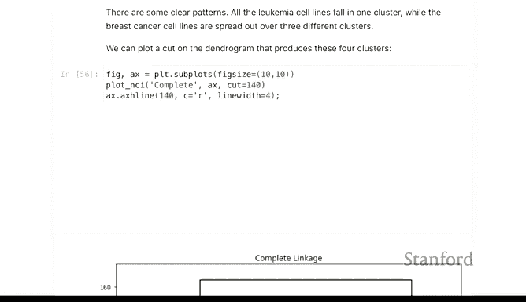

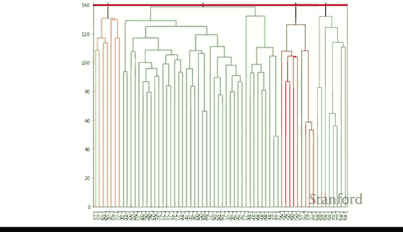

Let's shrink a little bit。Let's see。 these purple ones。It's rather small。

 but they seem to be mostly leukemia with the exception of these two。

 And I'm not an extra not to know those might be a form of leukaemia。

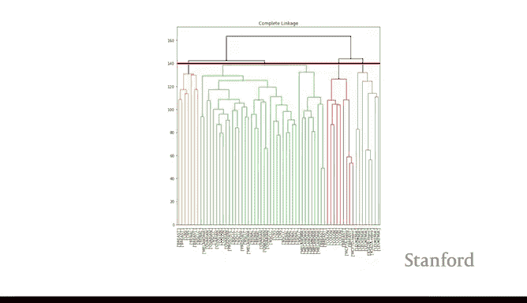

We make it a bit bigger because we can see that。 Yeah， we can see it。 That's a good point。

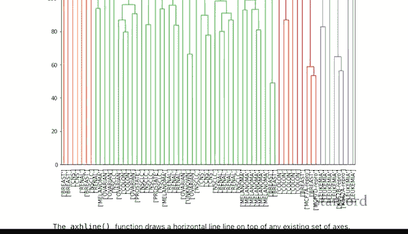

And the these red ones。Many it's， it's mostly colon cancer。

 though a few breast cancers were included。 And again， I don't really。

 I'm not sure certain enough to know what that what that that type of cancer is。 So this isn't。

 you know， perfect。 This cluster over here。You know it has a mix， maybe a majority breast cancer。

 but not not certainly not pure。You know， and unfortunately， you know。

 we can't expect to get perfect separation into classes unless， you know， there was a really。

 really strong difference。 Also， remember， we had there were 13 different types of cancers。

 by picking， cutting and having four groups， we necessarily emerging some That's point。

 So what you'd like to see is， say， for example， in the green， you know。

 that this merging of some cancer classes。 but。But these cancer clusters don't spread into other plastics。

Yeah， so I get， there is a sub cluster， maybe here。Reno button。

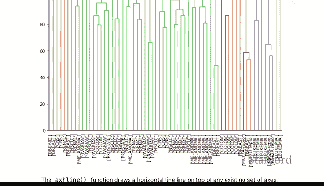

Yes， yeah。 that's a good point。 with only four， we can never get all 13。 and also。

 we only had 64 subjects。 So to really distinguish the cancer types， you。

 if we probably need more subjects than not， especially because we have 7000 measurements on each。

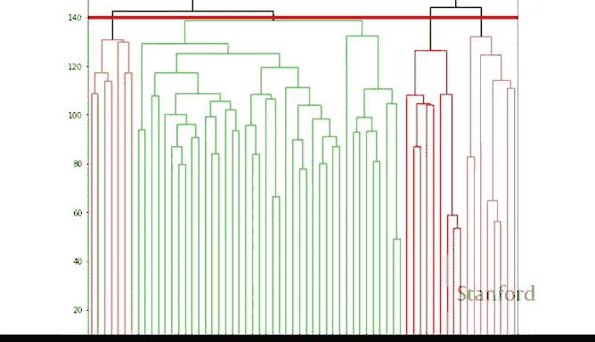

So that's an example of。Two places where unsupervised methods might be used。

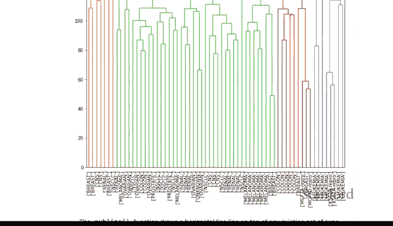

The remainder of the lab also does K means clustering on this data， but as we mentioned before。

 hierarchical clustering is sort of more commonly applied to this kind of data。

 so we're going to leave that for you to do offline。

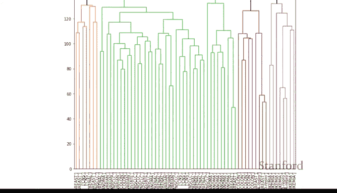

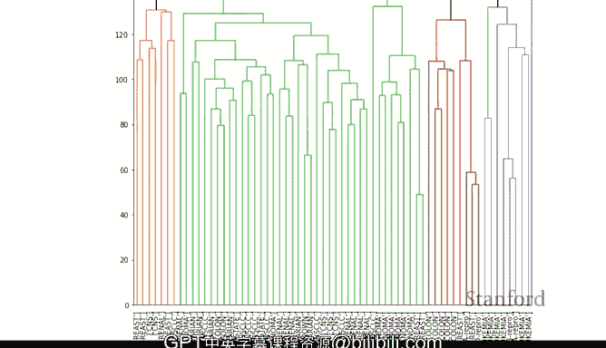

