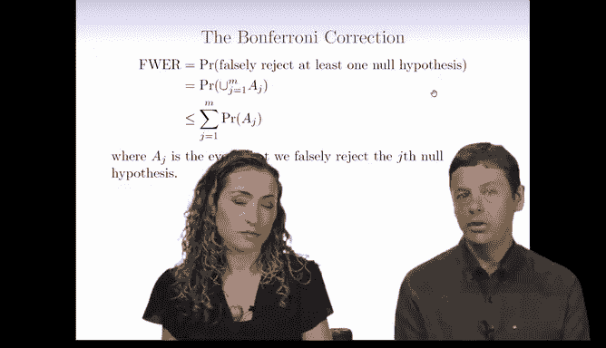
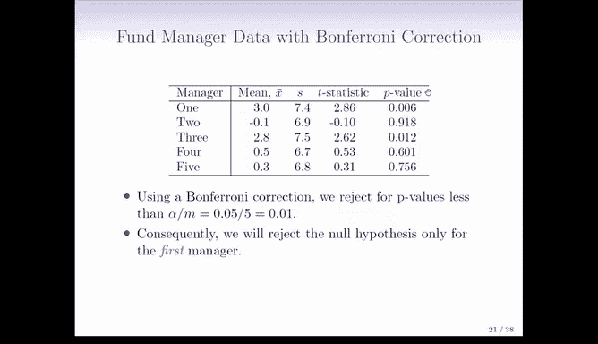

# 斯坦福大学《统计学习导论2023R语言版｜An Introduction to Statistical Learning with R》中英字幕 - P98：-098-Statistical Learning_ 13.3 Bonferroni Method for Controlling FWER.zh_en - GPT中英字幕课程资源 - BV1yU421o7WA

So should we just give up Garrett， do we just go home because familywise error rate is just impossible or is there an easy solution that we can just apply straight out of the box so there are a number of classical methods that we can use to control a familywise error rate these methods tend to work better for let's say medium values for M and Danielle is going to go through some more modern approaches for really large values of him but let's start by talking about a couple of the classical methods that you can at least use of him doesn't get too large and so the first one and by far the most popular I think is this approach called the Bon foronei correction and it's based on this relatively simple probabilistic calculation which says that the familywise error rate is equal to the pro of the union of these events AJ where AJ is just the event that we make type one mistake we falsely reject the Jthanol hypothesis。

And if you've done any kind of probability class， you'll know that the probability of the union of a whole lot of events is bounded above。

 it can't be larger than the sum of each of the individual probabilities so that puts sort of an upper bound on the familywise error rate here and it suggests that if we take each one of these hypothesis tests。

 and we only reject if the P value is less than alpha over M so that means that the familywise error rate can't be more than the sum of M different alpha over ms or in other words。

 m times alpha over M or just alpha， then we can control the familywise error rate at level alpha by only rejecting when the P value for an individual test is less than alpha over M。

So what does this mean we can break this down and make this a little bit simpler if you want your family wise error rate to be no bigger than 0。

05， but you've tested 100 null hypotheses， then you should reject any null hypothesis with a P value smaller than 。

05 divided by 100。And if you want to control family wise error rate at level 0。01。

 then it should be 0。01 divided by 100 exactlyact So its this is a popular approach I think for two reasons it's guaranteed to control the family wise08 and it's a very simple approach to implement just calculate your P values the standard way that you would for any hypothesis test and then you just apply a more stringent threshold with a simple calculation。

So just to illustrate this idea on some sample data here， this is a data set out of the book。

 this is fund manager data where we've looked at five different fund managers over Garreeth works at a business school just in case you're one I did mention that I work Oh Gareth。

 by the way he's a dean so we shouldn't tease him too much。I haven't noticed you holding back so far。

 but I' I'm gonna start remembering now。 yeah， Yeah， yeah， I'm not your dean。 So it doesn't matter。

 Yeah， that's true。 I'm totally off the hook。 So here we have the excess returns。

 So this just measures how much these funds outperformed the stock market in general over this period of time that we looked at。

 So the three next to the fund manager manager one just represents that on average。

 that fund was got a 3% higher return annually than the stock market in general S here just represents the standard deviation of those returns and the P values here just correspond to the null hypothesis that the fund manager is doing no better than the stock market。

 These returns are just noisy versions of the stock market， if you like。

 So the null to be clear the null hypothesis here for each of the five managers is that the true mean return is zero Tru excess mean return you can see I don't work in a business school。

 the true excess mean return is 0。😊，The observed access mean in return for each of the managers is like three negative。

1 and so on exactly so the question is is is3 or negative 。

1 far enough away from0 that we convinced that the manager is actually doing something other than just randomly picking stocks and so you can see some of these P values are pretty small and some of them are pretty large in particular manager one and manager three have pretty small P values so if we were just to look at one hypothesis test at a time then we would probably say okay the first and the third managers have statistically significant nonzero returns they seem to be doing better than the stock market as a whole but here we fail to take account of the fact that we're actually doing five separate hypothesis tests Emma is five in this case we're doing multiple tests so we should really be doing something like a bond for onlyi correction to adjust for that。

And so that means that the family wise0 rate here is almost certainly greater than 5%。

 if we're just looking at these individually， so if we do a bond for only correction here and we want a family wise zero rate of 5%。

 then the bond for only correction says all we need to do is take 。

05 and divide by M which is5 here and use 1% as our cut off instead of 5% and when we do that then。😊。

Unfortunately now， only the first manager， that's the only one we can be certain is outperforming the stock market because you see that manager 3 here now has a P value that's above 1%。

 our new bond for cutoff。 And so we can't be sure after adjusting for multiple testing that manager 3 is actually outperforming the stock market。

 So very simple approach。 but the negative side effect here is we can't reject as many hypotheses。

 So there is something weird about multiple testing， which is sort of like。

Sometimes hard to wrap your head around， which is it just all about honesty because if you just looked at this data and you're like。

 oh like I see that manager one has like the largest two statistic and the smallest P value so I'm just going to like toss the other ones and you just pretend that there weren't actually five managers then you wouldn't need to do any multiple testing correction the only reason you need to correct for multiple testing is because you know in your heart that you're a good and honest person and part of being a good and honest person is that you know that there were five managers and you have to account for that in your hypothesis testing but it can often feel very。

 very tempting for people not to fully reckon with the fact that there were more there was more than one manager to begin with in fact there were five。

And even if people aren't trying to be deliberately deceptive。

 they can often just misunderstand and not know that they need to be adjusting for this fact so like you look at your data a little bit you're like。

 this one looks interesting， let me test this one but without accounting for the fact that they in a way consider testing a lot of nu hypotheses and that can lead to a multiple testing problem。

