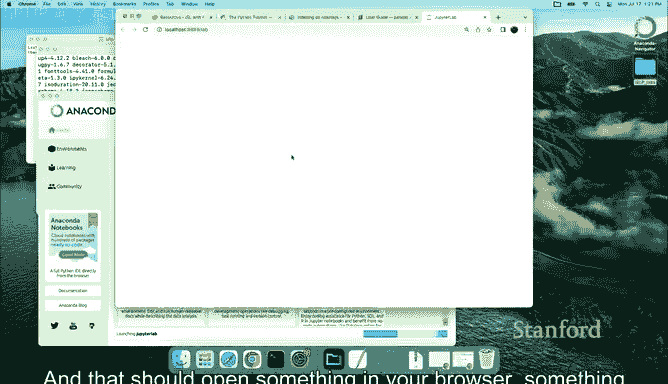

# 斯坦福大学《统计学习导论2023Python版｜An Introduction to Statistical Learning with Python》中英字幕 - P9：-009-Statistical Learning_ 2.Py Setting Up Python I 2023.zh_en - GPT中英字幕课程资源 - BV1u4421A7ZU

Okay， well here we are。 This is our first Python lab。

 which accompanies the new edition of our book Introuction to Statistical learning with applications in Python。

 and I'm sitting with Jonathan Taylor who is a Python expert and we got him to join us for this edition of the book and so he's the fifth author and he wrote all the labs。

And Jonathan's gonna。Take over the session and show us how to get Python going and and。

 and take us through the first lab for Chapter 2。Thanks， Trevor。

 very happy to be part of the team for this book。 It's been a lot of fun trying to write these labs to and add a few things to to statistics in Python that will go along with this book。

So I thought I'd start off by just in showing you how to install what's needed for the course。

 there's a package， a Python package that we'll have to install and just so we start almost from scratch。

 I'll just point out that here I've downloaded the labs here from the book website。The Python1， and。

There's a zip file for the notebook files over here， I've unpacked it into this directory here。

And this is where with these of the labs we're going to be running， includes a few data files and。

That's where we'll start。 We're going to be using this。Version of Python ship by Anaconda。 I've。

 I've assumed you've downloaded Anaconda and installed it。 That's a standard， you know， Mac install。

 If you're using Windows， it will be installed in a similar fashion。

 But this is this is how we're going to start the session。 and I'll just。

I' show you how to get set up as a first task。Okay， so here I've got Anaconda open and Anaconda has。

A way to manage sort of what code you're running by these environments。

 And I've made a special environment for us， And I recommended you the same。

 So I've made an environment here called I ILP and。

You can make a new environment by this createate button。And I'll just do that。Relatively quickly。

 just to show you if you had to do this yourself， so I'll call it ISOP2。I'll create it。

And these environments are sort of ways to isolate the code you're running because in any sort of in any modern。

 you know， computing system， there' are different versions of packages and you want to kind of control them。

 So these environments are a way to control them。Okay。

 so the one more thing we have to do besides making this environment is we have to install the code needed for the class。

 So I'm just going to do that by opening this terminal。 and I'm gonna。Kind of one command。 I'll just。

Do it here。 We're going install the package with this line Pip， install ILP。

 I've already done that on my session， but。This will install what's needed。For the course。

With the exception we'll see a bit later for the deep learning， we'll have a few more installs。

 but we'll get to that。In a few labs。 Okay， while that's running， I'll go back to my environment。

That I've already started。ISLP。 and we'll see how to start a session。 So in this home， there's this。

Panel， and we're going to run our code in Jupyter Lab。 So right now the Jupyter lab is。

 I can launch it with this button。 I will just say one more quick thing if you're making this environment yourself Note you'll want this tab up here to be the environment you're running。

In the new environment here。If we look， we'll see one thing that the Jupiter lab。

Has not been installed。 We'd have to install it before launching it。 so let's just click that one。

And then you'll see later it will transition to be loable。Well， you make this look so easy， Jonna。

 Thanks， it's really not hard if I was able to do it。Couldn't be too hard。Thanks， yeah。

 so now it's launchable and so this would launch a new session in this new environment if you're familiar。

 if you prefer using the terminal and you have some experience with Python。

 you can just run PIP in the terminal yourself， but this way is a simple way to do with a graphical interface。

Okay， so that's how we get set up。 And let's just go back to our。Environment。

 they're essentially identical environments， but I call this one an ILP and we'll launch Jupiter Lab。

 and that should open something in your browser。

Something that looks something like this。And it's opened up here into this the first lab that we'll look at the introduction to Python Lab。

