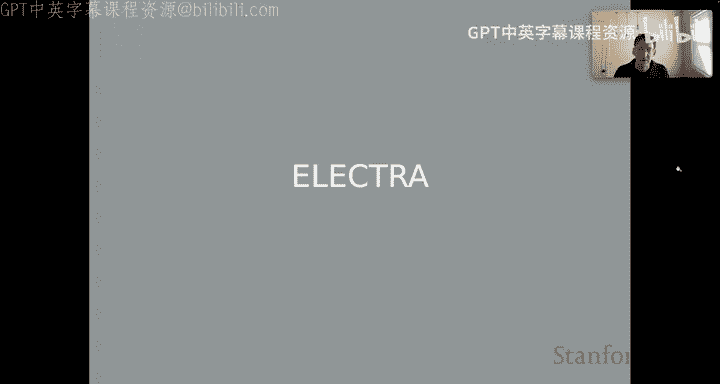
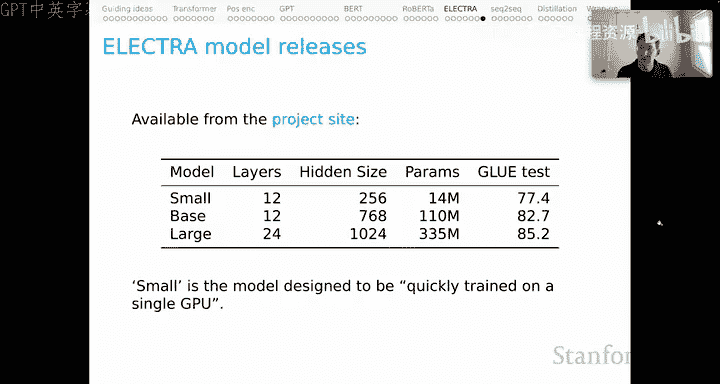

# 斯坦福大学《自然语言理解｜Stanford XCS224U Natural Language Understanding I Sp 2023》中英字幕（豆包翻译 - P10：-10-Contextual Word Representations, Part 7： ELECTRA .zh_en - GPT中英字幕课程资源 - BV1sx4y1s7oW

Welcome back everyone， this is part7 in our series on contextual representationations。

 we're going to talk about the electro model。

Recall that I finished the Bt Sccast by listing out some known limitations of that model。

Roberta addressed item 1 on that list， and we can think of E as keying into items 2 and 3。

 It 2 is about the mask token。 The Bt team observed that they had created a mismatch between the pre training and fine tuning vocabularies。

 because the mask token is never seen during fine tuning only during training。

 And you could think that that mismatch might reduce the effectiveness of the model。

Item 3 is about efficiency。 The B team observed that the M L M objective means that they only use around 15% of tokens when they are training。

 only 15% of them even contribute to the ML L M objective。

 We have to do all this work of processing every item in the sequence。

 But we get very few learning signals from that process。 And that's certainly data inefficient。

 And we might think about finding ways to make more use of the available data。

Electtra is going to make progress on both these fronts。 Let's explore the core model structure。

 For our example， we have this input sequence X， the chef cooked the meal。

The first thing we do is create X masked， which is a masked version of that input sequence。

 and we could do that using the same protocol as they use for BERT by masking out， say。

 15% of the tokens at random。Then we have our generator。

 This is a small Bt like model that processes that input and produces what we call X corrupt。

 This is an output sequence predicted by the model。

 and the twist here is that we're going to replace some of those tokens not with their original inputs。

 but rather with tokens that come out with probabilities proportional to the probability generators。

 and what that means is that sometimes we'll replace with the actual input token and sometimes with a different token。

 like in this case of cooked coming in being replaced by 8。That is where electa， the discriminator。

 takes over。The job of the discriminator， which is really the heart of the electro model。

 is to figure out which of those tokens in ex corrupt is an original and which was replaced。

So we train this model jointly with the generator an awaited version of the discriminator or elect objective。

And then essentially， we can allow the generator to drop away and focus on the discriminator as the primary pre trained artifact from this process。

One thing that I really love about the electro paper is that it includes very rich studies of how best to set up the electro model itself。

I'll review some of that evidence here starting with the relationship that they uncover between the generator and the discriminator。

First thing is an observation where the generator and discriminator are the same size。 They could。

 in principle， share their transformer parameters。 And the team found that more sharing is indeed better。

However， the best results come from having a generator that is small compared to the discriminator。

 which means less sharing。Here's a chart summarizing their evidence for this along the X axis。

 I have the generator size going up to 1024。 and along the Y axis， we have glue score。

 which will be our proxy for overall quality。The blue line up here is the discriminator at size 7，68。

 and we're tracking different generator sizes， As I said。

 And you see this characteristic reverse U shape， where， for example。

 the best discriminator at size 7，68 corresponds to a generator of size 2，56。 And indeed。

 as the generator gets larger and even gets larger than the discriminator performance drops off。

 And that U shape is repeated for all these different discriminator sizes。

 suggesting a real finding about the model。 I think the intuition here is that it's kind of good to have a small and relatively weak generator so that the discriminator has a lot of interesting work to do。

 because， after all， the discriminator is our focus。😊。

The paper also includes a lot of efficiency studies and those two are really illuminating。

 This is a summary of some of their evidence along the X axis we have pretrain flops。

 which you can think of as a raw amount of overall compute needed for training。

 and along the Y axis again we have the glue score。

The blue line at the top here is the full E model and the core result here is that for any compute budget you have that is any point along the X axis。

 E is the best model。It looks like in second place is adversarial E that's an intriguing variation of the model where the generator is actually trained to try to fool the discriminator。

 That's a clear intuition that turns out to be slightly less good than the more cooperative objective that I presented before。

And then the green lines are intriguing as well。 So for the green lines。

 we begin by training just in a standard Bt fashion， and that at a certain point。

 we switch over to the full electro model， and what you see there is that in switching over to full E。

 you get a gain in performance for any compute budget relative to the standard Bt training continuing as before。

 which is the lowest line in the chart。So a clear win for E relative to these interesting competitors。

And they did further efficiency analyses。 Let me review some of what they found there。

 This is the full electro model， as I presented it before。We could also think about E 15%。

 And this is the case where for the discriminator。 instead of having it make predictions about all of the input tokens。

 we just zoom in on the tokens that were part of this X corrupt sequence， ignoring all the rest。

 That's a very burnt like intuition where the ones that matter were these ones that got masked down here。

That makes fewer predictions for the discriminator。

Replace MLM is where we use the discriminator with no sorry where we use the generator with no discriminator。

 this is a kind of ablation of Bt， and then all tokens MLM is a kind of variant of Bt where instead of turning off the objective for some of the items we make predictions about all of them。

And here's a summary of the evidence that they found in favor of E。 That's at the top here。

 According to the glue score。 All tokens MlM and replace Ml M。 those Bt variants are just behind。

 And that's sort of intriguing because it shows that even if we stick to the Bt architecture。

 we could have done better simply by making more predictions than Bert was making initially。

Behind those is E 15 per cent。 And that shows that on the discriminator side， again。

 it pays to make more predictions。 If we retreat to the more burnt like mode where we predict only for the corrupted elements。

 we find that performance degrades。 And then at the bottom of this list is the original Bt model showing a clear win over。

 for E， according to this glue benchmark。The electro team released three models initially。

 small base and large， base and large kind of correspond roughly to Bt releases and small is a tiny one that they say is designed to be quickly trained on a single GPU。

 again， another nod toward increasing emphasis on efficiency for compute as an important ingredient in research in this space。

