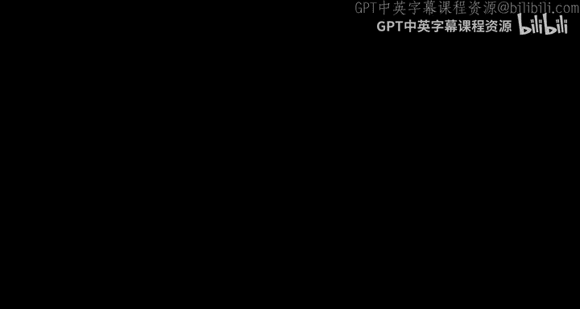
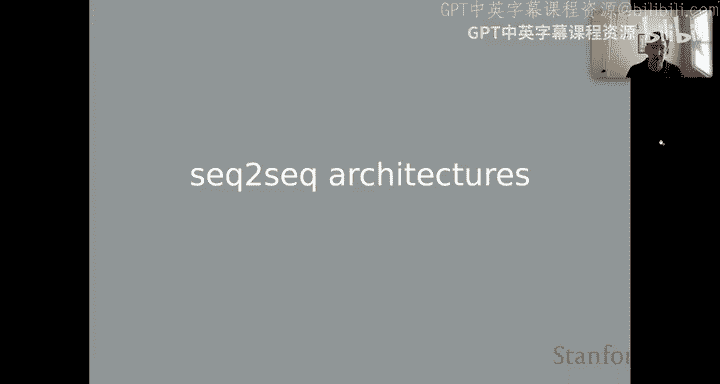
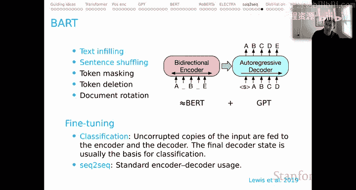
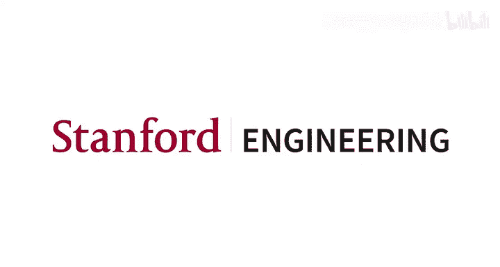

# 斯坦福大学《自然语言理解｜Stanford XCS224U Natural Language Understanding I Sp 2023》中英字幕（豆包翻译 - P11：-11-Contextual Word Representations, Part 8： Seq2seq Architectures .zh_en - GPT中英字幕课程资源 - BV1sx4y1s7oW

Welcome back everyone。 This is part 8 in our series on contextual representations。

 We're going to talk briefly about sequence to sequence architectures。

To kick it off， I thought I would begin with tasks。

 These are going to be tasks that have natural sequence to sequence structure。

 and I'm trying to leave open for now whether we would actually model them with sequence to sequence architectures。

 That's a separate question。Seek to seek tasks include machine translation， of course。

 this is a classic one where a text in one language comes in and we would like to produce text in another language as the output。

Summarization， also a classic seek to seek problem。 A long text comes in。

 and a presumably shorter one comes out， summarizing the input。

Free form question answering where we're trying to generate answers。

 this could also be a seek to seek problem where a question maybe with some contextual information comes in and the task in decoding is to generate an answer。

Dialogue， of course， classics seek to seek problem utterances to utterances。

Semantic paring could also be thought of as a seek to seek task here。

 Natural language sentences come in， and we try to map them to their logical forms。

 capturinguring aspects of their meaning related task would be code generation here。

 A natural language sentence comes in， and we try to produce a program that the sentence is describing。

And that is just a small sample of the many things that we could call seek to seek tasks。

 And even these are just special cases of the more general class of things that we might call encode or decoder problems。

 which would be agnostic about whether the encoding and decoding involve sequences they could involve images。

 video， speech and so forth。I've been offering historical notes throughout this series of lectures。

 and I think this is a nice point to emphasize that the R and N era really primed us to think about seek to seek problems in the context of transformers。

On the left here， I have a classic R and N formulation of a seek to seek problem where we have the input sequence ABC D。

 and then we begin decoding with this special symbol， Decode X， Y， Z。

 and then we produce our N token And that is the job of decoding The historical note here is that those tasks evolved from standard R NNs into R NNs with lots of attention mechanisms on the top here design specifically to help the decoding steps。

 Remember what was in the encoding part by offering all of these attention mechanisms back into that encoding phase。

 And what we see again in the transformer paper is a full embrace of attention as the primary mechanisms and a dropping away of all of these recurrent mechanisms here。

😊，In the context of transformers， we have a variety of ways that we could think about seek to seek problems。

 One of them being encoder decoder， but other options present themselves。

 This is a nice figure from the T 5 paper， which we'll talk about in a second。 on the left。

 you have encoder decoder， As I said， where we fully encode the input in the encoder side with some set of parameters。

 and then possibly different parameters do decoding。

 where in the decoding steps we attend fully back to all the steps from the encoder。

But we needn't have this encoder decoder structure。 Another option， for example。

 would be to simply process these sequences with a standard language model。 So in the middle here。

 you have a transformer based language model。 and you can see that characteristic attention mask where we don't get to look into the future。

 but rather can only attend to the past， Even for the part that we're thinking of as the encoded part。

An obvious variation of that would be to take our language model。 And when we do encoding。

 do a full attention connection set across all the things that we're doing en codingding。

 that's what you can see reflected here where when we're doing encoding。

 just as in the encoder decoder structure， we can have every element to tend to every other element。

 And then here， when we start to do decoding。 That's where the mask can only look into the past and not the future。

So that's a nice framework for thinking about this and the middle and right hand options have become increasingly prominent。

 as people have explored ever larger variants of the GPT architecture。

 which is a standard language model。But I'm going to focus now on two encoder decoder releases that I think are very powerful beginning with T5。

 which was the source of that nice previous framework there。

T 5 is an encoder decoder variant that had extensive， multitask。

 supervised and unsupervised training across lots of different tasks。

 And then one very innovative thing that they did in the T 5 paper。

 which really gives us a glimpse of what was about to happen with in context learning is that they offered task prefixes like translate English to German colon。

 And then you got the true input。 And so that instruction on the left。

 is kind of telling the model what we want to do in decoding。

 And it guides the model in this case to do translation。

 but the same part after the colon could be performing a sentiment task。

 given a different description of the task before the colon。

Wonderfully insightful thing where we express all these tasks as natural language。

 which he simply encode， and that guides the model's behavior， essentially。

 as though those task instructions were themselves structured information as inputs to the model。😊。

4 T5， we have lots of model releases as well， which has been tremendously empowering。

 This is a sample of the models that are available on Huging face。

 and you can see that they range from very manageable 60 million parameter models on up to really large 11 billion parameter releases。

Relatedly， the flan T5 models are variants of the T5 architecture that were specifically instruction tuned。

 and that's a set of methods that we'll talk about in the next unit of the course。

 Those are also very powerful。So that's T5。 The other architecture that I thought I would highlight here is Bart。

 Bart has some similarities and some real differences with T 5。

 The essence of Bart is that on the encoding side， we're going to have a standard Bt like architecture。

And on the decoding side， we're going to have a standard GPT like architecture。

That's fairly straightforward。 What's interesting about Bart is the way pre training happens。

 This is essentially oriented around。Taking corrupted sequences as input and figuring out how to uncorrupt them。

 So what they did on the corrupting side is， for example。

 text in filling where whole parts of the input are masked out or removed， S shuffling。

 where we reorganize parts of the input， token masking， token deletion， and document rotation。

And what they found is that the most effective pre tradinging regime was a combination of that text in filling step and the sentence shuffling step。

 And remember， the idea here is that in pretraining。

 were feeding in these corrupted sequences with these two techniques by and large and having the model learned to uncorrupt those sequences and the idea there。

 which is similar to the insight that we had from E is that that kind of task can lead the model to understand what good sequences look like。

So that's the pre training phase if you download parameters from hugging face。

 they're likely to be pretrained in this kind of uncorrupting fashion。For fine tuning。

 the protocol is a little bit different。 If we're doing classification tasks。

 we feed uncorrupted copies of the input into the encoder and the decoder。

 and then maybe we finet the final decoder state， as we would with G against our classification tasks。

 And for standards seek to seek problems。 We simply feed in the input in the output to the model and then fine tune it on that basis with no corruption。

 The corruption is by and large， confined to the pretraining phase。

 and the evidence that is offered in the paper is that that kind of objective puts models in a good pretrain state where they're really good at these fine tuning tasks across a lot of different tasks。

So that's T5 and BarRT， that's just two samples from the wide range of different seek to seek architectures that are out there。

 but I think they're both very powerful as pretrained artifacts that you can make use of and also highlight some of the innovation that is happening with transformers in the Si tose space。

