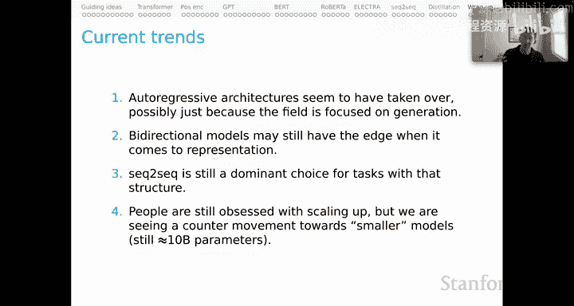

# 斯坦福大学《自然语言理解｜Stanford XCS224U Natural Language Understanding I Sp 2023》中英字幕（豆包翻译 - P13：-13-Contextual Word Representations, Part 10： Wrap-up .zh_en - GPT中英字幕课程资源 - BV1sx4y1s7oW

Welcome back， everyone。 This is the 10th and final screencast in our series on contextual representation。

 I'd like to just briefly wrap up in doing that。 I'd like to do three things。 First。

 just take stock of what we did a little bit。

Second， I'd like to make amends for really interesting architectures and innovations that I didn't have time to mention in the core series。

 And then finally， I'd like to look to the future， both for the course and also for the field。

Let me start by trying to make amends a little bit for some noteworthy architectures that I didn't have time for。

Transformer Excel is an early and very innovative attempt to bring in long contexts。

 and it does this by essentially caching earlier parts of a long sequence。

 and then recreating creating some recurrent connections across those cache states into the computation for the current set of states。

 Very innovative。 The ideas for transformer Excel were carried forward into Excelnet and the core of Excelnet is the goal of having bidirectional context。

 while none having an autoregressive language modeling loss。

 And they do this in this kind of really interesting way of sampling different sequence orders so that you process left to right while none the sampling enough sequence orders that you essentially have the power of bi directional context。

😊，And then Dierta is really interesting from the perspective of our discussion of positional encoding In that screencast。

 I expressed a concern that the positional encoding representations were exerting， in some cases。

 too much influence on the representations of words。

Deerta can be seen as an attempt to decouple word from position somewhat。

 It does that by decoupling those core representations and then having distinct attention mechanisms to those two parts。

 My guiding intuition here is that Derta will allow words to have more of their wordhood separate from where they might have appeared in the input string。

 And that seems very healthy to me。When I talked about Bert， I listed out some known limitations。

 there were four of them。I gave credit to Roberta for addressing the first one。

 which was around design decisions， and I gave it credit to Ea for addressing items 2 and3。

 where two was about the artificial nature of the mask token。

 and three was about the inefficiency of M L M training in the Bt context。

 I haven't yet touched on the fourth item。 The fourth item is from Yang at all。

 which is the Excelnet paper。 and Excelnet indeed addresses this concern。

 And the concern is just that Bert assumes the predicted tokens， are independent of each other。

 Given the unmasked tokens， which is oversimplified as high order long range dependency is prevalent in natural language。

 And the guiding idea behind Excelnet。 I that in having an auto aggressiveive language modeling loss。

 we bring in some of the conditional probabilities that help us overcome this artificial statistical nature of the M L M objective。

But remember， the interesting aspect of Excelnet is that we still have bi directional context。

 And this comes from sampling all of those permutation orders of the input string。

 really interesting to think about。 and also a lovely insight about the nature of Bert itself。😊。

I didn't get to discuss pretraining data really at all in this series， And I feel guilty about that。

 because I think we can now see that pretrain data is an incredibly important ingredient in shaping the behaviors of these large language models。

 So I have listed out here some core pretraining resources。 Open book corpus， the pile。

 big science data。 Wikipedia and Reddit。 And I have listed these years。

 not really to encourage you to go off and train your own large language model。

 but rather to think about auditing these data sets as a way of more deeply understanding the artifacts that we do have and coming to an understanding of where they're likely to be successful and where they might be actually very problematic。

 a lot of that is going to trace to the nature of the input data。😊，And then finally。

 let's look ahead to the future。 Some current trends to the best of my estimation。

 This is likely the situation we're in and what we're going to see going forward。 First。

 it seems like auto regressive architectures have taken over。 You know， that's the rise of G。

 But this may be simply because the field is so focused on generation right now。😊。

And so I would still maintain that if you simply want to represent examples for the sake of having a sentence embedding or understanding how different representations compare to each other。

 it seems to me that bidirectional models like Bt might still have the edge over models like GPT。

Sequence to sequence models are still a dominant choice for tasks that have that structure。

 It seems like they might have an edge in terms of an architectural bias that helps them understand the tasks themselves。

 although item1 here is important as we get these really large， pure language models。

 we might find ourselves moving more toward auto regressive formulations。

 even of tasks that have a sequence to sequence structure。 We shall see。And then finally。

 and maybe this is the most interesting point of all。

 People are still obsessed with scaling up to ever larger language models。 But happily。

 we are seeing a counter movement towards smaller models。

 Ive put smaller in quotes here because we're still talking about artifacts that have on the order of 10 billion parameters。

 but that is substantially smaller than these really， really massive language models。

 And there are a lot of incentives that are going to encourage these smaller models to become very good。

 We can deploy them in more places。 we can train them more efficiently。 We can train more of them。

 and we might have more control of them In the end for the things that we want to do。

 So all the incentives are there。 This is a moment of intense innovation and a lot of change in this space。

 I have no idea what these small models are going to be able to do a year from now。

 But I would exhort all of you to think about how you might participate in this exciting moment and help us reach the point where。

😊，Relatively small and inefficient models are nonetheless incredibly performant and useful to us。

