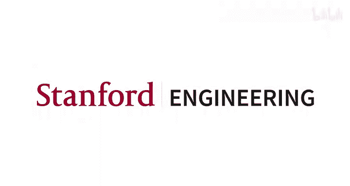

# 斯坦福大学《自然语言理解｜Stanford XCS224U Natural Language Understanding I Sp 2023》中英字幕（豆包翻译 - P14：-14-Homework 2 .zh_en - GPT中英字幕课程资源 - BV1sx4y1s7oW

Welcome， everyone。 This Sccast is an overview of assignment tube and its associated bakeoff。

 The name of this combination is few shot open Q A with DSP。

 And part of the function of this screencast is to unpack that complicated sounding title。

Let's begin with a review of different question answering tasks and keep in mind that the task you're confronted with for this assignment and bakeoff is the one in the final row。

 which is very difficult。 Indeed， let's begin at the top Q A standard Q A the way this is formulated in the modern phase as in dataset sets like S is that you're given a gold evidence passage。

 And the name of the game is to train a Q A reader that will learn to find answers to questions in those evidence passages。

 And in this mode， we don't have a retriever at all。 So I put N A here。We've talked about open Q A。

 This is the variant where we're not given a passage， but rather。

 we need to learn to retrieve relevant passages。 And then in the standard mode。

 we train a Q A module to learn how to find answers to questions in those retrieved passages and that is already substantially harder because now we have to retrieve good evidence and we don't have a guarantee that the answer will even be findable in the evidence that we have retrieved。

Few shot Q A is something we haven't discussed yet。

 This is the task that was really introduced in the G 3 paper。

 and it's hard along a different dimension。 In this mode， we are given a gold passage。

 We could use squad， for example， as the basis for the task。

 but we're not allowed to do any task specific reader training。

 We have to rely on a frozen large language model to learn in context how to do what we want it to do。

And in this mode， there's no retrieval because we just rely on the closed nature of a task like squad。

That's already hard enough because you don't get to do any task specific training。

We're going to move you into a mode that combines the hard aspects of Open QA and Fu shot QA。

 and that is few shot open QA in this mode。You do not have a gold evidence passage。

 and you are compelled to use only frozen language models to do the QA part。

We're going to have a retrieval mechanism for you。 You could do some fine tuning of it。

 but we're not going to explore that in this homework that could be left for projects。 So really。

 in the end， what you're left with is a frozen retrieval model， a frozen language model。

 And on that basis， you need to figure out how to answer questions effectively。 Just to repeat。

 your situation is a difficult one。During development， you will have gold QA pairs。But at test time。

 all you're going to have is questions。 No gold passages or any other associated data。

 You will see this in the bakeoff file。 It is simply a list of questions that you need to figure out how to answer。

 Very difficult indeed， I feel like this task would not even have been posable in 2018。

 And when we first did it last year。 I worried that it might be too difficult。

 but people did incredible things。 And I think you're going to do incredible things with this seemingly almost impossible task。

But just to emphasize here， you have to operate throughout this with frozen components。

 you cannot train any LLMs。 All you can do is in context learning with frozen models。

 but I assure you you'll get traction on this problem。Just as a reminder。

 for that task that I mentioned， few shot QA that is the one that was posed in the GT3 paper。

 Here's an example from their appendix。 It's a squad example。

 You can see you have this gold passage that you prompt your language model with。

You give it a demonstration Q A pair。 And then you have your final target question。

 The demonstration follows the sub string guarantee into the gold evidence passage。

 And so does the answer。 And that's how they pose this。 And they did pretty well at it。

 And just as a check， I tried Tex Da Vinci 2 with exactly this example and got the right answer。

 So no regression there。 They can still do few shot Q A with squadqua with these deployed models。

But as I said， that's not your task。 Your task is harder in your setting。

You are just given a question， and the task is to answer it。

And a standard baseline in this mode is what I've called retrieve， then read。

 And so the way this would work is that you'll rely on a retrieval mechanism to find a context passage that's relevant for this question。

And then you might add in for few shot retrieve then read some demonstrations。

 and you could get those from the squad data set that we provide to you or you could try to get it from somewhere else。

 You could also get from your train set or retrieve an answer to that demonstration question and the same thing for the context Squad provides all of these as gold evidence。

But it's conceivable that you would want to retrieve answers or predict answers and retrieve passages so that your system learns from demonstrations that are kind of like the actual situation that you have down here where there's no gold passages and no gold answers。

 just questions and everything else has to be found somewhere。For the assignment itself。

 we're pushing to use the demonstrate search predictt programming library and the vision behind this library is that we're going to make prompt engineering proper software engineering where you write a little program as opposed to typing out a prompt from scratch。

 And the idea here is that that opens up a whole new design space and really gets us thinking in new ways about how to design AI systems in this modern mode that are essentially prompting frozen pretrain components and getting them to work in concert to do complicated things that we want done。

 So this is a diagram from the DSP paper and you're going to be writing little programs that look like this。

For the notebook itself， we begin with some setup and what you see happening here is that we're kind of connecting with some large language model vendors who provide powerful frozen language models that you can use。

 Here's the key for open AI and here's the one for cohere。

 these are not supplied to you so you need to get set up separately with your own API keys for cohere。

 you can use the models for free and for open AI when you open an account you get some small number of free credits to use for their models。

And then finally we set you up with a Colbert server。

 this is an index that we created that will provide you with a very rich retrieval mechanism。

And then in the cell down here， we set up using the DSP library， the language model here。

 I'm using Tex Da Vinci1， and I've got my open AI key associated with it。

 And there's the commented out version for doing this with cohere models。

 And here I set up the retrieval mechanism。 And the final piece here is to just set DSP as a library so that you're using that LM and that retrieval mechanism。

So that's by way of setup。One thing I wanted to pause on here is the appearance of squad in the notebook that might surprise you because S is a closed standard Q A formulation of the task where you're given gold passages and so forth。

 So I want to emphasize that the role of squad here is to provide you with some training and dev examples。

 And I put train in quotation marks there because， of course， you can't train any systems。

 but you can use the train portion of squad to construct demonstrations for your passages and other things like that。

So in essence， Squad is providing train data， gold QA pairs。

 maybe with gold passages that you'll make use of that you can use for demonstrations。

 and Squad also provides dev QA pairs that we can use to simulate your actual situation so that you can figure out how well your system is going to do at test time that is on the bakeoff。

So that's why you get this section squad train， squad dev， S dev sample。

 That final thing there is just because you should keep in mind that in this mode。

 evaluations can be quite expensive， especially if you're paying open AI for each one of its API calls And so you'll want to do evaluations on small datas and do them only sparingly。

 So I've provided you with a tiny sample of 200 dev examples to kind of use in a very controlled way。

 although honestly， even that can get quite expensive。

 and so I would do even those kind of quantitative evaluations only sparingly。

With that background in place， we can begin thinking about using DSP itself。

 One nice thing about DSP is that it gives us very easy access to a language model。

 So what I'm showing in this cell 13 here is a direct call to the language model with the string which US states border no US states and you can see it's given me a list of responses and kind of messiness with all their new lines here。

 you can add in keyword parameters to the underlying language model if that model honors them。

 and that will affect the behavior of this function call。 So here I've called it with temperature 0。

9， and I'm getting four responses back and you can see it's listed them out in a list there。

Another nice thing about DSP is that if you call Lm。inspect history。

 it will show you the previous calls to the language model and it's formatted those quite nicely。

 so if you're uncertain about what you're feeding into your model and that can happen with DSP。

 you can call In history and get a look at what you actually did。Now， mostly for DSP。

 you won't call the language model directly the way we just did。

 you will rely on DSP templates to kind of format prompts to the language model and also extract information from the generated answer to use as kind of the basis for your system。

So here I've set up a very simple template， this happens in the notebook， QA template。

 it's got question and answer components and include some instructions。And then for example。

 if you create a DSP example from our running case， which US States border know US states。

 and you called it with a sample of two squad training instances to use as demonstrations。

You can feed that through your template。 And what you get is something that looks like this where our target question is at the bottom waiting to be answered。

 And here are those two demonstrations that we sampled from the squad train set。

Here are the instructions and here are some formatting stuff that comes from the template。

 And this is a pretty good standard mode for all these modern。

 large language models to help them do in context learning and figure out what you want them to do based on information in the prompt and the demonstrations you've provided。

And here to kind of put those pieces together， you have in DSP what I've called promptbased generation。

 so DSP。generate， you feed that through a template and that gives you a kind of generator function that when called on a DSP example。

 will give you back some responses and here's the answer value from the completions， Alaska。

 Hawaii is how it has answered the question， which US states， border or no US states。And again。

 if you feel unsure you can call inspect history and you'll see exactly what happened。

 it looks like this。 there's that prompt again with our two sample demonstrations。

 and there's the generated response in green。The other part of this assignment is thinking about retrieval。

 and as I said before for that， we have given you a cobert index and a cobert retrieval mechanism that you can use and you can mostly just treat that as a very effective retrieval mechanism。

Here's a question that we can use and as an example， DSsp。retrive。

 when given a string and some number of passages we want in response。

 we'll give you back a list of passages that you can use for constructing prompts and so forth。

As with the language model， if you need deeper access to the retrieval mechanism。

 you can call it directly with RM called on a string。

 and that will allow you to have a bunch of other keyword parameters in here and give you more information back than just the list of passages。

 for example， scores and other things that go along with retrieval。

 So that's there if you want to design more advanced systems as part of your original system。

All of these things come together in the first part of the notebook。

 This is a little DSP program that is a complete solution to few shot open Q A。

 It's just this tiny program。 Let's walk through it。 First， keep this in mind， use this decorator。

 DSP dot transformation on all of your programs。 so that your programs don't modify the DSP examples that come in。

 You'll be augmenting them with demonstrations and maybe changing the fields and you don't want that to have an in place impact on。

 for example， the squad dataset set that you have loaded in。 So as a precaution。

 always add this decorator to all your DSP functions and your life will be more sensible。

Next programs operate on DSP example instances， individual ones， that's what's coming in here。

 keep that in mind。In the first line of this little program。

 we sample K random demonstrations from the squad train set by default。

 And K is the user supplied parameter there。 that gives us a demonstrations attribute on the example that came in。

Then we use our QA template as before I define that on slide 12 that gives us this new modified generator function for the language model。

Right， that's the modified generator。 We call that on an example， and we get back completions。

 as well as a copy of the example。 DSs can be completions is the heart of this。

 It will have an answer attribute because of the Q A template。

 and that's the field that will use as the answer that the system has responded to the question with。

So that's the complete program for few shot open QA and the assignment questions essentially ask you to write very similar programs。

 both of the questions are DSP programs just like that one Que one is few shot open QA with context。

 so a small modification of the program I just showed you where you add in context passages that you retrieve using Colbert。

And then question two asks you to use the annotate primitive from DSP。

 which is very powerful as a mechanism for doing lots of things and what we have youd use it to do is construct demonstrations that will be especially effective for guiding the system toward the behaviors that you want it to have in context。

And that having done those things， you design your original system。

 we expect your original system to be a DSP program because we think we've provided you lots of primitives for writing really powerful DSP programs that will be really interesting solutions to the problems we've posed。

 but it is not required as before original systems can take many forms and you should feel free to use whatever techniques you would like。

If you would like to explore DSP even further， Omar has createdtro an intro notebook that walks through additional advanced programs for really hard QA problems。

 we're going to talk about a bunch of those techniques when we talk about in contextext learning a lot of the most powerful ones are exemplified in that intro notebook where we show you how we have DSP primitives that make it very easy to make use of those concepts。

 so that's a powerful next step that you might check out as part of thinking about your original system。

