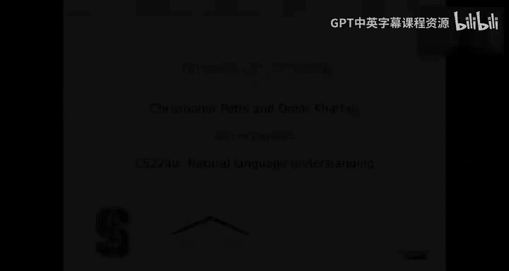
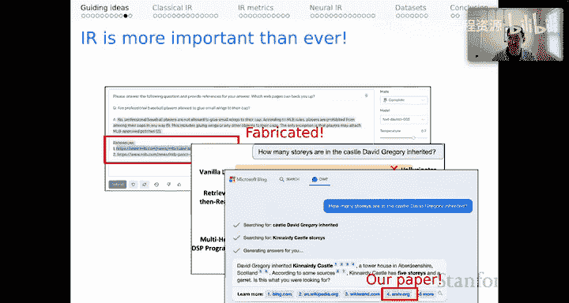
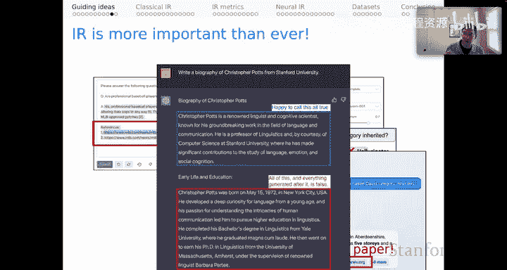
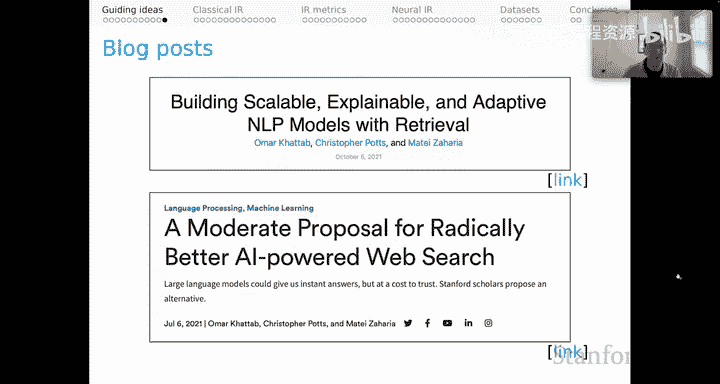

# 斯坦福大学《自然语言理解｜Stanford XCS224U Natural Language Understanding I Sp 2023》中英字幕（豆包翻译 - P15：-15-Information Retrieval, Part 1： Guiding Ideas .zh_en - GPT中英字幕课程资源 - BV1sx4y1s7oW

Welcome everyone， this is our first screencast on information retrieval。

 let's start with some guiding ideas these will serve both to give you a sense for the current moment in science and technology and also help you build a bridge into the homework which is on retrieval augmented in context learning。

You might have noticed by now that NLP is revolutionizing information retrieval。

 This is a story that really begins with the transformer or maybe more properly one of its most famous spoke models。

 Bert。 Soon after Bert was launched， Google announced that it was incorporating aspects of Bert into its core search technologies。

 and Microsoft made a similar announcement with Bing at about the same time。

 And I have a feeling that these two very public announcements where just a glimpse of the changes that were starting to happen with major search engines。

A little bit later， we started to see that large language models would play a direct role in search。

 I think the startupu。com was really visionary in this sense， and I like to highlight u。

com because its CEO Richard Socher is a distinguished alum of this course， and U。

com was way ahead of the curve in seeing that large language models could be really interesting and powerful aspects of web search。

And we've seen lots of activity in that space since then， for example。

 Microsoft has partnered with open AI and is now using open AI models as part of the Bing search experience。

 and you might have noticed also in a kind of different perspective on this that when G 4 was announced part of the announcement was a partnership with Morgan Stanley to help Morgan Stanley employees use G4 to find things in their own internal documents。

 and that just shows you that we hear a lot about public web search。

 but there are also powerful search applications that could happen internal to organizations again powered by in this case。

 throughout this entire story， as usual powered by the Transer。

You might ask yourself why this is happening。 And I think the fundamental reason is that information retrieval is simply a hard natural language understanding problem。

 And so the more powerful our NLU technologies， the better we can do with retrieval。

 Here's an example that kind of brings that point home。

 Our query is what compounds protect the digestive system against viruses。

 And a relevant document is in the stomach， gastric acid and proteases serve as powerful chemical defenses against ingested pathogens。

The coloring indicates relevance connections。 you'll notice that for the keywords in the query in the document。

 there is no string overlap。 The connections that we need to make here are entirely semantic。

 and that shows you that the more deeply we understand the language of the query in the document。

 the better we're going to be able to do at finding these relevant passages given queries like this。

So that's all mainly about information retrieval but I'm an NLP and for me the more exciting direction of this is that information retrieval is now revolutionizing NLP and the way it's doing that is by making our NLP problems more open and more relevant to actual daily tasks。

 let me use question answering to kind of highlight that。

In the by now standard formulation of question answering within N LP。

 the system is given a title and a context passage and a question。

 And the task is to answer that question。 and there is a guarantee that the answer will be a literal sub string of that context passage。

 That is standard Q A as formulated in tasks like S。 the Stanford question answering data set。

 So just to repeat at train time， you're given a title context， question and answer。And at test time。

 you're given a title， context and question。 And you have a guarantee that the answer is a literal substr of that context passage。

 That used to be a hard problem for our best models， but it has grown quite easy。

 And I think you can see that it's also pretty disconnected from actual things that we want to do with question answering in the world where we very rarely get this very rich kind of context or that substr guarantee。

So we are moving now as a field into a formulation of Q A that I've called open Q A。

 And this will be substantially harder In this mode。

 Maybe there's a title and a context and a question。 and the task is to answer。 But now。

 only the question and answer are given at train time。

 And the title and the context passage will need to be retrieved from somewhere from a large document corpus could be the web。

And having retrieved it， of course， we have no guarantee that the answer will be a literal substr of anything in the context or the title。

 So this is a substantially harder problem， but it's also much more relevant because this is simulating actually searching on the web where you pose a question and you need to retrieve relevant information in order to answer the question。

But substantially harder， only the question and answer at train time。 And at test time。

 all you're given is the question。 and all the relevant information needs to be retrieved。

 And what you see there is to the extent that we can have really good retrieval technologies find us really good evidence for answering these questions。

 We can develop effective systems。 And that is the crucial role for retrieval in this open Q A pipeline that you all will be exploring as part of the associated homework and bakeoff for this unit。

😊，And question answering is really just one example of a family of what you might call knowledge intensive tasks。

 I mentioned question answering， but we also have things like claim verification。

 common sense reasoning， long form reading comprehension and information seeking dialogue。

 These are all transparently tasks that depend very heavily on having rich information about the world inform forming whatever prediction the system makes。

 So that's pretty clear。 But I am also interested in taking standard。

 typically closed N LP tasks and expanding them into more open variance。 For example。

 summarization is standardly just posed as a task where you take in a long passage and try to produce a shorter one。

 But couldn't we make that a knowledgein task where we augment the input with lots of information that we've retrieved。

 I think it's a reasonable hypothesis that could improve summarization systems。Similarly。

 natural language inference typically just posed as a closed classification problem， premise。

 hypothesis。 And you give them one of three labels。

 But wouldn't it be interesting to augment the premise with information about the world that might help the system make better predictions as a classifier。

And I think that's just two examples of how we could take classical problems。

 even classification problems， and reformulate them into knowledge intensive tasks that would benefit from retrieval with the result that they could be made more effective and also more scalable to real world problems。

Let's talk a little bit about information retrieval approaches。 and I'll start with classical I R。

In this case， we have a user query coming in when was Stanford University founded。

And the first thing that we do is term lookup and so what we've done offline presumably is create a large index that maps terms to associated relevant documents。

 it could be a list of documents that contain the term。

 but we would probably also do some scoring of those documents with respect to these query terms to organize them by relevance。

On the basis of that index， we can do document scoring and give back to the user a ranked list of documents ordered by relevance。

 And then it's up to the user to figure out which of those documents to check out in looking for an answer to the question。

That is the classical search experience as we all know it。

There is now a movement afoot to replace a lot of that with pure language models。

 I've called this the L L Ms for everything approach。 In this mode， the user's query comes in。

 When was Stanford University founded， a big language model totally opaque to us。

 Does some mysterious work and spits out the answer。 Stanford University was founded in 1891。

A real change to the search experience， whereas before we had to look through a ranked list of web pages to find our answer。

 Now the answer is given to us directly。That could be very exciting， however。We might start to worry。

 We know these models can fabricate evidence。 And so we should be sical consumers of their outputs。

 And since we don't know where this answer came from。

 we have no information about how it was produced。 We might start to wonder about whether our information need was actually met。

 whether we should trust this string。And I'm deeply concerned about this model enough that I think we should be pushing in a different direction。

 And that's where you would get neural information retrieval modules continuing to be important players in open knowledge intensive tasks for N LP。

So neural Ir models are going to function a lot like those classical models。

 except in a much richer semantic space。 We're going to start with a big language model。

 just as we did in the L Lms for everything approach， But we're going to use it somewhat differently。

 The first thing we'll do with that language model is take all the documents that we have in our collection of documents and represent them with the language model。

😊，So the result of that will be some dense numerical representations that we expect to capture important aspects of their structure and their meaning。

 That is essentially the document index in the classical Ir mode。

 But now it's a bunch of deep learning representations。

Then the user's query comes in and the first thing we do with that query is process it probably using the same large language model and get back a dense numerical representation of that query。

And then on the basis of all these representations。

 we can do scoring and extraction as usual so at this point we can reproduce everything about the classical search experience。

 the only twist is that scoring will happen in a different way。

 because we're now dealing not with terms and scores。

 but rather with these dense numerical representations that we're accustomed to throughout deep learning。

But the result of all that scoring is that we give the user back a ranked list of pages。

 And so we've reproduced the classical experience for the user in the sense that they now need to search through those pages and find the answer to their question。

We just hope that we're doing a much better job of offering relevant pages in virtue of the fact that we're operating in a much richer semantic space。

This is a good moment to bridge into in context learning， which is the other part of this unit。

 and they'll all come together for you in the homework。

 So let's think about how that bridge is going to happen。 Now。

 we're going to be in the mode of having a large language model and prompting it。 And in this case。

 we've simply prompted it with a question who is Bert and the task is to come up with an answer in the mode that we're operating in。

 That is the only thing that we're given by the system。 This is a truly an open Q A formulation。

 So the question is， how can we effectively answer this question using retrieval。😊，Well。

 one thing we could do is retrieve from a document store a context passage for that question that we hope will be relevant evidence for answering that question。

 So that's given in green here。 But there's more that we could do with retrieval。 For example。

 we know that large language models when they're doing in context learning benefit from having demonstrations。

 So maybe we have a trained set of questions， and we could just retrieve from that set a question to use。

And that at that point， we could either use the training answer to that question or maybe retrieve an answer in the hope that that will more closely simulate what the system actually has to do。

 But in any case， we now have this demonstration， and we could go one further depending on the train set。

 we could either use training evidence like a passage from our Q A dataset set or retrieve a context passage again。

 using a retriever to function as evidence for this little demonstration here。

And the guiding hypothesis is that having woven together training instances with some retrieval steps to produce evidence for answering this question。

 we're going to do a better job at coming up with predicted answers。That's a kind of simple retrieve。

 then read pipeline where we're using our retriever to find evidence。

 What you'll see in the In contextex learning unit。 And as you work on the homework。

 is that this is just the start of a very rich set of options that we can employ for effectively develop in context learning systems that use retrieval to find relevant evidence。

 That's how these two themes really come together。And I think that these two themes coming together is one of the central questions for the field of N LP and I R in the current moment。

 because really， what we're seeing is a lot of worrisome behavior from large language models that are being deployed as part of search technologies。

 For example， we all saw that Google took a real hit in terms of its stock price for making a minor factual error in one of its demo videos。

Maybe that was appropriate， given how high stakes all of this is。

 but it's sort of funny to think about because at the same time。

 open AI models were fabricating evidence all over the place。

This is a sort of amusing example where I have asked the system。

 are professional baseball players allowed to glue small wings to their caps。

 and I asked the model to offer me some evidence for the answer that it gave。

 And it did indeed dutifully say no and then offer some evidence。

 but the evidence links that it offered are entirely fabricated。

 They are not real links to web pages。 If you follow them。 you get a 404 page。

 I find this tremendously frustrating and easily worse than offering no evidence at all。

 because we have all become accustomed to seeing URLs and assuming that they do function as kind of ground truth evidence for the answer given。

 So the fact that that ground truth is being completely fabricated is absolutely worse than offering no evidence at all。

Here's another funny case for this。 We're going to talk about our demonstrate search predict paper and figure one of that paper includes an example with the question how many stories are in the castle David Gregory inherited。

On Twitter， a user read our paper and then tried the example with a Bing search engine。

 and they said， aha， you know， Bing can answer your very difficult seeming question。 No problem。

 But then that user immediately followed up by noticing that Bing was actually citing our own paper as evidence for the answer to this question。

 I will say that this is deeply worrisome to me。 our paper should not be regarded as as good ground truth evidence about the castle David Gregory inherited。

 We used it purely as an illustrative example。 And if we had had slightly different intentions。

 we might have actually been talking about giving the wrong answer to this question。 In fact。

 our figure does embed some wrong answers。 And so the idea that a scientific research paper that's about in context learning with retrieval would be used as evidence for the castle David Gregory inherited anything about that is completely baffling to me。

 And that just shows you that simply because you have some search mechanisms doesn't mean that you're doing。

Good search， but what we really need in this context is high quality search。

And just to round this out， I found this amusing， but may a little bit worrisome。

 You should all try this with your own names。 I prompted Chat G P T with write a biography of Christopher Pots from Stanford University。

I'm very happy with the first paragraph。 It's very flattering to me。

 and we can go ahead and say that it is truthful。 But everything in the box in red is completely false。

 All of the factual information expressed there is false。 And it's kind of a nice biography of me。

 I have no complaints about any of these facts except that they are false。 And the reason， though。

 that I'm worried is that I think not everyone is going to get such flattering information when they ask for their biography。

 And we are just on the precipice of seeing really worrisome behavior with really meaningful downstream effects for people in society If these language models continue to fabricate evidence in this way。

 And that's why I feel like the current unit and the work that you do for it is absolutely extremely important and relevant to addressing this growing societal and technological problem。

😊。

That sets the stage。 If you would like a little bit more on this。 Omar。

 Mattezaharia and I did two blog posts on this a few years ago that I think remain still extremely relevant。

 The first is building scalable， explainable and adaptive N LP models with retrieval。

 That's a kind of technical blog post。And a more high level outward looking one is this modest proposal for radically better AI powered web search。

 where all the way back in 2021， we were emphasizing the importance of。

Providence for information and ground truth in documents as an important aspect of doing web search。

 even with big， powerful， fancy large language models。

 And that is the vision that we're going to try to project for you throughout this unit and with our homework。

