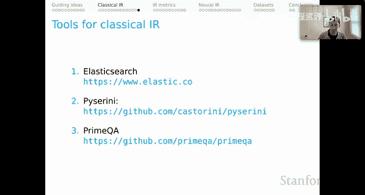

# 斯坦福大学《自然语言理解｜Stanford XCS224U Natural Language Understanding I Sp 2023》中英字幕（豆包翻译 - P16：-16-Information Retrieval, Part 2： Classical IR .zh_en - GPT中英字幕课程资源 - BV1sx4y1s7oW

Welcome back， everyone。 This is part 2 in our series on information retrieval。

 We're going to briefly review classical IR approaches。

 It will be a brief overview because our focus in this course is on neural information retrieval。

 but I did want to cover these classical ideas because they're very powerful and classical IR systems could very well be important components in models that you develop。

The standard starting point for classical I R is the term document matrix。

 I've got a fragment of a real term document matrix on the slide here。 The terms are along the rows。

 The documents go along the columns and the cells record the number of times that each word appeared in each one of these documents。

 These are standardly very large， very sparse matrices。

 but they encode latently a lot of information about which documents are relevant to which query terms。

T I approach TF IDF is a common approach to massaging those term document values to get more information about relevance from the matrix。

 Here's how TF IF works。 We begin from a corpus of documents D。

Term frequency is actually internal to each one of these documents。

 T F of a word given a document is simply the number of times that that word appears in the document divided by the total length of the document。

 so a standard relative frequency value。Document frequency is a function of words and our entire corpus。

 and we're simply counting the number of documents that contain the target word。

 regardless of how frequent the word is in each one of those documents， simpleimple occurrence。

 the number of documents that contains the target word。

And then inverse document frequency is just the log of the total size of our corpus divided by the document frequency value that we calculated。

And then TF IDF is simply the product of the TF and the IDF values。Here's a little worked example。

 I have a term document matrix on the slide in the left here。

 We calculate the IF values those are given on the right。

 and then the term frequency values are given at the bottom of the slide。

 And then we get the product of those for the T F IF values down in the lower right here。

 And I think you can start to see some noteworthy patterns， for example。

 The term C is in relatively few documents， just two of them。

 and it's relatively frequent in both of those documents。 And as a result， it has high TF IdF values。

 We could also look at term D here， It occurs in only one document。

 and is relatively infrequent in that document。 and a result of occurring in only one document。

 it ends up with a pretty high TF IdF value because its IdF value is so high。

 even though its term frequency is low and correspondingly。

word a term A here gets a TF IDF value of0， it was highly frequent in document 4。

 but it occurs in all of the documents and therefore ends up with an IDF value of0 and therefore TF IDF value of0 so it gives you a sense for how these values combine to give us TF IDF let's actually break down the scoring in a little bit more of a systematic way。

 starting with the IDF values。For IDF， we do have a little bit of a problem if we have a word that occurs in no documents。

 then the IDF value is undefined because we need to def by zero。

 so what I've done here is simply stipulate that that's a zero。

If a word appears in just one document， it gets a maximal IDF value。

And the IDF values drop off steadily as the word appears in more and more documents all the way up to appearing in every document。

 given the little corpus of 10 documents that we're imagining， and that too is an IDF value of 0。

 as we saw on the previous slide。 And the idea here is that by the time you have a word that appears in every document。

 it's simply not informative about which documents are relevant。

 And so itss IDF value should be minimized。And here's a slide showing selected TF IDF values and I think the pattern is very clear TF IDDF reaches its maximal values for terms that occur very frequently in very few documents and correspondingly TF IDF values are at their lowest for words that are very infrequent in very many documents。

 those are the tiny bubbles up here， that's the kind of core behavior of TF IDF。

 what we're really looking for is words that are truly distinguishing indicators of particular documents。

To calculate relevant scores for a given query which might contain multiple terms。

 the standard approach is simply to sum over whatever weighting we're using for the term document matrix。

 so for example， if weight here is TF IDF， we simply sum over the TF IDF values for every word in our query。

 and that gives us a relevant score for the entire user query。

BM25 is arguably the most famous classical IR approach BM 25 stands for Best Match attempttemp 25。

 which suggests a lot of exploration of the different hyperparameters of this model looking for a solution that was best。

 and this has indeed turned out to be an enduringly good solution。With BM 25。

 you're going to see that this is a kind of enhanced version of TF IDF。

 We begin from smoothed IF values。 These are essentially the IF values that I just showed you with a little bit of an adjustment to handle the undefined mis case that we briefly worried about。

The next component is scoring， and this is kind of analogous to term frequency。

 and you can see in this definition that term frequency is an important component。

 We also have two hyperparmeters K and B， which I'm going to talk about in a second。

But just to round this out， the BM25 weight is a combination of those adjusted IDF values and the scoring values which are analogous somewhat to term frequency in TF IDF。

So the definitions are different and we're going to dive into them。

 but at a high level you can see it's a product of two very similar values to the ones we had for TF IDF。

Let's take a look at the individual components in a bit more detail。 starting with IDF。

 What I have on the slide here is the IDF plot that I showed you previously from the TF IDF definitions。

 and then I have the BM25 variant of that at the bottom here。

 and what I've done is just emphasize that this S value here standardly set at 0。5。

 but we could in principle adjust it。So here are a few values for that value。 S。

 The standard value is the one in purple。 That's 0。5。

 And you can see that the result is that we very closely match the standard IF values throughout the entire space of document frequency values with the exception that we give a very high value incidentally towards words that appear in no documents that won't turn out to be relevant。

 And what really happens as we adjust S is we're adjusting things at that kind of really degenerate part of this overall space for words that appear in no documents。

 Once we get into words appearing in documents， the values track pretty closely with maybe the exception that if you set S very high you get real differences in the lowest part of this spectrum。

But by and large， if we set it at 0。5， we're just reproducing the IDF values that we had from the earlier definitions。

The scoring function is more nuanced as a result of having lots of hyperparameter。

 so let's break this down a little bit and see if we can get some analytic insights into what's happening。

The scoring function is repeated at the bottom here。

 and I've highlighted in orange a term that plays the role of penalizing long documents。

 And then this plot should help us see precisely how that plays out。

 So let's imagine that we're looking at a document that has length 10。

 I have the term frequency values along the X axis。 and the B M 25 scoring values along the Y axis。😊。

If I am looking at a document that has average if the corpus has average document length of 10。

 that's the purple line here， and that's the same length as our example document。

As our example document becomes long relative to the average length with five and three。

 you can see that the scoring values systematically go down。So to summarize。

 as our target document is long relative to the average， the scores are diminished。

 The overall effect of this， as I said， is to penalize long documents。

 And the intuition there is that long documents might just， as a result of being long。

 contain more terms。And therefore， on average， we should trust the terms they do contain less as evidence for our overall relevance scoring。

So that's the penalty for long documents。Now， let's dive into the role of B。

 The function of that hyperparameter B is to control the amount of the penalty that we give to long documents。

 So let's break that down a little bit over here。 Again， we have a target document of length 10。

 That's our example。 And we have an average document length of 5 over here。

 And you can see that as we increase B from 0。1 to 1， the overall effect is to diminish the scores。

 So higher values of B mean more of a penalty given to long documents。

 because that reduces the score even more。Over on the right here。

 if our target document is the example document has length 10。

 which is the same as the average document length for our corpus。

 then the value of B makes no difference as a result of the fact that there's no penalty even to apply in these cases。

 it's really just for long documents relative to the average that B is controlling the amount of penalty that we apply in those cases。

And then what about K， What is the effect of K， It appears here in the scoring function。

 the overall effect is to flatten out higher frequencies。

 And I think one way to get a grip on this is to think about the extreme situation in which you have set K very。

 very low。 This would be a non standard value for K。In the situation where you set it very low。

 what you essentially do is turn the scoring function into an indicator function。

 You can see that we get a register of a scoring value if the word is in the document。

 and then it simply flattens out over all the different values for term frequency。

 So it's like you appeared。And then I don't care how many times you appeared。

 I'm hardly going to adjust the scoring。And then as you make K larger。

 you get less and less of a dramatic effect like that。

 And so you care more and more about whether the word appears frequently in the documents or not。

 So this red line is really an extreme case where you've decided not to care very much about the different values of relative frequency。

 a more standard value for K is 1。2， and that's giving this kind of modest diminishing amount as you get terms that are really frequent in documents。

 you kind of flatten out the scoring function。So that's the overall effect flattening out higher frequencies with the value of k controlling how much flattening you decide to do。

With those components in place， we can return to our classic inverted index from information retrieval。

 It's an inverted index in the sense that we go from terms to documents rather than documents to terms。

 Have our query come in。 We do our term look up。 And previously。

 I showed you this as simply a list of documents。 But now， of course。

 with something like BM 25 or TF IF， we can augment this with precomputd scores or document frequency values and with precomputed IF values。

 And so we have all the ingredients we need for a given query to do full on document scoring very efficiently。

 And that is one essential ingredient for why these classical approaches are so massively scalable。😊。

That's kind of it for what I wanted to cover on classical I R。

 But I'd be remiss if I didn't mention a few obvious topics that are explored in detail in this literature。

 We could， of course， do query and document expansion。

 We could augment what the user gives us and what's in our corpus with additional information and maybe metadata that it would help us with relevant scoring。

We could move to phrase level search， I focused on unigrams， but of course。

 that's not a necessary restriction we could think about ngrams and even more sophisticated notions of linguistic units。

We haven't talked it all about term dependence。 We've kind of assumed that all the terms in a document are independent of each other。

 But if you think about bigrams like New York， that's obviously an unhappy approximation。

 we should be thinking about how how all these terms have their own internal statistical dependencies and bring that into the search functionality。

 We could also， and this is really important to think about different document fields。

 Documents are not homogenous and words that appear in the title might have a different relevance value inherently than words that appear in the body of a document。

 and we would want our best classical search technologies。

 and our best search technologies in general to be sensitive to those distinctions。

And then of course a big gap in what I've showed so far is link analysis。

 we could think about how the documents in our corpus form an implicit graph based on how they hyperlink with each other。

 and we know from modern search that that is a crucial factor in shaping relevance and having the best documents come to the top。

 I have left that out， but it's obviously incredibly important。And then， of course， finally。

Learning to rank that is learn functionality for what's relevant given queries is an important feature of the neural IR models that we're going to discuss。

 I have not introduced that in the context of classical IR。

 but we could have learned ranking functions that would go beyond the simple a priori calculations of things like TF IDDF and BM25。

Finally， there are lots of tools out there that would help you with classical IR。

 Elastic search is widely deployed very robust， mature search technology， highly scalable。

 lots of features， pisenei and prime QA are research repositories that could also be really useful to you if you want to think about setting up classical I models as baseline。

 or as using them in components in larger systems that might have a small role for neural IR models as kind of re-rannkkers of results that come from a very fast very robust classical IR system that's a common mode to operate in that gives you highly scalable solutions where the neural models that we'll talk about later play the role of kind of refining the core results returned by the classical model。

