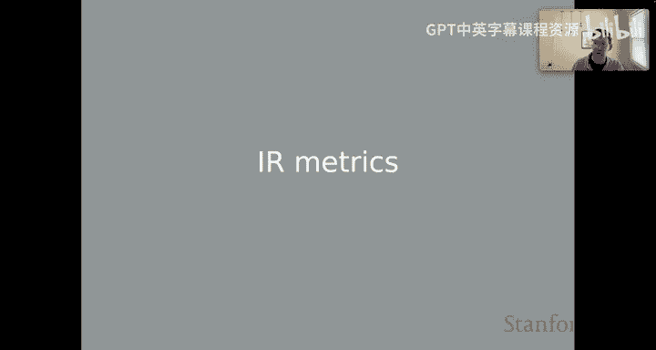
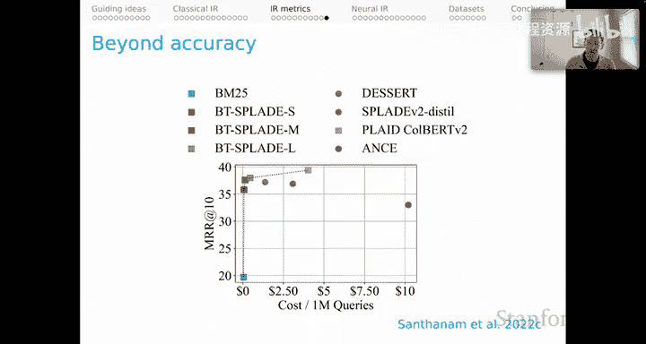

# 斯坦福大学《自然语言理解｜Stanford XCS224U Natural Language Understanding I Sp 2023》中英字幕（豆包翻译 - P17：-17-Information Retrieval, Part 3： IR metrics .zh_en - GPT中英字幕课程资源 - BV1sx4y1s7oW

Welcome back， everyone。 This is part 3 in our series on information retrieval。 In Part 2。

 we talked about classical Ir models。 I hope that gave you a sense for how Ir systems work。

 And we're now in a good position to think about how to evaluate them。

 That is the topic of Ir metrics。😊。

Right at the start， I want to emphasize that there are many ways in which we can assess the quality of IR systems。

Of course， inevitably will end up focused on accuracy style metrics。

 They're prominent in the literature， and they are an important aspect of system quality。

 but there are many other things we should think about for IR systems。

 particularly when they are deployed。 For example， in industrial context。

 latency is often incredibly important。 Latency is the time it takes to execute a single query。

 and in industrial context， latency constraints are often very tight。

 users expect low latency systems， and as a result， high latency systems are basically nonstarters。

 no matter how accurate they are。 And so you often see accuracy and latency paired as crucial aspects of system performance。

Throughput is similar。 Throughput is the total query served in a fixed time。

 maybe via batch processing that's related to latency， but it could trade off against latency。

 You might decide to sacrifice some per query speed in order to process batches of examples efficiently。

 And so whether you favor latency or throughput might depend on how users interact with your system。

Flops as a hardware agnostic measure of total compute resources。

 this could be a good holistic measure。 it might be hard to measure。And kind of hard to reason about。

 But it could be a good summary number。 But we might want to break it down into component pieces。

 For example， disk usage for your model or for your index。 that could be an important cost。

 especially for our index。 if we're going to index the entire web。

 then the cost of storing our index on disk could be very large。

 and we need to think about that as a component of system quality。

 for modern systems maybe be more pressing would be memory usage again for the model or the index。

 If we need to hold the entire index in memory to have a low latency system。

 that could get very expensive， very fast， for example。

And we could think about cost as a kind of way to summarize all of two through6 in a way that kind of gets us thinking holistically about the system and about trade offs that are inherent in these metrics。

 for example， if we want a really low latency system， we might need to hold everything in memory。

 and that could get very expensive， very fast。But we could decide， for example。

 that we're going to cut costs by making our system smaller overall。

 but that could lead to a sacrifice in accuracy， and so forth and so on。 given a cost constraint。

 we'll start thinking about trade offs in a way that seems very healthy。

 And I think more I our evaluation should be in that holistic mode。

 balancing all of these considerations relative to the interest that we have and the constraints that we're operating under。

All that said， though， we are now about to focus maybe too obsessively on accuracy style metrics。

 Let's dive into that。 As a preliminary， we should talk about the kinds of data sets that you're likely to have at your disposal。

 They're a little bit different from the ones that we accustomed to in N LP。

 So this is worth a review。Given a query queue and a collection of end documents D。

 one data type that you might have would be a complete partial gold ranking of all the documents with respect to your query。

 and you would need such rankings for every query in your dataset。

That would obviously be inordinately expensive to do with all human labeling。

 so most likely if you have a data set like this。The rankings were automatically generated via sum process。

It might be that you have an incomplete partial ranking of the documents with respect to queries。

 so that it might be that via some heuristics， some documents were presented to humans who then rank them。

 maybe just a handful of them for each query， And that could be the basis for inferring automatically a total ranking。

 but there will be some noise in this process that goes beyond being strictly gold labels。

 or you'll have only partial labels and need to think about that。

Another common kind of labeling in this space is to simply have binary judgments for whether or not documents in our corpus are relevant or not to the given query that's very common to see。

This could be based on human labeling， but it could also be based on a weak supervision heuristic。

 for example， whether each document contains the query that we're interested in as a substr。

 that would obviously be very noisy， but we found in practice that that kind of weak supervision heuristic can be powerful when it comes to training good IR systems。

And then maybe the most relevant data type for us as we think about neural IR systems in particular is the one given in item 4 here Here we have a tuple consisting of one positive document for our query and one or more negative documents for our query。

 that can be a device for both training IR systems and for evaluating them。

So with those data types in place， let's start to think about the metrics themselves。

 We'll start with the simplest ones， which are success and reciprocal rank。

 A common ingredient for both of them is what I've called rank here。For a ranking D of our documents。

 we say that the rank for a query in that ranking is an integer。

 and that is the position of the first relevant document for the query in our ranking， the first one。

And on that basis， we can define success at k， we pick some value k。

 and then we say for our query and our ranking， the value for success at k is1。

 if the rank for the query in our ranking is less than or equal to k， otherwise zero。

 so a binary judgment。And then the reciprocal rank is similar。R。

 R at K for a query in a document ranking is one over the rank for that query in the ranking。

 If the rank is less than or equal to K， otherwise 0。 So this is identical to success。

 except whereas success we have one。 Now we have one over the actual rank value。 but we map to 0。

 all cases where rank is a below K。And then MRR at K is a common metric that you see in the literature。

 and that's simply the average over multiple queries for the RR at K values。

Let's get a deeper feel for these metrics by looking at some examples。

 And I'm going to use these rankings as running examples。 Here's the first one。

 This is a ranking of six documents relative to some fixed query Q。

 and a star indicates that the document was judged relevant to the query。 So in this ranking。

 the first two are considered relevant。 And the final one in the ranking is also considered relevant。

Here's a second ranking in this ranking。 Again， it's the same three stars。

 but they appear in different positions。 Now， the first relevant document is at position 2。

 and the other two are in positions 5 and 6。And then for document ranking3， again， same three stars。

 but now they're at positions 3，4， and 5 in the ranking。Before we even think about metrics。

 you might step back and ask yourselves which one of these rankings is the best。

 And it might not be so obvious it might depend on perspective。 For example。

 document ranking 1 looks really good because the first two documents in the ranking are relevant。

 However， it has the third star all the way down in last place。Whereas just for a comparison。

 if you look at ranking 3， all of its stars are low in positions 3，4 and 5。

 but at least it didn't put any of them in last place。

 And then document ranking 2 might look intermediate between those two extremes。So obviously。

 different metrics will be sensitive to different notions of quality in that sense。

And it might be hard to decide a priori which kind of quality we're actually seeking。

 It's going to be all about trade offs and reflecting on those high level considerations。

Let's return to success in reciprocal rank。 How do they do Succes it2 for document ranking one。

 given our fixed query is one。 And that's because there is some relevant document at or above position 2 in this ranking。

ItDoesn't really matter in this case that there are two of them。Same thing for ranking two。

 we get a value of one because there is a star at or above position2。

Whereas ranking 3 gives us success at two of zero， and that's because there are no stars at or above position2 in the ranking。

The reciprocal rank values at two will be similar， but a little bit more nuanced。

 The R at2 for the first ranking is one。 And that's because it's one over one。 So we have。

Our first relevant document in position one。The denominator there is the rank。Whereas for ranking2。

 it's1 over two and that's because the first relevant document now is in position2 here。

Whereas for document 3， as before we get an R R at 2 of 0。

 because there are no stars at or above 2 in the ranking。Let's move now to precision and recall。

 these are classic IR metrics and they're going to be more nuanced than success and RR because they are going to be sensitive to multiple stars for success and RR。

 we really only cared about one star whereas now we're going to care about the full set of them that we have。

Two preliminary concepts first， the return set for a ranking at value K is the set of documents in the ranking at or above K。

And the relevant set for a query given a document ranking is simply the set of all documents that are relevant to the query。

 That is all the ones in my notation that have stars attached to them anywhere in the ranking。

Then we can define precision at a relevant value a chosen value k， the precision at K。Here。

 the numerator is the return set intersected with the relevant set。

 and the denominator is the value K。This is kind of intuitive in terms of precision if we think about the values add or above k as the guesses that we made with precision。

 we're saying how many of those guesses were good ones。And recall is a kind of duel of that。

 Reca has the same denominator。 The recall at K is the return set intersected with the relevant set。

 the number of those divided by， in this case， the number of relevant documents。

And so this is kind of like saying if the set of things at or above K are our guesses。

 how many of the relevant ones actually burd up to be at or above K？Kind of duall of precision。

Let's see how these values play out in terms of our three rankings。 We'll do precision first。

 Preion at 2 in our first ranking is 2 out of 2。Because we set K at or above 2。

 and both of those documents are relevant for ranking 2， it's one out of2 because， again。

 we have set two documents in our denominator and only one in our numerator。

 only one relevant document there。Whereas for ranking 3， precision at 2 is 0 out of 2。

Let's look at the recall。 The recall at two for our first ranking is2 out of3。

 recall the denominator there is three because there are three relevant documents。

 three stars and two of them are at or above K。 So that's quite an impressive value。

 is like the max there。For document ranking2 it's1 out of three， again。

 we have three relevant documents in the denominator and only one of them is at or above K。

And then finally， as you could predict for ranking 3。

 it's zero out of  three because there are no relevant documents at or above2 here。

So that kind of reproduces more or less the ranking that we saw for success and reciprocal rank。

But here's a twist。 Suppose we set our value of k to 5， whereas before it was 2。Now。

 we get this set of precision and recall values。 And the noteworthy thing here is that having said it at 5 document ranking 3 is now clearly in the lead。

 and it's in the lead because it didn't put anything in position 6。

 So it got precision at 5 out of 3 out of 5。 And it got recall at 5 of 3 out of 3。

 whereas both of these are less good。 And that shows you。

How important the value of K was to our overall assessment of quality。

 And we should think when we use these metrics about what we're doing。

 when we set K and how it might affect our assessment of ranking quality。

Average precision is a nice alternative because it's less sensitive to the value of K。

 and we just saw how impactful that can be。Average precision for a query relative to a document ranking is kind of intuitively spelled out like this。

 For the numerator， we're going to get precision values for every step where there is a relevant document。

 every place where there is a star。 And we sum those up。

And then the denominator is the set of relevant documents。

So here's how this plays out again using those same three rankings that we had before。

 we have relevant documents for ranking one at 1，2， and 6。

 so those are the three precision values that we check and we simply sum those up to get two out of five over three。

For document ranking 2， we sum up the same things， but now it positions 2，5 and 6， and we get 1。

4 divided by 3， and then for D3， we get relevant position we have relevant documents at 3，4 and 5。

 Those are precision values， and they sum to 1。43。And this is noteworthy because document ranking1 is the clear winner。

 even though we have no sensitivity to K any more。 but in fact。

 ranking 3" ahead of ranking 2 in this metric， which is something that we hadn't really seen before。

 except for that one case where we set K low for precision and recall。

This is nice because we don't have the sensitivity to any。

 We've kind of abstracted over all the different values we could have chosen。

 And we still have this numerator here， keeping track of the number of relevant documents。

That's a sampling of common metrics。 There are， of course， many more。

 but they'll follow similar patterns。 Let's step back here and ask， which metric should you be using。

 And you can probably anticipate my answer at this point。 There is no single answer。

 Let's just think about some trade offs。For you is the cost of scrolling through K passages low for your user say。

 or for you， then maybe success at K is fine grained enough。

 because all you need to do is find a relevant one in that set of K documents。

Are there multiple relevant documents per query？If so。

 success and reciprocal rank are probably going to be too coarse grainined because they're not sensitive to having these multiple relevant documents。

Is it more important to find every relevant document， if so， favor recall。

Is it more important to review only relevant documents， If so， favor precision， right。

 This would be a case where the cost of missing something is high。

But the cost of review is low down here。 Maybe the cost of review could be high。

 but we don't really pay too much if we miss things。 We just need to find a few relevant exemplars。

 And so we can favor precision in that case。F1 at K is the harmonic mean of the precision and recall values at K。

 and that can be used where there are multiple relevant documents。

 but their relative order above K doesn't matter that much。

 and so you've decided to balance precision and recall。

Average precision of all the metrics I showed you will give the finest grain distinctions of all the metrics that we discussed。

 It's sensitive to rank and precision and recall。 And so if you don't have very much information and you would like to make fine grain distinctions among different rankings。

 you've predicted， average precision may be a very good choice。But as I said at the start。

 I would love for us to break out of the mode of thinking only about accuracy。

To get us thinking in that direction， what I have here is what we call a synthetic leader board in this paper that we recently completed。

 and we just assembled from the literature a lot of different systems and tried to figure out from the papers what they had done in terms of hardware。

 accuracy， here M R and latency。And if you zoom in on the MR column， that is the accuracy column。

 I think it emerges that you should pick like one of these Colbert systems or this one here。But。

 for example， the Colber systems to achieve that MR R need pretty heavy duty hardware for GPus。

 Whereas if we go up to some of these splayed systems。

 they're kind of comparable in terms of quality， but they have fewer resources that they require in terms of hardware。

And then within those blade systems， you can start to think about the trade offs relative to hardware and latency。

 And that， again， gets you thinking in a totally new way about which of these systems is the best。

And that's the kind of thinking that I want to encourage。 Here's another perspective on this。

 This is also from that same paper。 We've got cost along the X axis here and a measure of accuracy along the Y axis。

 This is B M 25。 down at the bottom。 It's very inexpensive。

But it is very ineffective as well for essentially the same cost。

 you could have a huge jump in your accuracy in your MR R R。

 if you just picked that small B T bladeade system that's given in green。

And you could go up a little bit yet again with a slight cost increase by picking the media model。

 And then even just a slight cost increase after that。 And you get the B T splay large model。

 huge jump in performance with hardly any cost increase。 Where correspondingly。

 this kind of picture makes it seem like you wouldn't pick this ant system。

 because it's both expensive and less good in terms of accuracy than some of these more inexpensive systems。

 And more generally， this is sometimes called the Pareto frontier of systems。

 Given the two things we've decided to measure。 Some systems are strictly dominating some other systems。

But， of course， there may be other dimensions to this that would cause ants to pull ahead。

 And so we need to think holistically again。 And this is just reinforcing the notion that there is one isn't one fixed answer to the question of system quality。

 There are lots of dimensions and lots of trade offs to consider， ultimately。

