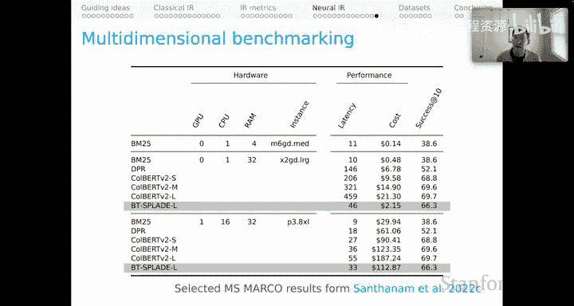

# 斯坦福大学《自然语言理解｜Stanford XCS224U Natural Language Understanding I Sp 2023》中英字幕（豆包翻译 - P18：-18-Information Retrieval, Part 4： Neural IR .zh_en - GPT中英字幕课程资源 - BV1sx4y1s7oW

Welcome back， everyone。 This is part 4 in our series on information retrieval。

 We come to the heart of it。 Neural information retrieval。

 This is the class of models that has done so much to bring NLP and I R back together again and open new doors for both of those fields。

😊。

In the background throughout this screencast， I think you should imagine that the name of the game is to take a pre trained Bt model and fine tune it for information retrieval。

And in that context， cross encoders are kind of conceptually the simplest approach that you could take for cross encoders。

 We're going to concatenate the query text and the document text together into one single text。

 process that text with Bt and then use representations in that Bt model as the basis for I R fine tuning In a bit more detail。

 we'd process the query in the document and then probably take the final output state above the class token。

 Add some task specific parameters on top and fine tune the model against our information retrieval objective。

 So that will be incredibly semantically expressive because we have all of these interesting interactions between query and document in this mode。

😊，In a bit more detail， in the background here， I'm imagining that we have a data set of triples where we have a query。

 one positive document for that query， and sum number one or more negative documents for that query。

The basis for scoring is as I described it before， we're going to take our Bt encoder。

 concatenate the query in the document and process that text。

 and then retrieve the final output state above the class token that's given here and that's fed through a dense layer that is used for scoring。

And then the loss function for the model is typically the negative log likelihood of the positive passage so in the numerator here we have our score for the positive passage according to our scoring function。

 and the denominator is that positive passage score again。

 sum together with the total for all the negative passages。So let's step back。

 This will be incredibly semantically rich， but it simply won't scale。

 The richness comes from us using the Bt model to jointly encode the query and the documents。

 So we have all these rich token level interactions。😊，But that is the model's downfall。

 This won't scale because we need to encode every document at query time。 So in principle。

 this means that if we have a billion documents， we need to do a billion forward passes with the Bt model one for every document with respect to our query。

 get all those scores and then make decisions on that basis and that will be simply infeasible。

 So although there's something conceptually right about this approach。

 it's simply intractable for modern search。DPR can be seen as a model that's kind of at the other end of the spectrum。

 This stands for dense passage retriever。 In this mode。

 we're going to separately encode queries and documents。 So on the left here。

 I've got our query encoded with a Bt like model。 And I've kind of grayed out all of the states。

 except the final output state above the class token。 That's the only one that we'll really need。

 I separately encode the document。 And again， we just need that final output state above the class token。

And then we're going to do scoring as a dot product of those two vectors。In a bit more detail， again。

 we have a data set consisting of those triples for our query。

 one positive document and one or more negative documents。

Now our core comparison function is what I've called SIim here。

 and the basis for SIM is that we encode our query using our query encoder and get the final output state。

 and we get the dot product of that with the encoding for our document again focused on the output state above the class token。

The loss is， as before， this is the negative log likelihood of the positive passage。

 So the positive score up here and then again， used down here sum together with the sum for all of the negative passages。

This will be highly scalable， but it's very limited in terms of its query document interactions。

 Let's unpack that a bit。 The core of the scalability is that we can now encode all of our documents offline ahead of time。

 And indeed， we only need to score， store one single vector associated with each one of those documents。

 And then at query time， we just encode the query， get that one representation above the class token and do a fast dot product with all of our documents。

 So it's highly scalable in that sense， too。😊，But at the same time。

 we have lost all of those token level interactions we had with the cross encoder。 Now。

 we have to hope that all of the information about the query and the document is summarized in those single vector representations。

 and we might worry that that results in a loss of expresspressivityity for the model。

Before moving on to some additional models in this space。

 I thought I would just pause here and point out that we have a little bit of modularity。

The loss function for both of the models that I've presented is the negative log likelihood of the positive passage。

 Here's how I presented it for the cross encoder。 And the core of that is this rep function。

 And here's how I am presented it for DPR， where the core of it is the Sim function。

 And you can now see that there's a general form of this where we just have some comparison function and everything else remains the same。

 And this is freeing because if you developed variances of DPR or cross encoders。

 The way that might play out is that you've simply adjusted the comparison function here and everything else about how your setting up models and optimizing them could potentially stay the same。

All right， let's move to Colbert。 This model is near and dear to me。

 Colbert was developed by Omar Kaab， who is my student， along with Mete Zharia。

 who is my long time collaborator and co adviseviss Omar with me。

And Omar would want me to point out for you that Colbert stands for contextualized late interaction with Bert。

That's an homage to the late night talk show host Stephen Colbert。

 who has late night contextual interactions with his guests。

But you are also free to pronounce this cot because obviously the Bt in that name is the famous Bt model。

Here's how Colbert works。 First， we encode queries using Bt。

 I've drawn this on its side for reasons that will become clear when I show you my full diagram。

 but it's just a burnt encoding of the query。 And I've grayed out all the states except the final ones because the only states we need are the output states from this model。

Similarly way， and we encode the document again with Bt。 and here again。

 the only states we need are the output states。And then the basis for Colbert scoring is a matrix of similarity scores between query tokens and document tokens。

 again， as represented by these final output layers。 So we get scores。 Then， in fact。

 we get a full grid of these scores。And then the basis for scoring is a maxim comparison for every query token。

 We get the value of the maximum similarity for document tokens。

 and we sum those together to get the maxim value。 That is the basis for the model。

In a bit more detail， again， we have a data set consisting of those triples。

The loss is the negative long likelihood of the positive passage， but now maxim is the basis。

 and here is the maxim scoring function in full detail。 But again。

 the essence of this is that for each query token， we get the maxim for some document token and sum all those maxim values together。

This will be highly scalable， but it has late contextual interactions between tokens in the query and tokens in the document。

 Let me unpack that。 It's highly scalable because as with DPR。

 we can store all of our documents ahead of time。 We just need to score this vector of output vectors here to represent documents at query time。

 We encode the query and get the output states and then perform a bunch of very fast maxim comparisons for scoring。

😊，But it's also semantically rich。 We have retained some of the advantages of the cross encoder。

 because we do have token level interactions between query and document。

 It's now it's just that they happen only on the output states。

 whereasas the cross encoder allowed them to happen at every layer in the Bt model。

 That was too expensive。 And this looks like a nice compromise。

 And Colbert has indeed proven to be an extremely powerful and effective I R mechanism。

One thing I really like about Colbert is that it brings in an older insight from I R。

 which is that essentially， we want to do some level of term matching between queries and documents。

 except now， since this is a neural model， We get to do that in a semantically very rich space。

 Let me show you that by way of an example。 Here I have the query。

 When did the Transers's cartoon series come out， And we have the document。

 The animated transformers was released in August 1986。 And I'm going to show you some maxim values。

😊，The largest score is between transformers in the query and transformers in the document。

That makes good sense。 But we also have a very strong maxim match between cartoon in the query and animated in the document。

 And that's a very semantic connection that only neural models like Colbert can make without extra effort。

 Similarlyly， for come out in the context of the query。

 we have a strong match to released in the document。

And then for when in the query that matches to the two parts of the date expression， August 1986。

 here， I've shown the top two maxim values to show that we're really getting a semantic connection to that full unit in the document。

So this kind of thing makes the model highly interpretable and also reveals to us why this is such an effective retrieval mechanism because it can make all of these deep associations。

Before moving on to S the final model that I wanted to talk about。

 I thought I would pause here and just talk a little bit with you about how you take Colbert or any of these neural models and then turn them into something that could be effective as a kind of deployed search technology。

 because in the background here is that we have semantic expressiveness。 but it comes at a price。

 we need to do forward inference in burnt models。 And that can be very expensive prohibitively so if we have very tight latency restrictions。

 And so the question for us is， can we overcome those limitations and make this a practical solution。

One easy thing to do to make this practical is to employ these models as rerans Here。

 this is how this would play out for Colbert。 For Colbert。 Remember。

 we have an index that essentially consists of token level representations。

 Those are each associated with documents。Given an index structure like this。

 a simple thing to do would be to take our query and code it as a bunch of tokens。

Get the top K documents for that query using a fast term based model like BM25。

 and then use Colbert only at stage2 to rerank the top K documents there。

So we use BM25 for the expensive first phase where we need to do brute force search over our entire index of documents。

 and the model like Colbert comes in only at phase 2 to do reranking。It sounds like a small thing。

 but， in fact， the reranking that happens in that second phase can be incredibly powerful and at a lot of value as a result of the fact that Colbert and models like it are so good at doing retrieval in this context。

 But they're expensive。 One nice thing about this， though， is that we can kind of control our costs。

 because if we set K very low， we'll do very little processing with Colbert。 if we set K high。

 we'll use Colbert more often and we can kind of calibrate that against other constraints that we're operating under。

😊，So this is a perfectly reasonable solution。 The one concern you might have， maybe as a purist。

 is that you now have two retrieval mechanisms in play。 B M 25。

 which does a lot of the work in Colbert， which performs the reranking function。

 We might hope for a more integrated solution。 So could we get beyond reranking for Colbert。

 I think the answer is yes， We're going to make a slight adjustment to how we set up the index。 Now。

 the primary thing will be that we have these token level vectors， which， of course， as before。

 associate with documents。Now， when a query comes in， we encode that into a sequence of vectors。

And then for each vector in that query representation， we retrieve the P most similar token vectors。

And then travel through them to their associated documents。

 And then the only cobert bare work that we do is scoring this potentially small set of documents that we end up in phase 2。

 because in phase 1， all we're doing is a bunch of similarity calculations between vector representations。

 So again， we have a lot of control over how much we actually use the full Colbert model at step 2 here。

 and therefore， we can calibrate against other constraints that we're operating under。

So this is certainly workable， but we can probably do even better。

And the way we can do even better is with centroid based ranking。

 And this begins from the insight that this index that we've constructed here will have a lot of semantic structure。

 and we can capture that by clustering the token level vectors that represent our documents into clusters and then taking their centroids to be representative summaries of those clusters。

 And we can use those as the basis for search。 So now。

 given a query that we encode again as a sequence of vectors for each one of those vectors。

 we retrieve the closest centroids and then travel from them to similar document tokens。

 And then from them to similar documents。 and then again， we use cobert。

 the full model only at step 3 here。 All these other comparisons or just fast similarity comparisons。

 And this gives us huge gains， because instead of having to search over this entire index。

 we search over a potentially very small number of centroid representations and use。😊。

As the basis for getting down to a small set of documents that we're going to score completely with Colbert。

That's a bunch of the work that we've done。 I thought I would just mention a little bit of the work that we've done specifically to address latency concerns for Colbert。

 And this comes from the paper that we called plaid。 And it begins from the observation that。

 despite all the hard work that I just described for you。

 The latency for the Colbert model was still kind of prohibitively high at 287 milliseconds。

 Whereas you might hope you could get this down to around 50 milliseconds for a feasible deployable solution at a minimum。

And this chart here is showing you where the work actually happens。

 And one surprising thing for Colbert is that only a small part of the overall time there is actually spent on the core modeling steps of representing examples and doing scoring。

And， in fact， only a small part is even used with the centroids that I described before。

 The bulk of the work is being done when we have to look things up in this giant index。 And also。

 when we do decompression， That's a point that I haven't mentioned before。

 But the essence of this is that。The Colbert index can get very large because we need to store token level representations。

 but we find that we can make them relatively low resolution，4 or even two bit representations。

 because all they need to do is represent individual tokens。

 But that that does mean that we would like to decompress them at some point to get back to their full semantic richness。

 And we found that that step of kind of unpacking them was also expensive。

And so what the team did is do a lot of work to kind of reduce the amount of heavy duty lookup and decompression that the Colbert model was doing。

They trade that a little bit off against using more centroids as part of that initial search phase phase that I described。

 but they did successfully remove almost all the overhead that was coming from these large data structures and the corresponding decompression that we had to do。

 And they got the latency all the way down to 58 milliseconds。

 I regard this as absolutely an amazing achievement。

 And I think it shows you how much innovative work can happen in this space。

 not focused on hill climbing on accuracy， but rather thinking about issues like latency and how they impact the deployability of systems like this。

 And there's lots more room for innovation in this space。

 So I would exhort you all to think about how you could contribute to making systems not only more accurate。

 but also more efficient along this and other dimensions。😊。

There's one more model that I wanted to mention， because I think this is incredibly powerful and competitive and also offers yet again another perspective on how to use neural representations in this space。

 This model is splayed。😊，Here's how Spplayade works I've got at the bottom here our encoding mechanism for sequences。

 and I'm trying to be agnostic about whether this is a query sequence or a document sequence because we both do both of those with the same kind of calculations。

So just imagine we're processing some text。 The core shift in perspective here is that now we're going to do scoring with respect。

 not to some other text， but rather with respect to our entire vocabulary。

 So here I have a small vocabulary of just seven items。 But， of course。

 you could have tens of thousands of items。 And that's important for splayed because we're going to have very sparse representations by comparison with cross encodecors。

 DPR and Colbert。So here's how this works。 We're going to form， like with Colbert。

 a matrix of scores。 But now the scoring is with respect to tokens in the sequence that we're processing and all of our vocabulary items。

 The scoring function for that is kind of detailed。 I've depicted it here。

 you should think of it as a kind of bunch of neural layers that help you represent all of these comparisons。

 So you do all of that work。 And then the blade scoring function is a kind of sparsification of the scores that we get out of that。

 that's depicted here。 And the essential insight is that with this blade function。

 we're going to get a score for every vocabulary item with respect to the sequence that we have processed。

 And that's what's depicted in orange here。 And you should think of this orange thing as a vector with the same dimensionality as our vocabulary G what are probably very sparse scores for our sequence with respect to everything in that vocabulary。

😊，Again， we do that for queries and for documents。 And then the similarity function that's at the heart of all of these models is now Sim displayedplayed。

 which is a dot product between the splayed representation for the query and the splayed representation for the document。

 So these are big， long sparse vectors。 And we take the dot product of them for the for scoring。

The loss is our usual negative log likelihood， plus importantly。

 a regularization term that leads to sparse balance scores。

 which I think is an important modification given how different displayed representations are compared to the others we've discussed。

But this is an incredibly powerful model， and I love this perspective。

 where we're now kind of even further back to original IR insights about how the vocabulary and term matching is so important。

 But again， it's happening in this very rich neural space as defined by this grid of scores。😊。

I'm not going to go through this slide in detail， but I couldn't resist mentioning a bunch of other recent developments。

 They are biased toward Colbert， because I'm biased toward Colbert。

 but I think the list does point to a kind of general set of directions around making systems more efficient and also making them more multilingual。

 And that can happen with things like distillation and also innovative ways of training the models and setting up new objectives for them。

 while balancing lots of considerations， not just accuracy， but also efficiency for these systems。

 Tdously exciting and active area of research for the field。😊，And to round out that point。

 I thought I would return to the thing that I emphasize so much when we talked about I metrics。

 which is that there is more at stake here than just accuracy。

 So this is from a series of controlled experiments that we did in this paper trying to get a sense for the system requirements。

 latency， costs and accuracy for a variety of systems。

 And there's no simple way to navigate this table。 So let me just highlight a few things。 First。

 BM 25 is the only model that we could even get to run with this tiny little compute budget。

 So if you are absolutely compute constrained or cost constrained。

 you might be forced to choose BM 25。 It's a reasonably effective model。

But assuming you can have more heavy duty hardware。

 you might think about tradeoffs within the space of possible Colbert setups。

 And this is illuminating because， for example， these two models are pretty close in accuracy。

 but very far apart in terms of cost and latency。 And so you might think I can sacrifice this amount of accuracy to do this amount of accuracy here to do this much in terms of reduced latency and cost。

 Here's another such comparisons。 Colbert small has latency of 206。

 Bt displayed large has latency of 46 and costs a fraction of what the Colbert model costs。 Now。

 the Colbert model is much more accurate。 but maybe this is an affordable drop here。

 given the other other considerations that are in play。

 And here's another comparison between two B T displayedplay large models。

 for a modest reduction in latency that comes from running on a GPU。

 I have to pay a whole lot more money for the same accuracy。So for example。

 you start to see that it's very unlikely that you'd be able to justify using a GPU with BT displayedplayed large when it's only a modest latency reduction。

 but a huge ballooning in the overall cost that you pay。

And I think there are lots of other comparisons like this that we can make。

 and we're going to talk later in the course about how we might systemize some of these observations into a leaderboard that takes account of all of these different pressures。

 and IR is a wonderful playground for thinking about such trade offs。

