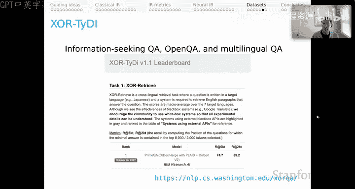
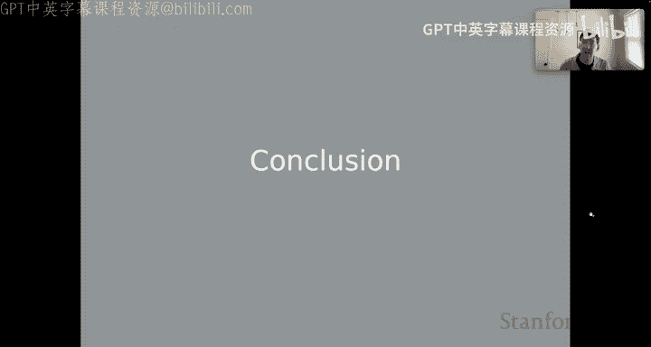
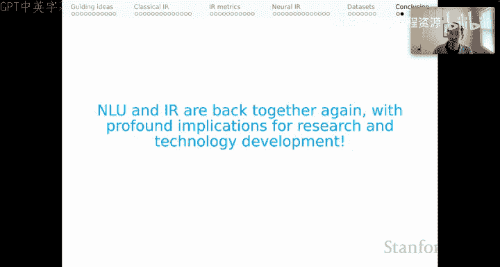

# 斯坦福大学《自然语言理解｜Stanford XCS224U Natural Language Understanding I Sp 2023》中英字幕（豆包翻译 - P19：-19-Information Retrieval, Part 5： Datasets and Conclusion .zh_en - GPT中英字幕课程资源 - BV1sx4y1s7oW

Welcome back， everyone。 This is the fifth and final screencast in our unit on information retrieval。

 I thought I would just point you to some data set resources and then wrap up in what I hope is an inspiring way。

For datas， let's start with T Re。 This is text retrieval conference。

 They have annual competitions The 2023 iteration has a number of different tracks that you might explore if you want to get involved in these bakeoff style competitions。

 In general， T Re has tended emphasize careful evaluation with small numbers of queries。

 say 50 queries each with about 100 annotated documents。

 but that doesn't mean that you have few documents。

 It just means that you're doing this kind of refined evaluation。

MS Marco is an incredibly important resource in the IR space。 It's the largest public IR benchmark。

 It was adapted from a question answering data set and has more than 500。

000 Bing search queries as its basis。Though labeling is pretty sparse， one relevance label per query。

 but that does match the setting that we need for training all of the neural Ir models that I covered in the previous screencast。

 So this really is a wonderful resource for passage ranking。

 you have 9 million short passages and for document ranking， you have 3 million long documents。

 So that's two ways in which you can explore system performance and also create pretrained resources that will be useful to others who are looking for IR solutions。

😊，Beer is an important new benchmark that stands for benchmarking Ir and the name of the game here is to do diverse zeroshot evaluations of I models across a bunch of different domains and task settings。

 And so this has been useful for benchmarking these models recently。

 We released a kind of companion dataset set that we call latte for long tail topic stratified evaluation。

 And the idea here is to rely primarily on stack exchange to explore pretty complicated pretty diverse questions。

 This is again， meant for zeroshot evaluation in what we did is release the data set with topic aligned pairs of devon test。

 So you can do some development work testing your system zeroshot in the devs tests and then try to transfer into kind of comparable domains。

 And another aspect of latte is that we have a subpart that's kind of oriented around the things that you see in web search and a second subpart forum queries that are more oriented to the kind of complicated。

😊，Questions that people pose directly in forums like stack exchange。

X or Tidi is a wonderful effort to push IR into a more multilingual setting both for QA and open QA and for pure IR applications。

 certainly worth looking at if you're thinking of developing multilingual IR solutions。

And that's it for data sets。 There are others。 But those are some greatest hits。

 And then I thought I would just list out a few core topics that I really didn't get to discuss。

 First， there is a large literature on different techniques for negative sampling。 Remember。

 all those triples I described。 Have a set of negatives。 The question is， where do those come from。

 And you always want to strike a balance between making them really easy so the model can discriminate and making them hard so that the model learn some subtle distinctions and getting that balance right can be very challenging。

I also didn't get to talk enough about weak supervision。

 I did mention one strategy where we kind of look to see whether documents contain the query as a sub string and use that as a a signal for relevance。

 And we have found in prior work， that that simple， heuristic can be incredibly powerful。

 And I think that does suggest that， especially for training systems。

 we should push toward weak supervision for them because it can be so effective and is often so inexpensive。

And then I've alluded to this a few times in a recent paper， we use dinos scoreses。

 which is a method for integrating a lot of different metrics together into a single unified metric to create leader boards that kind of really embrace all the aspects of Ir。

 And we're going to talk about dinos scoreses later in the quarter。

 And I think I'll return to the Ir example， because it is such a good example of how multiple pressures can be in play when we think about system quality。

So that's it for data sets。 And then to conclude， I really wanted to just say one final thing。

 NLU and IR are back together again in full force， and this has profound implications for research and technology development。

 And I hope this series of screencast has showed you how active and exciting this area of research is and kind of push you to think about how you could participate in this research because you can have a very large impact both within research and also throughout the industry as it tries to make use of language technology。

 So tremendously exciting， scientifically and technologically a wonderful and inspiring story of how these fields have come back together to achieve new and bigger things。

😊。

