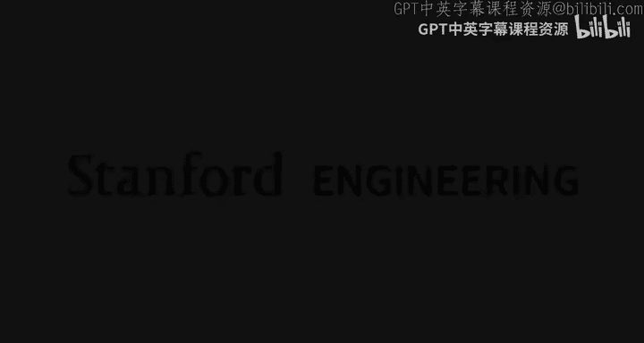
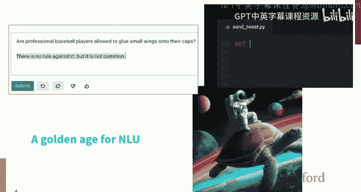
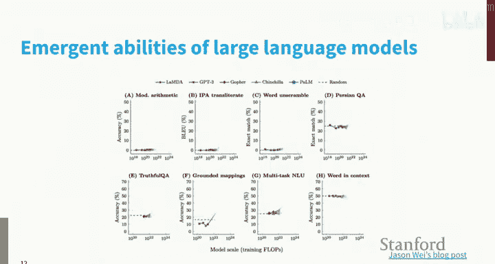
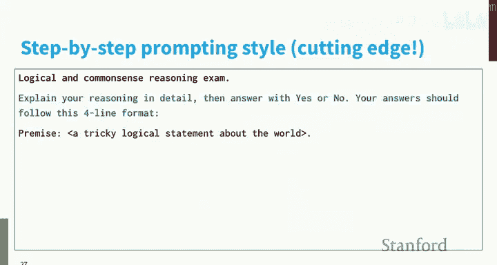
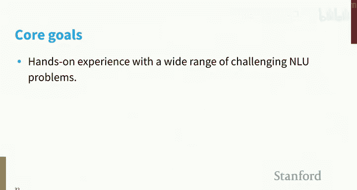
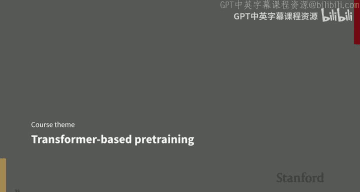
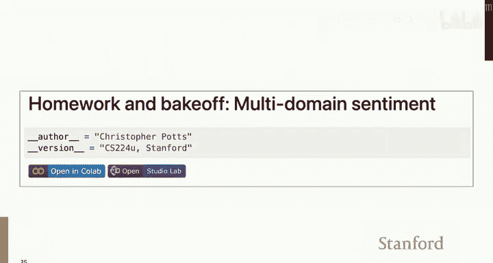
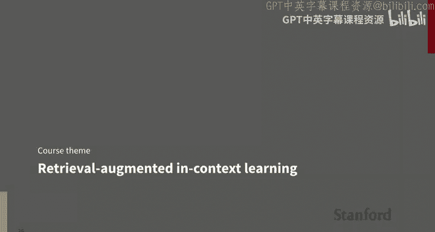

# 斯坦福大学《自然语言理解｜Stanford XCS224U Natural Language Understanding I Sp 2023》中英字幕（豆包翻译 - P1：-01-Intro & Evolution of Natural Language Understanding, Pt. 1 I  Spring 2023.zh - GPT中英字幕课程资源 - BV1sx4y1s7oW

Welcome everyone， this is natural language Understanding。

It is a weird and wonderful and maybe worrying moment to be doing natural language understanding。

My goal for today is just to kind of immerse us in this moment and think about how we got here and what it's like to be doing research now。

 and I think that'll set us up well to think about what we're going to do in the course and how that's going to set you up to participate in this moment in AI in many ways in whichever ways you choose and it's an especially impactful moment to be doing that and this is a projectoriented course and I feel like we can get you all to the point where you are doing meaningful things that contribute to this ongoing moment in ways that are going to be exciting and impactful that is the fundamental goal of the course。

Let's now think about the current moment， this is always a moment of reflection for me。

 I started teaching this course in 2012， which I guess is ages ago now it feels recent in my lived experience。

 but it does feel like ages ago in terms of the content in 2012 on the first day I had a slide that looked like this。

 I said it was an exciting time to be doing natural language understanding research。

I noted that there was a resurgence of interest in the area after a long period of people mainly focused on syntax and things like that。

But there was a widespread perception that NLU was poised for a breakthrough and to have huge impact that was relating to business things and that there was a whitehot job market for Stanford grads。

 a lot of this language is coming from the fact that we were in this moment when Siri had just launched。

 Watson had just won on Jeeopardy and we had all of these in-home devices and all the tech giants kind of competing on what was emerging as the field of natural language understanding。

Let's fast forward to 2022， I did feel like I should update that in 2022 by saying this is the most exciting moment ever as opposed to just being an exciting time。

 but I emphasized the same things right we were in this feeling that we had experienced a resurgence of interest in the area。

 although now it was hyperintensified， same thing with industry。

 the industry interest at this point makes the stuff from 2012 look like small potatoes。

Systems were getting very impressive but and I maintain this here。

 they show their weaknesses very quickly and the core things about NLU remain far from solve so the big breakthroughs lie in the future I will say that even since 2022 it is felt like there has been an acceleration and some problems that we used to focus on feel kind of like they're less pressing。

 I won't say solved， but they feel like we've made a lot of progress on them as a result of models getting better。

 but all that means for me is that there are more exciting things in the future that we can tackle even more ambitious things and you'll see that I've tried to overhaul the course to be ever more ambitious about the kind of problems that we might take on。

But we do kind of live in a golden age for all of this stuff and even in 2022 I'm not sure what I would have predicted to say nothing of 2012 that we would have these incredible models like Dolly2。

 which can take you from text into these incredible images。

 language models which will more or less be the star of the quarter for us。

 but also models that can take you from natural language to code and of course we are all seeing right now as we speak。

 that the entire industry related to web search is being reshaped around NLU technologies。

 so whereas this felt like a kind of niche area of NLP。

 when we started this course in 2012 now it feels like the entire field of NLP。

 certainly and in some aspects all of AI is focused on these questions of natural language understanding which is exciting for us。

One more moment of reflection here， you know， in this course throughout the years we have used simple examples to kind of highlight the weaknesses of current models and so a classic one for us was simply this question which US states border no US states the idea here is that it's a simple question but it can be hard for our language technologies because of that negation the no there。

In 1980 there was a famous system called Chat 80， it was a symbolic system representing the first major phase of research in NLP。

 you can see the fragment of the system here， and chat 80 was an incredible system in that it could answer questions like which country bordering the Mediterranean borders a country that is bordered by a country whose population exceeds the population of India。

 I've given you the answer here， Turkey， at least according to 1980s geography。

 but if you asked Chat 80 a simple question like which US states border no U states it would just say I don't understand。

 it was an incredibly expressive system but rigid it could do some things very deeply as you see from the first question but things that fell outside of its capacity。

 it would just fall down flat。That was the 1980s， let's fast forwardward 2009 around the time this course launched Wolfram Alra hit the scene。

 and this was meant to be a kind of revolutionary language technology。

 the website is still up and to my amazement it still gives the following behavior if you search for which US States border no US states。

 it kind of just gives you a list of the US states， revealing。

 I would say that it has no capacity to understand the question posed。

That was 2009 so we've gone from 1980 to 2009 okay let's go to 2020。

 this is the first of the open AI models add a which US states border no US states， the answer is no。

 and then it sort of starts to babble the US border is not a state border。

 it did that for a very long time。But about babbage， this is still 2020。

The US States border no US states， what is the name of the US state and then it really went off the deep end from there again for a very long time。

 that was babbage if you had seen this output， well at least for me。

 it might have shaken my faith that this was a viable approach， right？But the team persisted。

 I guess， 2021， this is the Curie model， which US states border no US states？

It had a problem that it started listing things， but it did say Alaska， Hawaii and Puerto Rico。

 which is an interestingly more impressive answer than the first answer。

 right It still has some problem understanding what it means to respond。

 but it's looking like we're seeing some signal。Da Vinci instruct Beta， this is 2022。

 it's important I think that this is the first of the models that have instruct in the name we'll talk about that in a minute。

 which US states border know US states， Alaska and Hawaii we' from 2020 to 2022 we have seen this astounding leap forward making everything before then sort of pale in comparison and then finally text Da Vinci won one of the new best in class models at least until two months ago。

 which US states border no US states， Alaska and Hawaii are the only US states that border no other US states a very impressive answer indeed and if you just think about the little history I've given。

A kind of microcosm of what is happening in the field。

A lot of time without much progress with some hype attached。

 and now in the last few years this kind of rapid progress forward。

And you know that's just one example， but these examples multiply and we can quantify this。

 here's another impressive case， I asked the Da Vinci2 model in which year was Stanford University founded。

 when did it enroll its first students， who is its current president and what is its mascot a complicated question indeed。

 and it gave a fluent and factually correct answer on all counts。

This is the Da Vinci3 model which was best in class until a few weeks ago。

 and it gave exactly the same answer， very impressive。

Now in this course and you'll see at the website， one of the readings we've suggested for the start of the course is this classic paper by Hector Leveck calledOn Our Best Behavior。

 and the thrust of this article essentially channeling Terry Wininorad and Terry Wininorad's schema。

 the idea is that we should come up with examples that will test whether models deeply understand and in particular get past the kind of simple memorization of statistics and other things about the data they're trained on and really probed to see whether they understand what the world is like。

 and Levek and Wininorad's technique for doing this is to pose very unlikely questions where humans have very natural answers like one of the ones Leveck poses is could a crocodile run the steeple Cha。

Maybe it's a question you've never thought about before。

 but you probably have a pretty consistent answer across this group。

 Could a crocodile run the steeple Cha here I asked another one of Lex's questions。

 Our professional baseball players allowed to glue small wings onto their caps。

 You could think about that for a second。 The Da Vinci2 model said there is no rule against it。

 but it is not common， and that seemed like a very good answer to me at the time。

 when the Da Vinci3 engine came out， though this started to worry me， No。

 professional baseball players are not allowed to glue small wings onto their caps。

 Major League Base has strict rules about the appearance of players' uniforms and caps。

And any modifications to the caps are not allowed Okay， I thought I was feeling good about this。

 but now I don't even myself know what the answer is are professional baseball players allowed to glue small wings onto their caps。

 We have two confident answers that are contradictory across two models that are very closely related starting to worry us a little bit I hope but still it's impressive What's that you could check。

 yes， I have a few cases and this is an interesting experiment for us to run for sure。

 let me show you the responses I got a bit later。The point though。

 I guess if you've seen the movie Bla Runner， this is starting to feel like to figure out whether an agent we were interacting with was human or AI。

 we would need to get very sophisticated interview techniques indeed， the touring test。

 long forgotten here now we're into the mode of trying to figure out exactly what kind of agents we're interacting with by having to be extremely clever about the kinds of things that we do with them。

Now that's kind of anecdotal evidence， but I think that the picture of progress is also supported by what's happening in the field。

 let me start this story with our benchmarks and the headline here is that our benchmarks， the tasks。

 the data sets we use to probe our models are saturating faster than ever before and I'll articulate what I mean by saturate so we here have a little framework along the X axis I have time stretching back into like the 1990s and along the y axis I have a normalized measure of distance from what we call human performance that's the red line set at zero。

Each one of these benchmarks has in its own particular way set a socal estimate of human performance。

 I think we should be cynical about that， but nonetheless。

 this will be a kind of marker of progress for us。First data set， MNIS。

 this is like digit recognition， famous task and AI was launched in the 1990s。

 and it took about 20 years for us to see a system that surpassed human performance in this very loose sense。

The switchboard corpus， this is going from speech to text。

 it's a very similar story launched in the '90s and it took about 20 years for us to see a superhuman system。

ImageNet， this was launched， I believe， in 2009， and it took less than 10 years for us to see a system that surpassed at red Line。

And now progress is going to pick up really fast， Squa 1。1。

 the Stanford question answering data was launched in 2016 and it took about three years for it to be saturated in this sense。

Squad 2。0 was the team's attempt to pose an even harder problem。

 one where there were unanswerable questions。But it took even less time for systems to get past that red line。

Then we get the glue benchmark， this is a famous benchmark in natural language understanding。

 a multitask benchmark。When this was launched， a lot of us thought that glue would be too difficult for present day systems。

 it looked like this might be a challenge that would stand for a very long time。

 but it took like less than a year for systems topass human performance， the response was super glue。

 but it was saturated if anything even more quickly。

Now we can be as cynical as we want about this notion of human performance and I think we should dwell on whether or not it's fair to call it that。

 but even setting that aside this looks like undeniably a story of progress the systems that we had in 2012 would not even have been able to enter the G benchmark to say nothing of achieving scores like this so something meaningful has happened Now you might think by the standards of AI。

 these data sets are kind of old here's a post from Jason Way where he evaluated our latest and greatest large language models on a bunch of mostly new tasks that we're actually designed to stress tests this new class of very large language models and Jason's observation is that we see emergent abilities across more than 100 tasks for these models。

 especially for our largest models The point though is that we again thought these tasks would stand for a very long time and what we're seeing instead is that one by one systems are。

Certainly getting traction and in some cases， performing at the standard we had set for humans。

Again， an incredible story of progress there。So I hope that is energizing。

 maybe a little intimidating， but I hope fundamentally energizing for you all the next question that I want to ask for you is just what is going on。

 what is driving all of this sudden progress。 Let's get a feel for that and that'll kind of serve as the foundation for the course itself。

Before I do that， though， are there questions or comments？

Things I could resolve or things I left out about the current moment。Brendon on Bar did very well。

We we should reflect， though， maybe as a group about what it means to do very well my question for you when you say it did well。

 what is the major League Bball rule about players gluing things onto their caps。

 you found the actual rule No is what I't Did you find I didn't find the Bard found that rule and gave me that number。

Yes， that is going to be the question for us。 I can get， which is right halluc。 Well。

 I'm going to show you the open AI models will offer me links， but the links go nowhere。

What you're pointing out， I think is an increasing societal problem these models are offering us what looks like evidence。

 but a lot of the evidence is just fabricated and this is worse than offering no evidence at all。

 what I really need is someone who knows Major League Baseball to tell me what is the rule about players and their caps I want it from an expert human not an expert language model。

成立。What's that， can we Google？Be careful how you Google， though， I guess that's the lesson of 2023。

All right， what's going on， let's start to make some progress on this again first a little bit of historical context。

 I've got a timeline going back to the 1960s along the X axis。

 this is more or less the start of the field itself and in that early era essentially all of the approaches were based in symbolic algorithms like the chat 81 that I showed you。

 in fact， you know that was kind of pioneered here at Stanford by people who were pioneering the very field of AI and that paradigm of essentially programming these systems lasted well into the 1980s。

In the 90s， early 2000s， we get the statistical revolution throughout artificial intelligence and then in turn in natural language processing。

 and the big change there is that instead of programming systems with all these rules we're going to design machine learning systems that are going to try to learn from data under the hood there was still a lot of programming involved because we would write a lot of feature functions that were little programs that would help us detect things about data and we would hope that our machine learning systems could learn from the output of those feature functions。

 but in the end this was the rise of the fully data-dven learning systems and we just hope that some process of optimization leads us to new capabilities。

The next big phase of this was the Deep learning revolution this happened starting around 2009。

2010 again Stanford was at the forefront of this to be sure it felt like a big change at the time but in retrospect this is kind of not so different from this mode here。

 it's just that we now replace that simple model with really big models。

 really deep models that have a tremendous capacity to learn things from data。

 we started also to see a shift even further away from those feature functions from writingville programs and more toward a more mode where we would just hope that the data and the optimization process could do all the work for us。

Then the next big thing that happened， which I could take us I suppose until about 2018 would be this mode where we have a lot of pre-trained parameters。

 these are pictures of maybe big language models or computer vision models or something。

 and when we build systems we build on those pre-train components and stitch them together with these task specific parameters and we hope that when they're all combined and we do some learning on some task specificific data we have something that's benefiting from all these pre-train components and then the mode that we seem to be in now that I want us to reflect critically on is this mode where we're going to replace everything with maybe one ginormous language model of some kind and hope that that thing。

 that enormous black box will do all the work for us we should think critically about whether that's really the path forward。

 but it certainly feels like the zeitgeist to be sure。Question， yeah， if you think it's worth it。

 could you go back to the last slide and maybe explain a little bit a more rounded example of what that all means I couldn't quite follow Let's do that later。

 the point from now though is really this shift from here where we're mostly learning from scratch from for our task here we've got things like Bt in the mix we've got pretrained components。

 models that we hope begin in a state that gives us a leg up on the problem we're trying to solve that's the big thing that happen and you get this emphasis on people releasing model parameters。

 you know in this earlier phase like here， there was no talk of releasing model parameters because mostly the models people trained were just good for the task that they had set as we move into this era and then certainly this one these things are meant to be like general purpose language capabilities or maybe general purpose computer vision capabilities that we stitch together。

Into a system that can do more than any previous system could do。Right。

 so then we have this big thing here。So that's the feeling now behind all of this。

 certainly beginning in this final phase here is the transformer architecture。

 Just mean take the temperature of the room， how many people have encountered the transformer before？

Right yeah it's sort of unavoidable if you're doing this research here's a diagram of it。

 but I am not going to go through this diagram now because starting on Wednesday we are going to have an entire lecture essentially devoted to unpacking this thing and understanding it All I can say for you now is that I expect you to go on the following journey which all of us go on how on earth does the transformer work it looks very。

 very complicated I hope can get you to the point where you feel oh。

 this is actually pretty simple components that have been combined in a pretty straightforward way that's your second step on the journey the one the true enlightenment comes from Wait a second why does this work at all and then you're with the entire field trying to understand why these simple things were brought together in this way have proved so powerful。

The other major thing that happened， which is kind of latent going all the way back to the start of AI。

 especially as it relates to linguistics， is this notion of self-supervision。

 of distributional learning， because this is going to unlock the door to us just learning from the world in the most general sense。

In self-supvision， your model's only goal is to learn from cooccurrence patterns in the sequences that it's trained on。

 and the sequences can be language， but they could be language plus sensor readings， computer code。

 maybe even images that you embed in this space， just symbols。

 and the model's only goal is to learn from the distributional patterns that they contain。

Or for many of these models to assign high probability to the attested sequences in whatever data that you pour in。

For this kind of learning， we don't need to do any labeling。

 All we need to do is have lots and lots of symbol streams。

And then when we generate from these models we're sampling from them。

 and that's what we all think of when we think of prompting and getting a response back。

 but the underlying mechanism is at least in part this notion of self-supervision。

 and I'll emphasize again because I think this is really important for why these models are so powerful。

 the symbols do not need to be just language， they can include lots of other things that might help a model piece together a full picture of the world we live in and also the connections between language and those pieces of the world。

 just from this distributional learning。The result of this proving so powerful is the advent of large scale pretraining because now we're not held back anymore by the need for labeled data。

 all we need is lots of data in unstructured format This really begins in the era of static word representations like word to V and glove。

And in fact， those teams， and I would say， especially the glove team。

 they were really visionary in the sense that they not only released a paper。And code。

 but pre-train parameters， this was really brand new for the field。

 this idea that you would empower people with model artifacts and people started using them as the inputs to recurrent neural networks and other things。

 and you started to see pre-training as an important component to doing really well at hard things。

There were some predecessors that I'll talk about next time but the really big moment for contextual representations is the ElLmo model。

 this is the paper deep contextualized word representations。

 I can remember being at the North American ACL meeting in New Orleans in 2018 at the best paper session they had not announced which of the best papers was going to win the outstanding paper award but we all knew it was going to be the ElLmo paper because the gains that they had reported from fine tuning their ElLmo parameters on hard tasks or the field were just mindblowing the sort of thing that you really only see once in a kind of generation of this research or so we thought because the next year。

Burt came out， same thing， I think same best paper award word thing。

 the paper already had had huge impact by the time it was even published and they too released their model parameters。

 Elmo is not transformer based， Bert is the first of the sequence of things that's based in the transformer and again lifting all boats even above where Elmo had brought us。

Then we get GPT， this is the first GPT paper and then fast forward a little bit， we get GPT3。

 and that was pretraining at a scale that was previously kind of unimaginable because this're now we're talking about。

 you know for the BERT model， 100 million parameters and for GPT3 well north of 100 billion different order of magnitude and what we started to see is emergent capabilities。

That model size thing is important again， this is a sort of feeling of progress and maybe also despair。

 I think I can lift your spirits a little bit， but we should think about model size。

 so I have years along the X axis again。And I have model size going from 100 million to 1 trillion here on a logarithmic scale。

 So 2018 G， that's like 100 million Bt。 I think it's 300 million for the large one。 okay， G2。

 even larger megaron 8。3 billion。 I remember when this came out， I probably laughed。

 maybe I thought it was a joke。 I certainly thought it was some kind of typo because I couldn't imagine that it was actually billion like with a B there。

But now that's we take that for granted megatron 11 billion， this is 2021 or so。

 then we get GPT3 reportedly at 175 billion parameters。

 and then we get this thing where it seems like we're doing typos again。

 megatron Turing NLG was like 500 and then palm is 540 billion parameters and I guess there are rumors that we have gone upward all the way to a trillion right？

Theres an undeniable trend here， I think there is something to this trend but we should reflect on it a little bit。

 one thing I want to say is there's a noteworthy pattern。

 a very few entities have participated in this very large in this race for very large models we've got like Google NviDdia meta and open AI right and that was actually a real cause for concern I remember being at a workshop between Stanford and open AI where the number one source of consternation was really that only open AI at that point had trained these really large models and after that predictably these other large tech companies kind of caught up。

But it was still for a while looking like a story of real centralization of power。

That might still be happening but I think there's reason to be optimistic so here at Stanford the Helm Group which is part of the Center for Research on Foundation models。

 led this incredibly ambitious project of evaluating lots of language models and one thing that emerges from that is that we have a more healthy ecosystem now so we have these like loose collectives big science and aluther are both kind of fully open source groups of researchers we've got well one academic institution represented this could be a little bit embarrassing for Stanford maybe we'll correct that。

And then maybe the more important thing is that we have lots of startups represented。

 so these are wellfunded but relatively small outfits that are producing outstanding language models。

 and so the result I think we're going to see much more of this and then we'll worry less about centralization of power there's plenty of other things to worry about so we shouldn't get sanguine about this but this particular point I think is being alleviated by current trends and there's another aspect of this too which is you have this scary rise in model size。

 but what is happening right now as we speak in a very quick way is we're seeing a push towards smaller models。

And in particular we're seeing that models that are in the range of like 10 billion parameters can be highly performant right so we have the flan models we have Lama and then here at Stanford。

 they released the alpaca thing and then databricks released hello dolly model these are all models that are like  eight to 10 billion parameters which I know this sounds funny because I laughed a few years ago when the megatron model had 8。

3 billion and now what I'm saying to you is that this is relatively small but so it goes and the point is that a 10 billion parameter model is one that could be run on regular old commercial hardware whereas these monsters up here really you have lots of pressures towards centralization of power there because almost no one can work with them but anyone essentially can work with alpaca and it won't be long before we've got the ability to kind of work with it on small devices and things like that and that too is really going to open the door to lots of innovation I think that will bring some good。

And I think it will bring some bad， but it is certainly a meaningful change from this scary trend that we were seeing until four months ago。

As a result of these models being so powerful， people started to realize that you can get a lot of mileage out of them simply by prompting them when you prompt one of these very large models you put it in a temporary state by inputting some text and then you generate a sample from the model using some technique and you see what comes out right so if you type into one of these models better late than。

It's going to probably spit out never。If you put in every day， I eat breakfast， lunch。

 and it will probably say dinner。And you might have an intuition that the reasons the causes for that are kind of different。

 The first one is a sort of idiom， so that it could just learn from cooccurrence patterns and text transparently for the second one。

 we kind of interpret it as humans as reflecting something about routines。

But you should remind yourself that the mechanism is the same as in the first case。

 this was just a bunch of cooccurrence patterns a lot of people describe their routines in text and the model picked up on that and carry that thought forward as you think about things like the president of the US is when it fills that in with Biden or whoever。

It might look like it is offering us factual knowledge and maybe in some sense it is。

 but it's the same mechanism as for those first two examples。

 it is just learning from the fact that a lot of people have expressed a lot of texts that look like the president of the USS is Joe Biden and it is repeating that back to us。

And so definitely， if you ask a model something like the key to happiness is。

 you should remember that this is just the aggregate of a lot of data that it was trained on it。

 has no particular wisdom to offer you necessarily beyond what was encoded latently in that giant C of mostly unauitted unstructured text。

Yeah， question。I guess， you know， it would be kind of hard to get something like this。

 but if we had like a corpus of just like， you know， all the like languages right。

 but literally all of the facts were wrong。We just dont imagine like a very factually ingredient。

Like， I guess I'm getting out like。How do we inject like truth into like these cors？

It's a question that bears repeating， how do we inject truth？

It's a question you all can think about what is truth of course。

 but also what would that mean and how would we achieve it and even if we did back off to something like how would we ensure self-consistency for a model or at the level of a worldview or a set of facts。

 even those questions which seem easier to pose are incredibly difficult questions in the current moment where our only mechanisms are basically that self-supervision thing that I described and then a little bit of what I'll talk about next。

 but none of the structure that we used to have where we would have a database of knowledge and things like that。

That is posing problems。The prompting thing we take this a step forward right so the GPT3 paper。

 remember that's that 175 billion parameter monster。

 the eye-opening thing about that is what we now call in contextext learning。

 which was just the notion that for these very large。

 very capable models you could input a bunch of text like here's a passage and maybe an example of the kind of behavior that you wanted。

 and then your actual question， and the model would do a pretty good job at answering the question。

What you're doing here is with your context passage and your demonstration pushing the model to be extractive to find an answer to its question in the context passage and then the observation of this paper is that they do a pretty good job at following that same behavior for the actual target question at the bottom here remember this is all just prompting putting the model in a temporary state and seeing what comes out。

 you don't change the model you just prompt it this in 2012。

 if you had asked me whether this was a viable path forward for a class project。

 I want to prompt an RN or something， I would have advised you as best I could to choose some other topic because I never would have guessed that this would work So the mind-blowing thing about this paper and everything that's followed is that we might be nearing the point where we can design entire AI systems on the basis of this simple in contexttex learning mechanism transformatively different。

From anything that we saw before。In fact， let me just emphasize this a little bit。

 It is worth dwelling on how strange this is。For those of you who have been in the field a little while。

 just contrast what I described in context learning with the standard mode of supervision。

Let's imagine for a case here that we want to train a model to detect nervous anticipation and I have picked this because this is a very particular human emotion。

 and in the old mode we would need an entire dedicated model to this right we would collect a little data set of positive and negative instances of nervous anticipation and we would train a supervised classifier on feature representations of these examples over here learning from this binary distinction。

We would need custom data and a custom model for this particular task in all likelihood。

In this new mode， few shot in context learning， we essentially just prompt the model hey model。

 here's an example of nervous anticipation my poem started to sweat as the lotto numbers were read off hey model。

 here's an example without nervous anticipation and so forth。

 and it learns from all those symbols that you put in and their co-occurrences。

 something about nervous anticipation。On the left for this model here。

 I've written out nervous anticipation， but remember that has no special status。

 I've structured the model around the binary distinction， the one and the zero。

And everything about the model is geared toward my learning goal。 On the right。

 nervous anticipation is just more of the symbols that I've put into the model。😊。

And the eye opening thing again about the GPT3 paper and what's followed is that models can learn。

 be put in a temporary state and do well at tasks like this。Now I talked about self-supvision before。

 and I think that is a major component to the success of these models。

 but it is increasingly clear that it is not the only thing that is driving learning in the best models in this class。

 the other thing that we should think about is what's called reinforcement learning with human feedback。

This is a diagram from the chat GT blog post， there are a lot of details here。

 but really two of them are important for us for right now。

 the first is that in a phase of training these models。

People are given inputs and ask themselves to produce good outputs for those inputs。

So you might be asked to do a little Python program and you yourself as an annotator might write that Python program for example。

 so that's highly skilled work that depends on a lot of human intelligence， and those examples。

 those pairs are part of how the model is trained and that is so important because that takes us way beyond just learning from co-occurrence patterns of symbols and text。

 it is now back to a very familiar story from all of AI， which is that it's not magic。

 what is happening is that a lot of human intelligence is driving the behavior of these systems。

And that happens again at step two here， so now the model produces different outputs and humans come in and rank those outputs again。

 expressing direct human preferences that take us well beyond self-supervision。

 so we should remember we had that brief moment where it looked like it was all unstructured unlabeled data。

 and that was important to unlocking these capacities。

 but now we are back at a very labor- intensiveive human capacity here。

 driving what look like the really important behaviors for these models。Final step。

 which I think actually intimately relates to that instruct tuning that I just described。

 that's a kind of way of summarizing this reinforcement learning with human feedback。

This is what's called step by step or chain of thought reasoning。 Now。

 we're thinking about the prompts that we use for these models。

So suppose we asked ourselves a question like can models reason about negation to give an example。

 does the model know that if the customer doesn't have any auto doesn't have any loans then the customer doesn't have any auto loans it's a simple example it's the sort of reasoning that you might have to do if you're thinking about a contract or something like that whether a rule has been followed and it just involves negation Our old friend from the start of the lecture。

Now， in the old school prompting style， all the way back in 2021。

 we would kind of naively just input， is it true that if the customer doesn't have any loans。

 then the customer doesn't have any auto loans into one of these models and we would see what came back？

And here it says no， this is not necessarily true， a customer can have auto loans without having any other loans。

 which is the reverse of the question that I asked。Again。

 kind of showing it doesn't deeply understand what we put in here。

 it just kind of does an act that looks like it did。And that's worrisome。

 but we're learning how to communicate with these very alien creatures now we do what's called step by step prompting。

 this is the cutting edge thing， you would just tell the model that it was in some kind of logical or common senseense reasoning exam that matters to the model then you could give some instructions and then you could give an example in your prompt of the kind of thing it was going to see。

And then finally you could prompt it with your premise and then your question。

 and the model would spit out something that looked really good here。

 I won't bother going through the details， but with that kind of prompt。

 the model now not only answers and reasons correctly but also offers a really nice explanation of its own reasoning。

The capacity was there， it was latent， and we didn't see it in the simple prompting mode。

 but the more sophisticated prompting mode elicited it。

And I think this is in large part the result of the fact that this model was instructted and so people actually taught it about how that markup is supposed to work and how it's supposed to think about prompts like this。

 so the combination of all that human intelligence and the capacity of the model led to this really interesting and much better behavior。

That is a glimpse of the foundations of all of this， I would say， Of course。

 we're going to unpack all of that stuff as we go through the quarter。

 but I hope you're getting a sense for it。 Are there questions I can answer about it。

 things I could circle back on， yes。

The human brain has about 100 billion neurons， is my understanding。

And I'm not sure how many parameters I might be maybe centllion parameters or something。

Are we approaching a point where these machines can start emulating the human brain or is there something to the language instincts or instincts of all kinds of maybe they tend to the human brain？

Oh， it's nothing but big questions today。Right， so the question is kind of like what is the relationship between the models we're talking about and the human brain。

 and you raise that in terms of the size， and I guess the upshot of your description was that these models remain smaller than the human brain。

I think that's reasonable it's tricky though on the one hand they obviously have superhuman capabilities on the other hand they fall down in ways that humans don't。

 it's very interesting to ask why that difference exists and maybe that would tell us something about the limitations of learning from scratch versus being initialized by evolution the way all of us were I don't know。

 but I would say that，Underlying your whole line of questioning is the question。

 can we use these models to eliminate questions of neuroscience and cognitive science。

 and I think we should be careful but that the answer is absolutely yes， and in fact。

The increased ability of these models to learn from data has been really illuminating about certain kind of recalcitrant questions from cognitive science in particular。

 you have to be careful because they're so different from us these models， on the other hand。

 I think they are helping us understand how to differentiate different theories of cognition and ultimately I think they will help us understand cognition itself。

And I would of course welcome projects that were focused on those cognitive questions in here。

 this is a wonderful space in which to explore this kind of more speculative angle connecting AI to the cognitive sciences。

Other questions， comments， Yes in the back。 I would be curious to understand whether I mean。

 partially following up on the brain thing just to use a metaphor of our brain not being just one huge lump of neurons but being separated into different areas and then also thinking about the previous phase that you talked about or breaking up the models and potentially having a model in the front that decides which domain our question falls into and then having different。

Sub models and I'm wondering whether that's arising。

 whether or're an attach on an architecture like that。

 because it just seems natural to me because prompting a huge model is just very expensive computationally。

It like combining big models and logic could be a cool approach I love it Yeah。

 like one quick summary of what you said would relate directly to your question。

 the modularity of mind is an important old question about human cognition to what extent are our abilities modularized in the mind brain。

呃。With these current models which have a capacity to do lots of different things if they have the right pre-training in the right structure。

 we could ask does modularity emerge naturally or do they learn non-modular solutions。

 both of those seem like they could be indirect evidence for how people work again we have to be careful because these models are so different from us but as a kind of existence proof for example。

 that modularity was emergent from otherwise unstructured learning that would be certainly eyeopening right I have no idea。

Yeah， I don't know whether their results for that their results No just kind of a follow up question on that as well so given how closed all these big models are。

 how could we interact with the model in such a way that helps us learn if there is modulars because we literally can only interact。

😊，How do we go about sexRight so the question is you know the closed off nature of a lot of these models has been a problem。

 we can access the open AI models but only through an API we don't get to look at their internal representations and that has been a blocker but I mentioned the rise of these 10 billion parameter models as being performant and interesting and those are models that with the right hardware you can dissect a little bit and I think that's just going to get better and better and so we'll be able to appear inside them in ways that we haven't been able to until recently。

And in fact， like we're going to talk a lot about explainability。

 that's a major unit of this course and I think it's an increasingly important area of the whole field that we have techniques for understanding these models so that we know how they're going to behave when we deploy them。

 and it would be wonderfully exciting if you all wanted to try to scale the methods we talk about to a model that was as big as  eight or 10 billion parameters。

 ambitious just to do that， but then maybe a meaningful step forward。Yeah。

I have a question back to like this baseball cap prompt that we were discussing。

 so I suppose like a part of the way that we discuss rules is like there is a little bit of ambiguity for like human interpretation like for example。

 in the honor code and the fundamental standard like it's intentionally ambiguous so that it's context dependent and so like the idea is that there's like this inherent underlying value system that like affords whatever the rules that are written out are and so that's like。

The primary form of evaluation and so I guess like how does that play into then how these language models are understanding。

 like is there some form of encoded or understanding and understood deeper value system that's encoded into them？

You could certainly ask I mean the essence of your question is could we with analysis techniques say find out that a model had a particular belief system that was guiding its behavior I think we can ask that question now。

 it sounds fantastically difficult but maybe piecemeal we could make some progress on it for sure。

 yeah I want to return to the MLB one though because well as you'll see and as I think we already saw these models purport to offer evidence from a rule book。

And that's where I feel stuck。You're keeping score home I posted the answer and some other stuff in the class discussion Wonderful。

 thank you。Yes。😊，Can we just hook up these models to a large database of factual15 information dispensecyclopedia and allow it to that up？

 oh well， kind of yes， actually， this is the sort of solution that I want to advocate for。

 I'm going to do this in a minute。Here let's so we'll do this overview I want to give you a feel for how the course will work and then dive into some of our major themes so high levelve overview we've got these topics。

 contextual representations， transformers and stuff。

 multidomain sentiment analysis that will be the topic of the first homework and it's going to build on the first unit there。

Retrieval augmented in context learning， this is where we might hook up to a database and get some guarantees about how these models will behave。

Compositional generalization in case you were worried that all the tasks were solved。

 I'm going to confront you with a task a seemingly simple task about semantic interpretation that you will。

 well， I think it will not be solved。 I mean those could be famous last words because who knows what you all are capable of。

 but it's a very hard task that we will pose。We'll talk about benchmarking and adversarial training and testing。

 increasingly important topics as we move into this mode where everyone is interacting with these large language models and feeling impressed by their behavior。

 we need to take a step back and rigorously assess whether they actually are behaving in good ways or whether we're just biased toward remembering the good things and forgetting the bad ones。

We'll do model introspection， that's the explainability stuff that I mentioned and finally methods and metrics。

 and as you can see for the like five， six and seven。

 that's going to be in the phase of the course where you're focused on final projects and I'm hoping that that gives you tools to write really rich final papers that have great analysis in them and really excellent assessments。

And then for the work that you'll do， we're going to have three assignments。

And each one of the assignments is paired with what we call a bakeoff which is an informal competition around data and modeling essentially the homework problems ask you to set up some baseline systems and get a feel for a problem and then you write your own original system and you enter that into the bakeoff and we have a leaderboard on great scope and the team is going to look at all your submissions and give out some prizes for topper systems but also systems that are really creative or interesting or ambitious or something like that and that has always been a lot of fun and also really illuminating because it's like crowdsourcing a whole lot of different approaches to a problem and then as a group we can reflect on what worked and what didn't and look at the really ambitious things that you all try so that's my favorite part we have three offline quizzes and this is just as a way to make sure you have incentives to really immerse yourself in the course material and those are done on canvas。

There's actually a fourth quiz which I'll talk a little bit about probably next time that is just making sure you understand the course policies。

 that's quiz zero， you can take it as many times as you want。

 but the idea is that you will have some incentive to learn about policies like due dates and so forth。

And then the real action is in the final project and that will have a lit review phase。

 an experiment protocol and a final paper， those three components you'll probably do those in teams and throughout all of that work you'll be mentored by someone from the teaching team and as I said before we have this incredibly expert teaching team。

 lots of varied expertise， a lot of experience in the field and so we hope to align you with the person with someone who's really aligned with your project goals and then I think you can go really。

 really far。Yeah。届力したい。QuRe looking forward to Bas and all Stanford kids get obsessed about this stuff on the final project。

 Is this more of an academic paper or rather about building working in code and。

Sing a state of the art。Great question for the first one， the bakeoffs Yes。

 it is easy to get obsessed with your bakeoff entry I would say that if you get obsessed and you do really well。

 just make that into your final project all three of them all three of them are really important problems they are not idle work I mean one of them is on retrieval augmented in context learning which is one of my core research focuses right now so is compositional generalization if you do something really interesting for a bakeoff。

 make it your final paper and then go on to publish it for the second part of your question I would say that the core goal is to get you to produce something that could be a research contribution in the field and we have lots of success stories。

 I've got links at the website to people who have gone on to publish their final paper as an NLP paper。

I'm careful the way I say that they didn't literally publish the final paper because in 10 weeks almost no one can produce a publishable paper。

 it's just not enough time， but you could form the basis for then working a little bit more or a lot more and then getting a really outstanding publication out of it and I would say that that's the default goal。

 the nature of the contribution though is highly varied。

 we have one requirement which is that the final paper have some quantitative evaluation in it but there are a lot of ways to satisfy that requirement and then you could be serving many different questions in the field。

For some expansive notion of the field as well。Background materials。

 so I should say that officially we are presupposing CS224N or CS224S as prerequisites for the course。

 and what that means is that I'm going to skip a lot of the fundamentals that we have covered in past years。

If you need a refresher， check out the background page of the course site。

 it covers fundamentals of scientific computing， static vector representations like word to V and glove。

 and supervised learning。And I'm hoping that that's enough of a refresher。

 if you look at that material and find that it too is kind of beyond where you're at right now。

 then contact us on the teaching team and we can think about how to manage that。

 but officially this is a course that presupposes CS224N。嗯。And then the core goals。

 this kind of relates to that previous question， hands on experience with a wide range of problems。

Menternship from the teaching team to guide you through projects and assignments。

 and then really the central goal here is to make you the best that is most insightful。

 most responsible， most flexible NLU researcher and practitioner that you can be for whatever you decide to do next and we're assuming that you have lots of diverse goals that somehow connect with NLU。

All right， let's do some course themes unless there are questions。

I have a whole final section of this slideshow that's about the course。

 materials and requirements and stuff might save that for next time and you can check it out at the website and you'll be forced to engage with it for quiz zero。

I thought instead I would dive back into the content part of this unless there are questions or comments。

All right， first course theme， transformformer based pre training。So starting with the transformer。

 we want to talk about core concepts and goals， give you a sense for what these models are like。

 why they work， what they're supposed to do all of that stuff。

 We'll talk about a bunch of different architectures。 There are dozens and dozens of them。

 but I hope that I have picked enough of them with the right selection of them to give you a feel for how people are thinking about these models and the kind of innovations they brought in that have led to real meaningful advancement just at the level of architectures。

 We'll also talk about positional encoding which I think maybe a lot of us have been surprised to see just how important that is as a differentiator for different approaches in this space。

 we'll talk about distillation taking really large models and making them smaller。

 it's an important goal for lots of reasons and an exciting area of research and that as I mentioned is going to do a little lecture for us on diffusion objectives for these models。

And then is going to talk about practical pre training and fine tuning。

I'm going to enlist the entire teaching team to do guest lectures。

 and these are the two that I've lined up so far。And that will kind of culminator be aligned with this first homework in bakeoff。

 which has done multi domainomain sentiment， I'm going to give you a bunch of different sentiment data sets and you're going to have to design one system that can kind of succeed on all of them。

AndThen for the bakeoff， we have an unlabeled data set for you， we have the labels but you won't。

 and that has data that's like what you developed on and then some mystery examples that you will not really be able to anticipate。

 and we're going to see how well you do at handling all of these different domains with one system。

And this is by way of kind of， again， a refresher on core concepts and supervised learning and really getting you to think about transformers。

 although we're not going to constrain the kind of solution that you offer for your original system。

Our second major theme will beRetrieval augmented in context learning。A topic。

That I would not even have dreamt of。Five years ago and seemed kind of infeasible three years ago and that we first did two years one year ago。

 oh goodness。I think this is only the second time， but I had to redo it entirely because things have changed so much。

Here's the idea。 We have two characters so far in our kind of emerging narrative for NLU。

On the one hand， we have this approach that I'm going to call LLMs for everything。

 large language models for everything。You input some kind of question here。

 I've chosen a very complicated question which MVP of a game Red Flhartyumppired was elected to the baseball Hall of Fame and hats off to you if you know that the answer is Sandy Kofax the LLMs for everything approach is that you just type that question in and the model gives you an answer。

And hopefully you're happy with the answer。The other character that I'm going to introduce here is what I'm going to call retrieval augmented。

 So I have the same question at the top here， except now this is going to proceed differently。

 The first thing that we will do is take some large language model and encode that query。😊。

Into some numerical representation。That's sort of familiar。

 The new piece is that we're going to also have a knowledge store。

 which you could think of as an oldfed web index， right。

 just a knowledge store of documents with the modern twist that now all of the documents are also represented by large language models。

 but fundamentally this is an index of the sort that drives all web search right now。

We can score documents with respect to queries on the basis of these numerical representations and if we want to。

 we can reproduce the classic search experience here I've got a ranked list of documents that came back from my query。

 just like when you do Google as of the last time I Googled。But in this mode we can continue right。

 we could have another language model slurp up those retrieved documents and synthesize them into an answer and so here at the bottom I've got it's kind of small。

 but it's the same answer over here， although notably this answer is now decorated with links that would allow you the user to track back to what documents actually。

Provided that evidence， whereas on the left。Who knows where that information came from。

 And that's kind of what we were already grappling with。

This is an important societal need because this is taking over web search what are our goals for this kind of model here so first we want synthesis fluency right we want to be able to take information from multiple documents and synthesize it down into a single answer and I think both of the approaches that I just showed you are going to do really well on that we also need these models to be efficient。

To be updatable， because the world is changing all the time。

We need it to track provenance and maybe invoke something like factuality， but certainly providence。

 we need to know where the information came from， and we need some safety and security。

 we need to know that the model won't produce private information and we might need to restrict access to parts of the model's knowledge to different groups like different customers or different people with different privileges and so forth。

That's what we're going to need if we're really going to deploy these models out into the world。

As I said， I think both of the approaches that I sketch do well on the synthesis part because they both use a language model and those are really good。

 they all have the gift of GB， so to speak。But about efficiency。

 right on the LLM for everything approach， we had this undeniable rise in model size。

 and I pointed out models like alpaca that are smaller。😊。

But I strongly suspect that if we are going to continue to ask these models to be both a knowledge store and a language capability。

 we're going to be dealing with these really large models。

The hope of the retrieval augmented approach is that we could get by with the smaller models and the reason we could do that is that we're going to factor out the knowledge store into that index and the language capability which is going to be the language model the only thing we're going to be asking the language model is to be good at that kind of in contexttex learning it doesn't need to also store a full model of the world and I think that means that these models could be smaller so overall a big gain in efficiency if we go retrieval augmented。

People will make progress， but I think it's going to be tense。What about updateability， Again。

 this is a problem that people are working on very concertedly for the LLMs for everything approach。

 but these models persist in giving outdated answers to questions。

And one pattern you see is that there's a lot of progress where you could like edit a model so that it gives the correct answer to who is the president of the US。

S， but then you ask it about something related to the family of the president and it reveals that it has outdated information stored in its parameters。

 and that's because all of this information is interconnected and we don't at the present moment。

 know how to reliably do that kind of systematic editing。Okay， on the retrieval augmented approach。

 we just reinex our data。If the world changes， we assume that the knowledge store changed like somebody updated a Wikipedia page。

 so we represent all the documents again or at least just the ones that changed。

 and now we have a lot of guarantees that as that propagates forward into the retrieved results which are consumed by the language model。

 it will reflect the changes we made to the underlying database in exactly the same way that a web search index is updated now。

One forward pass of the large language model compared to maybe training from scratch over here on new data to get an absolute guarantee that the change will propagate。

What about Providence， okay， we have seen this already this problem here， LOM for everything。

 I asked GT3， the Da Vinci3 model， my question， are professional baseball players allowed to glue small wings onto their caps。

 but I kind of cut it off but at the top there I said， provide me some links to the evidence。

And it dutifully provided the links， but none of the links are real。

 If you copy them out and follow them， they all go to 404 pages。

And I think that this is worse than providing no links at all because I'm attuned as a human in the current moment to see links and think they're probably evidence。

 and I don't follow all the links。And here you might look and say。

 oh yeah I see it found the relevant MLV pages and that's it right over here the kind of the point of this is that we are first doing a search phase where we're actually linked back to documents and then we just need to solve the interesting non-trivial question of how to link those documents into the synthesized answer but all of the information we need is right there on the screen for us。

 and so this feels like a relatively tractable problem compared to what we are faced with on the left I will say I've been just amazed at the rollout。

 especially of the B search engine which now incorporates open AI models at some level because it is clear that it is doing web search right because it's got information that comes from documents that only appeared on the web days before your query。

But what it's doing with that information seems completely chaotic to me。

So that it's kind of just getting mushed in with whatever else the model is doing。

 and you get this unpredictable。Combination of things that are grounded in documents and things that are completely fabricated。

 And again， I maintain this is worse than just giving an answer with no evidence attached to it。

I don't know why these companies are not simply doing the retrieval augmented thing。

 but I'm sure they are going to wise up and maybe your research could help them wise up a little bit about this。

Finally， safety and security， this is relatively straightforward on the LLMs for everything approach。

 we have a pressing problem。Privacy challenges， we know that those models can memorize long strings in their training data。

 and that could include some very particular information about one of us。

 and that should be worrying us。We have no known way with a language model to compartmentalize LLM capabilities and say look。

 you can see this kind of result and you cannot， and similarly。

 we have no known way to restrict access to part of an LLM's capabilities。

They just produce things based on their prompts and you could try to have some prompt tuning that would tell them for this kind of person or setting do this and not that。

 but nobody could guarantee that that would succeed whereas for the retrieval augmented approach again。

 we're thinking about accessing information from an index and access restrictions on an index is an old problem by now。

 again， I don't want to say solved， but something that a lot of people have tackled for decades now and so we can offer something like guarantees。

 just from the fact that we have a separated knowledge store。Again， my smiley face。

 you can see where my feelings are for the LLMs for everything approach。 you know。

 people are working on these problems。 and it's very exciting。 And if you want a challenge。

 take you know， take up one of these challenges here， But over here on the retrieval augmented side。

 I think we have lots of reasons to think it's not that they're completely solved。

 it's just that we can see the path to solving them。

 And this feels very urgent to me because of how suddenly this kind of technology is being deployed in a very user- facingcing way for one of the core things we do in society。

 which is web search。😊，So it's an urgent thing that we get good at this。

Final things I want to say about this， so until recently the way you would do even the retrieval augmented thing would be that you would have your index。

 and then you might train a custom purpose model to do the question answering part and it could extract things from the text that you produced or maybe even generate some new things from the text that you produced。

And that's kind of the mode that I mentioned before where you'd have like some language models。

 maybe a few of them， and you'd have an index， and you would stitch them together into a question answering system that you would probably train on question answering data。

 and you would hope that this whole big monster， maybe fine-tuned on squad or natural questions or one of those data sets gave you a general purpose。

 question answering capability。That's the present， but I think it might actually be the recent past。

 and in fact， the way that you all will probably work when we do this unit and certainly for the homework is that we will just have frozen components。

 and this starts from the observation that the retriever model is really just a model that takes in text and produces text with scores。

And a language model is also a device for taking in text and producing text with scores。

These are when these are frozen components， you can think of them as just black box devices that do this input output thing。

 and then you get into the intriguing mode of asking。

 but what if we had them just talk to each other？And that is what you will do for the homework in Baoff。

 you will have frozen retriever and a frozen large language model。

 and you will get them to work together。To solve a very difficult open domain question answering problem。

And that's kind of pushing us into a new mode for even thinking about how we design AI systems where it's not so much about fine tuning。

 it's much more about getting them to communicate with each other effectively to design a system from frozen components。

Again， unanticipated at least by me as of a few years ago and now an exciting new direction。

So just to wrap out， I think what I'll do since we're near the end of class year。

 I'll just finish up this one unit and then we'll use some of our time next time to introduce a few other of these course themes and that'll set us up well for diving into transformers final piece here just to inspire you few shot open QA is kind of the task that you will tackle for homework too and here's how you could think about this imagine that the question has come in what is the course to take。

The most standard thing we could do is just prompt the language model with that question what is the course to take down here and see what answer it gave back but the retrieval augmented insight is that we might also retrieve some kind of passage from a knowledge store here I have a very short passage。

 the course to take is natural language understanding and that could be done with a retrieval mechanism。

But why stop there， it might help the model， as we saw going back to the GPT3 paper to have some examples of the kind of behavior that I'm hoping to get from the model。

 and so here I have retrieved from some data set question answer pairs that will kind of give it a sense for what I want it to do in the end。

But again， why stop there， We could also。Pick questions that were based very closely on the question that we posed。

 that would be like Ka nearest neighbors approach where we use our retrieval mechanism to find similar questions to the one that we care about。

I could also add in some context passages， and I could do that by retrieval。

 so now we've used the retrieval model twice， potentially。

 once to get good demonstrations and once to provide context for each one of them。

But I could also use my retrieval mechanism with the questions and answers from the demonstration to get even richer connections between my demonstrations and the passages。

I could even use a language model to rewrite aspects of those demonstrations to put them in a format that might help me with the final question that I want to pose。

 so now I have an interwoven use of the retrieval mechanism and the large language model to build up this prompt。

 right？Down at the retrieval thing I could do the same thing and then when you think about the model generation again。

 we could just take the top response from the model but we can do very sophisticated things on up to this full retrieval augmented generation model which essentially marginalizes out the evidence passage and gives us a really powerful look at a good answer。

 a conditional on that very complicated prompt that we constructed。

I think what you're seeing on the left here is that we are going to move from an era where we just type in prompts into these models and hope for the best into an era where prompt construction is a kind of new programming mode where you're writing down computer code could be Python code that is doing traditional computing things。

 but also drawing on very powerful pre-train components to assemble this kind of instruction kit for your large language model to do whatever task you have set for it。

And so instead of designing these AI systems with all that fine tuning I described before。

 we might actually be moving back into a mode that's like that symbolic mode from the '80s where you type in a computer program。

 it's just that now the program that you type in is connected to these very powerful modern AI components。

And we're seeing right now that that is opening doors to all kinds of new capabilities for these systems。

 and this first homework and bakeoff is going to give you a glimpse of that。

 and you're going to use a programming model we've developed called demonstratesrate search predictdt that I hope will give you a glimpse of just how powerful this can be。

All right。We are out of time。Right， 420。So next time I'll show you a few more units from the course and then we'll dive into transformers。

