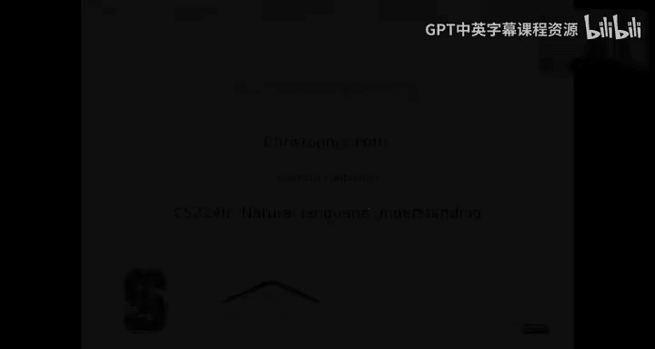
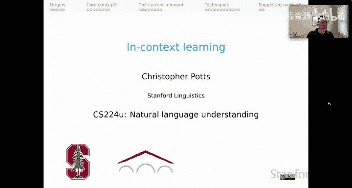
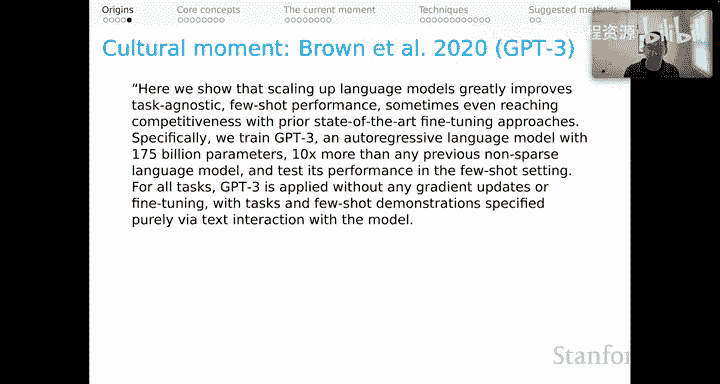
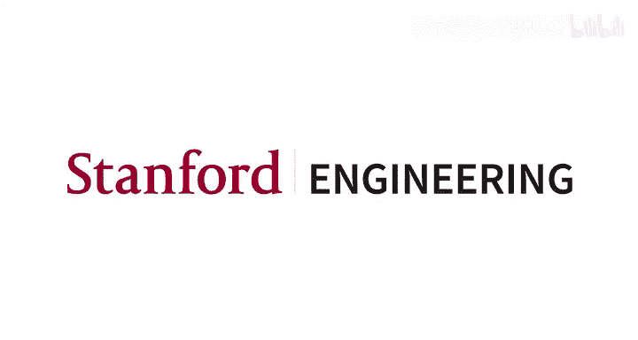

# 斯坦福大学《自然语言理解｜Stanford XCS224U Natural Language Understanding I Sp 2023》中英字幕（豆包翻译 - P20：-20-In-context Learning, Pt 1： Origins .zh_en - GPT中英字幕课程资源 - BV1sx4y1s7oW

Welcome， everyone。 This is the first screencast in our series on In context learning。

 The series is a kind of companion to the one that we did on information retrieval。

 The two series come together to help you with homework 2 and bakeoff 2。

 which is focused on few shot open domain question answering with frozen retrievers and frozen large language models。

😊。

To start this series， I thought we would just reflect a bit on the origins of the idea of in contexttext learning。

 which is really a story of how NLP got to this strange and exciting and chaotic moment for the field and maybe also for the society more broadly。

All credit to the Chomsky butt for bringing us to this moment。

I'm only joking The the Chomsky butt is a very simple pattern based language model。

 It's been around since the 90s， I believe， And with very simple mechanisms。

 it produces prose that is roughly in the style of the political philosopher and some time linguist Nome Chomsky。

 It produces prose that delights and maybe informs us。 And the underlying mechanisms are very simple。

 And I think that's a nice reminder about what all of these large language models might be doing。

 even in the present day。😊，But I'm only joking， although it's only partly a joke。

 I think when we think about precedence for in context learning。

 it is worth mentioning that in the pre deep learning era， Ngramham based language models。

 very sparse， large language models were often truly massive。 for example。

 Bra at all 2007 use a 300 billion parameter language model trained on 2 trillion tokens of text to help with machine translation。

 That is a very large and very powerful mechanism with a different character from the large language models of today day。

 but it is none the less worth noting that they played an important role in a lot of different fields way back when。

😊，I think for in context learning， as we know it now， the earliest paper， as far as I know。

 is the Dca NLP paper。 This is Mcchann atal 2018。 They do multi taskask training with task instructions that are natural language questions。

 and that does seem like the origin of the idea that with free form natural language instructions。

 we could essentially end up with artifacts that could do multiple things guided solely by text。

And then it's worth noting also that in the GPT paper， Radford etal 2018。

 you can find buried in there some tentative proposals to do prompt based experiments with that model。

But the real origins of the ideas， again， as far as I know， are Radford atal 2019。

 This is the G 2 paper。 And let me just show you some snippets from this paper。

 It's really inspiring how much they did。 They say at the start。

 we demonstrate language models can perform downstream tasks in a zero shot setting without any parameter or architecture modification。

 So there you see this idea of using frozen models。

 Proing them and seeing if they will produce interesting behaviors。

They looked at a bunch of different tasks for summarization。

 They say to induce summarization behavior， we add the text T， L。

 D R after the article and generate 100 tokens。 This is mind blowing。

 I remember when I first heard about this idea。 I had such a cognitive bias against in context learning of this sort being successful that I assumed what they were trying to say to us is that they had trained that token。

In a task specific way to do summarization and then just kind of given it a colorful name。 But no。

 they really meant it。 They simply prompt the model with this token and look at what comes out。

For translation， they say we test whether G 2 has begun to learn how to translate from one language to another in order to help it infer that this is the desired task。

 We condition the language model on a context of example pairs of the format。

 English sentence equals French sentence。 And then after a final prompt of English sentence equals。

 we sample from the model with greedy decoding and use the first generated sentence as the translation。

 Incredible in what you see emerging there is this idea of demonstrations， including in the prompt。

 some examples of the behavior that you want as a way of coaxing the model to do what you would like it to do。

 Here's a similar example。 They say similar to translation。

 the context of the language model is seated with example Que answer pairs which helps the model infer the short answer style of the dataset set。

 So that's for Q A。 And again， they started to see that demonstrations could help the model see what the implicit task instruction was。

And they also in the paper evaluate a bunch of other things， text completion， Wino grad schemas。

 and reading comprehension， and maybe others， it's a very impressive and thorough exploration。

 very open about the benefits and limitations of the methods of very impressive and creative paper。

That was the beginning of the idea in terms of research。

The cultural moment certainly arises with the G 3 paper brown at all 2020。

 which is also impressive in its own ways。 And here， I'm just going to quote from the abstract。

 and we can linger a bit over what it says。They start。

 We show that scaling up language models greatly improves task， agnostic fu shot performance。

 sometimes even reaching competitiveness with prior state of the art fine tuning approaches。

We could quibble with whether or not they actually saw competitiveness in that sense。

 but it is absolutely true that they got very impressive behaviors out of their model in this task。

 agnostic， few shot setting。Specifically， we train G 3。

 an autoregressive language model with  a hundred and 75 billion parameters。

10 x more than any previous non sparse language model and test its performance in the few shot setting。

 There are two things I really like about this part。 First。

1 hundred and 75 billion parameters is indeed incredibly ambitious and impressive。

 even to day to say nothing of back in 2020。 And I also really love that they mentioned non sparse language model。

 a nod to those Ngram based models that I mentioned before， which were often truly massive。😊。

For all tasks， G3 is applied without any gradient updates or fine tuning with tasks and few shot demonstrations specified purely via text interaction with the model。

 That's nice。 You might think in retrospect that theyre kind of repeating themselves here。

 They've already established that these are going to be frozen models。

 but I think it's necessary for them to do that because this was such an unfamiliar idea。

 And I can imagine， again， being a reader of this paper。

 And assuming that they can't really mean they're just using frozen models for all these tasks。

 Sure there is some fine tuning somewhere。 And so they are emphasizing that， in fact。

 the model is entirely frozen。

GP T 3 achieves strong performance on many NLP dataset sets， including translation。

 question answering and closed tasks， as well as several tasks that require on the fly reasoning or domain adaptation。

 such as unscrambling words using a novel word in a sentence or performing three digit arithmetic。

 I love this。 A real diversity of tasks。 And what I think you can see them doing is really trying to push the limits of what would be possible in this mode。

At the same time， we also identify some data sets where G3's few shop learning still struggles。

 as well as some data sets where G 3 faces methodological issues related to training on large webcorpora。

 I also love this sentence。 It's， again， very open about what they achieved and where the limitations are。

 They're acknowledging that they found some tasks that are still hard for the model。

 And they also acknowledge in the paper that they had some sort of minor slip ups where they intended to make sure they hadn't trained on data that was relevant for the test task that they were performing。

 And， in fact， they had not quite gotten that right。 And so they being very open about that。

 and kind of exploring how hard it is to get that right at the scale that they're operating at。

So just like the GPT2 paper， a wonderfully open and thorough exploration of the ideas。

