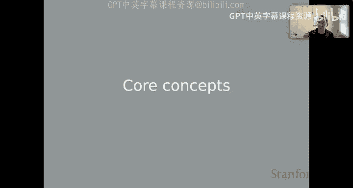
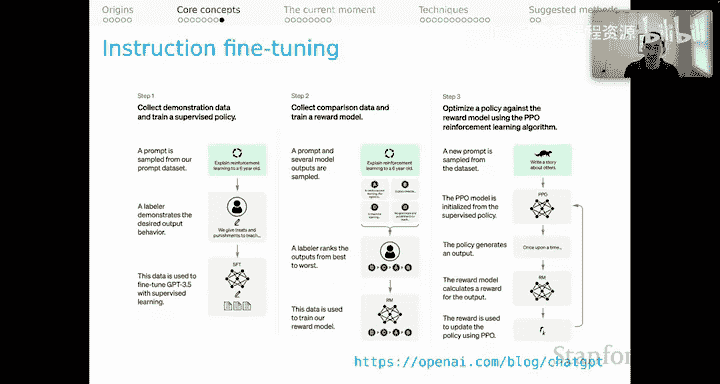

# 斯坦福大学《自然语言理解｜Stanford XCS224U Natural Language Understanding I Sp 2023》中英字幕（豆包翻译 - P21：-21-In-context Learning, Part 2： Core Concepts .zh_en - GPT中英字幕课程资源 - BV1sx4y1s7oW

Welcome back， everyone。 This is part 2 in our series on In context learning。

 I thought I'd cover some core concepts。 For the most part。

 I think these concepts are a review for you all， but I thought it would be good to kind of get them into our common ground to help us think about them as we think about what's happening with in context learning techniques。

To start， let's just establish some terminology。 I think there's a lot of variation in how these terms are used in the literature。

 And I thought I would just try to be clear about what I mean with these various crucial phrases。

Let's start with in context learning。 When I say in context learning， I mean a frozen language model。

Performs a task only by conditioning on the prompt text。 It's frozen。

 that is there are no gradient updates。 The only mechanism we have for learning is that we input some text and that puts the model in a temporary state that we hope is useful for having it generate things that we regard as useful for our task。

Few shot in context learning is a special case of that。

 this is where the prompt includes examples of the intended behavior。

And no examples of the intended behavior were seen in training。Of course。

 we are unlikely to be able to verify， too， in this modern era where models are trained on massive amounts of text willll have no idea typically what was in those training data sets。

 Often we have no ability to audit them。 And so we might not be sure whether we're actually doing few shot in context learning。

 But this is the ideal and the spirit of this is that if models have seen examples of this type and training。

 it's hardly few shot any more。 The whole point is to see whether with just a few instances。

 models can do what we want them to do。I'll also acknowledge that the term few shot is used in more traditional supervised learning settings in the sense of training on a few examples with gradient updates。

 And so I'm just emphasizing that when I say few shot in this lecture series。

 I'm always going to mean few shot in context learning with no gradient updates。

0 shot in context learning is another special case。

 This is where the prompt includes no examples of the intended behavior。

 but I'll allow that it could contain some instructions。 And as before， item 2。

 no examples of the intended behavior were seen in training。 Again。

 we're unlikely to be able to verify， too， So we won't know whether this is truly zero shot。

 but the concept is clear。For item 1， this is more interesting。

 I'll say that formatting and other instructions that you include in the prompt are a kind of gray area。

 But let's allow them in the zero shot category。 What I mean by that is that as you give more elaborate instructions。

 you might， in effect， be demonstrating the intended behavior。

 But the other side of this is that instructions are conceptually very different kinds of things for machine learning in general。

 than actual demonstrations。 And so it's interesting to separate out the case where you demonstrate directly from the case where you just describe the intended behavior。

 And so will allow mere descriptions to still be0 shot。

Another reminder is just how GPT and other models work we covered this in the unit on contextual representation。

 and I thought I'd just remind us so that this is front of mind as we think about the in contextex learning techniques。

Here's a slide repeating the auto aggressive loss function that these models use。 And again。

 the essence of this is that scoring happens on the basis of the embedding representation for the token that we want to predict at time step T。

And the hidden state that the model has created up until the time step preceding T。

 Those are the two crucial ingredients。And here's how that plays out for G style models in the context of training。

 Then I'll show you first training with teacher forcing。

 The slide is a repeat from one we had in the contextual representations unit。 But again。

 I want to issue a reminder here。At the bottom， we have one hot vectors representing the sequence of tokens in the sequence that we are using for training。

Normally， we represent these as actual sequences of tokens。

 But I'm trying to remind us at a mechanical level of how these things actually operate。

 So these are one hot vectors。 and those are used to look up vectors in our embedding layer that's given in gray here。

 And the result of that look up is a vector。 And at this stage。

 I have given the names of the vectors， according to our vocabulary。 But again。

 what we really have here is a sequence of vectors。

Those vectors are the input to the big transformer model that we're using for language modeling。

 I've shown a kind of schematic of this。 And the one thing I've highlighted is the pattern of attention mechanisms。

 recall that when we're doing auto regressive modeling。

 we can't look into the future with those dot product attention mechanisms only into the past。

 And so you see that characteristic pattern for the attention connections。

So we do all our processing with all these transformer blocks。

 and then at the very top we're going to use our embedding layer again。The labels， so to speak， are。

 again， our sequence offset by one from the sequence that we have at the bottom here。

 So like this was the start token。 We use that to predict the。Then at the next time step。

 the comes in down here， and that is the basis for predicting rock。 Rock comes in down here。

 predicts rules， rules down here。 And then we finally predict the end of token sequence。

 So we're offset by one using the previous context to predict the next token。And again。

 I've given these as one hot vectors because those one hot vectors are the actual learning signal。

And those are compared for learning with the vector of scores that the model produces at each time step scores over the entire vocabulary。

 And it's the difference between the one hot vector and the score vector that we use to get gradient updates to improve the model。

Again， I'm emphasizing this because we tend to think that the model has predicted tokens。

 but in fact， predicting tokens is something that we make them do。

 What they actually do is predict score vectors。So what's depicted on this slide here is teacher forcing。

There's an interesting thing that happened at this time step where the score vector actually put the highest score on the final element here。

 which is different from the one hot vector that we wanted to predict。 in teacher forcing。

 I still use this one hot vector down at the next time step to continue my predictions。

 There are versions of training where I would instead use the one hot vector that had a one here at the next time step。

 and that can be useful for introducing some diversity into the mix。

 And that is also a reminder that these models don't predict tokens， they predict score vectors。

 and in principle， even in training， We could use their predicted score vectors in lots of different ways。

 We could， We could do some beam search and use the entire prediction that they make over beam search to do training for future time steps。

 We could pick the lowest scoring item if we wanted， right？

 This is all up to us because fundamentally。 What these models do is predict score vectors。😊。

That was for training。 Our actual focus is on frozen language models for this unit。

 and so we're really going to be thinking about generation。 so let's think about how that happens。

Let's imagine that the model has been prompted with the beginning of sequence token and the。

 and it has produced the token rock。We use rock， the one hot vector there as the input to the next time step。

 We process that and make another prediction。 In this case。

 we could think of the prediction as rolls。Rolls comes in as a one hot vector at the next time step。

 and we continue our predictions。That's the generation process。 Again。

 I want to emphasize that at each time step， the model is predicting score vectors over the vocabulary。

And we are using our own rule to decide what token that actually corresponds to。

 what I' have depicted here is something that you might call greedy decoding。

 where the highest scoring token at each time step is used at the next time step。But again。

 that just reveals that there are lots of decision rules that I could use at this point to guide generation。

I mentioned beam search before。 that would be where we do a rollout and look at all the score distributions that we got for a few time steps and pick one that seems to be the best scoring across that whole sequence。

 which could yield very different behaviors from the behavior that we get from greedy decoding。

And if you look at the Apis for our really large language models now。

 you'll see that they have a lot of different parameters that are essentially shaping how generation actually happens。

 And that is， again， a reminder that generation is not really intrinsic to these models。

 What's intrinsic to them is predicting score vectors over the vocabulary。

 And the generation part is something that we make them do via a rule that we decide separately from their internal structure。

So that queuees up a kind of nice question that you could debate with your fellow researchers and friends and loved ones and people out in the world。

 do autoregressive language models simply predict the next token？

While your first answer might be yes， that's all they do。 and that is a reasonable answer。However。

We just saw that it's more precise to say that they predict scores over the entire vocabulary at each time step。

 And then we use those scores to compel them， to predict some token or other。

 We compel them to speak in a particular way。 That feels more correct at a technical level。

And you might reflect also that they actually represent data in their internal and output representations and very often in NLP。

 it's those representations that we care about not any particular generation process。

 and that just points to the fact that autoregressive LMs do a lot more than just speak， so to speak。

But on balance， I would say that it's saying they simply predict the next token might be the best in terms of science communication with the public。

 You can talk in nuanced ways with your fellow researchers about what they're actually doing and how they represent examples。

 but out in the world， it might give people the best mental model。

 If you simply say that they predict the next token based on the tokens that they have already generated and the ones that you put in。

 It's an appropriately mechanistic explanation that I think might help people out in the world calibrate to what's actually happening。

Because we should even remind ourselves as we see more impressive behaviours from these models that underlyingly。

 the mechanism is uniform。 If you prompt the model with better late than， and it says never。

Transparently， we can see that that's just a kind of high probability continuation of the prompt sequence。

When you have every day， I eat breakfast lunch， and it will probably say dinner。

 And you might immediately think， that reflects some world knowledge that the model has， but。

As far as we know， all that really is is a continuation of the sequence with a high probability token。

 and it high probability because of regularities in the world for the language model。

 this is simply a high probability continuation。And again。

 when you prompt it with the president of the US is。

 and it gives you the name of a person as an answer that might look like it has stored some knowledge about the world。

 And maybe there is a sense in which it has。 But as far as we know and mechanistically。

 that is simply offering a high probability continuation of the sequence。

 So when you get to something like the key to happiness is。😊。

And it offers you an answer that seems insightful。 You should， again。

 remind yourself that that is just a high probability continuation of the input sequence based on all the training experience that that model has had。

 And we really have no ability to audit what those training sequences were like。

 The mechanism is uniform。 There might be something interesting happening in terms of representation kind of under the hood here。

But we should remind ourselves that really it's just high probability continuations for all of these cases。

The final core concept that I want to mention here is that one that we're going to return to at various points throughout the series。

 and this is this notion of instruction fine tuning。

This is from the the blog post that announced chat G。

 It's a description of how they do Instruct fine tuning for that model。 There are three steps here。

 And I think the thing to highlight is that in step 1。

 we have what looks like fairly standard supervised learning， where at some level。

 we have human curated examples of prompts with good outputs and the model is trained on those instances。

 And then at step 2， we again， have humans coming in。 Now。

 to look at model outputs that have been generated and rank them according to quality conditional on the prompt input。

 So that's two stages at which people are playing a crucial role。

We have left behind the very pure version of the distributional hypothesis that says。

 just doing language model training of the sort I described before on entirely unstructured sequence symbols gives us models that are powerful。

 We have now entered back into a mode where a lot of the most interesting behaviors are certainly happening because people are coming in to offer direct supervision about what's a good output。

 given an input。 It's not magic when these models seem to do very sophisticated things。

 it is largely because they have been instructed to do very sophisticated things by very sophisticated humans。

 That is important in terms of understanding why these models work。

 And I think it's also important for understanding how various in context learning techniques behave。

 because increasingly， we're seeing a feedback loop where。

The kinds of things that we want to do with our prompts are informing the kinds of things that happen in the supervised learning phase。

 making them more powerful。 Again， it's not a mysterious discovery about how large language models work。

 but rather just a reflection of the kinds of instruct fine tuning that are very commonly happening now。

