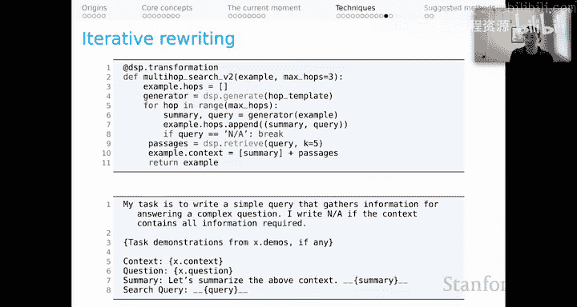
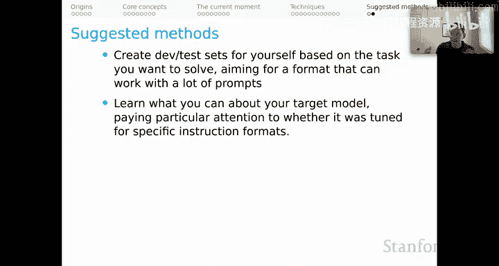

# 斯坦福大学《自然语言理解｜Stanford XCS224U Natural Language Understanding I Sp 2023》中英字幕（豆包翻译 - P23：-23-In-context Learning, Part 4： Techniques and Suggested Methods .zh_en - GPT中英字幕课程资源 - BV1sx4y1s7oW

Welcome back， everyone。 This is the fourth and final screencast in our series on In context learning。

 I'm going to talk about techniques for in context learning and then suggest some future directions for you in your own research in this space。

As before， I'm nervous about giving the screencast because it's essentially certain that what turns out to be a really powerful technique for in context learning will be discovered in a few months。

 making some of the seem outdated。 In fact， one of you might go off and discover precisely that technique。

 which will make this screencast seem incomplete。Nonetheless， I press on。

 I feel confident that we've learned important lessons about what works and what doesn't。

 and those will carry forward no matter what happens in the field。 So let's dive in。

 Let's start with the core concept of a demonstration。

 This is an idea that stretches back at least to the G2 paper and is indeed incredibly powerful in terms of designing effective in context learning systems。

 Let me illustrate in the context of few shot open domain question answering。

 which is our topic for the associated homework and bake off。

Imagine that we're given the question who is Bert， We're going to prompt our language model with this question and hope that it can generate a good answer。

By now you probably have an intuition that it would be effective to retrieve a context passage to insert into the prompt。

 to help the model， to provide it some evidence that it can use for answering the question。

The idea behind demonstrations is that it might also help to show the model examples of the kind of behaviors that we would like to elicit。

 And so maybe we have a train set of Q A pairs， and we fetch one of those Q A pairs and insert it into the prompt here。

 I've put the question， who is kermit。 And we would also insert the answer。

But this is your first real choice point here。 So， of course。

 you could use the answer that comes directly from your train set of Q A pairs。

 and that could be effective。 It will be a gold answer。But counter intuitively。

 it could be useful to instead use an answer that you retrieve from some data store or even generate using the very language model that you are prompting right now。

 And that could be good in terms of maybe finding demonstrations that are attuned to what your language model is actually capable of doing versus just relying on the gold Q A pairs。

 which might be disconnected from the behavior of your model。

 And the same kind of lesson applies to the evidence passages that we would give for each one of these demonstrations。

 We could， of course， if we have them， just use the gold passage from the train data。

But since this is a retrieved passage down here， it might be better in terms of exemplifying the intended behaviors to retrieve a passage instead of using a gold  one to better align with the experience the model actually has for our target question。

 Again， It's counterintuitive。 We have this gold passage。 Why would you use a retrieved one。

 And it's because it comes closer to simulating the situation that your model is actually in。

And that's just one lesson for demonstrations。 Let's think more broadly about this。

 How might you choose demonstrations。 Of course， you could just randomly choose them from available data。

 but perhaps you could do better。 Maybe you should choose your demonstrations based on relationships that they have to your target example。

 For example， in generation， you might choose examples that are retrieve based on similarity in some sense。

 to the target input， or for classification， you might select demonstrations to help the model implicitly determine the target input type。

You might also start to filter your demonstrations to satisfy specific criteria。 For example。

 in generation， maybe we want to be sure that the evidence passage contains the output string that would help the model figure out how to grapple with the evidence that we present to it。

Or in generation， you might want the language model to be able to predict the correct answer that's an idea that I alluded to before。

In classification， maybe a straightforward thing would be to ensure that your demonstration set for every prompt includes every label that's represented in your dataset set so that your model has an example of every possible behavior and isn't accidentally limited by the sort of thing that it sees in the prompt。

We could also think about massaging these demonstrations that we have available to us。

 maybe we sample them and then rewrite them with the language model。

 We could do this to synthesize across multiple initial demonstrations。

Maybe that's more efficient and allows us to include more demonstrations。

 We could also change the style or formatting， to match the target。

Use the LM to make the demonstrations more harmonious with what the language model expects。

 given the target or the capabilities of the language model， like， for example。

 if it's really important to you to generate answers in the style of a pirate。

 it might be useful to have your language model， actually rewrite the demonstrations in the style of a pirate。

 if it has that capability to further guide it toward the intended behavior。

The fundamental thing that you have to get used to， and it will seem obvious in retrospect。

 is that four powerful in contextext learning systems。

 your prompt might contain substrs that were generated by a different prompt to that self same language model。

 And， yes， that could be recursive。 right， Even though substrs might themselves be the product of multiple calls to your language model。

Again， it takes them getting used to， and it can be hard to think through how these systems actually work。

 but the end result can be something that is very powerful in terms of kind of aligning the behaviors of your language model with the results that you want to see。

In that context， let me actually linger a little bit over one of the questions on the assignment because this is one that people often find hard to think about。

 but fundamentally I think it's an intuitive and powerful idea。

 This is about choosing demonstrations。Let's start with our usual question， who is Bert？

We're going to retrieve some kind of context passage presumably。

 and then the question is what to do for demonstrations。

Suppose that I find the demonstration who is Elmo with answer Elmo is a friendly monster。

 And maybe that's just from my train set。 But the train set doesn't have context passages。

 So what I decide to do is retrieve a context passage。

And the context passage that I retrieve is Elmo is an LSTM for contextual representations。

That looks worrisome。 That context passage is about a different elmo than the one represented in this question answer pair serving as my demonstration。

 And you might worry that that is going to be very confusing for the language model。

 The evidence is not relevant， The question is， could we detect that automatically。

 I think the answer is， yes。 The way we do that is by firing off another instance of the language model。

In this case， we prompt it with our demonstration question， who is Elmo。

We get that same context passage， and then， yes， we'll probably insert a demonstration。

 And for simplicity right now， let's assume that that demonstration just comes from some trained data I have for the context。

 the question and the answer to keep things simple。

So this is a new prompt to our language model and we see what comes out and the answer is ElLmo is an LSTM。

And we can observe that that predicted response to this demonstration does not match the gold answer in our data set。

And we could use that as a signal that something about this demonstration is problematic。

 and we throw it out， and we start again。We're back to our question， who is Bert。

 we retrieve our context passage。And we sample another demonstration instance。 In this case。

 the context， question and answer look harmonious。And again。

 we could try to detect that automatically by firing off another instance of the language model with our demonstration question。

 Who is Ernie， same retrieved passage。We sample another demonstration there。

 and we look to see what the model does。 And in this case。

 the model's response matches our gold answer， and we decide we can therefore trust this as a demonstration in the hopes that that will finally lead to good behavior from our model。

So that's a bit convoluted， but I think the intuition is clear we're using the language model demonstrations and our gold data to figure out which demonstrations are likely to be effective and which aren't。

 and we're trying to do that automatically。And， yes。

 for this sub process with this language model where I just inserted a gold context question answer pair。

 you can imagine recursively doing the same thing of trying to find good demonstrations for the demonstration selection process。

 At some point， that recursive process needs to end。Let's move to another technique。

 This is called chain of thought， and this is also， I think， a lasting idea。

The intuition behind chain of thought is that for complicated things， it might be simply too much。

 given the prompt to ask the model to simply produce the answer in its initial tokens。

 It's just too much。 And so what we do with chain of thought is construct demonstrations that encourage the model to generate in a step by step fashion。

 exposing its own reasoning and finally arriving at an answer。

This again shows the power of demonstrations we illustrate chain of thought with these extensive。

 probably hand built prompts。And then when the model goes to do our target behavior。

 the demonstration has LED it to walk through a similar kind of chain of thought and ultimately produce what we hope is the correct answer。

 As we didn't lead it down the garden path or it didn't lead itself down the garden path toward the wrong answer。

 which absolutely can happen with chain of thought。The original chain of thought is quite bespoke。

 We need to carefully construct these chain of thought demonstration prompts to encourage the model to do particular things。

 I think there is a more generic version of this that can be quite powerful。

 I've called this generic step by step with instructions。

 And here we are definitely kind of aligning with the instruct fine tuning that these models are probably undergoing and leveraging that in some indirect fashion。

Here's an illustration。 I have prompted Da Vinci 3 with the question。

 is it true that if a customer doesn't have any loans， then the customer doesn't have any auto loans。

 It's a kind of complicated conditional question involving negation。

 And the model has unfortunately given the wrong answer。 No， this is not necessarily true。

 And the continuation is revealing a customer can have auto loans without having any other loans。

 which is kind of the reverse of the conditional question that I posed。 It got confused logically。

In generic step by step， what we do is just have a prompt that kind of tells it something high level about what we want to do。

 It says logic and common senseense reasoning exam。 Ex your reasoning in detail。

 And then we give a kind of description of what the reasoning should look like and what the prompt will look like using an informal mark up language that probably the model acquired via some in fine tuning phase。

And then we actually have the prompt there。And what happens is the model kind of walks through the logical reasoning and in this case。

 arrives at the correct answer and also does an excellent job of explaining its own reasoning。

 It's the same model。 But here it looks like this generic step by step step instruction format LED it to a more productive end point。

Self consistency is another powerful method。 This is from Wang at all 2022。

 and it relates very closely to an earlier model called retrieval augmented generation。

 This is a kind of complicated diagram here。 Let me zoom in on what the important piece is。

 We're going to use our language model。To sample a bunch of different generated responses。

 which might go through different reasoning paths using something like chain of thought reasoning and ultimately will produce some answers。

Those answers might vary across the different generated paths that the model has taken。

 And what we're going to do is select the answer that was most often produced across all of these different reasoning paths。

 That is technically speaking a version of marginalizing out the reasoning paths to arrive at an answer。

 with the intuition being that the answer that was arrived at by the most paths effectively or the most probable answer given all these paths is likely to be a trustworthy one。

And that too has proved really effective， it can get expensive because you sample a lot of these different reasoning paths。

 but the result can make models more self consistent。And just by the way， in DSP。

 we have a primitive called DSP dot majority that actually makes it very easy to do self consistency。

 You just set your model up to generate a lot of different responses， given your prompt template。

 and then DSP dot majority will figure out which answer was produced most often。

 given all of those reasoning paths。 So a nice simple primitive that makes selfcon essentially a drop in for any program that you write。

 assuming you can afford to do all of this sampling。And for more details on that。

 I would refer you to Omar's Intro notebook， which walks through this in more detail。

Self ask is another interesting idea。 So here the idea behind self ask is that we will via demonstrations。

 encourage the model to break down its reasoning into a bunch of different questions that it poses to itself and then seeks to answer。

 And in that way， the idea is that it will iteratively get to the point where it can find the answer to the overall question。

 This is especially powerful for questions that might be multihop that is might involve multiple different resources。

 which you can essentially think of as being broken down into multiple sub questions that need to be resolved in order to get an answer to the final question。

 So that self ask。 and it has an intriguing property for us as retrieval oriented researchers。

 Se ask can be combined with retrieval for answering the intermediate questions。

 So instead of trusting the model generations for those intermediate questions。

 You look to something like a search engine like in the paper they use Google to answer those questions。

😊，The answers get inserted into the prompt， and the model continues。

So that's self ask or maybe self ask and Google answerer。

Another very powerful general idea that I'm sure will survive。

 no matter what people discover about in context learning。

 is that it can be useful to iteratively rewrite parts of your prompt。

 You could be rewriting demonstrations or the context passages that they contain or the questions or the answers。

 I've given some code here that shows how this plays out in the context of multihop search where we're essentially gathering together evidence passages for a bunch of different sources。

 synthesizing them into into one and then using those as evidence for answering a complicated question。

 But the idea is very general。 especially given a limited prompt window or a very complicated situation in terms of information。

 It might be helpful to iteratively have your language model rewrite parts of its own prompt and then prompt the model with those rewritten chunks as a way of synthesizing information and getting better results。

 Very powerful idea。😊。

In the context of all of this， I thought I would just call out some results from the DSP paper。

So in the DSP paper， we evaluate across a bunch of different knowledge intensive tasks。

 most of them oriented toward question answering or information seeking dialogue。

The high levell takeaway here is that we can write DSP programs that are breakaway winners in these competitions that is the final row of this table here you can see us winning across the board。

 we are often winning by very large margins and the largest margins are coming from the most underexplored data sets like MusicQ and P QA。

The lesson here is first of all， that DSP is amazing and Omar and the team did an amazing job。

But I think the deeper lesson is that it is very early days for these techniques。

The only time you see these kind of breakaway results for modeling is when something new has happened and people are just figuring out what to do next。

 and we kind of caught that wave。 I expect the gap to close as people discover more powerful in contexttex learning techniques。

 And I would just encourage you to think about DSP as a tool for creating prompts that are truly full on AI systems。

 We want to bring the software engineering to prompt engineering and really think of this as a first class way of designing AI systems。

 And if we move into that mental model， I think we're going to see more and more breakaway results。

 and we will indeed realize the vision of having in contextt learning systems surpass the finetuned systems that were supervised in the classical mode。

But it's going to take some creativity and there's lots of space in which to be creative right now。

That's a good opportunity for me to cue up this final part of these Sccasts some suggested methods for you as you think about working in the space。

 First， as a working habit， create devon test sets for yourself based on the task you want to solve。

 aiming for a format that can work with a lot of different prompts and do this first。

 so that as you explore， you have a fixed target that you're trying to achieve that will help you get better results and be more scientifically rigorous。

😊。

Learn what you can about your target model。About how it was trained and so forth。

 Pay particular attention to whether it was tuned for specific instruction formats。

 I think we have already seen that to the extent to which you can align with its instruct fine tuning data。

 you will get better results。 Often， we don't know what that data set was like。

 but we can discover it in a kind of heuristic fashion， at least in part。

Think of prompt writing as AI system design。 That's what I said before。 Try to write systematic。

 generalizable code for handling the entire workflow from reading data to extracting responses and analyzing the results。

 That is a kind of guiding philosophical idea behind DSP。 But even beyond this DSP。

 I think this is an important methodological note。 We shouldn't be pecking out prompts and designing systems in that very ad hoc way。

 We should be thinking about this as the new mode in which we program AI systems and take it as seriously as we can。

And finally， for the current and perhaps brief moment。

 prompt designs involving multiple pretrain components and tools seem to be under exploreplored relative to their potential value For this unit。

 we are exploring how a retrieval model and a language model can work in concert to do powerful things。

 But we could obviously bring in other pretrain components。

 and maybe even other just core computational capabilities like calculators， whether Apis。

 you name it， thinking about how to design prompts that take advantage of all of those different tools is a wonderful new avenue were' starting to see exploration in the space。

 and it is sure to pay off in one form or another。 So maybe go forth and see what kind of value you can extract out of this new mode of tooling around prompting。

😊。

