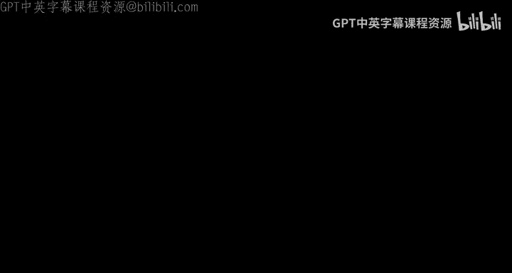
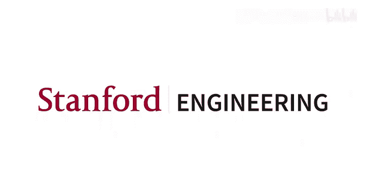

# 斯坦福大学《自然语言理解｜Stanford XCS224U Natural Language Understanding I Sp 2023》中英字幕（豆包翻译 - P24：-24-Homework 3 .zh_en - GPT中英字幕课程资源 - BV1sx4y1s7oW

Welcome， everyone。 This Sccast is an overview of As 3 and the Asso bakeoff。

 Our topic is compositional generalization。 This is a favorite topic of mine。

 This is our attempt to really probe deeply to see whether models have learned to systematically interpret natural language。

The starting point for the work is the Cogs paper and the associated benchmark from Kim and Lndson。

 We're actually going to work with the modification of cogs that we call recogs。

 This is recent work that we released， and it simply attempts to address some of the limitations that we perceive in the original Cogs benchmark。

 while none the less adopting the core insights and core agenda that Cogs set。

The Ricog's task is fundamentally a semantic parsing task。 The inputs are simple sentences。

 and the outputs are logical forms like this。 So here in this example。

 the input is a rose was helped by a dog。 And you can see that the output is a sort of event description as a logical form。

 We have an indefinite a rose。 an indefinite dog。 We have a helping event。

 The theme of that helping event is the rose。 And the agent of that helping event is the dog。

 Here is a similar example。 The sailor dusted a boy， and it has an output that looks like this。

 The new element here is that we have a definite description in the input。

 and that's marked by a star in the output。 This is like the sailor here。

You can probably see that the cogs and recog sentences tend to be somewhat unusual。

 this is a synthetic benchmark， they were automatically generated from a context free grammar and so their actual meanings are sort of unusual。

 but that's not really the focus of either of these benchmarks。

We're going to talk in more detail about how cogs and recogs compare to each other in the core screencast for this unit。

 but just briefly。Cogs is the original， Recogs builds on cogs and attempts to rework some aspects of cogs to focus on purely semantic phenomena。

 whereas we believe that cogs is testing in addition for a bunch of incidental details of logical forms。

For a quick comparison， I have the input， the sailor saw Emma here。

 and you can see the Ricogs and Cog's format。 And in Brague's strokes。

 the Recog's format is somewhat simpler。 There are a bunch of redundant symbols that have been removed and some core aspects of the semantics have been reorganized while none the less preserving the meaning of the original。

The recog splits work like this。 We have a large train set of almost 136000 examples。

 and there is a dev set of 3000 examples that are like those in train。 This is a sort of Iid D split。

 We're not going to make much use of the dev split。

 Our focus is instead on these generalization splits。

 This is what's so interesting about cogs and recogs。 This is 21000 examples in 21 categories。

 And the name of the game here is to have novel combinations of familiar elements to really test to see whether models have found compositional solutions to the task。

Here are three examples of those generalization splits。 They're typical of the full set。

 and I would say one hallmark of these generalization splits is that they hardly feel like generalization tasks for us as speakers of the language。

 they appear incredibly simple， but as you'll see， they're very difficult for even our best models。

For example， this category is subject to object proper name。

 The idea here is that we'll have some names that we see in subject position in the train set。

 like Lina Here is the subject。 and then in the generalization split。

 We will encounter Lina in object position， and that will be a new occurrence of Lina and the task is to see whether the model can figure out what role Lina plays in the semantics for that unfamiliar input。

 Very simple for people。 Sur difficult for our models。

 Priitive to subject is a similar sort of situation。 at train time。

 there are some names that just appear as isolated elements with no syntactic context around them。

 at generalization time， we have to deal with them as the subjects of full sentences。

 It seems simple， but it proves challenging。CP recursion is a little bit different。

 this is testing to see whether models can handle novel numbers of embedded sentences。

In the train set， you get embeddings like Emma said that Noah knew that the cat danced。

 and the generalization split simply includes greater depths。

 like Emma said that Noah knew that Lucas saw that the cat danced。It seems simple。

 it hardly feels like a generalization task to us， and yet again， difficult for our models。All right。

 That was by way of background。 Let's have a look at question 1。

 proper names and their semantic roles。 You are not training models for this question。

 This is good old fashioned data analysis。 It has two parts for task 1。

 You write a function called get proper roll names that takes in a logical form and extracts the list of all name roll pairs that occur in that logical form。

And then for taskask two， you write find name roles which uses get proper name roles to discover what roles different proper names are playing in the various splits that RicoGs contains。

And I'll just give you the spoiler。 Now。 Charlie， the proper name is only a theme in train and only an agent in the generalization splits。

 whereas Lina is only an agent in train and only a theme in the generalization splits。

 And this observation about the data tells us a lot about downstream model performance。

 These names indeed prove very difficult for our models to deal with。After question 1， I'll warn you。

 there is sort of a long modelling interlude。 I've provided all the pieces that you need to train your own recogs models。

 You don't necessarily have to do that， but I wanted to provide them so that you could explore that as an avenue for your original systems。

 So let me walk you through this interlude。 The first step is a hugging face tokenizer。

I'll confess to you that my original plan was to have this be one of the homework questions。

 But I found writing this hugging face tokenizer to be so difficult and so confusing that I decided not to burden you with it。

 So I' am instead offering you this tokenizer in the hopes that you can benefit from it and maybe modify it for your own tasks down the line。

The pieytorrch data set is similar。 This is a data set for recogs。

 I originally thought it would be a homework question。

 but it has some fiddly details about it that may be tentative about doing that。

 So instead I am just giving it to you。Step 3 is a pretrained recogs model， Z train this model。

 it is an outstanding recogs model， and the idea is that you can just load it in and then make use of it for your original system。

 you might finet this model or do something else to it。

 but you don't need to do that for the homework question that comes next。

 you simply use this as a pretrain model and explore its predictions。The next step is ReCOg's loss。

 and this is a simple pitorrch module that helps me make the model that Zen trained compatibleible with the code that we have for this course in general so that it's easy for you to fine tune the model if you want to。

 So that's a small detail。Then we have ReCOgG's module and this is a lightweight wrapper around Zen's model that is again designed to help us be compatible with the underlying optimization code in particular that we have in our course code base。

And then finally， the interlude ends at step 6 with Recogs module。 This Ricogs model。 sorry。

 this is the main interface and is the only one that you need to worry about if you're not training models for your original system。

 If you're not doing that if you're pursuing another avenue。

 Then you can more or less ignore one through 5 and just focus on 6 and treat it as a simple interface for loading ends model and using it。

😊，But I am hoping that some of you want to dig deeper into how this model is trained and maybe improve it。

 and in that case， steps1 through5 will be especially useful to you。

So that's why they're all embedded in the notebook。Having made it through the interlude。

 we now get to question 2， which is exploring predictions of the model For this question。

 you just use Zen's trained Recogs model out of the box。

 and what you're doing is continuing the data analysis that you began in question 1。

So you complete a function called category assess。And the name of the game here is to discover for yourselves that this really good model struggles really a lot with the proper names that are in unfamiliar positions。

 exactly the names that you identified for question1。

 And so you can see the hypothesis behind cogs and recogs validated here。

 novel combinations of these elements， however simple。

 turn out to be challenging for a really good model。Before proceeding。

 I wanted to say one thing about Recog's assessment。 And again。

 we'll talk more in detail about this in the main screencast for the unit But just quickly。

 the goal of recogs is really to test for semantic interpretation and get past some of the incidental details of logical form。

 So our evaluation code is somewhat complicated。 here are three instructive examples，4 recogs。

 Unlike for cogs。 the precise names of bound variables do not matter。 So， for example。

 these two logical forms here are called equivalent。

 even though the first logical form uses the variable 4 and the second logical form uses the variable 7。

 the idea is that since all these variables are implicitly bound for recogs and cogs。

 We don't care about their particular identity， just the binding relationships that they establish。

 and those are the same。 in these two cases。Here's another case。

 The order of conjuncts does not matter。 That seems intuitive semantically。

 and we wanted it to be realized in our evaluation code。

 So dog and happy and happy and dog evaluate to true。 The order of the conjuncts is incidental。

However， consistency of variable names does matter。

 so this pair evaluates to false because the first one uses dog and happy。

It has both a very variable 4 for both of those predications。

 whereas the second one has dog of4 and happy of seven， and that is semantically distinct。 Now。

 we're talking presumably about two distinct elements， whereas the first logical form is about one。

 And so we arrive at a conclusion that these are semantically not equivalent。

So that's three kind of cases that give you a feel for what we're trying to do with this evaluation。

 which is really get at semantic equivalence even where logical forms vary。

Final question for the main part of the homework。 Question 3 switches gears entirely。

 This is a basic in contextex learning approach。 And the idea here is to just get you over the hill in terms of using DSP。

 as we did in homework 2 and applying it to this new case。

 And my thinking here is that if I push you a little bit to write your first DSP program for recogs。

 you might try more versions of that and really make progress。 So here's the kind of logical。

 or here's the kind of prompt that you'll offer to the model。

 We've got a couple demonstrations input。 and then the task for the model is to generate a new logical form。

And the task here for you in terms of coding is to just write a very simple DSP program。

 It is simple indeed， as I said， my hope is that it's kind of inspiring you to do more sophisticated things。

 maybe for your original system。I will warn you that even for our best large language models。

 they superficially seem to understand what this task is about and when you glance at the logical forms that they predict。

 they often look kind of good， but then you run the evaluation code and you get zero right and you realize that kind of good is not really sufficient for this task。

 you need to be exactly correct and these large language models seem to struggle to be exactly correct at this semantic parsing task。

Finally， question four， as usual， you're doing your original system。For your original system。

 you can do anything you want。 The only constraint is that you cannot train your system on any examples from the generalization splits。

 nor can the output representations from those examples be included in any prompts that you use for in context learning。

The idea here is that we want to preserve the sanctity of the generalization splits to really get a glimpse of whether or not systems are generalizing in the way that we care about。

With that rule in place， I thought I would just review a few original system ideas。 and remember。

 this is not meant to be exhaustive， but rather just inspiring about some potential avenues。

 So here they are。 You could write a DSP program。 You could do further training of our model。

 You could use a pretrain model。 You could train from scratch。

 Maybe you could even write a symbolic solver。 and there might be other things that you can do。

 Let me elaborate just briefly on a few of these options， so。Here。

 if you want to further train our model that should be very easy。

 This little snippet of code here loads in the model that Zen trained。

 And then you can see with this here， I'm doing just a little bit of additional fine tuning of that model on a few of the dev examples。

 which is fine to do because our focus is on those gen splits。

 And what I've done in this snippet is expose a lot of the different optimization parameters。

 because I think you'd really want to think about how best to set up this model to get some more juice out of the available data from this further training。

 essentially。But I've also in the notebook offered you code that shows how easy it is to take our starting point and modify it to use a pretrain model here。

 what I've done really is just write a T5 recogs module to load in the T5 model and then T5 Recogs model is the primary interface。

 And now what you've got is a device that loads in T5 and it won't work at all if you try to use it directly to make predictions about the recogs task。

 it will actually sort of amusingly translate your examples into German。

 but you could finetune T5 so that it can do the recogs task with the hypothesis that the pretraining that T5 underwent is useful for helping with the generalization splits in particular。

And very similar code could be modified so that you train from scratch by simply loading in with hugging face code random parameters that might have the structure of a Bt model or something like that。

 Huggings F makes that very easy。 And you could explore different variants。

 essentially of training from scratch on the Ricogs task。

And I'll leave other options for you to think about。

 I'm really keen to see what you all do with the Reconx data。And then finally for the bakeoff。

 this is straightforward， there's a TSV file that contains some test cases。

 those are generalization test cases， you just need to add a column prediction which contains your predicted logical forms and then this final code snippet here is what you do to write that to disk for uploading to the gradecope autograder。

 and we'll see how you all do on this surprisingly very challenging task of semantic interpretation。

