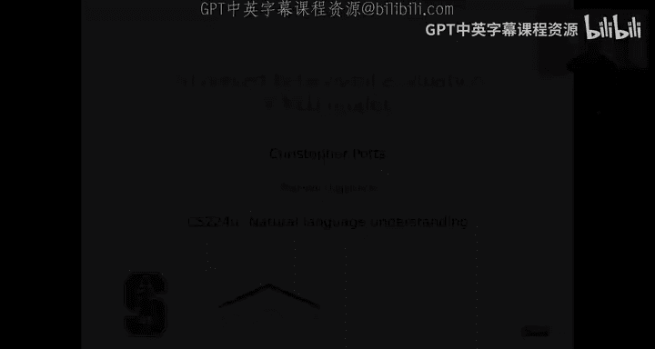
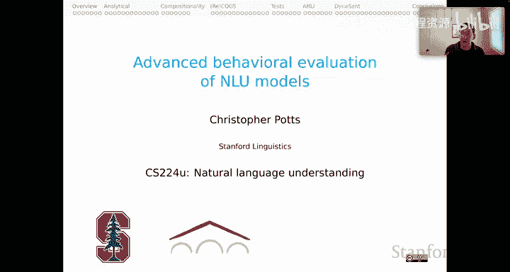
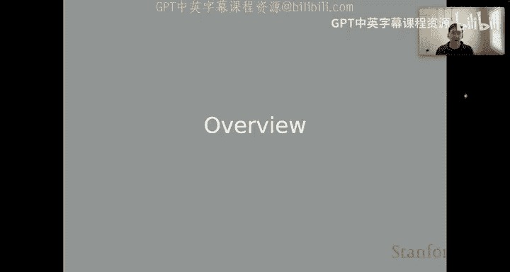
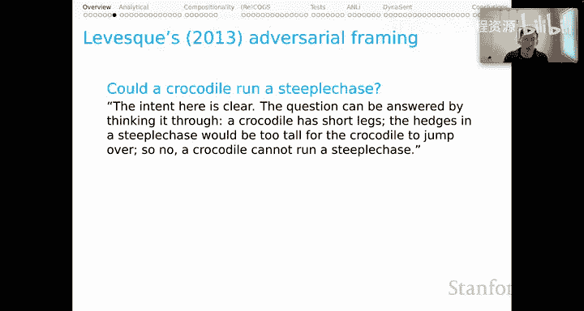

# 斯坦福大学《自然语言理解｜Stanford XCS224U Natural Language Understanding I Sp 2023》中英字幕（豆包翻译 - P25：-25-Behavioral Evaluation of NLU Models, Part 1： Overview .zh_en - GPT中英字幕课程资源 - BV1sx4y1s7oW

Welcome， everyone。 This Sccast kicks off our unit on advanced behavioral evaluation of N LU models For this unit。

 we're going to switch gears a little bit。 We've been very focused on architectures and models。

 We are now going to turn our attention to the nature of evaluation。

 how we gather evidence and how we mark progress in the field。😊。

For this unit we're going to focus on behavioral evaluations， those based in input output behavior。

 and in the next unit we're going to try to go one layer deeper to uncover information about how models manage those input output mappings。

To kick this off， I think it's useful to reflect a little bit on the varieties of evaluation that we conduct in the field and in AI more broadly。

For this unit， as I said， will be focused on behavioral methods。

 we are just focused on whether or not models produce the desired output， given some inputs。

 and we don't directly attend to how they manage to do that mapping。

Standard evaluations are often called I I D evaluations for independent and identically distributed。

 The intuition here is that we have some test examples that are disjoint from the ones the system was trained on。

 But we have a kind of underlying guarantee that the test examples are very much like those that were seen in training。

 So this standard mode gives us a lot of guarantees about what we can expect at test time。

 but it is also very friendly to our systems。With exploratory analyses。

 you might start to venture outside of that IID assumption。

You might know or not know about what the data or what the training data were like。

 but the idea is that you're now going to start to probe to see whether the model has certain capabilities via examples that you construct and they might go outside of what you would expect from the training data。

That could also be hypothesis driven you might just ask a question like， hey。

 does my model know about synonyms or does it know about lexical entailment and you might construct a data set that probes specifically for ways of answering that particular question。

 so you're using a behavioral evaluation to answer a kind of more conceptual hypothesis driven question there。

In challenge dataset sets， you might start to adventure outside of the friendly mode in this mode with challenge dataset sets。

 you might be posing problems that you know are going to be difficult。

 given the nature of the training experiences of your model。

 You're trying to push the limits to see where it's going to fall down essentially。

 and that could become truly adversarial in the sense that you might have done a full study of the training data and the properties of the model and then constructed examples where。

 you know the model is going to fail as a way of revealing some kind of problematic behavior or important weakness。

 And we could escalate all the way to what I've called security oriented behavioral evaluations in this mode。

 you might be deliberately constructing examples that you would expect to fall outside of the normal user interaction with your model。

 maybe with unfamiliar characters or character combinations to see what happens。 and in particular。

 you might be looking to see whether with those。Very unusual out of distribution inputs。

 the model does something that is toxic or problematic or unsafe in some way。

Those are all behavioral evaluations。 We could contrast those with what I've called structural evaluations。

 probing feature attribution and interventions。 These are the topic of the next unit。

 and with structural evaluations what we try to do is go beyond input output mappings and really understand the mechanisms at work behind those behaviors。

 and I think the ideal for that would be that we uncover the causal mechanisms behind model behaviors。

 Those go beyond behavioral testing and I think complement behavioral testing really powerfully。

Let's reflect a little bit on standard evaluations in the field。

 I think the upshot here is that they are extremely friendly to our systems in ways that should increasingly worry us as we think about systems being deployed in the wider world。

4 standard evaluations at step 1， you create a data set from a single process。

 That is the part to emphasize a single process。 You could scrape a website。

 You could reformat a database， You could crowd source some labels for some examples and so forth and so on。

 whatever you do。You run this one process。 And then in the next phase。

 you divide the data set into disjoint train and test sets， and you set the test set aside。

 It's under lock and key。 You won't look at it until the very end。

That's really good because that's going to be our estimate of the capacity of the system to generalize。

 But notice you've already been very friendly to your system。

 because step 1 offers you a guarantee that those test examples will， in some sense。

 be very much like those that you saw in training。Then you develop your system on the train set。

Only after all development is complete， you evaluate the system based on some notion of accuracy standardly on the test set。

And then this is crucial。 You do report the results as an estimate of the system's capacity to generalize。

 And at that point， you're communicating with the wider world and saying you have a measure of the system's accuracy。

 And you know， people will infer that that means that's the accuracy that they will experience if they use the model in free usage。

This is the part that worries me。 Step 1 was a single process for creating the data。

 and we report that as an estimate of the system's capacity to generalize。

 even though we know full well that the world is not a single homogeneous process。

 we absolutely know that once the model is deployed。

 It will encounter examples that are very different from those that were created at step 1。

 And that is the worrisome part。 And that is where so called adversarial evaluations come in。

 They needn't be full on adversarial， but the idea is to expose some of the fragility of that standard evaluation mode。

At step one in adversarial evaluations， you create a data set by whatever means you like as usual。

You develop and assess the system using that data set， according to whatever protocols you choose。

Now， the new part， you develop a new test data set of examples that you suspect or know will be challenging given your system and the original data set。

Only after all system development is complete， you evaluate the system based on accuracy on that new test set。

And then you report the results as providing some kind of estimate of the system's capacity to generalize as before。

 This is the new piece。 this contrast， we have our data set that we use to create the system。

 especially for training。But then in step 3， we have a new test data set。

 and that plays a crucial role of now offering us an estimate of the system's capacity to generalize。

 And to the extent that we have created some hard and diverse new test sets in this way。

 we can probably gain increasing confidence that we are simulating what life will be like for the model。

 if it is deployed。And that's a kind of call for action to do this really effectively to really feel like you can get behind step5 here。

 you should construct these adversarial or challenge data sets in a way that covers as much of the spectrum of user behaviors。

 user goals， user inputs， as you will expect to see， and that implies having diverse teams of people。

 battle testing these models and creating hard examples and studying the resulting behavior。

 and in that way， with a concerted effort there， you can inch closer to having a real guarantee for how the model will behave when it is deployed。

It's a hallmark of behavioral testing that you will never have a full guarantee。

 but you could approach it。 And then as the next unit will show。

 you might supplement that with some deeper understanding of how the model works。But in any case。

 I feel like this is the mode that we should be in when we think about AI systems in this modern era of ever widening impact。

The history of this is kind of interesting。 Advdversarial testing feels like a new idea， but in fact。

 it stretches all the way back to at least the Tring test。

 You might recall that the fundamental insight behind the Tring test is that we'll get a reliable evaluation。

 when we pit people against computers where the goal of the computer is to try to fool the person into thinking it is a person itself。

 and the human is trying their level best to figure out whether that entity is a human or some kind of AI。

 That is an inherently adversarial dynamic that is centered around linguistic interaction。

 And so I think like we have to call that the first or certainly the most influential adversarial test。

Some time later， Terry Winnerad proposed developing data sets that involved very intricate problems that he hoped would get past simple statistical tricks and really probed to see whether models truly understood what the world was like。

Hector Levek， in this lovely paper on our best behavior。

 kind of revived this idea from Winnerad of adversarial testing models to see whether they truly understand what language and what the world is like。

Though Winnerad sentences are really interesting to reflect on Now。

 They are kind of simple problems that can be quite revealing about physical reality and social reality。

 and all the rest。 here's a typical winnerad case。 The trophy doesn't fit into the brown suit case because it's too small。

 What is too small。 The human intuition is to say the suit case。

 And that's probably because you can do some kind of mental simulation of these two objects and then arrive at an answer to the question。

The minimal pair there is the trophy doesn't fit into the brown suit case because it's too large。

 What is too large Here。 The human answer is the trophy again。

 because of that kind of mental simulation that you can do。

 And the idea is that this is a behavioral test that will help us understand whether models also have that kind of deep understanding of our physical reality。

Here's a case that keys more into kind of social norms and roles that people play。

 The council refused the demonstrators a permit because they feared violence， Who feared violence。

 The human answer is the council based on kind of stereotypical roles for demonstrators and politicians。

Versus the council refused the demonstrators a permit because they advocated violence。

 who advocated violence。 Again， we default to saying the demonstrators。

 because of our default assumptions about the roles that people will play。 And the idea is to。

 for a model to get these response is correct， it too。

 needs to kind of deeply understand what's happening with these entities and with the social norms involved。

That's the guiding hypothesis。 again， behavioral testing can never give us full guarantees that we've probed fully for the underlying capability that we cared about。

 but examples like this are inspiring in terms of getting us closer to that ideal。

Hector Levk took this further in a way that I think has proved really inspiring for the field。

 He says， for example， could a crocodile run a steeple chase。 The intent here is clear。

 The question can be answered by thinking it through a crocodile has short legs The hedges in a steeple chase would be too tall for the crocodile to jump over。

 So no， a crocodile cannot run a steeple chase。 Again。

 evoking this idea of doing a mental simulation about a very unfamiliar situation and arriving at a systematic answer to the question。

😊。

And what Levec was really after was what he called foiling cheap tricks。

 can we find questions where cheap tricks like this will not be sufficient to produce the desired behavior？

This， unfortunately， has no easy answer。 The best we can do， perhaps。

 is to come up with a suite of multiple choice questions carefully and then study the sorts of computer programme that might be able to answer them。

 Again， what I hear in this early paper back in 2013 is a call for constructing adversarial data sets that will reveal much more about the solutions that our models have found。

😊。

